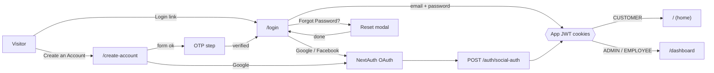
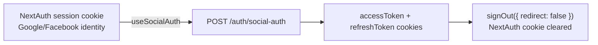
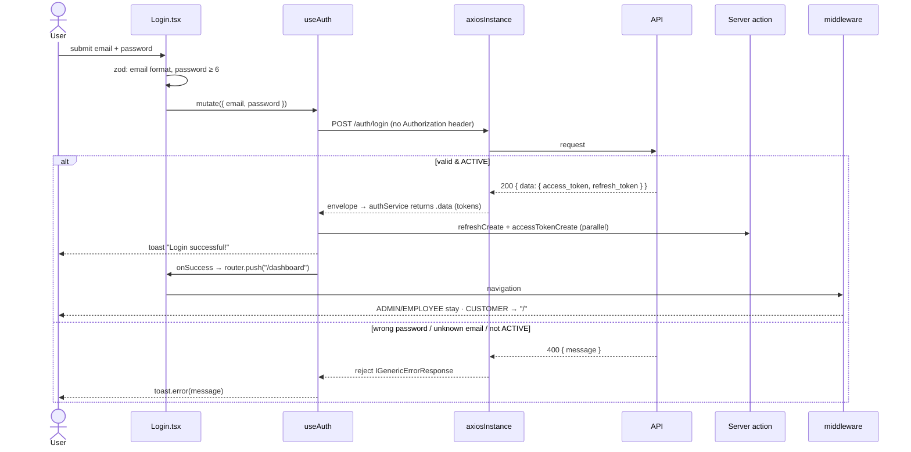
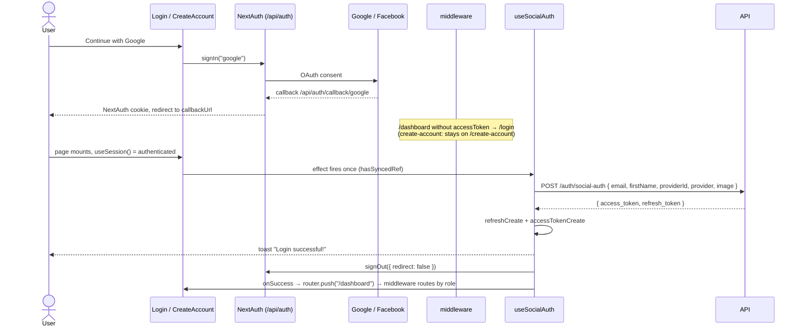
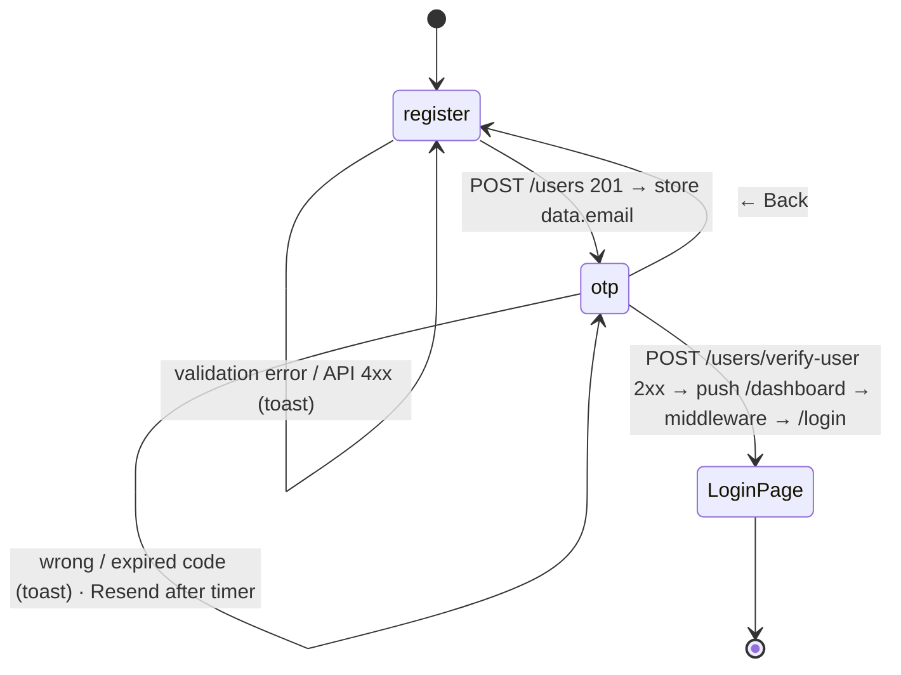
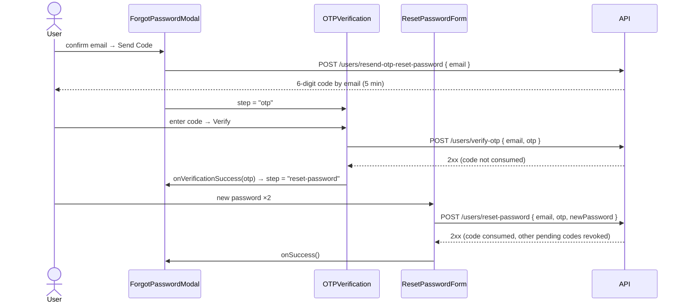
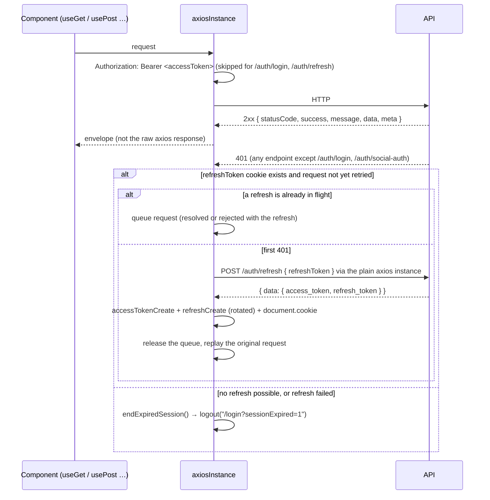

# Auth Module: Frontend Technical Documentation

> **Scope:** how a visitor becomes a signed-in user on the Natura Care client (Next.js 15, App Router): **login**, **create account + email OTP**, **Google/Facebook sign-in**, **forgot/reset password**, and the **session** that follows (tokens, refresh, expiry, logout, route protection, role-based landing).
>
> **Audience:** frontend engineers joining or maintaining the project. Also useful to QA and backend engineers who need the client's side of the auth contract.
>
> **Related:** [Project README](../README.md) (run, build, Docker) · [User module](./user.md) (profile, admin user management, change password) · [Coding conventions](../claude-docs/basic-instructions.md)

| | |
|---|---|
| **Module root** | [`src/modules/auth/`](../src/modules/auth/) |
| **Routes** | `/login`, `/create-account` (public route group) · `/api/auth/[...nextauth]` (NextAuth handler) |
| **Route guard** | [`src/middleware.ts`](../src/middleware.ts) |
| **HTTP layer** | [`src/lib/axios/axiosInstance.ts`](../src/lib/axios/axiosInstance.ts) (Bearer header, 401 → refresh → sign-out) |
| **Backend resources** | `/auth/*` and the public `/users/*` OTP endpoints on `NEXT_PUBLIC_API_BASE_URL` |
| **Roles** | `ADMIN`, `EMPLOYEE`, `CUSTOMER` |
| **Last reviewed** | 2026-10-24 |

---

## Table of Contents

1. [Overview](#1-overview)
2. [User Journeys at a Glance](#2-user-journeys-at-a-glance)
3. [Tech Stack Used by This Module](#3-tech-stack-used-by-this-module)
4. [File Architecture](#4-file-architecture)
5. [Routes & Entry Points](#5-routes--entry-points)
6. [Session Model](#6-session-model)
   - [6.1 Tokens and cookies](#61-tokens-and-cookies)
   - [6.2 JWT payload and lifetimes](#62-jwt-payload-and-lifetimes)
   - [6.3 NextAuth is a bridge, not a session](#63-nextauth-is-a-bridge-not-a-session)
7. [Login: Email & Password](#7-login-email--password)
   - [7.1 Screen](#71-screen)
   - [7.2 Flow](#72-flow)
   - [7.3 Where the user lands](#73-where-the-user-lands)
8. [Social Sign-in: Google & Facebook](#8-social-sign-in-google--facebook)
9. [Create Account & Email OTP Verification](#9-create-account--email-otp-verification)
   - [9.1 Registration form](#91-registration-form)
   - [9.2 OTP verification step](#92-otp-verification-step)
10. [Forgot / Reset Password](#10-forgot--reset-password)
11. [Session Lifecycle: Refresh, Expiry & Logout](#11-session-lifecycle-refresh-expiry--logout)
12. [Route Protection (Middleware)](#12-route-protection-middleware)
13. [Admin & Staff Section](#13-admin--staff-section)
14. [API Reference](#14-api-reference)
15. [Types](#15-types)
16. [Validation Schemas](#16-validation-schemas)
17. [Constants](#17-constants)
18. [Hooks](#18-hooks)
19. [Services, Server Actions & Utilities](#19-services-server-actions--utilities)
20. [Reusable Components](#20-reusable-components)
21. [Configuration & Environment Variables](#21-configuration--environment-variables)
22. [Business Rules Summary](#22-business-rules-summary)
23. [Known Issues & Technical Debt](#23-known-issues--technical-debt)
24. [How-To Recipes & Troubleshooting](#24-how-to-recipes--troubleshooting)

---

## 1. Overview

The auth module turns credentials into the **app JWT pair** (`accessToken` + `refreshToken`) that every other module depends on. It covers four entry paths, all of which end with the same two cookies:

| Path | Screen | Backend | Result |
|---|---|---|---|
| **Email + password** | `/login` | `POST /auth/login` | Tokens stored, user redirected |
| **Google / Facebook** | `/login`, `/create-account` | OAuth via NextAuth, then `POST /auth/social-auth` | Account created or matched by email, tokens stored |
| **Sign up** | `/create-account` → OTP step | `POST /users` → `POST /users/verify-user` | Account activated. **No tokens**: the user then logs in. |
| **Forgot password** | Modal on `/login` (and on the profile page) | `resend-otp-reset-password` → `verify-otp` → `reset-password` | Password changed. **No tokens**: the user then logs in. |

Key design decisions:

- **The backend JWT is the only session.** The middleware, the axios interceptor and `useCurrentUser` all read the `accessToken` cookie. NextAuth is used only to complete OAuth and is signed out as soon as its identity has been swapped for the app JWT ([§6.3](#63-nextauth-is-a-bridge-not-a-session)).
- **Tokens live in JS-readable cookies.** The client decodes the JWT in the browser (user id, role) and at the edge (middleware). That is convenient but trades away `httpOnly` protection ([§23](#23-known-issues--technical-debt), TD-12).
- **Route protection is optimistic and client-side.** `middleware.ts` only decodes the JWT; it never verifies the signature. The API is the real authority. A 401 from the API ends the session on the client ([§11](#11-session-lifecycle-refresh-expiry--logout)).
- **One login page for every role.** Admins, employees and customers all use `/login`; the role inside the token decides where they end up ([§7.3](#73-where-the-user-lands)).
- **Staff accounts are not created here.** Everyone signs up as a `CUSTOMER`; an admin promotes them from `/all-users` ([§13](#13-admin--staff-section)).

[↑ Back to top](#table-of-contents)

---

## 2. User Journeys at a Glance

What a person actually does, and what they see.

| # | Journey | Steps the user takes | What they see at the end |
|---|---|---|---|
| J1 | **Customer logs in** | Navbar **Login** → email + password → **Login** | Toast "Login successful!" → home page `/` with avatar menu in navbar |
| J2 | **Admin / employee logs in** | `/login` → email + password | `/dashboard` (admin sidebar; employees see the reduced menu) |
| J3 | **Sign up with email** | **Create an Account** → name, email, password ×2 → **Create Account** → 6-digit code from email → **Verify** | Toast "OTP verified successfully" → `/login` → must log in (J1) |
| J4 | **Google / Facebook** | **Continue with Google/Facebook** → provider consent | Toast "Login successful!" → home (customer) or `/dashboard` (staff). New users are created as verified customers. |
| J5 | **Forgot password** | Type email on `/login` → **Forgot Password?** → **Send Code** → enter code → new password ×2 | Modal closes → log in with the new password |
| J6 | **Session expires** | Any action after the session dies | Redirect to `/login`, toast "Your session has expired. Please log in again." |
| J7 | **Log out** | Navbar avatar menu → **Logout** (or customer sidebar **Logout**) | Full page reload, signed out |
| J8 | **Checkout as guest** | Cart → Checkout → "Log in for faster checkout" link (optional) | Guest checkout works without login; the link only goes to `/login` |



[↑ Back to top](#table-of-contents)

---

## 3. Tech Stack Used by This Module

| Concern | Library | Notes |
|---|---|---|
| Framework | Next.js 15 (App Router), React 19 | Page files lazy-load module components with `dynamic()`. |
| OAuth | `next-auth` v4 (Google, Facebook providers) | Route handler at `app/api/auth/[...nextauth]`. Bridge only. |
| Server state / mutations | `@tanstack/react-query` v5 | `useAuth`, `useSocialAuth`, `usePost`. |
| HTTP | `axios` | Two instances: the intercepted `axiosInstance` and a plain one used only for `/auth/refresh` ([§19](#19-services-server-actions--utilities)). |
| Forms | `react-hook-form` + `zod` (`@hookform/resolvers`) | Schemas in [`src/modules/auth/schemas/`](../src/modules/auth/schemas/). |
| OTP input | `input-otp` via shadcn wrapper [`components/ui/input-otp.tsx`](../src/components/ui/input-otp.tsx) | 6 slots. |
| Cookies | `js-cookie` (browser) + Next server actions (`cookies()`) | Both write the same cookie names. |
| JWT decode | `jwt-decode` | Browser and edge middleware. No signature check. |
| Toasts | `sonner` | Fired by the hooks; components rarely toast themselves. |
| Animation / icons | `framer-motion` (signup), `react-icons` (`FcGoogle`, `FaFacebook`), `lucide-react` | |
| Styling | Tailwind CSS v4 | Brand tokens `greenPrimary-*`, `neutralPrimary-*`, `backgroundPrimary`. |

[↑ Back to top](#table-of-contents)

---

## 4. File Architecture

The project uses a **feature-module** layout: `src/app` holds routing only; logic and UI live in `src/modules/<feature>/`, split by audience (`public/`) and by kind (`hooks/`, `services/`, `schemas/`, …).

```text
natura-care-client/
├── src/
│   ├── middleware.ts                              # Edge route guard: decodes accessToken, role-based redirects
│   │
│   ├── app/
│   │   ├── layout.tsx                             # Wraps the app in <NextAuthProvider> (+ QueryProvider …)
│   │   ├── (public)/
│   │   │   ├── layout.tsx                         # PromotionBar + Navbar + Footer shell
│   │   │   └── (auth)/                            # Route group: no URL segment
│   │   │       ├── login/page.tsx                 # → modules/auth/public/login/Login
│   │   │       └── create-account/page.tsx        # → modules/auth/public/create-account/CreateAccount (noindex)
│   │   ├── (error-page)/unauthorized/             # Countdown page that logs out → /login
│   │   └── api/auth/[...nextauth]/route.ts        # NextAuth GET/POST handler (OAuth callbacks)
│   │
│   ├── modules/auth/
│   │   ├── public/
│   │   │   ├── login/Login.tsx                    # Login form, social buttons, forgot-password trigger, sessionExpired toast
│   │   │   ├── create-account/CreateAccount.tsx   # Signup form + strength meter + brand panel; swaps to OTP step
│   │   │   ├── otp-verification/OTPVerification.tsx  # 6-digit OTP, 5-min timer, resend; "account" | "password-reset"
│   │   │   └── forgot-password/
│   │   │       ├── ForgotPasswordModal.tsx        # 3-step wizard: initiate → otp → reset-password
│   │   │       └── ResetPasswordForm.tsx          # New password + confirm (local zod schema)
│   │   ├── hooks/
│   │   │   ├── useAuth.ts                         # Email login mutation → stores tokens
│   │   │   ├── useSocialAuth.ts                   # Watches NextAuth session → /auth/social-auth → stores tokens
│   │   │   └── useCreateAccount.ts                # Legacy duplicate of usePost (unused)
│   │   ├── services/
│   │   │   ├── auth-api.service.ts                # authService.login/socialLogin + postService (shared by ALL mutation hooks)
│   │   │   └── auth.service.ts                    # getUserInfo, logout, endExpiredSession, getNewAccessToken …
│   │   ├── actions/auth.actions.ts                # "use server" actions that set, read and delete the token cookies
│   │   ├── config/auth.config.ts                  # NextAuth authOptions (providers, callbacks, pages)
│   │   ├── schemas/
│   │   │   ├── login.schema.ts                    # loginSchema, LoginFormValues
│   │   │   └── create-account.schema.ts           # createAccountSchema, CreateAccountFormValues
│   │   ├── constants/auth.constants.ts            # authKey = "accessToken", refreshKey = "refreshToken"
│   │   ├── types/next-auth.d.ts                   # Session.user.role augmentation
│   │   └── utils/
│   │       ├── jwt.utils.ts                       # decodedToken (jwt-decode), decodeJWT (manual, unused)
│   │       └── session.utils.ts                   # getUserSession (getServerSession, unused)
│   │
│   ├── providers/NextAuthProvider.tsx             # <SessionProvider> (client component)
│   ├── lib/axios/
│   │   ├── axiosInstance.ts                       # Intercepted instance: Bearer, envelope unwrap, 401 refresh queue
│   │   └── axios.ts                               # Plain instance (no interceptors) used for /auth/refresh
│   ├── hooks/api/usePost.ts                       # Generic POST mutation used by signup / OTP / reset
│   ├── components/
│   │   ├── form/ (InputField, PasswordField, SubmitButton)
│   │   ├── ui/input-otp.tsx                       # InputOTP, InputOTPGroup, InputOTPSlot
│   │   ├── primitives/CustomNavDropdown.tsx       # Avatar menu with Logout (admin + customer navbar)
│   │   ├── layout/navbar/Navbar.tsx               # "Login" link when signed out
│   │   └── layout/sidebar/CustomerSidebar.tsx     # Customer Logout
│   └── config/env.config.ts                       # getBaseUrl(), NEXTAUTH_* and OAuth client ids/secrets
└── public/images/auth/                            # login-{top,bottom}-{left,right}.png decorative art
```

**Page convention.** Page files only set `metadata` and lazy-load the module component behind a full-page loader:

```tsx
// src/app/(public)/(auth)/login/page.tsx
const DynamicLogin = dynamic(() => import("@/modules/auth/public/login/Login"), {
  loading: () => <LoadingPage />,
});
export default function LoginPage() {
  return <DynamicLogin />;
}
```

> `postService` lives in the auth module for historical reasons, but `usePost`, `usePatch`, `useFormPost` and `useFormPatch` across the **whole app** go through it. Changing its error behavior ([TD-5](#23-known-issues--technical-debt)) affects every module.

[↑ Back to top](#table-of-contents)

---

## 5. Routes & Entry Points

| Route | Component | Metadata | Notes |
|---|---|---|---|
| `/login` | [`Login.tsx`](../src/modules/auth/public/login/Login.tsx) | "Login \| Natura Care Limited" (indexable) | In `PUBLIC_ROUTES` and `AUTH_ROUTES`. Signed-in users are redirected to their role home. |
| `/create-account` | [`CreateAccount.tsx`](../src/modules/auth/public/create-account/CreateAccount.tsx) | "Create Account \| Natura Care", `robots: noindex, nofollow` | In `PUBLIC_ROUTES` only (not `AUTH_ROUTES`, see [TD-10](#23-known-issues--technical-debt)). The OTP step is component state, **not a route**. |
| `/api/auth/*` | NextAuth handler | — | `/api/auth/signin/<provider>`, `/api/auth/callback/<provider>`, `/api/auth/session`, `/api/auth/signout`. Excluded from the middleware matcher. |
| `/unauthorized` | [`Unauthorized.tsx`](../src/components/feedback/errors/Unauthorized.tsx) | — | 10-second countdown, then `logout()` → `/login`. Not reached by the current interceptor (legacy path). |

**Where users enter the auth flow:**

| Entry | File | Condition |
|---|---|---|
| Navbar **Login** button (desktop and mobile menu) | [`Navbar.tsx`](../src/components/layout/navbar/Navbar.tsx) | Shown after mount when there is no `userId` in the JWT. Before mount a same-size placeholder avoids hydration mismatch. |
| Checkout "Log in for faster checkout" | [`PersonalInformation.tsx`](../src/modules/checkout/public/PersonalInformation.tsx) | Guest at checkout. Login does **not** return them to checkout ([TD-4](#23-known-issues--technical-debt)). |
| Middleware redirect | [`middleware.ts`](../src/middleware.ts) | Guest opens a protected known route (e.g. `/my-account`, `/dashboard`). |
| Session expiry | [`auth.service.ts`](../src/modules/auth/services/auth.service.ts) `endExpiredSession()` | `/login?sessionExpired=1`. |
| Links between auth pages | Login ↔ Create Account, OTP step → Login | |

[↑ Back to top](#table-of-contents)

---

## 6. Session Model

### 6.1 Tokens and cookies

| Cookie | Constant | Written by | Read by |
|---|---|---|---|
| `accessToken` | `authKey` | Server action `accessTokenCreate()` after login/social/refresh; also `document.cookie` after a refresh | `middleware.ts`, axios request interceptor, `getUserInfo()` → `useUser`, `useCurrentUser`, `useCart`, `useUserAddress`, Navbar |
| `refreshToken` | `refreshKey` | Server action `refreshCreate()` | `getNewAccessToken()`, `hasStoredSession()`, the interceptor's `canRetry` check, middleware |

Properties to know:

- **Not `httpOnly`.** The client must read them to decode the user id and role.
- **Browser-session cookies.** `cookieStore.set(name, token)` sets no `maxAge`/`expires`, so the cookies normally disappear when the browser fully closes, whatever the JWT lifetime ([TD-12](#23-known-issues--technical-debt)). There is no "remember me".
- **The API also sets its own `refreshToken` cookie** (`httpOnly`, `sameSite: strict`) on its own domain. The client ignores it and sends the refresh token in the request **body** instead.
- **Logout** clears both cookies on the client and the server, and removes `localStorage["accessToken"]` (a leftover key). The guest cart (`localStorage["local_cart"]`) is **not** touched.

### 6.2 JWT payload and lifetimes

```ts
// accessToken payload (decoded with jwt-decode; never verified on the client)
{ sub: number /* user id */, email: string, role: "ADMIN" | "EMPLOYEE" | "CUSTOMER", iat: number, exp: number }
```

| Issued by | Access token | Refresh token | Refresh payload |
|---|---|---|---|
| `POST /auth/login`, `POST /auth/refresh` | `JWT_EXPIRES_IN` (prod: **30d**) signed with `JWT_SECRET` | `JWT_REFRESH_EXPIRES_IN` (prod: **30d**) signed with `JWT_REFRESH_SECRET` | `{ sub }` |
| `POST /auth/social-auth` | **15m** (hard-coded) | **7d** (hard-coded), signed with `JWT_SECRET` | `{ sub, email, role }` |

> The social refresh token is signed with the wrong secret, so refreshing it always fails. Social users are signed out about 15 minutes after signing in. See [TD-1](#23-known-issues--technical-debt).

`/auth/refresh` reloads the user from the database, so a **role change or deactivation takes effect at the next refresh**, and a non-`ACTIVE` account cannot refresh.

### 6.3 NextAuth is a bridge, not a session



- `middleware.ts` treats a user as signed in **only** when `accessToken` exists. A NextAuth cookie alone does not count, otherwise someone halfway through OAuth could not reach `/login` to finish.
- `authOptions.callbacks.jwt` copies `account.provider` (`"google"` / `"facebook"`) onto the NextAuth token; `callbacks.session` exposes it as `session.provider` and `session.sub` and attaches the raw token as `session.token`.
- `pages.signIn = "/login"` sends NextAuth errors back to the login page.
- `<NextAuthProvider>` (`SessionProvider`) wraps the whole app in `app/layout.tsx` so `useSession()` works on Login, Create Account and the navbar dropdown.

[↑ Back to top](#table-of-contents)

---

## 7. Login: Email & Password

**Entry:** [`Login.tsx`](../src/modules/auth/public/login/Login.tsx) · **Schema:** `loginSchema` · **Hook:** `useAuth` · **Endpoint:** `POST /auth/login`

### 7.1 Screen

| Block | Content / behavior |
|---|---|
| Decorative art | Four `/images/auth/login-*.png` corners, desktop only (`lg+`), `aria-hidden`. |
| Card | Title "Login", subtitle, **Email** (`InputField`) and **Password** (`PasswordField` with show/hide). Both validate on change via `trigger`. |
| **Forgot Password?** | Requires the email field to be filled (otherwise toast "Please enter your email above first"), then opens `ForgotPasswordModal` prefilled with it ([§10](#10-forgot--reset-password)). |
| **Login** | `SubmitButton`, disabled with spinner state while pending. |
| Social | **Continue with Google**, **Continue with Facebook**. Both disabled and labelled "Logging in..." while the token exchange runs. |
| Footer | "Don't have an account? **Create an Account**" → `/create-account`. |
| Session-expired notice | On mount, if `?sessionExpired=1` is present: toast "Your session has expired. Please log in again." and the flag is removed from the URL with `history.replaceState` (so a reload does not show it again). Read from `window.location` on purpose, so the page doesn't need a `Suspense` boundary for `useSearchParams`. |

### 7.2 Flow



Error messages the user can see come straight from the API:

| Situation | API status | Toast |
|---|---|---|
| Wrong password | 400 | "Invalid credentials" |
| Email not registered | 400 | "User not found" ([TD-13](#23-known-issues--technical-debt)) |
| Account `PENDING_VERIFICATION`, `INACTIVE`, `SUSPENDED`, `ARCHIVED` | 400 | "Account is not active" |
| Social-only account (no password) | 400 | "Password not set for this account" |
| API unreachable | — | Redirect to `/network-error` |

> The API wraps auth failures in **400**, not 401. The interceptor also lists `/auth/login` and `/auth/social-auth` as `CREDENTIAL_ENDPOINTS`, so a 401 there would never be mistaken for a dead session.

### 7.3 Where the user lands

`Login` always calls `router.push("/dashboard")`; the middleware then corrects it by role:

| Role in token | `/dashboard` result | Final page |
|---|---|---|
| `ADMIN` | allowed | `/dashboard` |
| `EMPLOYEE` | allowed (in `EMPLOYEE_ROUTES`) | `/dashboard` |
| `CUSTOMER` | admin route → redirect | `/` (home) |

A user who is **already signed in** and opens `/login` is redirected by the middleware to their *role home* instead: `CUSTOMER` → `/my-account`, `ADMIN`/`EMPLOYEE` → `/dashboard`. The two paths differ ([TD-4](#23-known-issues--technical-debt)).

[↑ Back to top](#table-of-contents)

---

## 8. Social Sign-in: Google & Facebook

**Hook:** [`useSocialAuth`](../src/modules/auth/hooks/useSocialAuth.ts) · **Config:** [`auth.config.ts`](../src/modules/auth/config/auth.config.ts) · **Endpoint:** `POST /auth/social-auth` · **Full guide:** [Third-party login](./third-party-login.md)

| Screen | Buttons | `signIn()` call |
|---|---|---|
| `/login` | Google, Facebook | `signIn(provider, { callbackUrl: "/dashboard", redirect: true })` |
| `/create-account` | Google only | `signIn("google", { callbackUrl: window.location.href, redirect: false })`. For OAuth providers NextAuth v4 still does a full redirect. |



Request body built from the NextAuth session:

| Field | Source | Fallback |
|---|---|---|
| `email` | `session.user.email` | — (required) |
| `firstName` | `session.user.name` (the **full** display name) | `"User"` |
| `providerId` | `session.token.sub` (provider account id) | email |
| `provider` | `session.provider.toUpperCase()` → `GOOGLE` / `FACEBOOK` | `GOOGLE` |
| `image` | `session.user.image` | `""` |

Backend behavior that shapes the UX:

- **Upsert by email OR providerId.** An unknown user becomes an `ACTIVE`, email-verified `CUSTOMER` immediately, with no OTP. That is why the Login page's social buttons also work as sign-up.
- **An existing email/password account is matched by email** and signed in. Only `lastLoginAt` is updated; `authProvider` stays `EMAIL`, so the user can keep using their password.
- **Account status is not checked** on this path ([TD-14](#23-known-issues--technical-debt)).
- On failure the hook toasts the message and calls `signOut({ redirect: false })` so the user can try again from a clean state.
- `hasSyncedRef` guarantees **one exchange per NextAuth session**, even though the effect re-runs whenever `session` or the mutation object changes.

[↑ Back to top](#table-of-contents)

---

## 9. Create Account & Email OTP Verification

**Entry:** [`CreateAccount.tsx`](../src/modules/auth/public/create-account/CreateAccount.tsx) → [`OTPVerification.tsx`](../src/modules/auth/public/otp-verification/OTPVerification.tsx) · **Schema:** `createAccountSchema`



### 9.1 Registration form

**Layout:** two columns on `lg+`. A green brand panel (`perks`: *Faster checkout*, *Order tracking*, *Member-only deals*, plus an encryption note) sits beside the form; on phones only the form shows. The card fades and slides in with `framer-motion`.

| Field | Form key | Sent as | Rule (client) |
|---|---|---|---|
| First Name | `firstName` | `firstName` | required |
| Last Name | `lastName` | `lastName` | required |
| Email | `userEmail` | `email` | required, email format |
| Password | `password` | `password` | ≥ 6 (**server requires ≥ 8**, [TD-6](#23-known-issues--technical-debt)) |
| Confirm Password | `confirmPassword` | — | must equal `password` ("Password not matched") |

**Password strength meter.** Shown only after the password reaches 6 characters, so it never overlaps the field's absolutely-positioned error text. `getPasswordStrength()` gives one point each for length ≥ 8, mixed case, a digit and a symbol, then maps `max(0, score − 1)` onto `strengthLevels`: **Weak → Fair → Good → Strong**. It is advisory only and does not block submit.

**Submit:** `usePost("/users")` with a JSON body `{ firstName, lastName, email, password }`. The backend:

- creates a `CUSTOMER` in `PENDING_VERIFICATION` status,
- emails a 6-digit code valid for **5 minutes**,
- returns **409** if the email (or phone) is already used.

On 2xx the component stores `data.email` and switches to the OTP step. **Sign up with Google** is also offered ([§8](#8-social-sign-in-google--facebook)).

### 9.2 OTP verification step

[`OTPVerification`](../src/modules/auth/public/otp-verification/OTPVerification.tsx) is shared by signup and forgot password, and switches behavior on `verificationType`:

| | `"account"` (signup, default) | `"password-reset"` |
|---|---|---|
| Title | Account Verification | Password Reset |
| Verify endpoint | `POST /users/verify-user` `{ email, otp }` | `POST /users/verify-otp` `{ email, otp }` |
| Effect on the server | Marks email verified, status → `ACTIVE`, consumes code | Read-only check; the code is consumed later by `reset-password` |
| On success | `router.push("/dashboard")` (no tokens → middleware sends the user to `/login`) | `onVerificationSuccess(otp)` → parent moves to the reset form |
| Resend endpoint | `POST /users/resend-otp-verify-user` | `POST /users/resend-otp-reset-password` |
| "Already have an account? Login" | shown | hidden |

Behavior:

- **6 slots**, submit disabled until all 6 are filled (a guard toast also covers this).
- **Countdown** from 300 s ("Code expires in: mm:ss"), matching the server's `OTP_EXPIRY_MINUTES = 5`.
- **Resend** is enabled only when the timer reaches 0. A successful resend resets the timer and clears the input. Resending invalidates earlier codes on the server.
- **← Back** returns to the previous step (the signup form keeps its values because `CreateAccount` stays mounted).
- The OTP step is **state, not a URL**. Reloading the page loses it ([TD-2](#23-known-issues--technical-debt)).

[↑ Back to top](#table-of-contents)

---

## 10. Forgot / Reset Password

**Components:** [`ForgotPasswordModal.tsx`](../src/modules/auth/public/forgot-password/ForgotPasswordModal.tsx) → `OTPVerification` (`"password-reset"`) → [`ResetPasswordForm.tsx`](../src/modules/auth/public/forgot-password/ResetPasswordForm.tsx)

Opened from two places:

| Opened from | Prefilled email | `onSuccess` |
|---|---|---|
| `/login` → **Forgot Password?** | value of the login email field | Close the modal; the user logs in with the new password |
| Profile → Change Password → **Forgot password?** ([user.md §10.3](./user.md#103-change-password--forgot-password)) | signed-in user's email | `logout("/login")`, because the old session belongs to the old password |



Rules:

- **Step 1 (initiate):** email is editable; **Send Code** is disabled while the email is empty or while sending. The API refuses unknown emails, `SUSPENDED`/`ARCHIVED` accounts and unverified emails, and the message is shown as a toast.
- **Step 3 (reset):** local schema: `newPassword` at least 8 characters, `confirmPassword` must match ("Passwords don't match"). The server also caps the password at 72 characters.
- The verified OTP is kept in modal state (`verifiedOtp`) and sent again with the new password; `reset-password` checks it a second time.
- The modal is a hand-built overlay (`fixed inset-0`, ✕ button). It has no Esc handling or focus trap ([TD-16](#23-known-issues--technical-debt)).

[↑ Back to top](#table-of-contents)

---

## 11. Session Lifecycle: Refresh, Expiry & Logout

### Request and refresh



Design notes from [`axiosInstance.ts`](../src/lib/axios/axiosInstance.ts):

- **Status decides, not the message.** Every 401 outside the credential endpoints counts as a dead session. Earlier code matched message strings ("jwt expired" …) and left users on broken screens when an unknown message came back.
- **`extractTokens()` reads both envelope depths.** The plain axios instance returns the raw `sendResponse` body, so the tokens sit at `response.data.data`. Writing `undefined` into the cookie would cause an endless 401 loop.
- **Refresh tokens rotate.** The new refresh token is stored as well, otherwise the next refresh would send a stale one.
- **Queued requests are rejected on failure,** not dropped, so screens show an error instead of loading forever.
- A 400 containing "Invalid refresh token" also ends the session.

### Expiry with no API call

The middleware lets a request through when the access token is **expired but a refresh token exists**, so the first API call on the page can refresh it. Without a refresh token, an expired access token counts as signed out and protected routes redirect to `/login`.

### `endExpiredSession()` guards

- Runs only in the browser.
- **Does nothing for visitors without stored credentials** (`hasStoredSession()` is false). A guest hitting a protected endpoint from a public page sees a failed request, not a jump to `/login`.
- Shares the `isEndingSession` latch with `logout()`, so a burst of failing requests produces one redirect, not competing ones.

### Logout

[`logout(redirectTo = "/")`](../src/modules/auth/services/auth.service.ts):

1. Expire both cookies via `document.cookie`.
2. Delete them server-side (`refreshDelete`, `accessTokenDelete` server actions).
3. Remove `localStorage["accessToken"]`.
4. `window.location.href = redirectTo`, a **full reload** that drops every React Query cache and in-memory state.

The backend `POST /auth/logout` is **not called**. Tokens are stateless and stay valid until they expire.

| Caller | Call | Lands on |
|---|---|---|
| `CustomNavDropdown` (navbar avatar menu, all roles) | `await logout()` then `signOut({ callbackUrl: "/login" })` | `/` or `/login`, whichever navigation wins ([TD-9](#23-known-issues--technical-debt)) |
| `CustomerSidebar` | `await logout("/login")` then `signOut({ callbackUrl: "/login" })` | `/login` |
| `ChangePassword` / reset from profile | `logout("/login")` | `/login` |
| `Unauthorized` page | `logout()` then `router.replace("/login")` | `/login` |
| Interceptor | `endExpiredSession()` | `/login?sessionExpired=1` |

[↑ Back to top](#table-of-contents)

---

## 12. Route Protection (Middleware)

The full route lists and role matrix are documented in [user.md §4](./user.md#4-routing--access-control). The auth-relevant behavior:

| Rule | Code |
|---|---|
| Signed in = `accessToken` cookie decodes. A NextAuth cookie alone does not count. | `isLoggedIn = !!accessToken`, then `jwtDecode` |
| Signed-in user opening `/login` (or `/signup`) → role home: `CUSTOMER` → `/my-account`, `ADMIN`/`EMPLOYEE` → `/dashboard` | `AUTH_ROUTES` block |
| Guest opening a known non-public route → `/login` | `!isLoggedIn && !isPublicRoute && isKnownRoute` |
| Expired access token **with** refresh token → allowed through | `isTokenExpired && refreshToken` |
| A token that can't be decoded → treated as signed out | `catch { isLoggedIn = false }` |
| Unknown paths → Next's not-found page, not a redirect | `isKnownRoute` |
| `/my-cart`, `/check-out`: guests and customers only; staff are sent to `/dashboard` | `GUEST_CUSTOMER_ONLY_ROUTES` |

Limits:

- **No signature verification.** A forged token gets past the middleware, but every API call fails, the interceptor sees a 401 and ends the session. Never put sensitive data in server-rendered pages on the assumption that the middleware verified the user.
- **The role comes from the token,** so a role change applies to routing after the next token refresh or sign-in.
- **Matcher** excludes `/api`, `/_next/*`, `favicon.ico` and any path with a dot (static files).

[↑ Back to top](#table-of-contents)

---

## 13. Admin & Staff Section

There is no auth-specific admin screen. Staff use the same flows as customers, with these differences:

| Topic | How it works |
|---|---|
| **Signing in** | `/login` with email + password (or Google/Facebook if the account's email matches). Lands on `/dashboard`. |
| **Getting a staff account** | Sign up as a customer ([§9](#9-create-account--email-otp-verification)), then an `ADMIN` changes the role in **Users** (`/all-users` → Edit) ([user.md §7.3](./user.md#73-edit-user-role-change)). There is no "invite staff" or "create user" screen. |
| **When a new role takes effect** | Routing reads the role from the JWT, so the promoted or demoted user keeps their old access until their token refreshes or they sign in again. `useCurrentUser` flags (`isUserAdmin`, `isUserEmployee`) update on the next fetch. |
| **Employee limits** | Only `/dashboard`, `/products`, `/inventory`, `/order-list`, `/category`, `/profile`. Other admin URLs redirect to `/dashboard`. The sidebar hides those links too. |
| **Staff cannot shop** | `/my-cart`, `/check-out` and `/my-account/**` redirect staff to `/dashboard` (or `/`). Use a separate customer account to test checkout. |
| **Logging out** | Navbar avatar menu → **Logout** (`CustomNavDropdown`). The admin sidebar has no logout button. |
| **Changing password** | `/profile` → Security → **Change** (email accounts only), with an OTP-reset escape hatch ([user.md §10.3](./user.md#103-change-password--forgot-password)). |
| **Locked out / deactivated staff** | A non-`ACTIVE` account cannot log in ("Account is not active") or refresh; their current session ends at the next refresh. |

[↑ Back to top](#table-of-contents)

---

## 14. API Reference

Base URL: `NEXT_PUBLIC_API_BASE_URL` in the browser; `INTERNAL_API_BASE_URL` (falling back to the public URL) on the Next server. See [`env.config.ts`](../src/config/env.config.ts) and the [README](../README.md).

### Auth endpoints

| Method | Endpoint | Used by | Request | Success `data` | Hook / caller |
|---|---|---|---|---|---|
| `POST` | `/auth/login` | Login | `{ email, password }` | `{ access_token, refresh_token }` | `useAuth` → `authService.login` |
| `POST` | `/auth/social-auth` | Login, CreateAccount | `{ email, firstName, lastName?, providerId, provider: "GOOGLE" \| "FACEBOOK" \| "APPLE", image? }` | `{ access_token, refresh_token }` | `useSocialAuth` → `authService.socialLogin` |
| `POST` | `/auth/refresh` | axios interceptor | `{ refreshToken }` | `{ access_token, refresh_token }` | `getNewAccessToken` (plain axios) |
| `POST` | `/auth/logout` | — | — | — | **Not used** by the client |

### Public user endpoints (signup / OTP / reset)

| Method | Endpoint | Used by | Request | Success `data` | Notable errors |
|---|---|---|---|---|---|
| `POST` | `/users` | CreateAccount | `{ firstName, lastName, email, password }` (multipart also accepted, with optional `profileImage`) | `UserProfileDto` (`id`, `email`, …) | 400 validation · 409 email/phone already used |
| `POST` | `/users/verify-user` | OTPVerification (`account`) | `{ email, otp }` | `{ userId, email }` | 400 wrong/expired code, already verified |
| `POST` | `/users/resend-otp-verify-user` | OTPVerification (`account`) | `{ email }` | `{ email, expiresAt }` | 400 already verified |
| `POST` | `/users/resend-otp-reset-password` | ForgotPasswordModal, OTPVerification (`password-reset`) | `{ email }` | `{ email, expiresAt }` | 400 unknown email, suspended/archived, unverified |
| `POST` | `/users/verify-otp` | OTPVerification (`password-reset`) | `{ email, otp }` | `{ message }` | 400 wrong/expired code |
| `POST` | `/users/reset-password` | ResetPasswordForm | `{ email, otp, newPassword }` | `{ email, message, … }` | 400 inactive/unverified/wrong code · 404 no account |

### Response and error shapes

```ts
// Success: what the intercepted axios instance resolves with
interface ResponseSuccessType {
  statusCode: number; success: boolean; message: string;
  data: unknown; meta?: IMeta;
}

// Failure: what it rejects with (toGenericError)
interface IGenericErrorResponse {
  statusCode: number; message: string; errorMessages: string[] | string;
}
```

> **`usePost` never rejects.** `postService.request` catches the rejection and *returns* it, so `usePost`'s `onSuccess` receives the `IGenericErrorResponse` and branches on `statusCode` (2xx → success toast, 4xx → error toast or toasts). That is why every component callback checks `statusCode >= 200 && < 300`, and why `onError` callbacks passed to `usePost` never run ([TD-5](#23-known-issues--technical-debt)). `useAuth` and `useSocialAuth` call `authService` directly and do reject normally.

[↑ Back to top](#table-of-contents)

---

## 15. Types

| Type | Location | Shape / purpose |
|---|---|---|
| `LoginFormValues` | [`login.schema.ts`](../src/modules/auth/schemas/login.schema.ts) | `{ email: string; password: string }` |
| `CreateAccountFormValues` | [`create-account.schema.ts`](../src/modules/auth/schemas/create-account.schema.ts) | `{ firstName; lastName; userEmail; password; confirmPassword }` |
| `ResetPasswordFormValues` | `ResetPasswordForm.tsx` (local) | `{ newPassword; confirmPassword }` |
| `OTPVerificationProps` | `OTPVerification.tsx` | `{ email?; verificationType?: "account" \| "password-reset"; onVerificationSuccess?(otp); onBack?() }` |
| `ForgotPasswordModalProps` | `ForgotPasswordModal.tsx` | `{ email; onClose(); onSuccess() }` |
| `ResetPasswordFormProps` | `ResetPasswordForm.tsx` | `{ email; otp; onSuccess(); onCancel() }` |
| `UserResponse` | `CreateAccount.tsx` (local) | `{ id; email; firstName; lastName }`, the slice of `POST /users` data the signup step uses |
| `DecodedToken` | [`middleware.ts`](../src/middleware.ts) | `{ exp; email; role }` |
| Token payload (implicit) | `getUserInfo()` callers | Cast inline as `{ sub?: number; email?: string; role?: … }` in `useUser`, `useCurrentUser`, `useCart`, `useUserAddress` |
| NextAuth augmentation | [`auth.config.ts`](../src/modules/auth/config/auth.config.ts) | `Session.provider?`, `Session.sub?`; `JWT.provider?` |
| NextAuth augmentation | [`types/next-auth.d.ts`](../src/modules/auth/types/next-auth.d.ts) | `Session.user.role?`. Never populated (legacy). |
| `ResponseSuccessType`, `ResponseSuccessType1<T>`, `IGenericErrorResponse` | [`types/api/response.types.ts`](../src/types/api/response.types.ts) | API envelope / error. `ResponseSuccessType1<T>` types `data` generically. |
| `CategoryCreateResponse` | same | Used in `ForgotPasswordModal` only as "some envelope". A copy-paste artifact; prefer `ResponseSuccessType`. |
| `ISubmitButton`, `IInputField`, `IPasswordField` | `src/types` | Form component props. |

[↑ Back to top](#table-of-contents)

---

## 16. Validation Schemas

| Schema | File | Rules |
|---|---|---|
| `loginSchema` | [`login.schema.ts`](../src/modules/auth/schemas/login.schema.ts) | `email`: required, email format · `password`: min 6 |
| `createAccountSchema` | [`create-account.schema.ts`](../src/modules/auth/schemas/create-account.schema.ts) | `firstName`, `lastName`: required · `userEmail`: required, email format · `password`: min 6 · `confirmPassword`: required, must equal `password` (error on `confirmPassword`) |
| `resetPasswordSchema` | `ResetPasswordForm.tsx` (local) | `newPassword`: min 8 · `confirmPassword`: must equal `newPassword` |
| OTP (no schema) | `OTPVerification.tsx` | exactly 6 characters; input pattern `REGEXP_ONLY_DIGITS_AND_CHARS` |

**Client vs server rules.** The API is authoritative; these mismatches surface as server toasts:

| Field | Client | Server | Effect |
|---|---|---|---|
| Signup password | ≥ 6 | **8–72** | 6–7 character passwords pass the form, then fail at the API |
| Login password | ≥ 6 | any (bcrypt compare) | Harmless |
| Reset password | ≥ 8, no max | 8–72 | Over 72 characters fails at the API |
| OTP | 6 digits **or letters** | 6 digits | Letters always fail verification |

[↑ Back to top](#table-of-contents)

---

## 17. Constants

| Constant | Location | Value / purpose |
|---|---|---|
| `authKey` / `refreshKey` | [`auth.constants.ts`](../src/modules/auth/constants/auth.constants.ts) | `"accessToken"` / `"refreshToken"` cookie names. The server actions and `logout()` also hard-code the same strings. |
| `CREDENTIAL_ENDPOINTS` | [`axiosInstance.ts`](../src/lib/axios/axiosInstance.ts) | `["/auth/login", "/auth/social-auth"]`: a 401 here means wrong credentials, not a dead session. |
| `PUBLIC_ROUTES`, `AUTH_ROUTES`, `CUSTOMER_ROUTES`, `ADMIN_ONLY_ROUTES`, `EMPLOYEE_ROUTES`, `GUEST_CUSTOMER_ONLY_ROUTES` | [`middleware.ts`](../src/middleware.ts) | Route access lists. `CUSTOMER_ROUTES[0]`, `ADMIN_ONLY_ROUTES[0]` and `EMPLOYEE_ROUTES[0]` double as role homes. |
| `perks` | `CreateAccount.tsx` | Brand-panel benefit list (icon, title, text). |
| `strengthLevels` | `CreateAccount.tsx` | Weak / Fair / Good / Strong labels and color classes. |
| OTP timer `300` | `OTPVerification.tsx` (inline) | Seconds; mirrors server `OTP_EXPIRY_MINUTES = 5`. |
| OTP length `6` | `OTPVerification.tsx` (inline) | Mirrors server `generateOtpCode()` (100000–999999). |
| `authOptions.pages.signIn` | `auth.config.ts` | `"/login"` |
| `/login?sessionExpired=1` | `auth.service.ts` ↔ `Login.tsx` | Query flag contract between the expiry handler and the login toast. |
| Decorative images | `public/images/auth/login-{top,bottom}-{left,right}.png` | Login corners; two are reused (inverted) on the signup brand panel. |

[↑ Back to top](#table-of-contents)

---

## 18. Hooks

### Module hooks

| Hook | File | Signature | Behavior |
|---|---|---|---|
| `useAuth` | [`hooks/useAuth.ts`](../src/modules/auth/hooks/useAuth.ts) | `useAuth(onSuccess?) → UseMutationResult` · `mutate({ email, password })` | Calls `/auth/login`, stores both tokens through server actions (in parallel), toasts "Login successful!", runs `onSuccess`. On error toasts `error.message`. |
| `useSocialAuth` | [`hooks/useSocialAuth.ts`](../src/modules/auth/hooks/useSocialAuth.ts) | `useSocialAuth(onSuccess?) → UseMutationResult` | **Self-triggering:** when `useSession()` becomes `authenticated`, exchanges the NextAuth identity once, stores tokens, signs NextAuth out, runs `onSuccess`. Mount it on any page that is an OAuth `callbackUrl`. |
| `useCreateAccount` | [`hooks/useCreateAccount.ts`](../src/modules/auth/hooks/useCreateAccount.ts) | same as `usePost` | **Unused** duplicate of `usePost`. |

### Shared hooks used by this module

| Hook | File | Notes |
|---|---|---|
| `usePost<T>` | [`hooks/api/usePost.ts`](../src/hooks/api/usePost.ts) | `usePost(endpoint, onSuccess?, onError?)` then `mutate(body)`. Toasts by `statusCode`. See the note in [§14](#14-api-reference) about errors arriving in `onSuccess`. |
| `useSession` | `next-auth/react` | OAuth bridge status on Login, CreateAccount and `CustomNavDropdown` (name fallback for the avatar initial). |
| `useCurrentUser`, `useUser` | [`modules/user/hooks/`](../src/modules/user/hooks/) | Read identity *after* auth. See [user.md §6](./user.md#6-identifying-the-current-user). |
| `useHasMounted` | [`hooks/useHasMounted.ts`](../src/hooks/useHasMounted.ts) | Navbar waits for mount before choosing Login vs avatar, because cookies are browser-only. |

[↑ Back to top](#table-of-contents)

---

## 19. Services, Server Actions & Utilities

### `auth-api.service.ts`: API calls

| Export | Purpose |
|---|---|
| `authService.login(credentials)` | `POST /auth/login` → returns envelope `.data` (the tokens). Throws on failure. |
| `authService.socialLogin(dto)` | `POST /auth/social-auth` → tokens. Throws on failure. |
| `postService.request / requestForm / requestFormPatch / patch` | Generic POST/PATCH helpers (JSON or multipart) used by **all** shared mutation hooks. **Return** errors instead of throwing. |

### `auth.service.ts`: session helpers (browser)

| Export | Purpose |
|---|---|
| `getUserInfo()` | Decode `accessToken` → payload object, or `""` when there is no token. |
| `getCookie(key)` | `js-cookie` read with `""` fallback. |
| `isLoggedIn()` | `!!accessToken` (currently unused). |
| `hasStoredSession()` | Access **or** refresh cookie present. Decides whether a 401 should end a session. |
| `logout(redirectTo = "/")` | Clear cookies + storage, full-page redirect. Latched. |
| `endExpiredSession()` | Browser-only, stored-session-only `logout("/login?sessionExpired=1")`. |
| `getNewAccessToken()` | `POST {baseUrl}/auth/refresh` with `{ refreshToken }` on the **plain** axios instance (avoids interceptor recursion). |
| `UserFullData(userId)` | **Legacy**: a hook disguised as a function; use `useCurrentUser`. |

### `auth.actions.ts`: server actions (`"use server"`)

`accessTokenCreate(token)`, `refreshCreate(token)`, `accessTokenDelete()`, `refreshDelete()`, `getAccessToken()`, `getRefreshToken()`. They write cookies through `next/headers` `cookies()` so the **next request's** middleware sees them, which `document.cookie` alone would not guarantee before a `router.push`.

### Utilities and config

| Export | File | Purpose |
|---|---|---|
| `decodedToken(token)` | [`utils/jwt.utils.ts`](../src/modules/auth/utils/jwt.utils.ts) | `jwtDecode` wrapper. |
| `decodeJWT(token)` | same | Manual base64 decode. **Unused.** |
| `getUserSession()` | [`utils/session.utils.ts`](../src/modules/auth/utils/session.utils.ts) | `getServerSession(authOptions)`. **Unused.** |
| `authOptions` | [`config/auth.config.ts`](../src/modules/auth/config/auth.config.ts) | NextAuth providers, secret, `jwt`/`session` callbacks, `pages.signIn`. |
| `getBaseUrl()` | [`config/env.config.ts`](../src/config/env.config.ts) | Public URL in the browser; `INTERNAL_API_BASE_URL` on the server. |
| `redirectToErrorPage`, `getErrorType` | [`lib/utils/error.utils.ts`](../src/lib/utils/error.utils.ts) | Network/server error redirects from the interceptor. |

[↑ Back to top](#table-of-contents)

---

## 20. Reusable Components

| Component | Path | Used for | Key props |
|---|---|---|---|
| `InputField` | [`components/form/InputField.tsx`](../src/components/form/InputField.tsx) | Email, first/last name | `labelName`, `name`, `control`, `trigger`, `placeholderText`, `inputType`, `isRequired` |
| `PasswordField` | [`components/form/PasswordField.tsx`](../src/components/form/PasswordField.tsx) | All password inputs (show/hide toggle) | same as `InputField` |
| `SubmitButton` | [`components/form/SubmitButton.tsx`](../src/components/form/SubmitButton.tsx) | Login, Create Account, Update Password | `submitTitle`, `isPending` (disables), `buttonWidth`, `bgColor` |
| `InputOTP`, `InputOTPGroup`, `InputOTPSlot` | [`components/ui/input-otp.tsx`](../src/components/ui/input-otp.tsx) | OTP entry | `maxLength`, `pattern`, `value`, `onChange`, `disabled` / `index` |
| `OTPVerification` | [`modules/auth/public/otp-verification/`](../src/modules/auth/public/otp-verification/OTPVerification.tsx) | Signup + reset OTP step (reusable) | see [§9.2](#92-otp-verification-step) |
| `ForgotPasswordModal` | [`modules/auth/public/forgot-password/`](../src/modules/auth/public/forgot-password/ForgotPasswordModal.tsx) | Login page and profile Change Password | `email`, `onClose`, `onSuccess` |
| `ResetPasswordForm` | same folder | Final reset step | `email`, `otp`, `onSuccess`, `onCancel` |
| `CustomSubmitButton` | private in `OTPVerification.tsx` | Verify button that also accepts `disabled` | `submitTitle`, `disabled`, `isPending` |
| `LoadingPage` | [`components/feedback/loading/LoadingPage.tsx`](../src/components/feedback/loading/LoadingPage.tsx) | `dynamic()` fallback on both pages | — |
| `CustomNavDropdown` | [`components/primitives/CustomNavDropdown.tsx`](../src/components/primitives/CustomNavDropdown.tsx) | Avatar menu: dashboard/account links + **Logout** | — |
| `NextAuthProvider` | [`providers/NextAuthProvider.tsx`](../src/providers/NextAuthProvider.tsx) | `SessionProvider` for `useSession` | `children` |
| `Unauthorized` | [`components/feedback/errors/Unauthorized.tsx`](../src/components/feedback/errors/Unauthorized.tsx) | Legacy unauthorized page with auto-logout | reads `from`, `message` query params |

[↑ Back to top](#table-of-contents)

---

## 21. Configuration & Environment Variables

| Variable | Scope | Used by | Notes |
|---|---|---|---|
| `NEXT_PUBLIC_API_BASE_URL` | build time (baked) | `getBaseUrl()` in the browser | Changing it means rebuilding the image ([README](../README.md#docker)). |
| `INTERNAL_API_BASE_URL` | server runtime | `getBaseUrl()` on the Next server | Docker-internal API URL. |
| `NEXTAUTH_URL` | server runtime | NextAuth | Public site origin; OAuth callbacks are built from it. |
| `NEXTAUTH_SECRET` | server runtime | `authOptions.secret` | Encrypts the NextAuth cookie. |
| `GOOGLE_CLIENT_ID`, `GOOGLE_CLIENT_SECRET` | server runtime | Google provider | |
| `FACEBOOK_CLIENT_ID`, `FACEBOOK_CLIENT_SECRET` | server runtime | Facebook provider | |

**OAuth redirect URIs** to register in the Google Cloud console and the Meta app:

```text
{NEXTAUTH_URL}/api/auth/callback/google
{NEXTAUTH_URL}/api/auth/callback/facebook
```

Development uses personal/office test OAuth apps and production uses the client's, so the IDs differ between `.env.development` and `.env.production` on purpose. In Docker the runtime values come from the backend's `deploy/env/client.prod.env` ([README › Docker](../README.md#docker)).

Backend values that change client behavior: `JWT_EXPIRES_IN`, `JWT_REFRESH_EXPIRES_IN` (prod 30d / 30d), `OTP_EXPIRY_MINUTES` (5, keep in sync with the OTP timer).

[↑ Back to top](#table-of-contents)

---

## 22. Business Rules Summary

| # | Rule | Enforced in |
|---|---|---|
| AR-1 | A user is signed in only when a decodable `accessToken` cookie exists; a NextAuth session alone is not a session. | `middleware.ts`, interceptor |
| AR-2 | Email sign-up creates a `CUSTOMER` in `PENDING_VERIFICATION`; it cannot log in until the email OTP is verified. | API; `OTPVerification` |
| AR-3 | OTP codes are 6 digits, valid for 5 minutes; resending invalidates earlier codes. | API; OTP timer |
| AR-4 | Verifying the account does **not** sign the user in; they log in afterwards. | `OTPVerification` → middleware |
| AR-5 | Only `ACTIVE` accounts can log in with a password or refresh a token. | API (`validateUser`, `refreshToken`) |
| AR-6 | Google/Facebook sign-in creates an active, verified `CUSTOMER` on first use and signs existing users in by email. | API `upsertSocialUser` |
| AR-7 | Email and phone are unique across accounts (409 on signup). | API |
| AR-8 | Password reset needs an active account with a verified email; the code is checked twice (verify, then reset) and consumed on reset. | API; `ForgotPasswordModal` |
| AR-9 | Resetting the password from the profile ends the current session. | `ChangePassword` → `logout("/login")` |
| AR-10 | After login, `ADMIN`/`EMPLOYEE` land on `/dashboard`, `CUSTOMER` on `/`; already signed-in users opening `/login` go to their role home. | `Login`, `middleware.ts` |
| AR-11 | Any 401 outside the credential endpoints triggers one refresh attempt, then sign-out to `/login?sessionExpired=1`; guests with no stored credentials are never redirected. | `axiosInstance.ts`, `endExpiredSession` |
| AR-12 | Logout is client-side only (cookies + full reload); issued tokens are not revoked server-side. | `logout()` |
| AR-13 | Staff accounts are made by promoting a customer; role changes reach routing at the next token refresh. | `/all-users` EditUser, `/auth/refresh` |
| AR-14 | Staff cannot use cart, checkout or My Account. | `middleware.ts` |

[↑ Back to top](#table-of-contents)

---

## 23. Known Issues & Technical Debt

Ordered by user impact. **(BE)** marks issues whose fix belongs in `natura-care-server`.

| # | Issue | Impact | Suggested fix |
|---|---|---|---|
| TD-1 | **(BE) Social refresh tokens can never refresh.** `socialLogin` signs both tokens with the default `JwtService` secret (`JWT_SECRET`) and hard-codes 15m/7d, but `/auth/refresh` verifies with `JWT_REFRESH_SECRET`. The two differ in every environment. | Google/Facebook users are signed out to `/login?sessionExpired=1` about **15 minutes** after signing in. | Make `socialLogin` call `generateTokens(payload)` like `login` does. |
| TD-2 | **Abandoned-signup dead end.** If a user leaves or reloads during the OTP step, the account stays `PENDING_VERIFICATION`. Login says "Account is not active", signing up again returns 409, and resend is reachable only from inside the signup flow. | Users cannot finish registering without support. | On "Account is not active" for a pending account, offer "Verify email": call `resend-otp-verify-user` and show `OTPVerification`. Ideally the API returns a distinct error code for this. |
| TD-3 | Successful verification pushes `/dashboard` without a session; the middleware sends the user to `/login`, which only works by accident. | Confusing hop; no "now log in" message. | `router.push("/login?verified=1")` with a toast, or have `verify-user` return tokens and sign the user in. |
| TD-4 | **Hard-coded post-login redirect.** Everyone is pushed to `/dashboard`; customers bounce to `/` (not `/my-account`), and there is no return-to (e.g. the checkout "Log in for faster checkout" link loses the checkout). | Extra redirect; lost context. | Decode the role after storing tokens and reuse the middleware's role-home map; support `?callbackUrl=` for safe same-origin paths. |
| TD-5 | **`postService` swallows errors.** It returns the rejection, so `usePost`'s `onError` callbacks never run. In `OTPVerification` the "clear the code on error" logic is dead, and `verify-otp`/`resend` show two success toasts (hook + component). | Dead error paths; duplicate toasts. | Let `postService` rethrow and move the 4xx toasting into `onError` (app-wide change: check every `usePost` caller). |
| TD-6 | Password minimum is 6 on the client (signup, login) but 8–72 on the server; the placeholder says "At least 6 characters". | Avoidable server error on signup. | Share `PASSWORD_MIN = 8`, `PASSWORD_MAX = 72` constants across schemas. |
| TD-7 | OTP input accepts letters (`REGEXP_ONLY_DIGITS_AND_CHARS`); codes are numeric. | Users on phones get a full keyboard; letters always fail. | Use `REGEXP_ONLY_DIGITS` and `inputMode="numeric"`, `autoComplete="one-time-code"`. |
| TD-8 | Resend is disabled for the full 5-minute validity. | A user whose email is delayed or lost must wait 5 minutes. | Separate a short resend cooldown (30–60 s) from the expiry countdown. |
| TD-9 | `CustomNavDropdown` logout calls `logout()` (default redirect `/`) and then `signOut({ callbackUrl: "/login" })`; two navigations race. | Users land on `/` or `/login` unpredictably. | `await signOut({ redirect: false })` first, then `logout("/login")`, as one shared `signOutEverywhere()` helper also used by `CustomerSidebar`. |
| TD-10 | `AUTH_ROUTES = ["/login", "/signup"]`: `/signup` doesn't exist and `/create-account` is missing. | Signed-in users can open the signup page. | Replace `/signup` with `/create-account`. |
| TD-11 | `Login` also redirects to `/dashboard` as soon as NextAuth says `authenticated`, before `useSocialAuth` has stored tokens; the middleware bounces it back. | Brief redirect flicker during social login. | Remove that effect; `useSocialAuth`'s `onSuccess` already navigates. |
| TD-12 | Tokens are JS-readable session cookies with no `secure`/`sameSite`/`maxAge` set by the server actions. | XSS can read tokens; closing the browser usually signs the user out despite 30-day JWTs. | Short term: set `secure`, `sameSite: "lax"`, `maxAge` matching the JWT. Long term: `httpOnly` cookies plus a `/me` endpoint. |
| TD-13 | **(BE)** Unknown email returns "User not found" while a wrong password returns "Invalid credentials". | Anyone can test which emails are registered. | Return "Invalid credentials" for both. |
| TD-14 | **(BE)** `social-auth` does not check account status and links accounts by email silently. | A suspended user can still sign in with Google. | Reject non-`ACTIVE` accounts in `socialLogin`. |
| TD-15 | Dead or debug code: `useCreateAccount`, `decodeJWT`, `getUserSession`, `UserFullData`, `isLoggedIn`, `Session.user.role` augmentation, large commented-out legacy components, and `console.log` calls (including the full NextAuth session in `useSocialAuth` and the refresh token in `getNewAccessToken`). | Noise; tokens printed to the browser console. | Delete; strip logs or gate them behind a dev flag. |
| TD-16 | `ForgotPasswordModal` is a hand-rolled overlay (no Esc, focus trap or `aria-modal`). | Accessibility. | Render inside `CustomModal2` (Radix Dialog). |
| TD-17 | SEO config disagrees: `/create-account` is `noindex` but listed in `sitemap.ts`; `/login` is indexable and in the sitemap; `robots.ts` disallows a non-existent `/otp-verification`. | Mixed signals to crawlers. | Make both auth pages `noindex`, drop them from the sitemap, and clean up `robots.ts`. |
| TD-18 | Facebook is offered on Login but not on Create Account. | Inconsistent. Works anyway, since social sign-in also signs users up. | Add the button or document the choice. |

[↑ Back to top](#table-of-contents)

---

## 24. How-To Recipes & Troubleshooting

### Protect a new page

1. Add the route prefix to the right list in [`middleware.ts`](../src/middleware.ts) (`CUSTOMER_ROUTES`, `ADMIN_ONLY_ROUTES`, and also `EMPLOYEE_ROUTES` if employees need it).
2. Keep prefixes unambiguous: the lists use `startsWith`, so `/contact` also matches `/contact-us` ([user.md TD-1](./user.md#19-known-issues--technical-debt)).
3. Never rely on the middleware alone; the API must enforce the same rule.

### Read the signed-in user

Use `useCurrentUser()` for profile data or `useUser()` for id/role only. See [user.md §6](./user.md#6-identifying-the-current-user). Render identity-dependent UI only after mount (`useHasMounted`).

### Add another OAuth provider (e.g. Apple)

1. Add the provider to `authOptions.providers` and its env vars to [`env.config.ts`](../src/config/env.config.ts).
2. Register `{NEXTAUTH_URL}/api/auth/callback/<id>` with the provider.
3. Confirm the backend `AuthProvider` enum accepts it (`APPLE` already exists).
4. Add a button calling `signIn("<id>", { callbackUrl, redirect: true })`. The `callbackUrl` page must mount `useSocialAuth`.

### Make an authenticated call outside React Query

Import `axiosInstance` from `@/lib/axios/axiosInstance`. The Bearer header, envelope unwrapping, refresh and sign-out are automatic. Do **not** use `@/lib/axios/axios` (no interceptors); it exists only for the refresh call.

### Sign the user out from new UI

```ts
import { logout } from "@/modules/auth/services/auth.service";
import { signOut } from "next-auth/react";

await signOut({ redirect: false }); // clear any leftover NextAuth cookie
await logout("/login");             // clear app cookies + full reload
```

### Troubleshooting

| Symptom | Likely cause | Check |
|---|---|---|
| Social users sent to login with "session expired" after about 15 min | TD-1 | `POST /auth/refresh` returns 400 "Invalid refresh token" |
| "Account is not active" right after signing up | OTP never verified (TD-2) | User `status` in admin **Users** → View |
| Redirect loop between `/login` and `/dashboard` | Stale or garbage `accessToken` cookie that decodes but the API rejects | DevTools → Application → Cookies; delete both tokens |
| Login works locally, OAuth fails in production | `NEXTAUTH_URL` / redirect URI mismatch or missing runtime env | NextAuth error page query `?error=`; container env |
| Signed in but navbar shows "Login" | Cookie set on a different path or domain, or read before mount | Cookie `Path=/`; `useHasMounted` guard |
| Every request 401s after deploy | API `JWT_SECRET` rotated; old tokens invalid | Expected: the interceptor signs the user out once; they log in again |
| Pressing Login does nothing visible | API unreachable → `/network-error`, or a 400 toast hidden behind another overlay | Network tab for `/auth/login` |

[↑ Back to top](#table-of-contents)
