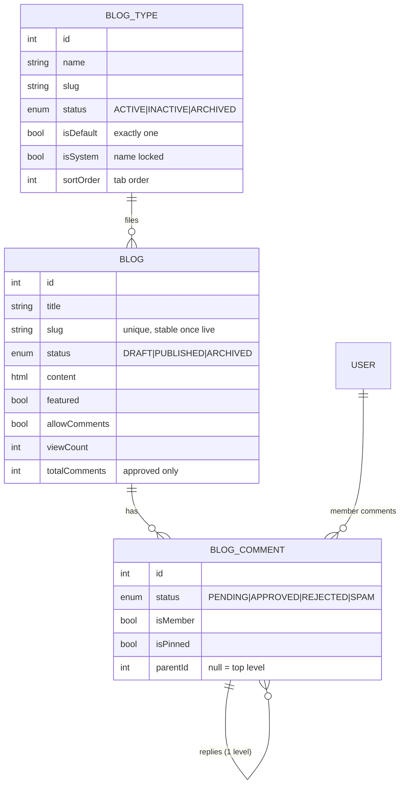
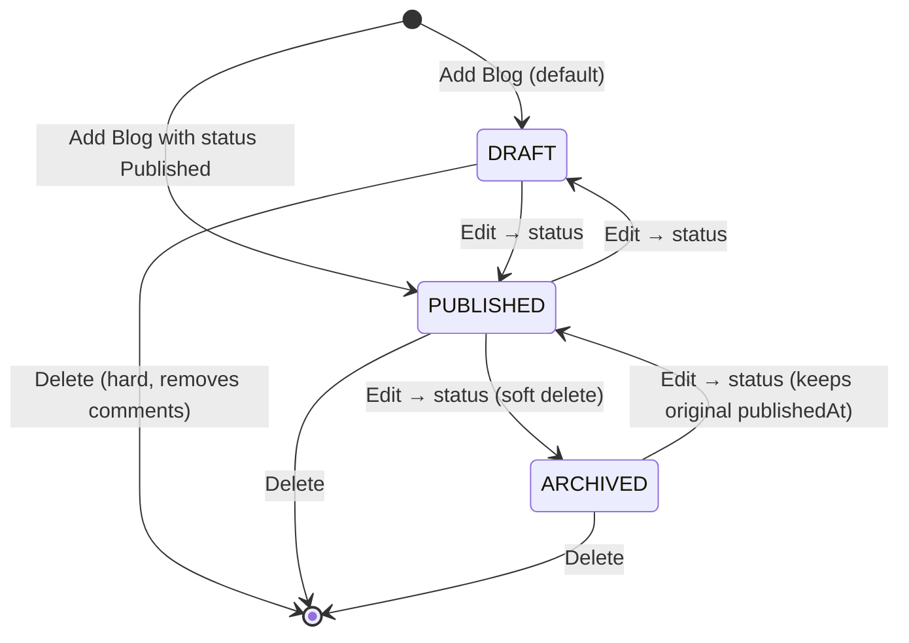
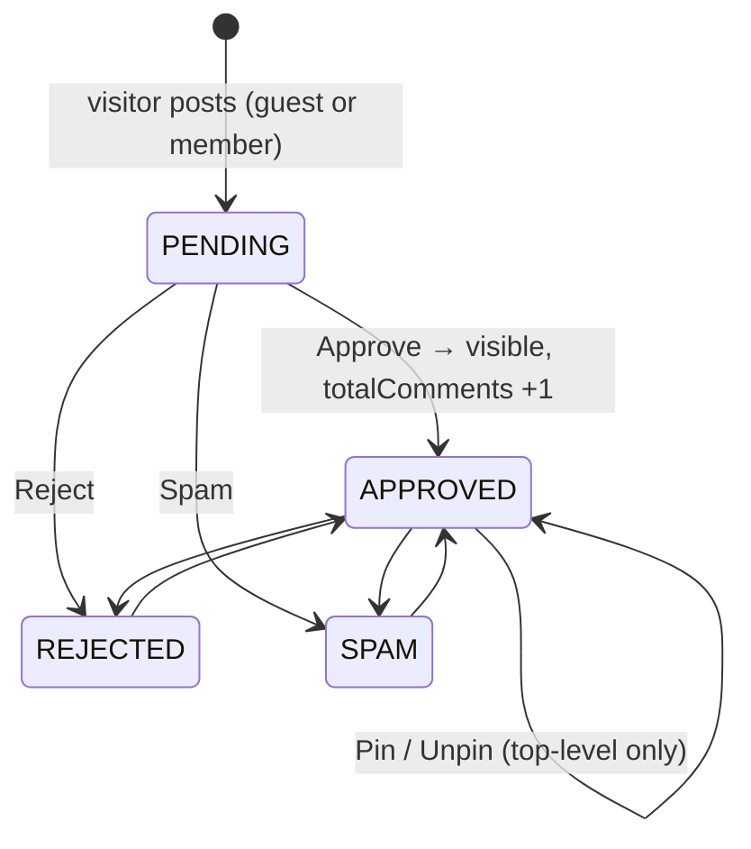
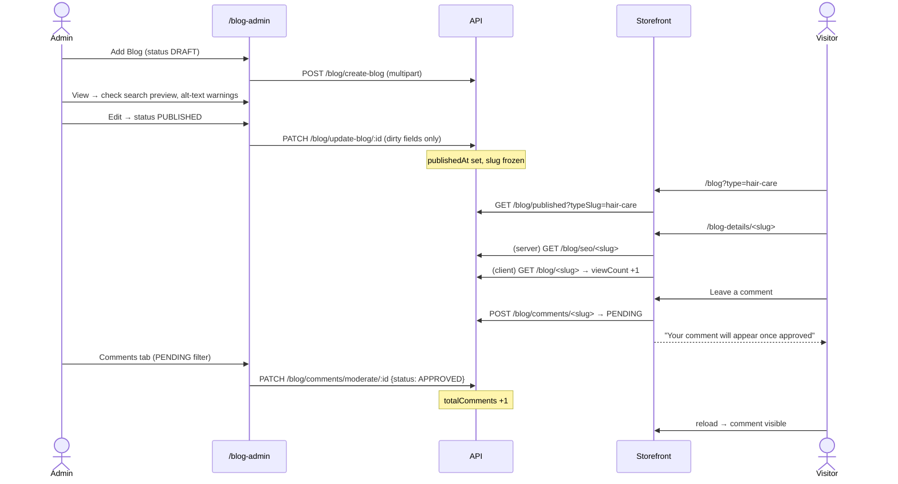
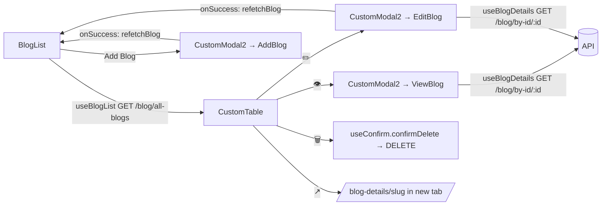
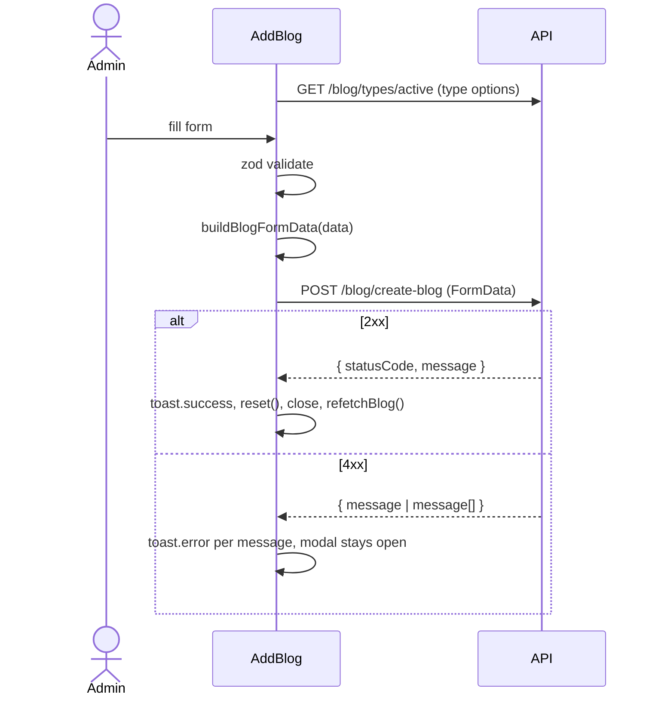
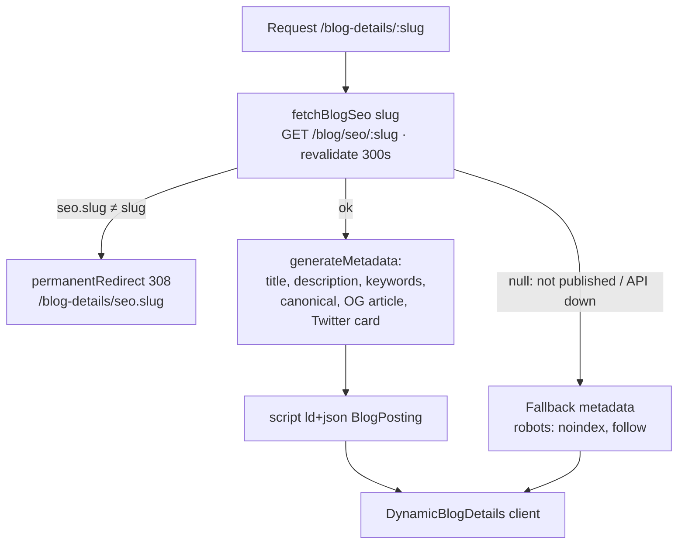
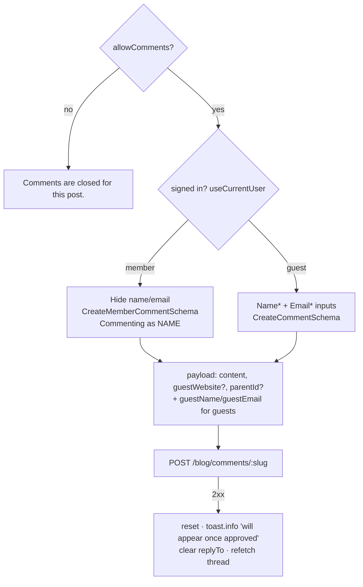

# Blog Module — Frontend Technical Documentation

> **Scope:** everything the Natura Care client (Next.js 15, App Router) does with the **blog**: the admin blog screen (posts, blog types, comment moderation, stats), the storefront listing (`/blog`) and post page (`/blog-details/[slug]`), the public comment and reply flow, and the server-rendered SEO layer (metadata, JSON-LD, slug redirects, sitemap).
>
> **Audience:** frontend engineers joining or maintaining the project. QA and backend engineers can use it to see the client's side of the blog contract.
>
> **Related:** [Project README](../README.md) (run, build, Docker) · [Auth module](./auth.md) (sign-in, session, route guard) · [User module](./user.md) (roles, `useCurrentUser`) · [Category module](./category.md) (same admin conventions) · [SEO concepts](./concepts/seo.md) · [Server blog controller](../../natura-care-server/src/modules/blog/blog.controller.ts) (API contract, guards)

| | |
|---|---|
| **Module root** | [`src/modules/blog/`](../src/modules/blog/) |
| **Admin route** | `/blog-admin` (admin route group) |
| **Storefront routes** | `/blog`, `/blog?type=<slug>&page=<n>`, `/blog-details/[slug]` |
| **Backend resource** | `/blog/*` on `NEXT_PUBLIC_API_BASE_URL` (e.g. `https://api.naturacarebd.com/n-care/api/v1`) |
| **Write access (API)** | `ADMIN` only. Exception: anyone can post a comment, guests included. |
| **Last reviewed** | 2026-10-24 |

---

## Table of Contents

1. [Overview](#1-overview)
2. [Domain Model: Posts, Types & Comments](#2-domain-model-posts-types--comments)
3. [Tech Stack Used by This Module](#3-tech-stack-used-by-this-module)
4. [File Architecture](#4-file-architecture)
5. [Routes & Access Control](#5-routes--access-control)
6. [End-to-End Workflow](#6-end-to-end-workflow)
7. [Admin Section — Screen Layout & Stats](#7-admin-section--screen-layout--stats)
8. [Admin Section — Blogs Tab](#8-admin-section--blogs-tab)
   - [8.1 Data fetching](#81-data-fetching)
   - [8.2 Columns](#82-columns)
   - [8.3 Row actions & modals](#83-row-actions--modals)
9. [Admin Section — Add Blog](#9-admin-section--add-blog)
10. [Admin Section — Edit Blog](#10-admin-section--edit-blog)
11. [Admin Section — View Blog](#11-admin-section--view-blog)
12. [Admin Section — Types Tab](#12-admin-section--types-tab)
13. [Admin Section — Comments Tab (Moderation)](#13-admin-section--comments-tab-moderation)
14. [Storefront — Blog Listing](#14-storefront--blog-listing)
15. [Storefront — Post Page](#15-storefront--post-page)
    - [15.1 Server layer: metadata, JSON-LD, redirect](#151-server-layer-metadata-json-ld-redirect)
    - [15.2 Client layer: the article](#152-client-layer-the-article)
    - [15.3 Page anatomy](#153-page-anatomy)
16. [Storefront — Comments & Replies](#16-storefront--comments--replies)
17. [SEO & Sitemap](#17-seo--sitemap)
18. [API Reference](#18-api-reference)
19. [Query Keys & Cache Invalidation](#19-query-keys--cache-invalidation)
20. [Types](#20-types)
21. [Validation Schemas](#21-validation-schemas)
22. [Constants](#22-constants)
23. [Hooks](#23-hooks)
24. [Utilities](#24-utilities)
25. [Reusable Components](#25-reusable-components)
26. [Error Handling & User Feedback](#26-error-handling--user-feedback)
27. [Business Rules Summary](#27-business-rules-summary)
28. [Known Issues & Technical Debt](#28-known-issues--technical-debt)
29. [How-To Recipes](#29-how-to-recipes)

---

## 1. Overview

The blog is the content-marketing arm of the shop. Admins write posts about hair care, skincare and wellness. Visitors read them, comment, share them, and get pushed toward `/product`.

| Audience | Where | What happens |
|---|---|---|
| **Admin** | `/blog-admin` → **Blogs** tab | List every post in any status; add, edit, view, delete; open live posts on the site. |
| **Admin** | `/blog-admin` → **Types** tab | Manage the blog types that become the filter tabs on `/blog`, and choose the default type. |
| **Admin** | `/blog-admin` → **Comments** tab | Moderation queue: approve, reject, mark as spam, pin, delete. |
| **Shopper / guest** | `/blog` | Browse published posts, filter by type, paginate. The state lives in the URL. |
| **Shopper / guest** | `/blog-details/[slug]` | Read the article with its table of contents, reading progress, video, share buttons, related posts, a shop call-to-action and comments. |
| **Search engines / social** | `/blog-details/[slug]` (server), `/sitemap.xml` | Per-post `<head>`, Open Graph/Twitter cards, `BlogPosting` JSON-LD, 308 redirect from old slugs, sitemap entries. |

Key design decisions:

- **Only `PUBLISHED` posts are public.** The API pins the status on `/blog/published`, and `GET /blog/:slug` returns 404 for drafts and archived posts unless the caller is an admin ([§2](#2-domain-model-posts-types--comments)).
- **List payloads never carry `content`.** The client models this with two types, `IBlogListItem` and `IBlog`. The Edit and View modals fetch the full post by id ([§20](#20-types)).
- **Multipart writes.** Create and update send `FormData` because of the cover image. The payload builders live in [`blog-form-data.utils.ts`](../src/modules/blog/utils/blog-form-data.utils.ts) ([§24](#24-utilities)).
- **Edits send only dirty fields.** Removing the cover or video is an explicit flag (`removeBanner` / `removeVideo`), not an empty value ([§10](#10-admin-section--edit-blog)).
- **Every comment is moderated.** New comments start as `PENDING` and never appear until an admin approves them. The form tells the visitor this ([§16](#16-storefront--comments--replies)).
- **SEO is server-rendered, the article is client-rendered.** The page file fetches a lightweight `GET /blog/seo/:slug`, which does not count a view, for `<head>` and JSON-LD. The article itself is a client component that calls `GET /blog/:slug`, which does count a view ([§15](#15-storefront--post-page)).
- **Slugs are stable after publishing.** Renaming a live post keeps its URL. If the slug changes anyway, the old URL redirects with a 308 ([§15.1](#151-server-layer-metadata-json-ld-redirect)).

[↑ Back to top](#table-of-contents)

---

## 2. Domain Model: Posts, Types & Comments



### Post status lifecycle



| Status | Storefront | Admin table hint | `publishedAt` |
|---|---|---|---|
| `DRAFT` | Hidden. The detail URL shows "Post not found". | "Only admins can see it" | Not set until the first publish |
| `PUBLISHED` | Listed, readable, in the sitemap | "Live on the blog" | Set on the first publish |
| `ARCHIVED` | Hidden, URL shows "Post not found" | "Hidden from the blog" | Kept, so re-publishing restores the original date |

### Blog types

Types are the filter tabs on `/blog` (for example "Tips & Tricks", "Hair Care", "Natural Skincare", "Wellness & Lifestyle").

| Flag | Meaning | Client behaviour |
|---|---|---|
| `isDefault` | The fallback type for posts created without one. There is always **exactly one**. | Shown as "(Default)" in pickers and as a badge in the table. It can't be deleted (no delete icon) or set to anything but Active (status select disabled). |
| `isSystem` | A seeded type whose identity is frozen | The name input is disabled and a notice explains why. |
| `status` | Only `ACTIVE` types appear as tabs and in the post form | `GET /blog/types/active` returns them in `sortOrder` order. |
| `blogCount` | Number of posts (admin list only) | Shown in the table and in the delete confirmation. |

Deleting a type **never orphans posts**: the API moves them to the default type, or to `reassignToTypeId` when one is given.

### Comment moderation lifecycle



- Only **`APPROVED`** comments are served publicly and counted in `IBlog.totalComments`.
- Replies go **one level deep**. Only top-level comments show a Reply button, and only top-level approved comments can be pinned.
- `email`, `ipAddress` and `moderatorNotes` are serialised **only on admin routes**. The server clears IP and browser data on comments older than 90 days ([`blog-comment-retention.service.ts`](../../natura-care-server/src/modules/blog/blog-comment-retention.service.ts)).

[↑ Back to top](#table-of-contents)

---

## 3. Tech Stack Used by This Module

| Concern | Library | Notes |
|---|---|---|
| Framework | Next.js 15 (App Router), React 19 | Route files `dynamic()`-import module components. The post page is an **async server component** for SEO. |
| Server state | `@tanstack/react-query` v5 | Through in-house hooks in [`src/hooks/api/`](../src/hooks/api/). Defaults: `staleTime` 0, `refetchOnWindowFocus` on (see [TD-1](#28-known-issues--technical-debt)). |
| HTTP (client) | `axios` | Shared instance with Bearer header, envelope unwrapping and 401 → refresh: [`axiosInstance.ts`](../src/lib/axios/axiosInstance.ts). |
| HTTP (server) | `fetch` with `next.revalidate` | [`blog-seo.server.ts`](../src/modules/blog/utils/blog-seo.server.ts), cached for 300 s. |
| Forms | `react-hook-form` + `zod` (`@hookform/resolvers`) | `dirtyFields` drives partial updates. |
| Rich text | `react-quill-new` (Quill 2) via [`TextEditor`](../src/components/form/TextEditor.tsx) | Toolbar: size, bold, underline, lists ([TD-2](#28-known-issues--technical-debt)). |
| Tables | `@tanstack/react-table` | Through `CustomTable`, with server pagination. |
| UI primitives | Radix (Tabs, Dialog, Select) via shadcn/ui | `components/ui/*`. |
| Toasts | `sonner` | Fired automatically by the API hooks ([§26](#26-error-handling--user-feedback)). |
| Icons | `lucide-react`, `react-icons/fa6` (share networks), `react-icons/bi` (sidebar) | |
| Styling / motion | Tailwind CSS v4, `tw-animate-css` | Article typography is one long arbitrary-variant class string (`ARTICLE_BODY`). Animations respect `motion-reduce`. |

[↑ Back to top](#table-of-contents)

---

## 4. File Architecture

The project uses a **feature-module** layout. `src/app` holds routing only. Logic and UI live in `src/modules/blog/`, split by audience (`admin/`, `public/`) and by kind (`hooks/`, `types/`, `schemas/`, `constants/`, `utils/`).

```text
natura-care-client/
├── src/
│   ├── middleware.ts                              # Role guard: /blog-admin ∈ ADMIN_ONLY_ROUTES (not EMPLOYEE_ROUTES)
│   ├── app/
│   │   ├── (admin)/blog-admin/page.tsx            # "use client"; dynamic(() => import(modules/blog/admin/Blog), { ssr: false })
│   │   ├── (public)/blog/page.tsx                 # static metadata + dynamic(public/blog/Blog)
│   │   ├── (public)/blog-details/[slug]/page.tsx  # async server: generateMetadata, 308 redirect, JSON-LD, dynamic(BlogDetails)
│   │   └── sitemap.ts                             # Adds every published post (revalidate 300)
│   │
│   ├── constants/api/
│   │   ├── blog.api.constants.ts                  # BLOG_API, BLOG_TYPE_API, BLOG_COMMENT_API (paths, keys, rootKeys)
│   │   └── index.ts                               # Re-exports them
│   │
│   ├── modules/blog/
│   │   ├── admin/
│   │   │   ├── Blog.tsx                           # Page: stats grid + CustomTabGroup (Blogs | Types | Comments); BlogList inside
│   │   │   ├── blog.columns.tsx                   # getBlogColumns(view, edit, delete)
│   │   │   ├── AddBlog.tsx                        # Create form → buildBlogFormData → POST multipart
│   │   │   ├── EditBlog.tsx                       # Fetch by id → reset → dirty-only multipart PATCH
│   │   │   ├── ViewBlog.tsx                       # Read-only overview: hero, notices, stats, search preview, content, audit
│   │   │   ├── BlogTypes.tsx                      # Types tab: table + add/edit modals + delete confirm
│   │   │   ├── blog-type.columns.tsx              # getBlogTypeColumns(edit, delete)
│   │   │   ├── AddBlogType.tsx                    # Create type (optionally as default)
│   │   │   ├── EditBlogType.tsx                   # Edit type + separate "Make Default" action
│   │   │   ├── BlogComments.tsx                   # Moderation queue (opens on PENDING)
│   │   │   └── comment.columns.tsx                # getCommentColumns(moderate, delete, pin)
│   │   ├── public/
│   │   │   ├── blog/
│   │   │   │   ├── Blog.tsx                       # /blog listing: URL-driven type tabs, grid, pagination
│   │   │   │   └── BlogCardSkeleton.tsx
│   │   │   └── blog-details/
│   │   │       ├── BlogDetails.tsx                # /blog-details/[slug]: Article, PostVideo, ShopCallout, NotFound
│   │   │       ├── BlogDetailsSkeleton.tsx
│   │   │       ├── TableOfContents.tsx            # TableOfContents (desktop sticky) + MobileTableOfContents
│   │   │       ├── ReadingProgress.tsx            # Fixed top progress bar tied to the <article>
│   │   │       ├── ShareButtons.tsx               # FB / WhatsApp / X / LinkedIn / copy / native share (also used by Career)
│   │   │       ├── RelatedBlog.tsx                # "Keep reading" strip
│   │   │       ├── CommentSection.tsx             # Approved thread, nested replies, pagination
│   │   │       └── CommentForm.tsx                # Guest/member "Leave a comment" + reply mode
│   │   ├── hooks/
│   │   │   ├── useBlog.ts                         # Admin: list, stats, details-by-id, create, update, archive, delete
│   │   │   ├── useBlogType.ts                     # Admin list, active types, create, update, set default, delete
│   │   │   ├── useBlogComment.ts                  # Admin queue, public thread, create, moderate, pin, delete
│   │   │   └── usePublicBlog.ts                   # Storefront: published list, details by slug, related
│   │   ├── schemas/
│   │   │   ├── blog.schema.ts                     # CreateBlogSchema, UpdateBlogSchema, Create/UpdateBlogTypeSchema
│   │   │   └── blog-comment.schema.ts             # CreateCommentSchema (guest), CreateMemberCommentSchema, ModerateCommentSchema
│   │   ├── types/blog.types.ts                    # BlogStatus, IBlogListItem, IBlog, IBlogType, IBlogComment, IBlogSeo, IBlogStats…
│   │   ├── constants/blog.constants.ts            # Tabs, status options, banner size cap, public page size
│   │   └── utils/
│   │       ├── blog-form-data.utils.ts            # buildBlogFormData, buildBlogUpdateFormData
│   │       ├── blog-display.utils.ts              # Status styles, blogPublicPath, date/number formatters, word count
│   │       ├── blog-content.utils.ts              # prepareArticle (heading ids + TOC), getVideoEmbed
│   │       ├── blog-seo.server.ts                 # fetchBlogSeo, fetchPublishedBlogsForSitemap, toJsonLd (server-only)
│   │       └── html.utils.ts                      # Re-export of lib/utils/html.utils stripHtml (legacy import path)
│   │
│   ├── components/
│   │   ├── layout/sidebar/AdminSidebar.tsx        # "Blog" → /blog-admin (admin-only item)
│   │   ├── layout/navbar/Navbar.tsx               # "Blog" → /blog (active on any /blog* path)
│   │   ├── layout/hero/Hero.tsx                   # Listing page banner
│   │   ├── data-display/table/CustomTable.tsx
│   │   ├── data-display/pagination/CustomPagination.tsx
│   │   ├── form/ (InputField, TextAreaField, TextEditor, SingleSelectSearch, CheckboxField, SubmitButton, file-upload/SingleMediaInput)
│   │   └── primitives/ (modal/CustomModal2, tab/CustomTabGroup, tab/CustomTabGroupPrimary, button/AddButton, CustomTooltip)
│   │
│   └── hooks/
│       ├── api/ (useGet, useGetAll, usePost, usePatch, useFormPost, useFormPatch, useDelete)
│       ├── table/useHandleModalState.ts
│       └── useConfirm.ts
```

**Page conventions.**

```tsx
// Admin — client only, no SSR (the screen is behind auth and is all client state)
const BlogContent = dynamic(() => import("@/modules/blog/admin/Blog"), {
  ssr: false,
  loading: () => <LoadingPage />,
});

// Storefront detail — the server component owns SEO, then hands off to the client article
export async function generateMetadata({ params }) { /* fetchBlogSeo(slug) */ }
export default async function BlogDetailsPage({ params }) {
  const seo = await fetchBlogSeo(slug);             // deduped with generateMetadata
  if (seo && seo.slug !== decodeURIComponent(slug)) permanentRedirect(`/blog-details/${seo.slug}`);
  return <>{seo && <script type="application/ld+json" … />}<DynamicBlogDetails /></>;
}
```

[↑ Back to top](#table-of-contents)

---

## 5. Routes & Access Control

### Routes that touch the blog

| Route | Group | Rendering | Component | Purpose |
|---|---|---|---|---|
| `/blog-admin` | `(admin)` | Client only (`ssr: false`) | [`admin/Blog.tsx`](../src/modules/blog/admin/Blog.tsx) | Full management |
| `/blog` | `(public)` | Static metadata + client listing | [`public/blog/Blog.tsx`](../src/modules/blog/public/blog/Blog.tsx) | Listing |
| `/blog?type=hair-care&page=2` | `(public)` | same | same | Filtered or paged listing (shareable) |
| `/blog-details/[slug]` | `(public)` | Server `<head>` + JSON-LD, client article | [`BlogDetails.tsx`](../src/modules/blog/public/blog-details/BlogDetails.tsx) | Post page |
| `/sitemap.xml` | — | Server, revalidate 300 s | [`app/sitemap.ts`](../src/app/sitemap.ts) | Published posts + `/blog` |

### Who can open what

Access is checked in [`src/middleware.ts`](../src/middleware.ts) by decoding the role from the `accessToken` cookie. How sign-in creates that cookie is covered in the [Auth module docs](./auth.md).

| Route / action | ADMIN | EMPLOYEE | CUSTOMER | Guest |
|---|:-:|:-:|:-:|:-:|
| `/blog-admin` (page) | ✅ | ❌ → `/dashboard` | ❌ → `/` | ❌ → `/login` |
| `/blog`, `/blog-details/*` (pages) | ✅ | ✅ | ✅ | ✅ |
| Read published posts, types, approved comments (API) | ✅ | ✅ | ✅ | ✅ |
| Read a **draft / archived** post via `GET /blog/:slug` | ✅ (preview) | ❌ 404 | ❌ 404 | ❌ 404 |
| Post a comment `POST /blog/comments/:slug` | ✅ | ✅ | ✅ | ✅ (name + email required) |
| Every other write, admin list, stats, moderation (API) | ✅ | ❌ 403 | ❌ 403 | ❌ 401 |

The sidebar mirrors the middleware: the "Blog" item in [`AdminSidebar`](../src/components/layout/sidebar/AdminSidebar.tsx) has no `employee: true`, so employees never see it.

> ⚠️ `/blog` and `/blog-details` are **not** listed in `PUBLIC_ROUTES`. They load for everyone only because the middleware lets unknown routes through to Next's own routing (`isKnownRoute` is false). See [TD-3](#28-known-issues--technical-debt).

### How the server identifies the viewer

The axios interceptor attaches the Bearer token to every request when one exists.

- **`GET /blog/:slug`** uses `OptionalAuthGuard`. An admin token unlocks drafts, so an admin can preview a draft at its real `/blog-details/<slug>` URL, and the view counter is **not** bumped for admins. Everyone else gets 404 for anything not published, and each request counts a view.
- **`POST /blog/comments/:slug`** uses `OptionalAuthGuard`. A member's name and email come from the JWT and the guest fields are ignored. That is why [`CommentForm`](../src/modules/blog/public/blog-details/CommentForm.tsx) hides those inputs when a user is signed in.
- **Server-side fetches** in `blog-seo.server.ts` send **no token**, so `<head>` and the sitemap only ever see published posts. A draft previewed by an admin gets the fallback, `noindex` metadata.

[↑ Back to top](#table-of-contents)

---

## 6. End-to-End Workflow



[↑ Back to top](#table-of-contents)

---

## 7. Admin Section — Screen Layout & Stats

**Entry:** [`admin/Blog.tsx`](../src/modules/blog/admin/Blog.tsx) · **Sidebar label:** "Blog" · **Page title:** none set, because the route file is `"use client"` ([TD-8](#28-known-issues--technical-debt))

```text
┌──────────┬──────────┬────────┬──────────┬──────────────────┬───────────────────┐
│ Total 24 │ Published│ Draft 3│ Archived │ Pending Comments │ Approved Comments │   ← useBlogStats()
│          │ 19       │        │ 2        │ 5                │ 112               │
└──────────┴──────────┴────────┴──────────┴──────────────────┴───────────────────┘
 [ Blogs ] [ Types ] [ Comments ]                                ← CustomTabGroup (BLOG_TAB_LIST)
 ┌ Blogs ─────────────────────────────────────────── [+ Add Blog] ┐
 │ [Search blogs…]                                               │
 │ Post │ Type │ Author │ Engagement │ Status │ Published │ Action│
 └───────────────────────────────────────────────────────────────┘
```

- **Stats** come from `GET /blog/stats` ([`useBlogStats`](../src/modules/blog/hooks/useBlog.ts)). Each tile shows "—" while loading. The grid is 2, 3 or 6 columns depending on width.
- **Tabs** use [`CustomTabGroup`](../src/components/primitives/tab/CustomTabGroup.tsx), the same component as the Home Content screen. The tab is **local state** and is not in the URL, so a reload always opens on **Blogs**.
- Each tab component (`BlogList`, `BlogTypes`, `BlogComments`) owns its own pagination, search and modal state.

[↑ Back to top](#table-of-contents)

---

## 8. Admin Section — Blogs Tab

**Component:** `BlogList` inside [`admin/Blog.tsx`](../src/modules/blog/admin/Blog.tsx)



### 8.1 Data fetching

Local state: `currentPage` (1), `pageSize` (10), `searchTerm`, `sortOrder` (`"desc"`).

```ts
useBlogList({ page: currentPage, limit: pageSize, search: searchTerm, sortOrder });
// → GET /blog/all-blogs?page&limit&search&sortOrder
// key: ["getAllBlogs", page, limit, search, sortOrder, status, typeId]
```

- Returns **every status**, so drafts and archived posts stay reachable.
- `useBlogList` also accepts `status` and `typeId`, but the screen has **no filter UI** for them yet ([TD-6](#28-known-issues--technical-debt)).
- Search is the `CustomTable` built-in, debounced.
- Every column has `enableSorting: false`, so `onSortChange` never fires and the list stays newest-first.

### 8.2 Columns

[`getBlogColumns(handleView, handleEdit, handleDelete)`](../src/modules/blog/admin/blog.columns.tsx):

| Column | Content |
|---|---|
| **Post** | 76×48 cover thumbnail (16:10, the same crop as the storefront card) or an `ImageOff` placeholder; ⭐ when `featured`; title (truncated, full text in `title`); `/slug` in monospace |
| **Type** | Blue pill with `type.name`, or "—" |
| **Author** | `authorName` and "N min read" when `readTime` is set |
| **Engagement** | 👁 views (`formatCompact`: 1284 → "1.3K", exact count on hover) and 💬 approved comments |
| **Status** | Pill + dot from `BLOG_STATUS_STYLES`; the hover text explains visibility |
| **Published** | Date + relative time. Shows "Edited N days ago" when edited more than a day after publishing. Unpublished rows show "Not yet · Created …". |
| **Action** | 👁 View · ✏️ Edit · 🗑 Delete · ↗ Open on website (dimmed and unclickable unless `PUBLISHED`) |

### 8.3 Row actions & modals

Modal state comes from [`useHandleModalState<IBlogListItem>()`](../src/hooks/table/useHandleModalState.ts): `handleOpen("view" | "edit", row)`, `isOpen(type)` and `handleClose()`. The Add modal uses its own `useState`.

| Modal | Size | Component |
|---|---|---|
| Add | `w-[60vw]`, `lg:h-[85vh]` | `AddBlog` |
| Edit | `w-[60vw]`, `lg:h-[85vh]` | `EditBlog` |
| View | responsive 100vw → 60vw, `max-w-5xl`, `max-h-[85vh]`, brand scrollbar | `ViewBlog` |

**Delete** is a **hard delete** behind [`useConfirm().confirmDelete`](../src/hooks/useConfirm.ts):

> *"Delete this blog permanently?"* — *"Its comments will be removed too. To keep it out of the storefront without losing it, set the status to Archived instead."*

`onConfirm` returns the `mutateAsync` promise, so the dialog shows a spinner until the request finishes. `useDelete` then invalidates `["getAllBlogs"]`.

> `useArchiveBlog` (`PATCH /blog/archive-blog/:id`) exists but no button uses it. Archiving is done through the Status field in Edit.

[↑ Back to top](#table-of-contents)

---

## 9. Admin Section — Add Blog

**Component:** [`AddBlog.tsx`](../src/modules/blog/admin/AddBlog.tsx) · schema `CreateBlogSchema` · `useCreateBlog` → `POST /blog/create-blog` (multipart via `useFormPost`)



**Fields** (top to bottom)

| Field | Form name | Rules | Notes |
|---|---|---|---|
| Title * | `title` | 3–255 chars | |
| URL Slug | `slug` | Optional; ≤255; `^[a-z0-9]+(?:-[a-z0-9]+)*$` | Empty → the server builds it from the title. **Required in practice for Bangla titles**, because only ASCII letters, digits and hyphens make a URL. |
| Blog Type * | `blogType` | Required string (option id) | `SingleSelectSearch` over active types. The default type is labelled "(Default)". |
| Status * | `status` | `DRAFT \| PUBLISHED \| ARCHIVED` | Defaults to **Draft** |
| Author Name | `authorName` | ≤200 | The byline. The storefront falls back to "Natura Care". |
| Read Time (minutes) | `readTime` | Integer ≥1, or `null` | Number input emits a number or `null`. Empty → the storefront estimates it at 200 wpm. |
| Excerpt | `excerpt` | ≤500 | Card teaser, header standfirst, SEO description fallback |
| Content * | `content` | Required, not `<p><br></p>` | Quill `TextEditor`. An empty editor stores `""`. |
| Tags | `tags` | Free text | Comma-separated → JSON array |
| Cover Image | `banner` | `File`, ≤5 MB, `image/*` | `SingleMediaInput`, sent as `bannerFile` |
| Cover Image Alt Text | `bannerAlt` | ≤255 | Falls back to the title when rendered |
| Video URL | `videoUrl` | Valid URL or empty | YouTube / Vimeo / .mp4 / any link ([§24](#24-utilities)) |
| Featured | `featured` | boolean, default `false` | ⭐ in admin |
| Allow Comments | `allowComments` | boolean, default `true` | Hides the public reply form when off |
| *SEO (hidden)* | `metaTitle`, `metaDescription`, `metaKeywords` | ≤255 / free / CSV | **Commented out in the JSX.** The schema, defaults and payload wiring remain, so restoring them is an uncomment ([TD-7](#28-known-issues--technical-debt)). |

**Payload** ([`buildBlogFormData`](../src/modules/blog/utils/blog-form-data.utils.ts)):

```ts
// always sent
title, content, typeId, status,
featured: "true" | "false",
allowComments: "true" | "false",
tags: '["shikakai","hair care"]',   // JSON array string, [] when empty
metaKeywords: '[]',
// only when non-empty (an empty string would fail the API's validators, e.g. URL on videoUrl)
slug, excerpt, bannerAlt, authorName, videoUrl, metaTitle, metaDescription,
readTime   // only when a number
bannerFile // only when a File
```

[↑ Back to top](#table-of-contents)

---

## 10. Admin Section — Edit Blog

**Component:** [`EditBlog.tsx`](../src/modules/blog/admin/EditBlog.tsx) · schema `UpdateBlogSchema` (`.partial()`) · `useUpdateBlog` → `PATCH /blog/update-blog/:id` (multipart via `useFormPatch`)

It uses the same fields as Add. The differences are all about **loading** and **sending only what changed**.

### Loading

1. The table row has no `content`, so `useBlogDetails(row.id)` fetches `GET /blog/by-id/:id`. Skeletons show while it loads.
2. When the post arrives, `reset({...})` seeds the form. Using `reset` instead of `setValue` **re-baselines `dirtyFields`**, so loaded values don't count as edits.
3. `banner` is seeded with the saved **URL string**, so `SingleMediaInput` previews the current cover. Clearing it sets the field to `null`.
4. Arrays come back as comma-joined strings (`tags`, `metaKeywords`).

### Slug hint (business rule)

| Post state | Hint under the slug input |
|---|---|
| Never published | "Follows the title until the post is first published, unless you set it yourself." |
| Has `publishedAt` | "This post is live, so changing the title keeps its URL. If you change the slug, the old link will redirect to the new one." |

### Submit logic

```ts
if (!isDirty) { toast.info("No changes detected!"); close(); return; }

const removeBanner = Boolean(dirtyFields.banner)  && !formValues.banner;    // picker cleared
const removeVideo  = Boolean(dirtyFields.videoUrl) && !formValues.videoUrl; // input emptied

updateBlog(id, buildBlogUpdateFormData(formValues, dirtyFields, { removeBanner, removeVideo }));
```

`buildBlogUpdateFormData` rules:

| Field kind | Sent when | Empty value |
|---|---|---|
| `title`, `content`, `typeId`, `status` | dirty **and** non-empty | Not sent |
| `slug` | dirty and non-empty | **Not sent**: emptying the slug keeps the current URL |
| `excerpt`, `bannerAlt`, `authorName`, `metaTitle`, `metaDescription` | dirty | Sent as `""`, which **clears** it on the server |
| `featured`, `allowComments` | dirty | `"true"`/`"false"` |
| `tags`, `metaKeywords` | dirty | `"[]"`, which clears them |
| `readTime` | dirty and a number | Clearing it is **not** sent, so the old value stays ([TD-5](#28-known-issues--technical-debt)) |
| `bannerFile` | `banner instanceof File` | — |
| `removeBanner=true` | dirty, cleared, and no new file | — |
| `videoUrl` / `removeVideo=true` | dirty + value / dirty + empty | — |

The API reads a **missing key as "leave it alone"**, so removal has to be an explicit flag.

[↑ Back to top](#table-of-contents)

---

## 11. Admin Section — View Blog

**Component:** [`ViewBlog.tsx`](../src/modules/blog/admin/ViewBlog.tsx) · `useBlogDetails(row.id)` → `GET /blog/by-id/:id`

A read-only overview that works for **any status**. Top to bottom:

| Block | Content / logic |
|---|---|
| **Hero** | The cover (16:9 / 16:7) with a gradient. Shows the status pill, ⭐ Featured, type chip, title, byline · date · read time. "No cover image" placeholder when missing. |
| **Link bar** | `CopyUrl` (copies the public URL) and "View on website" (only when `PUBLISHED`) |
| **Notices** | **Draft**: visitors can't see it. **Archived**: hidden and its link shows not found; re-publishing restores the original date. **Comments closed** (live + `!allowComments`). **No cover alt text** (cover present, alt missing). |
| **Stats** | Views · Comments · Read Time (set value vs. `estimateReadMinutes(countWords(content))`) · Live Since / Created |
| **Details** | Type, byline, featured, comments on/off, video link, cover alt text |
| **Search Preview** | A Google-style snippet: `naturacarebd.com › blog-details › slug`, title (`metaTitle \|\| title`, clipped at **60**), description (`metaDescription \|\| excerpt`, clipped at **160**), length meters that warn past the limit, and a "Uses custom SEO text" / "Built from the title and excerpt" label |
| **Tags** | Chips |
| **Excerpt** | Plain text |
| **Content** | Rendered HTML (word count in the header), scroll-capped at 28 rem |
| **Audit** | Created (by), Published, Last Updated (by) |

Blocks fade in one after another (`ENTER` + `enterDelay(ms)`), and the animation is disabled under `motion-reduce`.

[↑ Back to top](#table-of-contents)

---

## 12. Admin Section — Types Tab

**Component:** [`BlogTypes.tsx`](../src/modules/blog/admin/BlogTypes.tsx) · `useBlogTypeList` → `GET /blog/types/all-blog-types`

**Columns** ([`blog-type.columns.tsx`](../src/modules/blog/admin/blog-type.columns.tsx)): Name (+ green **Default** badge) · Slug · Blogs (`blogCount`) · Order (`sortOrder`) · Status (green when Active, red otherwise) · Action (✏️, plus 🗑 unless `isDefault`).

### Add type — [`AddBlogType.tsx`](../src/modules/blog/admin/AddBlogType.tsx)

| Field | Rules | Payload |
|---|---|---|
| Name * | 2–100 | `name` (the server builds the slug) |
| Status * | `ACTIVE` (default) / `INACTIVE` / `ARCHIVED` | `status` |
| Tab Order | Integer ≥0 or `null` | `sortOrder`, sent when it is a **number**, so `0` is kept |
| Description | Optional | Only when non-empty |
| Make this the default type | Checkbox | `isDefault`. The server demotes the previous default. |

Sent as JSON via `usePost` → `POST /blog/types/create-blog-type`.

### Edit type — [`EditBlogType.tsx`](../src/modules/blog/admin/EditBlogType.tsx)

- Default values come straight from the row. There's no refetch, because the type has no heavy fields.
- Sends **dirty fields only** via `PATCH /blog/types/update-blog-type/:id`.
- `isSystem` disables the Name input and shows the notice "This is a system type — its name cannot be changed."
- `isDefault` disables Status and shows a notice to promote another type instead.
- **Make Default** is a separate `type="button"` action, not a form field. It confirms first (`variant: "info"`), then calls `PATCH /blog/types/set-default/:id`. It's separate because the API demotes the old default **in the same transaction**, which can't be folded into a partial update.

### Delete type

The confirmation says what will happen: *"Its N post(s) will be moved to the default type."* The UI never passes `reassignToTypeId`, although `useDeleteBlogType(id, reassignToTypeId?)` supports it.

[↑ Back to top](#table-of-contents)

---

## 13. Admin Section — Comments Tab (Moderation)

**Component:** [`BlogComments.tsx`](../src/modules/blog/admin/BlogComments.tsx) · `useCommentList` → `GET /blog/comments/all-comments`

- **Opens on the `PENDING` filter**, because that is where every new comment lands. Filter chips: All · Pending · Approved · Rejected · Spam (`COMMENT_FILTER_OPTIONS`; `""` = All). Changing the filter resets to page 1.
- Search across comments (CustomTable built-in).

**Columns** ([`comment.columns.tsx`](../src/modules/blog/admin/comment.columns.tsx)):

| Column | Content |
|---|---|
| Author | Name, email (admin-only field), "Member" / "Guest" |
| Comment | Truncated to 90 chars, with "(reply)" and "(pinned)" markers |
| Blog | Post title, truncated to 30 |
| Date | `dd/mm/yyyy` |
| Status | Green Approved, amber Pending, red Rejected/Spam |
| Action | Context-sensitive buttons below |

**Actions** (each one is hidden when it would be a no-op):

| Button | Shown when | Request | Effect |
|---|---|---|---|
| Approve | status ≠ `APPROVED` | `PATCH /blog/comments/moderate/:id` `{status:"APPROVED"}` | Published in the thread; `totalComments` +1 |
| Reject | status ≠ `REJECTED` | same, `REJECTED` | Hidden |
| Spam | status ≠ `SPAM` | same, `SPAM` | Hidden |
| Pin / Unpin | `APPROVED` **and** top-level | `PATCH /blog/comments/pin/:id?isPinned=<bool>` | Pinned comments lead the public thread |
| 🗑 | always | `DELETE /blog/comments/delete-comment/:id` (with confirm) | Also deletes its replies |

Moderate and pin call `refetchComment()` on success. Delete relies on `useDelete` invalidating `["getAllBlogComments"]`. `moderatorNotes` is supported by the hook and schema but not exposed in the UI.

[↑ Back to top](#table-of-contents)

---

## 14. Storefront — Blog Listing

**Route:** `/blog` · **Component:** [`public/blog/Blog.tsx`](../src/modules/blog/public/blog/Blog.tsx) · **Metadata:** static "Blog | Natura Care Limited"

```text
┌──────────────── Hero: "Blog" ────────────────┐
│ ( All ) ( Tips & Tricks 4 ) ( Hair Care 7 ) … │  ← CustomTabGroupPrimary, from useActiveBlogTypes()
│ Showing 1-9 from 24                           │  ← only when there is more than one page
│ ┌card┐ ┌card┐ ┌card┐                          │  ← 1 / 2 / 3 columns (sm / xl)
│ ┌card┐ ┌card┐ ┌card┐                          │
│ « 1 2 3 »                                     │  ← CustomPagination
└───────────────────────────────────────────────┘
```

### URL is the source of truth

| URL | Tab | API call |
|---|---|---|
| `/blog` | All | `GET /blog/published?page=1&limit=9` |
| `/blog?type=hair-care` | Hair Care | `…&typeSlug=hair-care` |
| `/blog?type=hair-care&page=2` | Hair Care, page 2 | `…&page=2&typeSlug=hair-care` |

- `buildQuery({ type?, page? })` edits the current search params. **Switching tab deletes `page`**, because the new result may have fewer pages. Page 1 and the "All" tab are removed from the URL to keep it clean.
- Navigation uses `router.push(…, { scroll: false })`, then a smooth `window.scrollTo(0)` on page change, the same as the product listing.
- The "All" tab's value is `""`, which also means "no `type` param", so the tabs and the URL can't fall out of sync.
- Tab counts come from `type.blogCount` when the API returns it.

### Card

The whole card is a `Link` to `/blog-details/<slug>`: 16:10 cover (or "No Image"), a white date badge (`publishedAt ?? createdAt`, `dd/mm/yyyy`), title clamped to two lines, excerpt passed through `stripHtml` and clamped to two lines (omitted when empty, since list payloads have no `content`), and "Read more →".

**Empty state:** "No Posts Yet". The message differs depending on whether a type filter is active. **Loading:** `BlogCardSkeleton` × 9.

[↑ Back to top](#table-of-contents)

---

## 15. Storefront — Post Page

**Route:** `/blog-details/[slug]` · **Server:** [`app/(public)/blog-details/[slug]/page.tsx`](../src/app/(public)/blog-details/[slug]/page.tsx) · **Client:** [`BlogDetails.tsx`](../src/modules/blog/public/blog-details/BlogDetails.tsx)

### 15.1 Server layer: metadata, JSON-LD, redirect



- `generateMetadata` and the page both call `fetchBlogSeo(slug)`. Next deduplicates the request within one render.
- `/blog/seo/:slug` is used instead of the detail route because **the detail route counts a view**, and this code runs on every render and every crawl.
- **Title:** `"<title> | Natura Care Blog"`. **Canonical:** `/blog-details/<current slug>`. **Twitter:** `summary_large_image` when there is a cover.
- **JSON-LD** `BlogPosting`: headline, description, image, published and modified dates, author (Person, or the Natura Care Organization when there is no byline), publisher with logo, `mainEntityOfPage`, `articleSection` (the type), keywords (tags). It's serialised with `toJsonLd`, which escapes `<` so admin-written text can't break out of the `<script>`.

### 15.2 Client layer: the article

`BlogDetails` reads `slug` from `useParams` and calls `usePublicBlogDetails(slug)` → `GET /blog/:slug`. That call **bumps `viewCount`**, so call it only here.

| State | Render |
|---|---|
| Loading | `BlogDetailsSkeleton` |
| `blog` | `<Article blog={blog} />` |
| none (404) | `NotFound`: "This post may have been removed, or it isn't published yet." with Back to blog / Browse products |

**Client-side slug fix-up:** if the API resolved an old slug, `blog.slug` differs from the URL, so `router.replace(blogPublicPath(blog.slug))` puts the current URL in the address bar. The server's 308 handles crawlers and full loads; this handles client-side navigation.

**Content preparation:** `prepareArticle(blog.content)` (memoised) gives every `<h2>` and `<h3>` a unique id (`tips`, `tips-2`, keeping ids the author set, and keeping Bangla letters and marks) and returns the outline for the table of contents.

### 15.3 Page anatomy

```text
▔▔▔▔▔▔▔▔▔▔▔▔▔▔▔▔▔▔▔▔▔▔▔▔▔▔▔▔▔▔▔▔▔▔▔▔  ReadingProgress (fixed, tracks <article> only)
Home › Blog › Hair Care                 Breadcrumb (type → /blog?type=slug)
[🌿 HAIR CARE]                          Type chip (link)
Title (h1)
Excerpt (standfirst)
(R) Rahat · 3 Oct 2026 · Updated …   ⏱ 5 min · 💬 4 → #comments   (👁 views hidden, TD-1)
┌──────────────── Cover (priority) ───────────────┐
┌─────────────── article ──────────┐ ┌─ aside (lg+, sticky) ─┐
│ [Mobile TOC, collapsible]        │ │ On this page (TOC)    │
│ Rich-text body (ARTICLE_BODY)    │ │ Share                 │
│ ▶ Watch (PostVideo)              │ │ ← All posts           │
│ #tags                            │ └───────────────────────┘
│ Found this helpful? [share]      │
│ Written by … (author card)       │
└──────────────────────────────────┘
┌──── ShopCallout → /product ─────┐
Related posts (RelatedBlog)
Comments (CommentSection + CommentForm)
```

| Piece | Behaviour |
|---|---|
| Read time | `blog.readTime ?? estimateReadMinutes(countWords(content))` |
| "Updated" | Only when `editedAfterPublish` (more than a day after `publishedAt`) |
| Views | Hidden when 0 |
| `TableOfContents` / `MobileTableOfContents` | Rendered only when there are **≥ 2 headings**. An `IntersectionObserver` highlights the current section (it becomes active in the upper third). Headings have `scroll-mt-28` to clear the sticky navbar. |
| `PostVideo` | `getVideoEmbed(url)`: YouTube → `youtube-nocookie.com` iframe, Vimeo → player iframe, `.mp4/.webm/.ogg` → native `<video>`, anything else → a link card |
| `ShareButtons` | Facebook, WhatsApp, X, LinkedIn, copy link (toast), native `navigator.share` when available. The URL is built after mount, so server and client markup match. |
| `ShopCallout` | "Put these tips into practice" → `/product`. The copy uses the type name. |
| `RelatedBlog` | `GET /blog/related/:slug` (same type, current post excluded by the API). The whole section is hidden when the list is empty. Swipe row on phones, grid from `sm`. "See all" → `/blog?type=<slug>`. |

> **Security note:** the body is rendered with `dangerouslySetInnerHTML`. This is acceptable because only admins can write content, through the dashboard editor, which is the same trusted-author model the rest of the site uses. Comments are rendered as **plain text**, never as HTML.

[↑ Back to top](#table-of-contents)

---

## 16. Storefront — Comments & Replies

**Components:** [`CommentSection.tsx`](../src/modules/blog/public/blog-details/CommentSection.tsx), [`CommentForm.tsx`](../src/modules/blog/public/blog-details/CommentForm.tsx)

### Thread

- `usePublicComments(slug, page)` → `GET /blog/comments/by-blog/:slug?page&limit=10`. It returns **approved top-level comments with their approved replies nested**, pinned first (the API orders them), all in one request.
- The heading shows "N Comments", using `meta.totalItems` and falling back to the post's `totalComments` until the thread loads.
- Each comment has an avatar with an initial and a **stable colour per name** (character-sum hash over four tones). The name links to `website` when given (`rel="nofollow ugc"`). Pinned comments get a highlighted bubble and a 📌 badge. Content is plain text with `whitespace-pre-line`.
- **Reply** is shown only on top-level comments and only when `allowComments`. Clicking it sets `replyTo` and scrolls `#comment-form` into view.
- Pagination appears when there is more than one page.

### Form



- **Member vs. guest** is decided by `useCurrentUser().currentUserData?.id`. The resolver switches schemas, and the narrower member resolver is cast to the guest form type, because the form still owns all four fields.
- `guestWebsite` is sent only when it is filled in, so the API's URL validator doesn't run on `""`.
- **Reply mode:** the heading becomes "Write a reply", a "Replying to NAME ✕" banner appears, and the submit label becomes "Post reply". Cancel clears it.
- Privacy line: "Your email is never published. Comments appear after a quick review."

[↑ Back to top](#table-of-contents)

---

## 17. SEO & Sitemap

| Surface | Source | Cache | Notes |
|---|---|---|---|
| `/blog` `<head>` | Static `metadata` in the route file | Build | |
| `/blog-details/[slug]` `<head>` | `fetchBlogSeo` → `GET /blog/seo/:slug` | `revalidate: 300` | Not published → `noindex, follow` fallback |
| JSON-LD `BlogPosting` | Same SEO payload | same | `toJsonLd` escapes `<` |
| Old slug | `permanentRedirect` (308) | — | Search rankings carry over |
| `/sitemap.xml` | `fetchPublishedBlogsForSitemap` → `GET /blog/published` (no paging = full list) | `revalidate = 300` | `lastModified = updatedAt ?? publishedAt ?? createdAt` (`updatedAt` only changes on editorial edits, not on views or comments). `changeFrequency: monthly`, `priority: 0.6`. An unreachable API yields `[]`, so the static entries still render. |

Both server fetchers **swallow errors and return `null` / `[]`**, so an API outage degrades the metadata but never breaks the page or the sitemap. More detail: [SEO concepts](./concepts/seo.md).

[↑ Back to top](#table-of-contents)

---

## 18. API Reference

All paths are defined in [`blog.api.constants.ts`](../src/constants/api/blog.api.constants.ts) and are relative to `NEXT_PUBLIC_API_BASE_URL`. Responses use the shared envelope `{ statusCode, success, message, data, meta? }`.

### Posts — `BLOG_API`

| Constant | Method & path | Guard | Used by |
|---|---|---|---|
| `paths.ALL` | `GET /blog/all-blogs` | ADMIN | `useBlogList` |
| `paths.STATS` | `GET /blog/stats` | ADMIN | `useBlogStats` |
| `paths.BY_ID(id)` | `GET /blog/by-id/:id` | ADMIN | `useBlogDetails` |
| `paths.CREATE` | `POST /blog/create-blog` (multipart) | ADMIN | `useCreateBlog` |
| `paths.UPDATE_BY_ID(id)` | `PATCH /blog/update-blog/:id` (multipart) | ADMIN | `useUpdateBlog` |
| `paths.ARCHIVE_BY_ID(id)` | `PATCH /blog/archive-blog/:id` | ADMIN | `useArchiveBlog` (unused) |
| `paths.DELETE_BY_ID(id)` | `DELETE /blog/delete-blog/:id` | ADMIN | `useDeleteBlog` |
| `paths.PUBLISHED` | `GET /blog/published?page&limit&typeSlug&search` | Public | `usePublicBlogs`, sitemap |
| `paths.BY_SLUG(slug)` | `GET /blog/:slug` (**counts a view** for non-admins) | Optional auth | `usePublicBlogDetails` |
| `paths.RELATED(slug)` | `GET /blog/related/:slug` | Public | `useRelatedBlogs` |
| *(hard-coded)* | `GET /blog/seo/:slug` | Public | `fetchBlogSeo` ([TD-9](#28-known-issues--technical-debt)) |

### Types — `BLOG_TYPE_API`

| Constant | Method & path | Guard | Used by |
|---|---|---|---|
| `paths.ALL` | `GET /blog/types/all-blog-types` | ADMIN | `useBlogTypeList` |
| `paths.ACTIVE` | `GET /blog/types/active` | Public | `useActiveBlogTypes` (storefront tabs + admin picker) |
| `paths.BY_ID(id)` | `GET /blog/types/:id` | ADMIN | — |
| `paths.CREATE` | `POST /blog/types/create-blog-type` | ADMIN | `useCreateBlogType` |
| `paths.UPDATE_BY_ID(id)` | `PATCH /blog/types/update-blog-type/:id` | ADMIN | `useUpdateBlogType` |
| `paths.SET_DEFAULT_BY_ID(id)` | `PATCH /blog/types/set-default/:id` | ADMIN | `useSetDefaultBlogType` |
| `paths.DELETE_BY_ID(id)` | `DELETE /blog/types/delete-blog-type/:id[?reassignToTypeId=]` | ADMIN | `useDeleteBlogType` |

### Comments — `BLOG_COMMENT_API`

| Constant | Method & path | Guard | Used by |
|---|---|---|---|
| `paths.ALL` | `GET /blog/comments/all-comments?page&limit&search&status&blogId` | ADMIN | `useCommentList` |
| `paths.BY_BLOG_SLUG(slug)` | `GET /blog/comments/by-blog/:slug?page&limit` | Public | `usePublicComments` |
| `paths.CREATE(slug)` | `POST /blog/comments/:slug` | Optional auth | `useCreateComment` |
| `paths.MODERATE_BY_ID(id)` | `PATCH /blog/comments/moderate/:id` `{status, moderatorNotes?}` | ADMIN | `useModerateComment` |
| `paths.PIN_BY_ID(id)` | `PATCH /blog/comments/pin/:id?isPinned=` | ADMIN | `usePinComment` |
| `paths.DELETE_BY_ID(id)` | `DELETE /blog/comments/delete-comment/:id` | ADMIN | `useDeleteComment` |
| `paths.BY_ID(id)` | `GET /blog/comments/:id` | ADMIN | — |

[↑ Back to top](#table-of-contents)

---

## 19. Query Keys & Cache Invalidation

Each constants object has three parts: `keys` (full key arrays for `useGet` / `useGetAll`), `rootKeys` (the single string that `useDelete` invalidates) and `paths`. React Query matches keys by **prefix**, so invalidating `["getAllBlogs"]` also refreshes the by-id detail keys, which start with the same root.

| Query | Key |
|---|---|
| Admin list | `["getAllBlogs", page, limit, search, sortOrder, status, typeId]` |
| Admin details | `["getAllBlogs", "details", id]` |
| Stats | `["getBlogStats"]` |
| Published list | `["getPublishedBlogs", page, limit, typeSlug, search]` |
| Post by slug | `["getBlogDetails", slug]` |
| Related | `["getRelatedBlogs", slug]` |
| Admin types | `["getAllBlogTypes", page, limit, search, sortOrder]` |
| Active types | `["getActiveBlogTypes"]` |
| Admin comments | `["getAllBlogComments", page, limit, search, status, blogId]` |
| Public thread | `["getBlogComments", slug, page, limit]` |

| Mutation | Refresh strategy |
|---|---|
| Create / update blog | `refetchBlog()` (list only) |
| Delete blog | `useDelete` invalidates `getAllBlogs` |
| Create / update / set-default type | `refetchBlogType()` |
| Delete type | invalidates `getAllBlogTypes` |
| Moderate / pin comment | `refetchComment()` |
| Delete comment | invalidates `getAllBlogComments` |
| Create public comment | `refetchComments()` (thread) |

`getBlogStats` and `getActiveBlogTypes` are **never invalidated** by these mutations. They refresh on remount or window focus because `staleTime` is 0 ([TD-4](#28-known-issues--technical-debt)).

[↑ Back to top](#table-of-contents)

---

## 20. Types

[`src/modules/blog/types/blog.types.ts`](../src/modules/blog/types/blog.types.ts)

| Type | Purpose |
|---|---|
| `BlogStatus` | `"DRAFT" \| "PUBLISHED" \| "ARCHIVED"` |
| `BlogTypeStatus` | `"ACTIVE" \| "INACTIVE" \| "ARCHIVED"` (the shared `Status` enum) |
| `CommentStatus` | `"PENDING" \| "APPROVED" \| "REJECTED" \| "SPAM"` |
| `IBlogAuditUser` | `{ id, name, email }` on audit fields |
| `IBlogType` | Type row. `blogCount` is only on the admin list. |
| `IBlogListItem` | List payload: **no `content`**. Includes `bannerUrl`, `bannerAlt`, `readTime`, `viewCount`, `totalComments`, `tags`, `type`, `publishedAt`, `updatedAt` (editorial changes only). |
| `IBlog` | `IBlogListItem` + `content`, `videoUrl`, `allowComments`, `metaTitle`, `metaDescription`, `metaKeywords`, `author`, `createdBy`, `updatedBy` |
| `IBlogComment` | Public fields + `replies?`. **Admin-only:** `email`, `ipAddress`, `moderatorNotes`, `blog`, `user`, `approvedBy`. |
| `IBlogSeo` | `GET /blog/seo/:slug` payload. `slug` is the **current** one. |
| `IBlogStats` | Six counters for the admin header |
| `IBlogOption` | `{ id: string; name: string }` for `SingleSelectSearch` |

Hook param types: `IBlogListParams`, `IPublicBlogParams`, `IBlogTypeListParams`, `ICommentListParams`. Content helpers: `IArticleHeading`, `VideoEmbed`. Comment form: `IReplyTarget`.

[↑ Back to top](#table-of-contents)

---

## 21. Validation Schemas

**[`blog.schema.ts`](../src/modules/blog/schemas/blog.schema.ts)**

| Schema | Notes |
|---|---|
| `CreateBlogSchema` | Every field in [§9](#9-admin-section--add-blog). `blogType` is a **string** (option id) and is converted to a number in the payload. `readTime` is `number \| null` because `InputField type=number` emits `null` when cleared. |
| `UpdateBlogSchema` | The same base rules with `.partial()` |
| `CreateBlogTypeSchema` | `name` 2–100, `status`, `sortOrder` int ≥0 nullable, `isDefault`, `description` |
| `UpdateBlogTypeSchema` | `.partial()` of the above |

Inferred types: `CreateBlogType`, `UpdateBlogType`, `CreateBlogTypeType`, `UpdateBlogTypeType`. The `…Type` suffix means "TS type of the schema". It's unrelated to "blog type", so read carefully.

**[`blog-comment.schema.ts`](../src/modules/blog/schemas/blog-comment.schema.ts)**

| Schema | Fields |
|---|---|
| `CreateCommentSchema` (guest) | `content` 2–5000, not blank · `guestName` 1–150 · `guestEmail` valid email · `guestWebsite` URL or `""` |
| `CreateMemberCommentSchema` | `.pick({ content, guestWebsite })` |
| `ModerateCommentSchema` | `status`, `moderatorNotes?` (not used by the UI) |

[↑ Back to top](#table-of-contents)

---

## 22. Constants

**Module:** [`blog.constants.ts`](../src/modules/blog/constants/blog.constants.ts)

| Constant | Value | Used by |
|---|---|---|
| `BLOG_TAB_LIST` | Blogs · Types · Comments | Admin tab bar |
| `BLOG_STATUS_OPTIONS` | Draft · Published · Archived | Add/Edit blog |
| `BLOG_TYPE_STATUS_OPTIONS` | Active · Inactive · Archived | Add/Edit type |
| `COMMENT_STATUS_OPTIONS` | Pending · Approved · Rejected · Spam | Filter base |
| `COMMENT_FILTER_OPTIONS` | `{ id: "", name: "All" }` + the above | Moderation chips |
| `BLOG_BANNER_MAX_SIZE` | `5 * 1024 * 1024` (matches the API's `validateImageFile`) | `SingleMediaInput` |
| `PUBLIC_BLOG_PAGE_SIZE` | `9` (three rows of three) | Listing + skeleton |

**API:** `BLOG_API`, `BLOG_TYPE_API`, `BLOG_COMMENT_API` ([§18](#18-api-reference)), re-exported from `@/constants/api`.

**Local (file-scoped):** `SEO_TITLE_LIMIT = 60`, `SEO_DESCRIPTION_LIMIT = 160`, `ENTER`, `LIFT` (ViewBlog) · `ARTICLE_BODY` (BlogDetails) · `AVATAR_TONES` (CommentSection) · `BLOG_SEO_REVALIDATE_SECONDS = 300` (seo.server) · `SITE_URL` (post page) · `BLOG_STATUS_STYLES` (display utils).

[↑ Back to top](#table-of-contents)

---

## 23. Hooks

All hooks wrap the shared API hooks. Each one returns **named, domain-specific fields** (for example `isCreating` rather than `isPending`) and takes an `onSuccess` callback that fires **only on a 2xx `statusCode`**.

| Hook | File | Returns |
|---|---|---|
| `useBlogList(params)` | `useBlog.ts` | `blogs, meta, isBlogLoading, refetchBlog` |
| `useBlogStats()` | `useBlog.ts` | `stats, isStatsLoading` |
| `useBlogDetails(id?)` | `useBlog.ts` | `blog, isBlogDetailsLoading` (disabled without `id`) |
| `useCreateBlog(onSuccess?)` | `useBlog.ts` | `createBlog(formData), isCreating` |
| `useUpdateBlog(onSuccess?)` | `useBlog.ts` | `updateBlog(id, formData), isUpdating` |
| `useArchiveBlog(onSuccess?)` | `useBlog.ts` | `archiveBlog(id), isArchiving` |
| `useDeleteBlog()` | `useBlog.ts` | `deleteBlog(id): Promise, isDeletingBlog` |
| `useBlogTypeList(params)` | `useBlogType.ts` | `blogTypes, meta, isBlogTypeLoading, refetchBlogType` |
| `useActiveBlogTypes()` | `useBlogType.ts` | `activeBlogTypes, isActiveBlogTypesLoading` |
| `useCreateBlogType` / `useUpdateBlogType` / `useSetDefaultBlogType` | `useBlogType.ts` | mutate fn + pending flag |
| `useDeleteBlogType()` | `useBlogType.ts` | `deleteBlogType(id, reassignToTypeId?)` |
| `useCommentList(params)` | `useBlogComment.ts` | `comments, meta, isCommentLoading, refetchComment` |
| `usePublicComments(slug?, page, limit)` | `useBlogComment.ts` | `comments, commentMeta, isCommentsLoading, refetchComments` |
| `useCreateComment(slug, onSuccess?)` | `useBlogComment.ts` | `createComment(payload), isSubmittingComment` |
| `useModerateComment` / `usePinComment` / `useDeleteComment` | `useBlogComment.ts` | mutate fn + pending flag |
| `usePublicBlogs(params)` | `usePublicBlog.ts` | `blogs, meta, isBlogsLoading` |
| `usePublicBlogDetails(slug?)` | `usePublicBlog.ts` | `blog, isBlogLoading` (**counts a view**) |
| `useRelatedBlogs(slug?)` | `usePublicBlog.ts` | `relatedBlogs, isRelatedLoading` |

**Shared hooks used:** `useGet` / `useGetAll` (GET; `useGet` returns `data`, `useGetAll` returns the whole envelope with `meta`), `usePost`, `usePatch` (JSON), `useFormPost`, `useFormPatch` (multipart), `useDelete(rootKey)`, `useHandleModalState<T>()`, `useConfirm()` (`confirm`, `confirmDelete`), `useCurrentUser<IUser>()`.

**Component-local hooks:** `useActiveHeading(ids)` in `TableOfContents.tsx` (IntersectionObserver).

[↑ Back to top](#table-of-contents)

---

## 24. Utilities

| Function | File | What it does |
|---|---|---|
| `buildBlogFormData(data)` | `blog-form-data.utils.ts` | Create payload ([§9](#9-admin-section--add-blog)) |
| `buildBlogUpdateFormData(data, dirty, {removeBanner, removeVideo})` | same | Dirty-only update payload ([§10](#10-admin-section--edit-blog)) |
| `toJsonArray(csv)` *(private)* | same | `"a, b,,c"` → `'["a","b","c"]'`, and `""` → `'[]'` |
| `BLOG_STATUS_STYLES` | `blog-display.utils.ts` | `{ pill, dot, label, hint }` per status |
| `blogPublicPath(slug)` | same | `/blog-details/<slug>`. Use this, never a hand-built string. |
| `formatCompact(n)` | same | `1284` → `"1.3K"` |
| `formatBlogDate(d)` / `formatBlogDateTime(d)` | same | `"3 Oct 2026"` / locale medium + short time, `"—"` when null |
| `timeAgo(d)` | same | Today / Yesterday / N days / months / years ago |
| `editedAfterPublish(pub, upd)` | same | `true` when more than 24 h apart |
| `countWords(html)` / `estimateReadMinutes(words)` | same | `stripHtml`, then split on whitespace / `max(1, round(words/200))` |
| `prepareArticle(html)` | `blog-content.utils.ts` | Adds unique ids to h2/h3 and returns `{ html, headings }` |
| `getVideoEmbed(url)` | same | `iframe` (YouTube no-cookie, Vimeo) / `file` / `link` / `null` |
| `fetchBlogSeo(slug)` | `blog-seo.server.ts` | Server-only, cached for 300 s, `null` on any failure |
| `fetchPublishedBlogsForSitemap()` | same | Server-only, `[]` on failure |
| `toJsonLd(data)` | same | `JSON.stringify` with `<` escaped. **Also used by the Career module.** |
| `stripHtml(html)` | `@/lib/utils/html.utils` (re-exported by `blog/utils/html.utils.ts`) | Strips tags and decodes common entities (`&nbsp;`, `&amp;`…) |

[↑ Back to top](#table-of-contents)

---

## 25. Reusable Components

### Shared components the blog depends on

| Component | Path | Blog usage |
|---|---|---|
| `CustomTable<T>` | `components/data-display/table/CustomTable.tsx` | All three admin tables (server pagination, search) |
| `CustomPagination` | `components/data-display/pagination/` | Listing and comment thread |
| `CustomModal2` | `components/primitives/modal/` | Add / Edit / View dialogs |
| `CustomTabGroup` | `components/primitives/tab/` | Admin tabs (local state) |
| `CustomTabGroupPrimary` | same | Storefront type tabs, used **controlled** (`value` / `onValueChange`, no `tabContent`) |
| `AddButton`, `CustomTooltip` | `components/primitives/` | Header add buttons; view/edit/delete icons |
| `InputField`, `TextAreaField`, `SingleSelectSearch`, `CheckboxField`, `SubmitButton` | `components/form/` | Every form |
| `TextEditor` | `components/form/TextEditor.tsx` | Post body (Quill, SSR-disabled, ignores non-user change events so `dirtyFields` stays clean) |
| `SingleMediaInput` | `components/form/file-upload/` | Cover image. Previews either a `File` or a URL string; clearing sets `null`. |
| `Hero` | `components/layout/hero/` | Listing banner |
| `LoadingPage`, `Skeleton` | `components/feedback/`, `components/ui/` | Route loading, modal skeletons |
| `ConfirmProvider` (via `useConfirm`) | app providers | Delete and set-default confirmations |

### Blog components reused elsewhere

| Component / util | Reused by |
|---|---|
| `ShareButtons` | [`CareerDetails.tsx`](../src/modules/career/public/career-details/CareerDetails.tsx) |
| `toJsonLd` | [`career-details/[slug]/page.tsx`](../src/app/(public)/career-details/[slug]/page.tsx) |

> Both are generic and worth moving to `components/` and `lib/` so that Career doesn't import from `modules/blog` ([TD-10](#28-known-issues--technical-debt)).

### Blog-internal presentational pieces

`StatusPill`, `StatTile`, `Section`, `Rule`, `Notice`, `AuditRow`, `CopyUrl`, `LengthMeter`, `SearchPreview`, `ViewBlogSkeleton` (ViewBlog) · `MetaItem`, `AuthorAvatar`, `PostVideo`, `ShopCallout`, `NotFound`, `Article` (BlogDetails) · `CommentAvatar`, `CommentItem` (CommentSection) · `HeadingLinks` (TOC) · `BlogCardSkeleton`, `BlogDetailsSkeleton`, `ReadingProgress`.

[↑ Back to top](#table-of-contents)

---

## 26. Error Handling & User Feedback

| Situation | What the user sees | Where |
|---|---|---|
| Any GET fails | `toast.error(message \|\| "Failed to fetch data.")` | `useGet` / `useGetAll` |
| Mutation 2xx | `toast.success(api message)` | `usePost`, `usePatch`, `useFormPost`, `useFormPatch` |
| Mutation 4xx with `message[]` | One error toast **per message** (class-validator output) | `useFormPost` |
| Mutation network / 5xx | `toast.error(message)` | all mutation hooks |
| Delete success | "Deleted successfully." | `useDelete` |
| Edit with no changes | `toast.info("No changes detected!")`, then the modal closes | EditBlog, EditBlogType |
| Comment posted | `toast.info("Thanks! Your comment will appear once it has been approved.")` | CommentForm |
| Copy link | "Link copied" / "Couldn't copy the link" | ShareButtons, CopyUrl |
| Post not public / missing | "Post not found" screen; `<head>` is `noindex` | BlogDetails + page |
| API down during SSR | Generic metadata, no JSON-LD, page still renders | `fetchBlogSeo` returns `null` |
| Field errors | Inline under the field (zod) | all forms |

> Unlike the category module, server errors are **not mapped back onto form fields** (for example "slug already taken" shows only as a toast). See [TD-5](#28-known-issues--technical-debt).

[↑ Back to top](#table-of-contents)

---

## 27. Business Rules Summary

1. Only `PUBLISHED` posts appear on `/blog`, on detail pages (for non-admins), in related posts and in the sitemap.
2. New posts default to **Draft**. `publishedAt` is set on the first publish and survives archiving.
3. Once a post has been published, **changing the title does not change the URL**. Changing the slug explicitly creates a **308 redirect** from the old URL.
4. An empty slug on create → generated from the title. An empty slug on edit → the current slug is kept. Bangla titles need a typed slug.
5. **Archive = soft delete** (reversible, keeps comments). **Delete = hard delete** (also removes comments).
6. Exactly **one default type**. It can't be deleted or deactivated. Promoting another type demotes the old one atomically.
7. **System types** can't be renamed.
8. Deleting a type moves its posts to the default type. Posts are never orphaned.
9. Every comment starts as **`PENDING`**. Only **`APPROVED`** comments are public and counted.
10. Replies go **one level deep**. Only approved top-level comments can be pinned. Pinned comments come first.
11. Guests must give a name and a valid email. Members are identified by their token. Email is never shown publicly.
12. `allowComments = false` hides the form and the Reply buttons, but **existing approved comments still show**.
13. Each non-admin load of `GET /blog/:slug` adds one view. SEO, sitemap and admin reads never do.
14. The cover image is at most **5 MB**, any image type. Alt text falls back to the title.
15. Read time is shown as entered, or estimated at **200 words per minute** (minimum 1).
16. A post counts as "Updated" only when edited **more than 24 h** after publishing.

[↑ Back to top](#table-of-contents)

---

## 28. Known Issues & Technical Debt

| ID | Issue | Impact | Suggested fix |
|---|---|---|---|
| **TD-1** | **View count is inaccurate, so it is hidden on the storefront** (commented out in `BlogDetails.tsx`; admin table and View Blog still show it). The server adds 1 on every non-admin `GET /blog/:slug`. Inflation comes from: (1) React Query defaults (`staleTime` 0, `refetchOnWindowFocus` / `refetchOnReconnect` / refetch on remount), so tab refocus or Back counts again; (2) no per-visitor de-duplication, so every reload counts; (3) any direct API call (bots, scrapers) counts; (4) an admin whose token has expired is treated as a guest and counted. | Inflated `viewCount` (e.g. 213 on a post that only the team had opened) | 1. Make `GET /blog/:slug` read-only and add `POST /blog/:slug/view`, called once on mount (guarded by a `useRef` for Strict Mode). 2. Skip the POST if `localStorage` `viewed:<slug>` is under 24h old; optionally de-duplicate on the server too (IP + user agent + slug with a TTL, via `IpInterceptor`). 3. Pass `{ staleTime: Infinity, refetchOnWindowFocus: false }` to the detail query. 4. Reset existing counts, then restore the commented block and the `Eye` / `formatCompact` imports. |
| **TD-2** | The `TextEditor` toolbar/formats allow only size, bold, underline and lists, **with no headings or links**. Quill drops `<h2>`/`<h3>`, so `prepareArticle` finds none and the **table of contents never renders** for posts written in the dashboard. `ARTICLE_BODY` styles blockquotes, images, tables and code that the editor can't produce. | Lost feature, long unstructured posts | Give the blog its own editor config (headings 2/3, link, blockquote, image) without changing other modules' editors. |
| **TD-3** | `/blog` and `/blog-details` are not in middleware `PUBLIC_ROUTES`. They work only because unknown routes fall through. | Fragile: a future change to unknown-route handling would put the blog behind login | Add `"/blog"` to `PUBLIC_ROUTES` and a `pathname.startsWith("/blog-details/")` check like the other detail pages. |
| **TD-4** | `getBlogStats` is never invalidated after create/delete/moderate, and `getActiveBlogTypes` is never invalidated after type changes. | Admin header counts and the type picker can be stale until remount or refocus | `queryClient.invalidateQueries` on those keys in the success callbacks. |
| **TD-5** | Edit: clearing **Read Time** isn't sent, so the old value stays. Server errors (for example a duplicate slug) are toast-only, not set on the field. | Admins can't clear read time; weaker form UX | Send an explicit clear (empty value or `removeReadTime`) once the API supports it; add a `blogErrorField()` mapper like `categoryErrorField()`. |
| **TD-6** | `useBlogList` supports `status` and `typeId`, but the Blogs tab has no filter UI. All columns are unsortable. | Hard to find drafts in a long list | Add `SegmentedFilter` (status) + type select, as in the category screen. |
| **TD-7** | The SEO inputs (meta title, description, keywords) are commented out in Add and Edit. ViewBlog still shows "Uses custom SEO text" for older posts. | Admins can't control search snippets | Re-enable them behind a collapsible "SEO" section. |
| **TD-8** | `app/(admin)/blog-admin/page.tsx` is `"use client"`, so it can't export `metadata`. The browser tab has no page title. | Cosmetic | Make the page a server component that exports `metadata` and renders a client wrapper (as `/category` does). |
| **TD-9** | `/blog/seo/:slug` is hard-coded in `blog-seo.server.ts` instead of in `BLOG_API.paths`. `SITE_URL` / `baseUrl` (`https://naturacarebd.com`) are hard-coded in the post page and the sitemap. | Drift risk, wrong URLs on staging | Add `paths.SEO(slug)`, and read the site URL from `env.config`. |
| **TD-10** | Career imports `ShareButtons` and `toJsonLd` from `modules/blog`. | Cross-module coupling | Move them to `components/shared/` and `lib/seo/`. |
| **TD-11** | `blog/utils/html.utils.ts` is a re-export shim. The listing still imports through it. | Dead indirection | Import from `@/lib/utils/html.utils` and delete the shim. |
| **TD-12** | Unused code: `useArchiveBlog`, `ModerateCommentSchema`/`moderatorNotes` UI, `reassignToTypeId` UI, `BLOG_TYPE_API.paths.BY_ID`, `BLOG_COMMENT_API.paths.BY_ID`. The comment schema's JSDoc says the member fields are "pre-filled from the session", but the code switches schemas. | Confusion | Wire them up or remove them; fix the comment. |
| **TD-13** | The admin tab (`Blogs/Types/Comments`) is not in the URL. | Reload or a shared link always opens Blogs | Sync with `?tab=` the way the storefront listing syncs `?type=`. |

[↑ Back to top](#table-of-contents)

---

## 29. How-To Recipes

### Add a new field to a post (for example `subtitle`)

1. **Type:** add `subtitle?: string` to `IBlogListItem` (if it's listed) or to `IBlog` in [`blog.types.ts`](../src/modules/blog/types/blog.types.ts).
2. **Schema:** add it to `baseBlogSchema` and to `CreateBlogSchema` in [`blog.schema.ts`](../src/modules/blog/schemas/blog.schema.ts). `UpdateBlogSchema` picks it up through `.partial()`.
3. **Payload:** in `buildBlogFormData`, append it when non-empty. In `buildBlogUpdateFormData`, append `data.subtitle ?? ""` when dirty, so it can be cleared.
4. **Forms:** add `defaultValues` in **both** AddBlog and EditBlog, seed it in EditBlog's `reset({...})`, and render an `InputField`.
5. **Display:** ViewBlog `Details` section and/or `BlogDetails` header.
6. Confirm the API DTO accepts it (`natura-care-server/src/modules/blog/dto`).

### Enable headings in the post editor (fixes TD-2)

Add optional `modules`/`formats` props to [`TextEditor`](../src/components/form/TextEditor.tsx) that default to the current config, and pass a blog config from AddBlog and EditBlog:

```ts
toolbar: [[{ header: [2, 3, false] }], ["bold", "underline", "link"], ["blockquote"], [{ list: "ordered" }, { list: "bullet" }]]
formats: ["header", "bold", "underline", "link", "blockquote", "list"]
```

The table of contents, anchors and heading styles on the storefront then work with no further changes.

### Link to a post from another module

```ts
import { blogPublicPath } from "@/modules/blog/utils/blog-display.utils";
<Link href={blogPublicPath(post.slug)}>…</Link>
```

### Link to a filtered listing

`/blog?type=<blogType.slug>`. Omit `page` for page 1.

### Preview a draft as an admin

Sign in as an admin and open `/blog-details/<draft-slug>` directly. The API returns the draft to an admin token (no view counted). `<head>` falls back to `noindex`, because the SEO fetch runs without a token.

### Add a moderation note field

`useModerateComment` already accepts `{ status, moderatorNotes }`, and `ModerateCommentSchema` exists. Add a small dialog in `BlogComments` that collects the note before calling `moderateComment(id, { status, moderatorNotes })`.

### Verify SEO output locally

Run the local API and `yarn dev` ([README](../README.md#compile-and-run-the-project)), open a published post, and check `<head>` and the `application/ld+json` script in view-source. Open `/sitemap.xml` to check the post entries. Change the slug in admin, then open the old URL: it should 308 to the new one.

[↑ Back to top](#table-of-contents)
