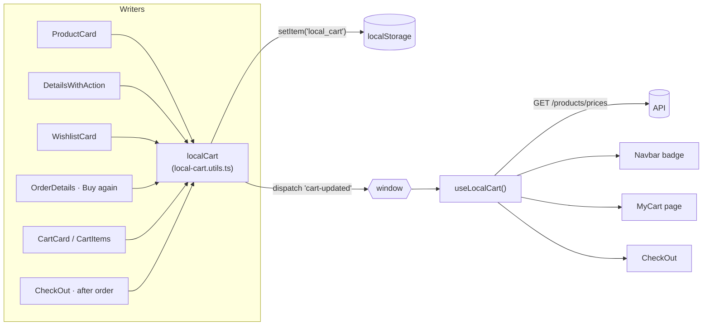
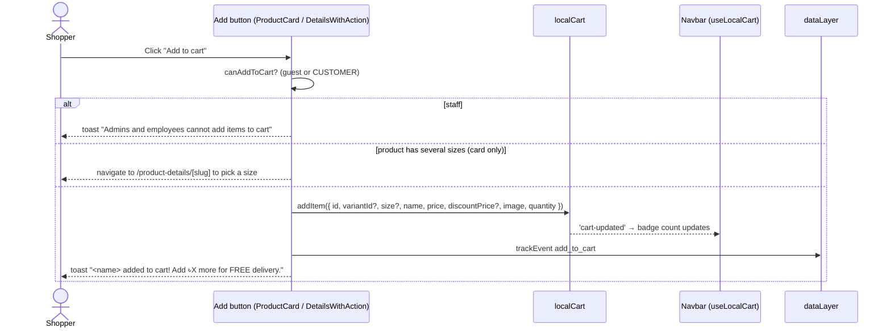
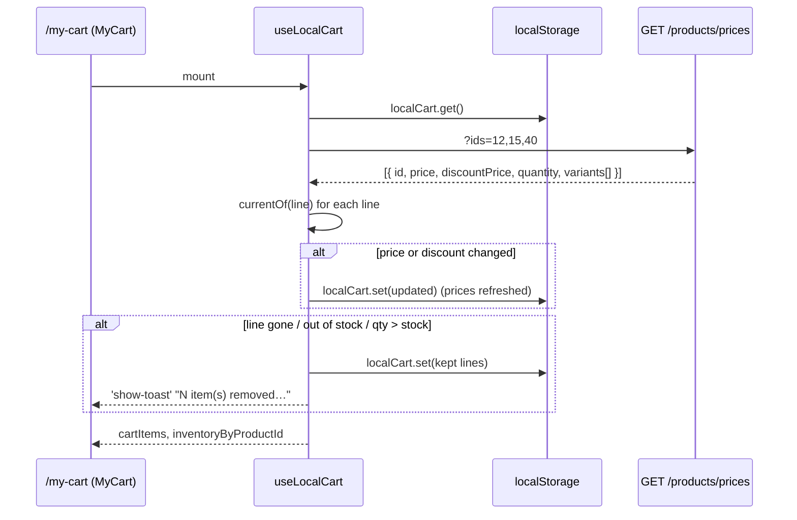

# Cart Module — Frontend Technical Documentation

> **Scope:** everything the Natura Care client (Next.js 15, App Router) does with the **shopping cart**: how lines are added from across the storefront, how the cart is stored and kept in sync, how prices and stock are re-checked against the API, the `/my-cart` page, the free-delivery nudge, and the hand-off to checkout.
>
> **Audience:** frontend engineers joining or maintaining the project.
>
> **Related:** [Project README](../README.md) (run, build, Docker) · [Product module](./product.md) (product types, sizes, add-to-cart buttons) · [User module](./user.md) (roles, session, middleware) · [Auth module](./auth.md) · [Analytics / GTM concepts](./concepts/analytics-gtm-ga4.md) · [Coding conventions](../claude-docs/basic-instructions.md)

| | |
|---|---|
| **Module root** | [`src/modules/cart/`](../src/modules/cart/) |
| **Storefront route** | `/my-cart` (public route group) → hands off to `/check-out` |
| **Storage** | Browser `localStorage`, key `local_cart` — **no server-side cart** |
| **Backend resource** | `GET /products/prices?ids=…` on `NEXT_PUBLIC_API_BASE_URL` (price + stock re-check) |
| **Roles** | Guest, `CUSTOMER` (use the cart) · `ADMIN`, `EMPLOYEE` (blocked; their cart is wiped) |
| **Last reviewed** | 2026-10-24 |

---

## Table of Contents

1. [Overview](#1-overview)
2. [Tech Stack](#2-tech-stack)
3. [File Architecture](#3-file-architecture)
4. [Routing & Access Control](#4-routing--access-control)
   - [4.1 Route](#41-route)
   - [4.2 Middleware rules](#42-middleware-rules)
   - [4.3 In-app role guards](#43-in-app-role-guards)
5. [Domain Model & Business Logic](#5-domain-model--business-logic)
   - [5.1 What a cart line is](#51-what-a-cart-line-is)
   - [5.2 Pricing rules](#52-pricing-rules)
   - [5.3 Stock rules](#53-stock-rules)
   - [5.4 Free delivery](#54-free-delivery)
6. [State Management (the "front store")](#6-state-management-the-front-store)
   - [6.1 `localCart` — the store](#61-localcart--the-store)
   - [6.2 Window events — the change bus](#62-window-events--the-change-bus)
   - [6.3 `useLocalCart` — the reactive view](#63-uselocalcart--the-reactive-view)
7. [Workflows](#7-workflows)
   - [7.1 Add to cart](#71-add-to-cart)
   - [7.2 Opening the cart: re-price & re-stock](#72-opening-the-cart-re-price--re-stock)
   - [7.3 Change quantity](#73-change-quantity)
   - [7.4 Remove a line / clear cart (with undo)](#74-remove-a-line--clear-cart-with-undo)
   - [7.5 Checkout hand-off & clearing after an order](#75-checkout-hand-off--clearing-after-an-order)
8. [The `/my-cart` Page](#8-the-my-cart-page)
9. [Entry Points Outside the Module](#9-entry-points-outside-the-module)
10. [Analytics Events](#10-analytics-events)
11. [API Reference](#11-api-reference)
12. [Types](#12-types)
13. [Constants](#13-constants)
14. [Hooks](#14-hooks)
15. [Utilities](#15-utilities)
16. [Reusable Components](#16-reusable-components)
17. [Business Rules Summary](#17-business-rules-summary)
18. [Known Issues & Technical Debt](#18-known-issues--technical-debt)
19. [How-To Recipes](#19-how-to-recipes)

---

## 1. Overview

The cart is a **client-side cart**. It lives in the browser's `localStorage`, works the same for guests and signed-in customers, and needs no API call to add, change or remove a line. The server is only asked one question: *"what do these products cost right now, and how many are in stock?"* — and its answer always wins.

| Audience | Where | What they can do |
|---|---|---|
| **Guest & Customer** | Product card, product details, wishlist, order details ("Buy again") | Add a product (or one size of it) to the cart. |
| **Guest & Customer** | Navbar | See the number of lines in the cart; open `/my-cart`. |
| **Guest & Customer** | `/my-cart` | Change quantities (capped by stock), remove lines or clear the cart with **Undo**, see savings and free-delivery progress, proceed to checkout. |
| **Guest & Customer** | `/check-out` | The cart is read to build the order payload; it is cleared after the order is placed. |
| **Admin & Employee** | — | Cannot add to cart, cannot open `/my-cart` or `/check-out`, and any cart left in the browser is wiped. |

Key design decisions:

- **`localStorage` is the source of truth for *what* is in the cart; the API is the source of truth for *price and stock*.** Prices saved at add-to-cart time are placeholders and are overwritten on every cart read ([§7.2](#72-opening-the-cart-re-price--re-stock)).
- **A line is a product, or one size of a product.** Two sizes of the same product are two lines, keyed by `cartLineKey` ([§5.1](#51-what-a-cart-line-is)).
- **No global state library.** A small storage wrapper (`localCart`) plus a `cart-updated` window event plus a hook (`useLocalCart`) gives every component a live view of the cart ([§6](#6-state-management-the-front-store)).
- **Lines that can't be bought are removed, not flagged.** Product archived, size retired, out of stock, or quantity above stock → the line is dropped and the shopper is told ([§5.3](#53-stock-rules)).
- **The order total is calculated by the server.** The cart sends only `{ productId, variantId?, quantity }` per line; the backend re-prices everything when the order is created.
- **A server-side cart exists in the code but is unused.** `useCart` and the `ICart` types target `/cart` endpoints; the UI was switched to the local cart and the API version is kept in comments marked `KEEP IT` ([§18](#18-known-issues--technical-debt)).

[↑ Back to top](#table-of-contents)

---

## 2. Tech Stack

| Concern | Technology | Used for |
|---|---|---|
| Framework | **Next.js 15** (App Router), **React 19** | `/my-cart` route, `next/dynamic` code-splitting, `next/image`, `next/link` |
| Language | **TypeScript** | Typed cart lines, pricing helpers, API contracts |
| Persistence | **`localStorage`** (`local_cart`) | The cart itself |
| Change notification | **DOM `window` events** (`cart-updated`, `cart-cleared`) | Re-rendering every cart consumer after a write |
| Server state | **TanStack Query v5** via the shared [`useGet`](../src/hooks/api/useGet.ts) hook | `GET /products/prices`, `GET /free-delivery-settings/active-free-delivery` |
| HTTP | **Axios** ([`axiosInstance`](../src/lib/axios/axiosInstance.ts)) | Requests, auth header, error envelope |
| Styling | **Tailwind CSS** + project color tokens (`greenPrimary-*`, `neutralPrimary-*`, `destructive-*`, `success-*`) | All cart UI |
| UI primitives | **shadcn/ui** (`Separator`, `Skeleton`), **lucide-react** icons, `react-icons` (navbar bag) | Layout & icons |
| Notifications | **sonner** (`toast`, with an **Undo** action) | Add / remove / clear feedback |
| Confirmation | Project [`useConfirm`](../src/hooks/useConfirm.ts) (promise-based dialog) | "Clear cart?" |
| Analytics | GTM `dataLayer` via [`trackEvent`](../src/lib/analytics/gtm.events.ts) | `add_to_cart`, `remove_from_cart`, `begin_checkout`, `purchase` |
| Access control | Next.js **middleware** ([`src/middleware.ts`](../src/middleware.ts)) + `jwt-decode` | Keeping staff off `/my-cart` and `/check-out` |

[↑ Back to top](#table-of-contents)

---

## 3. File Architecture

```text
src/
├── app/(public)/my-cart/
│   └── page.tsx                       # Route: metadata + dynamic import of <MyCart/>
│
├── modules/cart/
│   ├── hooks/
│   │   ├── useLocalCart.ts            # ★ The reactive cart: read, re-price, re-stock, role guard
│   │   └── useCart.ts                 # Server cart (GET /cart) — NOT USED, kept for a future switch
│   ├── utils/
│   │   ├── local-cart.utils.ts        # ★ localCart store (get/set/addItem/removeItem/clear), line keys
│   │   └── cart-pricing.utils.ts      # ★ linePricing, cartTotals, formatTk — shared with checkout
│   ├── types/
│   │   └── cart.types.ts              # ICart / ICartItem (server cart), ICartCard (checkout row props)
│   ├── constants/
│   │   └── cart.constants.ts          # Mock data from the design phase — NOT USED
│   └── public/                        # Storefront UI
│       ├── MyCart.tsx                 # Page composition
│       ├── CheckoutSteps.tsx          # Cart → Details & payment → Order placed
│       ├── FreeDeliveryProgress.tsx   # "Add ৳X more for FREE delivery" bar
│       ├── CartItems.tsx              # List card: header, Clear cart, lines, Continue shopping
│       ├── CartCard.tsx               # One line: image, price, stepper, line total, remove
│       ├── OrderSummary.tsx           # Totals, savings, Proceed to Checkout, trust badges
│       ├── MobileCheckoutBar.tsx      # Pinned total + Checkout on < lg screens
│       ├── EmptyCart.tsx              # Empty state
│       ├── CartCardSkeleton.tsx       # Loading placeholder (currently unused)
│       └── OrderSummarySkeleton.tsx   # Loading placeholder (currently unused)
│
├── modules/free-delivery/hooks/
│   ├── useFreeDelivery.ts             # Active free-delivery threshold
│   └── useFreeDeliveryNudge.ts        # Toast text after add-to-cart, reads localCart
│
└── middleware.ts                      # GUEST_CUSTOMER_ONLY_ROUTES = ["/my-cart", "/check-out"]
```

**Ownership rule:** the cart module owns the storage format. Other modules **write** only through `localCart.addItem()` and **read** only through `useLocalCart()` / `localCart.get()` and the pricing helpers — never through `localStorage` directly.

[↑ Back to top](#table-of-contents)

---

## 4. Routing & Access Control

### 4.1 Route

| Path | File | Rendering |
|---|---|---|
| `/my-cart` | [`app/(public)/my-cart/page.tsx`](../src/app/(public)/my-cart/page.tsx) | Server component that exports `metadata` (`"Cart \| Natura Care Limited"`) and renders `<MyCart/>` through `next/dynamic` with `<LoadingPage/>` as the fallback. `MyCart` is a client component because the cart only exists in the browser. |

`/my-cart/` is disallowed in [`robots.ts`](../src/app/robots.ts) — it is a per-browser page with no SEO value.

### 4.2 Middleware rules

[`src/middleware.ts`](../src/middleware.ts) puts the cart and checkout in their own list:

```ts
const GUEST_CUSTOMER_ONLY_ROUTES = ["/my-cart", "/check-out"];
```

| Visitor | `/my-cart`, `/check-out` |
|---|---|
| Guest (no `accessToken` cookie) | ✅ Allowed |
| `CUSTOMER` | ✅ Allowed |
| `EMPLOYEE` | ↪ Redirected to `/dashboard` (`EMPLOYEE_ROUTES[0]`) |
| `ADMIN` | ↪ Redirected to `/dashboard` (`ADMIN_ONLY_ROUTES[0]`) |
| Unknown role | ↪ Redirected to `/` |

> The guest/staff check uses `GUEST_CUSTOMER_ONLY_ROUTES.includes(pathname)` — an **exact** match. `/my-cart` is matched; `/my-cart/` with a trailing slash falls through to the general role rules, which still let customers and guests in.

### 4.3 In-app role guards

Middleware stops staff from *opening* the cart, but a staff member could still have items in `localStorage` from an earlier guest session on the same browser. Three guards cover that:

| Guard | Where | Effect |
|---|---|---|
| **Hide the bag icon** | [`Navbar.tsx`](../src/components/layout/navbar/Navbar.tsx) | Cart link rendered only when `!isUserAdmin && !isUserEmployee`. |
| **Block add-to-cart** | `ProductCard`, `DetailsWithAction` | `canAddToCart = !userInfo?.role \|\| userInfo.role === "CUSTOMER"`; otherwise a toast: *"Admins and employees cannot add items to cart"*. |
| **Wipe & ignore the cart** | [`useLocalCart`](../src/modules/cart/hooks/useLocalCart.ts) | `isRestrictedUser` (role `ADMIN` / `EMPLOYEE`) → `localCart.clear()`, every return value is empty/zero, and `/products/prices` is not called. |

[↑ Back to top](#table-of-contents)

---

## 5. Domain Model & Business Logic

### 5.1 What a cart line is

A line is stored as an `ILocalCartItem` ([§12](#12-types)):

```ts
{ id: 12, variantId: 31, size: "100ml", name: "Onion Hair Oil - 100ml",
  price: 450, discountPrice: 399, image: "https://…/1.webp", quantity: 2 }
```

- **Identity** is `cartLineKey(item) = "${id}:${variantId ?? ""}"`. A `SIMPLE` / `COMBO` product is `"12:"`; each size of a `VARIABLE` product is its own line (`"12:31"`, `"12:32"`). Use `isSameLine(a, b)` to compare — never compare `id` alone.
- **Adding an existing line adds to its quantity**; it does not create a duplicate.
- **The size is stored twice** — as `variantId` / `size`, and inside `name` (`"<product> - <size>"`) — so cart and checkout can render a line without another lookup.
- **Order is preserved.** Lines appear in the order they were added; Undo puts a removed line back at its old index.

### 5.2 Pricing rules

All maths lives in [`cart-pricing.utils.ts`](../src/modules/cart/utils/cart-pricing.utils.ts) and is shared by the cart page, checkout, the promo bar and the free-delivery nudge, so every screen shows the same number.

| Rule | Implementation |
|---|---|
| The **unit price** is `discountPrice` when it is `> 0` **and** lower than `price`; otherwise `price`. | `linePricing().unit` |
| Line total = unit × quantity. | `lineTotal` |
| Line savings = (price − discountPrice) × quantity, only when discounted. | `lineSavings` |
| Percent badge = `round((price − discount) / price × 100)`. | `percentOff` |
| Cart **subtotal** (what free delivery is compared against) = Σ line totals. | `cartTotals().total` |
| "Items (n)" in the summary is the **regular** price total; savings are shown as a separate negative line. | `cartTotals().original`, `.savings` |
| Old carts stored prices as strings (`"550"`) — values are coerced with `Number(x) \|\| 0`. | `num()` |
| Currency is shown as `৳1,234.5` (`en-BD`, max 2 decimals). | `formatTk()` |

Delivery charge and coupons are **not** applied in the cart; the summary shows *"Calculated at checkout"* (or **FREE** once the threshold is met) and *"Have a coupon? Apply it at checkout."*

### 5.3 Stock rules

Stock comes from `GET /products/prices` (for a sized line, the size's own stock). With that answer, `useLocalCart` enforces:

| Situation | Behavior |
|---|---|
| Product missing from the answer (archived / not `ACTIVE`) | Line **removed** |
| Line has a `variantId` the product no longer lists (size retired) | Line **removed** |
| Line has no `variantId` but the product now has sizes | Line **removed** |
| Stock is `0` | Line **removed** |
| Line quantity **>** stock | Line **removed** (not clamped — see [§18](#18-known-issues--technical-debt)) |
| Stock between 1 and 5 | `CartCard` shows *"Only N left in stock"* (`LOW_STOCK = 5`) |
| Quantity = stock | `+` button disabled ("No more in stock"); a forced increase shows a toast |

After any removal the cart is saved, `cart-updated` fires, and a `show-toast` event is dispatched with *"N item(s) removed from cart due to stock issues."*

### 5.4 Free delivery

The threshold is the `minOrderAmount` of the first active free-delivery setting (`useFreeDelivery`). When there is one:

- `MyCart` shows [`FreeDeliveryProgress`](../src/modules/cart/public/FreeDeliveryProgress.tsx) (`subtotal` vs `threshold`, progress bar, "Shop more" link).
- `OrderSummary` shows Delivery **FREE** once `totals.total >= threshold`.
- After every add-to-cart, [`useFreeDeliveryNudge`](../src/modules/free-delivery/hooks/useFreeDeliveryNudge.ts) appends *"Add ৳X more for FREE delivery."* or *"You've unlocked FREE delivery!"* to the success toast (toast lasts 2.5 s instead of 0.5 s).

The backend makes the final call at order creation (delivery is waived only when the server-computed subtotal reaches the same minimum).

[↑ Back to top](#table-of-contents)

---

## 6. State Management (the "front store")

There is no Redux / Zustand / Context for the cart. The store is three small pieces:



### 6.1 `localCart` — the store

[`local-cart.utils.ts`](../src/modules/cart/utils/local-cart.utils.ts) — a plain object, safe to import anywhere (each method returns early on the server).

| Method | Does | Fires `cart-updated` |
|---|---|---|
| `get()` | Parses `local_cart`; migrates the old `comparePrice` field to `discountPrice`. Returns `[]` on the server. | — |
| `set(cart)` | Replaces the whole cart. | ✅ |
| `addItem(item)` | Merges by `isSameLine` (adds quantity) or appends. | ✅ (via `set`) |
| `removeItem(id, variantId?)` | Removes one line. | ✅ (via `set`) |
| `clear()` | Removes the key. | ✅ |

### 6.2 Window events — the change bus

| Event | Dispatched by | Listened to by | Purpose |
|---|---|---|---|
| `cart-updated` | `localCart.set` / `clear`, stock clean-up | every `useLocalCart` instance | Re-read `localStorage` and re-render |
| `cart-cleared` | `useLocalCart` after wiping a staff cart | every `useLocalCart` instance | Same as above |
| `show-toast` (`detail: { message, type }`) | `useLocalCart` after a stock clean-up | **nobody** (see [§18](#18-known-issues--technical-debt)) | Tell the shopper lines were removed |

These are same-tab events. Changes made in **another tab** are not picked up until the page is reloaded (no `storage` listener).

### 6.3 `useLocalCart` — the reactive view

[`useLocalCart.ts`](../src/modules/cart/hooks/useLocalCart.ts) is the only way components should *read* the cart. Each call:

1. Loads `localCart.get()` into state and subscribes to `cart-updated` / `cart-cleared`.
2. Works out the role from `useCurrentUser()`; for `ADMIN` / `EMPLOYEE` it clears and short-circuits.
3. Calls `GET /products/prices?ids=<unique product ids>` (query key `["getCartProductCurrentPrice", ids]`, so the navbar, cart and checkout share one cached request).
4. Writes changed `price` / `discountPrice` back to `localStorage` (only when something actually changed, to avoid an event loop).
5. Removes lines that fail the stock rules ([§5.3](#53-stock-rules)).
6. Derives `subTotal`, `cartItemsForOrder`, `inventoryByProductId`, `hasOutOfStockItems`.

See [§14](#14-hooks) for the full return shape.

[↑ Back to top](#table-of-contents)

---

## 7. Workflows

### 7.1 Add to cart



- **Product card:** quantity is always `1`. A `VARIABLE` product with one size adds that size; with several, the shopper is sent to the details page.
- **Product details:** adds the selected size and the chosen quantity (already capped by stock). **Buy Now** = add, then `router.push("/check-out")`.
- Price values are passed as **strings**; `cart-pricing.utils` coerces them.

### 7.2 Opening the cart: re-price & re-stock



`currentOf(line, prices)` picks the price/stock that applies: the matching size in `variants[]` when the line has a `variantId`; the product itself when it has no sizes; `undefined` (= cannot be bought) otherwise.

### 7.3 Change quantity

In [`CartCard`](../src/modules/cart/public/CartCard.tsx), `setQuantity(next)`:

1. Ignores `next < 1` (the `−` button is disabled at 1; use the bin to remove).
2. If stock is known and `next > stock` → `toast.error("Only N of "<name>" in stock.")`, no change.
3. Otherwise rewrites the matching line via `localCart.set(...)`; `cart-updated` re-renders the page, summary, mobile bar and navbar.

### 7.4 Remove a line / clear cart (with undo)

[`CartItems`](../src/modules/cart/public/CartItems.tsx):

| Action | Steps |
|---|---|
| **Remove** (bin icon) | Remember the line's index → `trackEvent remove_from_cart` → `localCart.removeItem(id, variantId)` → toast *"Removed "<name>""* with **Undo** (5 s). |
| **Clear cart** | `useConfirm` dialog (*"Remove all items from your cart?"*, danger variant) → `remove_from_cart` for every line → `localCart.set([])` → toast *"Your cart was cleared"* with **Undo** (6 s). |
| **Undo** | `restore(removed)` re-inserts each line at its old index, skipping any line that was re-added meanwhile. |

When the last line goes, `MyCart` switches to `<EmptyCart/>`.

### 7.5 Checkout hand-off & clearing after an order

[`CheckOut.tsx`](../src/modules/checkout/public/CheckOut.tsx) uses the same hook:

```ts
const { cartItems, cartItemsForOrder, subTotal, totalCartItems } = useLocalCart();
const totals = cartTotals(cartItems);
```

- `begin_checkout` is tracked once, when the cart has items.
- The order request sends `cartItemsForOrder` — `[{ productId, variantId?, quantity }]` — **not** prices. `POST /order/create-order` re-prices every line on the server.
- On success: `localCart.clear()` → invoice dialog → `purchase` event.

[↑ Back to top](#table-of-contents)

---

## 8. The `/my-cart` Page

[`MyCart.tsx`](../src/modules/cart/public/MyCart.tsx) composition:

```text
<Hero "Shopping Cart" + breadcrumb "Cart">
<main>
  ├─ cart empty → <EmptyCart/>                       (icon, message, "Continue Shopping" → /product)
  └─ cart has lines
     ├─ <CheckoutSteps current={0}/>                  Cart ● ─ Details & payment ○ ─ Order placed ○
     ├─ <FreeDeliveryProgress/>                       only when a threshold is active
     ├─ grid  [ 1fr | 360px (lg) / 400px (xl) ]
     │   ├─ <CartItems/>                              header, Clear cart, <CartCard/> × n, Continue shopping
     │   └─ <aside sticky top-32> <OrderSummary/>     Items, Product discounts, Delivery, Subtotal, CTA, trust list
     └─ <MobileCheckoutBar/>                          fixed bottom bar, hidden at lg+
```

Responsive / UX details worth knowing:

- Below `lg` the summary drops under the item list, so `MobileCheckoutBar` pins the total and a **Checkout** button to the bottom (respecting `env(safe-area-inset-bottom)`); `main` gets `pb-32` so it never covers content.
- `CartCard` falls back to an icon when an image URL fails (`onError`), shows a `−N%` badge, strikes through the regular price and shows "You save ৳X" per line.
- Accessibility: stepper buttons have `aria-label`s, the quantity is `aria-live="polite"`, the free-delivery bar is `role="progressbar"` inside a `role="status"` region, the summary uses `<dl>`, steps use `aria-current="step"`.
- Animations use `animate-in fade-in` with `motion-reduce:animate-none`.

[↑ Back to top](#table-of-contents)

---

## 9. Entry Points Outside the Module

| Module / file | Uses | Notes |
|---|---|---|
| [`product/shared/ProductCard.tsx`](../src/modules/product/shared/ProductCard.tsx) | `localCart.addItem` | Qty 1; multi-size products redirect to details. See [Product module §11](./product.md#11-cart-integration). |
| [`product/public/product-details/DetailsWithAction.tsx`](../src/modules/product/public/product-details/DetailsWithAction.tsx) | `localCart.addItem` | Selected size + qty; **Buy Now** goes to `/check-out`. |
| [`wishlist/customer/WishlistCard.tsx`](../src/modules/wishlist/customer/WishlistCard.tsx) | `addWishlistItemToCart` → `localCart.addItem` | Skips unavailable products and products with sizes. "Add all" in `WishList.tsx` then routes to `/my-cart`. Items stay in the wishlist. |
| [`order/customer/OrderDetails.tsx`](../src/modules/order/customer/OrderDetails.tsx) | `localCart.addItem` | **Buy again**: re-adds available lines with their size; price is a placeholder the cart re-prices. Several items → `/my-cart`. |
| [`components/layout/navbar/Navbar.tsx`](../src/components/layout/navbar/Navbar.tsx) | `useLocalCart().totalCartItems` | Badge shows the number of **lines** (not units), `99+` cap. |
| [`components/layout/promo-bar/PromotionBar.tsx`](../src/components/layout/promo-bar/PromotionBar.tsx) | `formatTk` | Currency formatting only. |
| [`free-delivery/hooks/useFreeDeliveryNudge.ts`](../src/modules/free-delivery/hooks/useFreeDeliveryNudge.ts) | `localCart.get`, `cartTotals`, `formatTk` | Toast text after add-to-cart. |
| [`checkout/public/*`](../src/modules/checkout/public/) | `useLocalCart`, `localCart.clear`, `cartTotals`, `linePricing`, `formatTk`, `ICartCard` | See [§7.5](#75-checkout-hand-off--clearing-after-an-order). |

[↑ Back to top](#table-of-contents)

---

## 10. Analytics Events

Sent to the GTM `dataLayer` through `trackEvent()` (typed by `GA4Event` in [`gtm-events.types.ts`](../src/lib/analytics/gtm-events.types.ts)); only when analytics is enabled. See [Analytics / GTM concepts](./concepts/analytics-gtm-ga4.md).

| Event | Fired from | Params |
|---|---|---|
| `add_to_cart` | `ProductCard` | `item_id` (SKU or `PROD_<id>`), `item_name`, `quantity: 1`, `value` (`product.price`), `currency: "BDT"` |
| `add_to_cart` | `DetailsWithAction` (Add to Cart, Buy Now) | `item_id`, `item_name` (with size), `quantity`, `value` (price × qty), `currency` |
| `add_to_cart` | `WishlistCard` | `item_id`, `item_name`, `quantity: 1`, `value` (`discountPrice ?? price`), `currency` |
| `remove_from_cart` | `CartItems` (remove, and once per line on Clear cart) | `item_id: PROD_<id>`, `item_name`, `quantity`, `value` (line total), `currency` |
| `begin_checkout` | `CheckOut` (once per mount) | `value` (subtotal), `currency`, `items[]` (`item_id`, `item_name`, `quantity`, `price`) |
| `purchase` | `CheckOut` (order success) | `transaction_id`, `value` (grand total), `currency`, `items[]` |

> Undo does **not** send a new `add_to_cart`. "Buy again" from an order sends no event.

[↑ Back to top](#table-of-contents)

---

## 11. API Reference

| Method & path | Called by | Auth | Purpose |
|---|---|---|---|
| `GET /products/prices?ids=1,2,3` | `useLocalCart` | Optional (`IdentifyViewerGuard`) | Current price, discount and stock per product, plus `variants[]` for sized products. **Guests and customers only get `ACTIVE` products** — a missing id means "can no longer be bought". Admins get every status. |
| `GET /free-delivery-settings/active-free-delivery` | `useFreeDelivery` | Public | Active threshold(s); the first `minOrderAmount` is used. |
| `POST /order/create-order` | `CheckOut` | Optional | Places the order from `cartItemsForOrder`; server re-prices and takes stock. |
| `GET /cart`, `PATCH /cart/items/:id`, `DELETE /cart/items/:id` | `useCart`, commented-out components | JWT | **Unused** server-cart API. |

Response of `GET /products/prices` (inside the standard `{ statusCode, success, message, data }` envelope):

```json
[
  {
    "id": 12, "price": 450, "discountPrice": 399, "quantity": 120,
    "variants": [
      { "id": 31, "price": 450, "discountPrice": 0, "quantity": 40 },
      { "id": 32, "price": 800, "discountPrice": 720, "quantity": 0 }
    ]
  }
]
```

`discountPrice` is `0` when there is no discount; the pricing helpers treat `0` as "no discount".

[↑ Back to top](#table-of-contents)

---

## 12. Types

| Type | File | Used for |
|---|---|---|
| `ILocalCartItem` | [`utils/local-cart.utils.ts`](../src/modules/cart/utils/local-cart.utils.ts) | **The** cart line. `id` (product id), `variantId?`, `size?`, `name`, `price`, `discountPrice?`, `image`, `quantity`. |
| `IPriceQuantity`, `IProductPriceQuantity` | [`hooks/useLocalCart.ts`](../src/modules/cart/hooks/useLocalCart.ts) (local) | Shape of `GET /products/prices`. |
| `ICartItemForOrder` | `hooks/useLocalCart.ts` (local) | `{ productId, variantId?, quantity }` — the order payload line. |
| `ICartCard` | [`types/cart.types.ts`](../src/modules/cart/types/cart.types.ts) | Props of the checkout row `CheckOutItem`. (`CartCard.tsx` declares its own `ICartCard` props interface — same name, different shape.) |
| `ICart`, `ICartItem` | `types/cart.types.ts` | Server cart (`GET /cart`). Unused. |
| `Totals` | `public/OrderSummary.tsx` | `ReturnType<typeof cartTotals>` → `{ units, original, savings, total }`. |

[↑ Back to top](#table-of-contents)

---

## 13. Constants

| Constant | Where | Value / meaning |
|---|---|---|
| `CART_KEY` | `local-cart.utils.ts` | `"local_cart"` — the `localStorage` key. **Changing it empties every shopper's cart.** |
| `LOW_STOCK` | `CartCard.tsx` | `5` — show "Only N left" at or below this stock. |
| `STEPS` | `CheckoutSteps.tsx` | `["Cart", "Details & payment", "Order placed"]`. |
| `TRUST` | `OrderSummary.tsx` | Cash on delivery · Delivery across Bangladesh · 100% genuine Natura products. |
| `GUEST_CUSTOMER_ONLY_ROUTES` | `src/middleware.ts` | `["/my-cart", "/check-out"]`. |
| `cartItems`, `products` | [`constants/cart.constants.ts`](../src/modules/cart/constants/cart.constants.ts) | Design-phase mock data. **Not imported anywhere** — safe to delete. |

Toast durations (in components): add-to-cart 0.5 s (2.5 s with free-delivery nudge), remove-with-undo 5 s, clear-with-undo 6 s.

[↑ Back to top](#table-of-contents)

---

## 14. Hooks

### Module hooks

**`useLocalCart()`** — [`hooks/useLocalCart.ts`](../src/modules/cart/hooks/useLocalCart.ts)

| Returns | Type | Meaning |
|---|---|---|
| `cartItems` | `ILocalCartItem[]` | Current lines (re-priced). `[]` for staff. |
| `totalCartItems` | `number` | Number of **lines** (navbar badge). |
| `cartItemsForOrder` | `ICartItemForOrder[]` | Order payload lines. |
| `subTotal` | `number` | Σ unit × qty (same rule as `cartTotals().total`). |
| `discount` | `0` | Placeholder, always `0`. |
| `inventoryByProductId` | `Record<string, number>` | Stock per line, keyed by **`cartLineKey`** (despite the name). |
| `hasOutOfStockItems` | `boolean` | Any line with stock `0`. |
| `isProductPriceLoading` | `boolean` | `/products/prices` in flight. |
| `isRestrictedUser` | `boolean` | Current user is `ADMIN` / `EMPLOYEE`. |
| `clearCartForRestrictedUser` | `() => void` | Clears the cart if restricted (e.g. on logout). |

**`useCart()`** — [`hooks/useCart.ts`](../src/modules/cart/hooks/useCart.ts) — server cart via `GET /cart`, fetched only when signed in. **Not used by any live component.**

### Shared hooks used

| Hook | From | Why |
|---|---|---|
| `useGet` | [`hooks/api/useGet.ts`](../src/hooks/api/useGet.ts) | TanStack Query wrapper (`endpoint, queryKey, params, shouldFetch`). |
| `useCurrentUser` | `modules/user/hooks/useCurrentUser` | Role for the staff guard. |
| `useFreeDelivery` | `modules/free-delivery/hooks/useFreeDelivery` | Threshold. |
| `useFreeDeliveryNudge` | `modules/free-delivery/hooks/useFreeDeliveryNudge` | Add-to-cart toast text. |
| `useConfirm` | [`hooks/useConfirm.ts`](../src/hooks/useConfirm.ts) | "Clear cart?" dialog (requires `<ConfirmProvider>`). |

[↑ Back to top](#table-of-contents)

---

## 15. Utilities

**[`local-cart.utils.ts`](../src/modules/cart/utils/local-cart.utils.ts)**

| Export | Signature | Notes |
|---|---|---|
| `localCart` | `{ get, set, addItem, removeItem, clear }` | See [§6.1](#61-localcart--the-store). |
| `cartLineKey` | `(item: { id, variantId? }) => string` | `"12:"` / `"12:31"`. Use as React `key` and map key. |
| `isSameLine` | `(a, b) => boolean` | Compares line keys. |

**[`cart-pricing.utils.ts`](../src/modules/cart/utils/cart-pricing.utils.ts)**

| Export | Signature | Returns |
|---|---|---|
| `linePricing` | `(item: Pick<ILocalCartItem, "price" \| "discountPrice" \| "quantity">)` | `{ price, unit, hasDiscount, quantity, lineTotal, lineOriginal, lineSavings, percentOff }` |
| `cartTotals` | `(items: ILocalCartItem[])` | `{ units, original, savings, total }` |
| `formatTk` | `(value: number) => string` | `"৳1,234.5"` |

Rule of thumb: **any number about the cart shown to a shopper must come from these two functions**, so cart, checkout and toasts never disagree.

[↑ Back to top](#table-of-contents)

---

## 16. Reusable Components

### Shared components used by this module

| Component | From | Used in |
|---|---|---|
| `Hero` | `components/layout/hero/Hero` | `MyCart` page header |
| `CustomBreadCrumb` | `components/primitives/CustomBreadCrumb` | `MyCart` |
| `LoadingPage` | `components/feedback/loading/LoadingPage` | Route `loading` fallback |
| `Separator`, `Skeleton` | `components/ui/*` (shadcn) | `OrderSummary`, skeletons |
| `toast` | `sonner` (global `<Toaster>` in `app/layout.tsx`) | All feedback |

### Module components designed for reuse

| Component | Props | Reuse notes |
|---|---|---|
| [`CheckoutSteps`](../src/modules/cart/public/CheckoutSteps.tsx) | `current?: number` (0–2) | Progress for the whole purchase; reuse on checkout/success screens. |
| [`FreeDeliveryProgress`](../src/modules/cart/public/FreeDeliveryProgress.tsx) | `subtotal`, `threshold`, `compact?` | Renders nothing when `threshold <= 0`. `compact` drops the helper line (for tight spots like checkout). |
| [`OrderSummary`](../src/modules/cart/public/OrderSummary.tsx) | `totals`, `freeDeliveryThreshold?` | Pure; pass `cartTotals(items)`. |
| [`MobileCheckoutBar`](../src/modules/cart/public/MobileCheckoutBar.tsx) | `total`, `savings`, `units` | Fixed, `lg:hidden`; add bottom padding to the page using it. |
| [`CartCard`](../src/modules/cart/public/CartCard.tsx) | `item`, `inventoryQuantity?`, `onRemove` | Writes quantity straight to `localCart`. |
| [`EmptyCart`](../src/modules/cart/public/EmptyCart.tsx) | — | Static empty state. |

[↑ Back to top](#table-of-contents)

---

## 17. Business Rules Summary

1. The cart is stored in the browser only (`localStorage.local_cart`); it is per browser, not per account.
2. Guests and customers can use the cart; admins and employees cannot, and any cart they hold is wiped.
3. A line is a product or one size of a product; adding the same line again increases its quantity.
4. Prices and stock always come from `GET /products/prices`; stored prices are only placeholders.
5. The charged unit price is the discount price when it is above 0 and lower than the regular price.
6. A line is removed when the product or size can't be bought, is out of stock, or its quantity exceeds stock.
7. Quantity is at least 1 and at most the current stock.
8. Free delivery is shown when the cart subtotal reaches the active threshold; delivery charge and coupons are applied at checkout.
9. The order sends only product id, size id and quantity; the server computes the totals.
10. The cart is cleared after a successful order.

[↑ Back to top](#table-of-contents)

---

## 18. Known Issues & Technical Debt

| # | Issue | Impact | Suggested fix |
|---|---|---|---|
| 1 | `show-toast` event has **no listener**. | Shoppers are not told when lines are removed for stock reasons; they just disappear. | Call `toast.warning(...)` from `sonner` directly in `useLocalCart`. |
| 2 | Quantity above stock **removes** the line instead of clamping it. | Customer asking for 5 when 3 remain loses the line entirely. | Return `{ ...item, quantity: inventory.quantity }` (already sketched in a comment). |
| 3 | No `storage` event listener. | A second tab shows a stale cart and badge until reload. | `window.addEventListener("storage", e => e.key === "local_cart" && updateCart())`. |
| 4 | Each `useLocalCart()` call runs its own effects (navbar + page + checkout). | Price write-backs / clean-ups can run more than once; the network call is deduped by React Query. | Lift into a `CartProvider` context, or a tiny external store with `useSyncExternalStore`. |
| 5 | `hasOutOfStockItems` is effectively always `false` (those lines are removed first). | Dead flag. | Remove, or keep lines and use the flag to block checkout. |
| 6 | `subTotal` duplicates `cartTotals().total`; `discount` is a constant `0`; `setInventoryData` state is never read. | Two sources of truth for the subtotal. | Derive from `cartTotals` and delete the leftovers. |
| 7 | `inventoryByProductId` is keyed by line key, not product id. | Misleading name. | Rename to `stockByLine`. |
| 8 | Server returns `discountPrice: 0`, local lines may hold `undefined` → treated as "changed" once. | One extra `localStorage` write per new line. | Normalize `0 → undefined` before comparing. |
| 9 | `add_to_cart` value differs by entry point (regular price vs discount price); `begin_checkout` uses `String(item.id)` while other events use `PROD_<id>` / SKU. | Inconsistent GA4 revenue / item reports. | Use `linePricing().unit` and one `productItemId()` helper everywhere. |
| 10 | Unused code: `useCart`, `ICart`/`ICartItem`, `cart.constants.ts`, both skeletons, large commented `KEEP IT` blocks. | Noise for new developers. | Move the server-cart version to a branch or delete; keep this doc as the reference. |
| 11 | `console.log` when wiping a staff cart. | Console noise in production. | Remove. |
| 12 | Middleware staff check is an exact `includes(pathname)` match. | `/check-out/` (trailing slash) skips the staff redirect (in-app guards still apply). | Use `startsWith` like the other route lists. |

[↑ Back to top](#table-of-contents)

---

## 19. How-To Recipes

### Add something to the cart from a new place

```ts
import { localCart } from "@/modules/cart/utils/local-cart.utils";
import { trackEvent } from "@/lib/analytics/gtm.events";

localCart.addItem({
  id: product.id,
  variantId: size?.id,                       // only for VARIABLE products
  size: size?.size,
  name: size ? `${product.name} - ${size.size}` : product.name,
  price: String(size?.price ?? product.price), // placeholder; the cart re-prices
  discountPrice: discount ? String(discount) : undefined,
  image: product.images?.[0]?.url ?? "",
  quantity: 1,
});
trackEvent({ name: "add_to_cart", params: { /* … */ currency: "BDT" } });
```

Also: block staff (`!role || role === "CUSTOMER"`), and use `useFreeDeliveryNudge()` for the toast text.

### Show the cart count or total somewhere

```ts
const { totalCartItems, cartItems } = useLocalCart();
const { total, savings, units } = cartTotals(cartItems);
// render with formatTk(total)
```

### Add a field to a cart line

1. Add it to `ILocalCartItem` as **optional** (old carts in browsers won't have it).
2. Pass it in every `localCart.addItem` call ([§9](#9-entry-points-outside-the-module)).
3. If it was renamed, migrate in `localCart.get()` the way `comparePrice → discountPrice` is handled.

### Change the stock rule (e.g. clamp instead of remove)

Edit the filter in the "CHECK WHEN INVENTORY OF THE PRODUCTS UPDATE" effect in `useLocalCart.ts`, switching `filter` to `map` + `filter` and returning a clamped line. Keep the toast message in sync.

### Switch to a server-side cart

The previous API implementation is kept in comments (`// ! KEEP IT`) in `CartCard`, `CartItems`, `OrderSummary`, `Navbar`, `ProductCard`, `DetailsWithAction` and `CheckOut`, using `useCart()` and `/cart` endpoints. A switch also needs: merging the guest `local_cart` into the server cart on login, and keeping `cartLineKey` (product + size) as the line identity.

[↑ Back to top](#table-of-contents)
