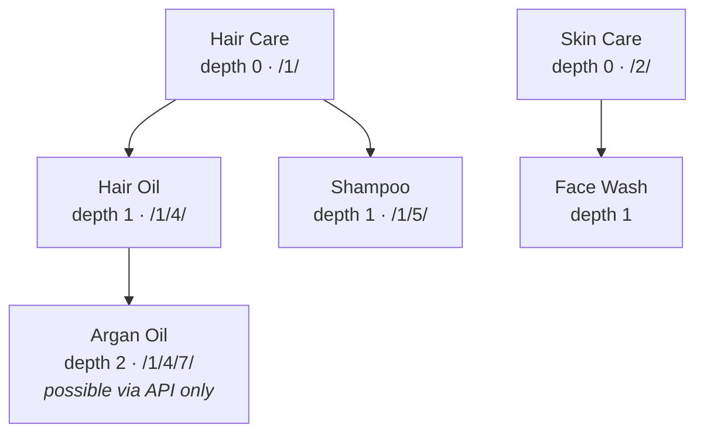
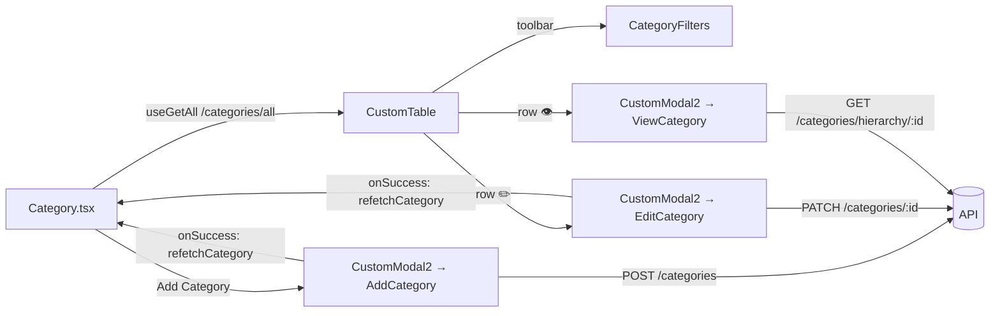
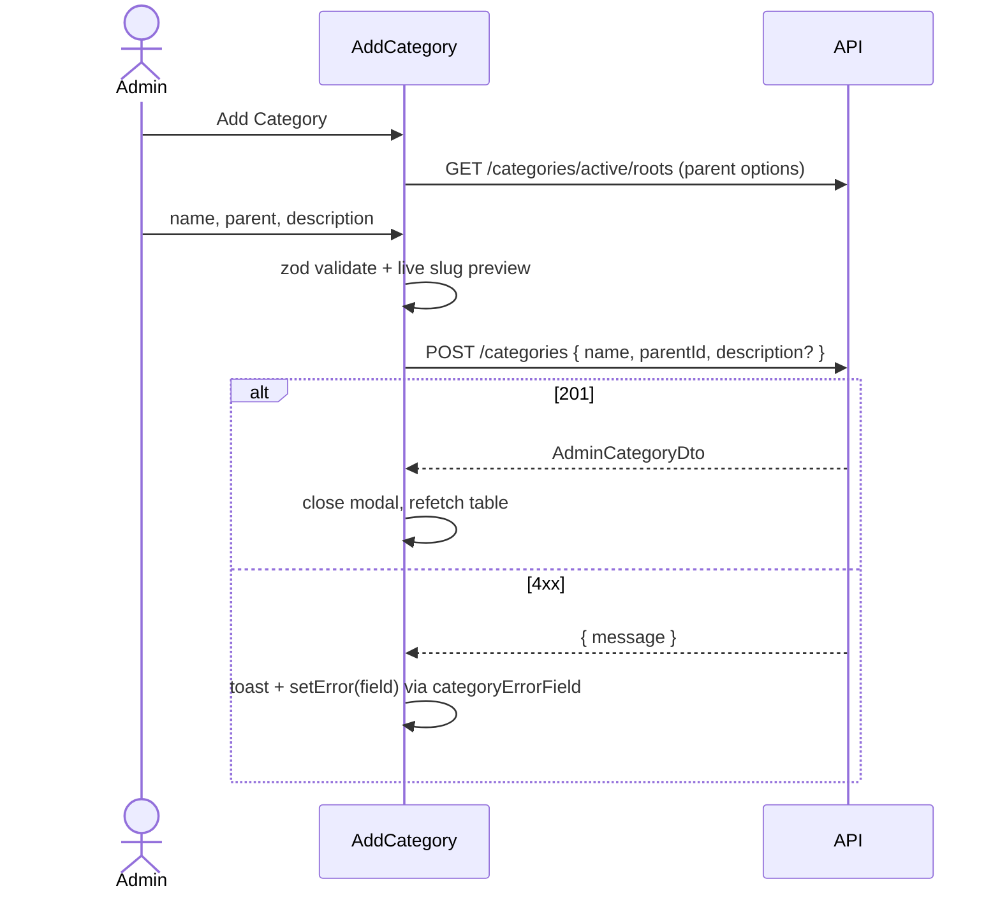
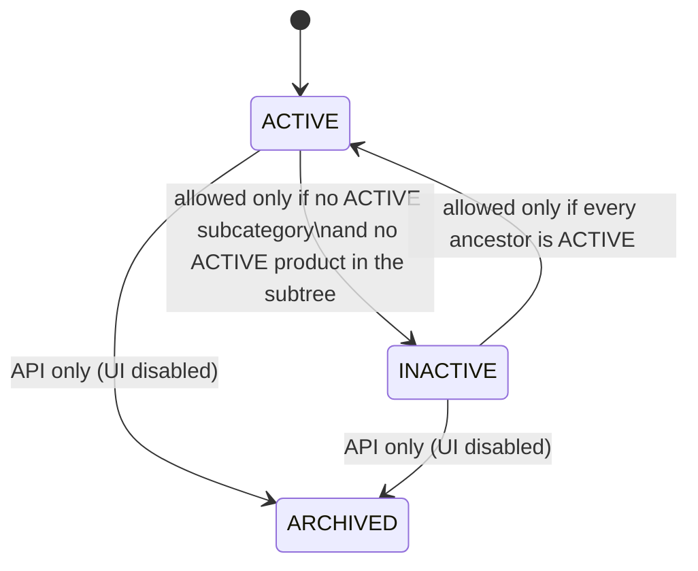
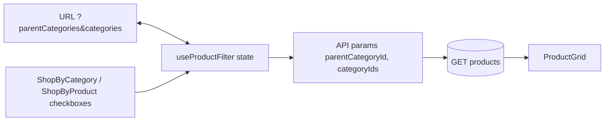

# Category Module — Frontend Technical Documentation

> **Scope:** everything the Natura Care client (Next.js 15, App Router) does with **product categories**: the admin category screen (list, filter, add, edit, view hierarchy), the category pickers that other admin screens reuse, and the way the storefront shop filters, footer and product pages use categories.
>
> **Audience:** frontend engineers joining or maintaining the project. QA and backend engineers can use it to see the client's side of the category contract.
>
> **Related:** [Project README](../README.md) (run, build, Docker) · [Auth module](./auth.md) (sign-in, session, route guard) · [User module](./user.md) (roles, profile) · [Server category docs](../../natura-care-server/docs/category.md) (API contract, DB schema, error messages) · [Coding conventions](../claude-docs/basic-instructions.md)

| | |
|---|---|
| **Module root** | [`src/modules/category/`](../src/modules/category/) |
| **Admin route** | `/category` (admin route group) |
| **Storefront touchpoints** | `/product` (shop filters), `/product/...` details pages, footer links, home product rows |
| **Backend resource** | `/categories` on `NEXT_PUBLIC_API_BASE_URL` (e.g. `https://api.naturacarebd.com/n-care/api/v1`) |
| **Write access (API)** | `ADMIN` only |
| **Last reviewed** | 2026-10-24 |

---

## Table of Contents

1. [Overview](#1-overview)
2. [Domain Model: Tree, Status & Visibility](#2-domain-model-tree-status--visibility)
3. [Tech Stack Used by This Module](#3-tech-stack-used-by-this-module)
4. [File Architecture](#4-file-architecture)
5. [Routes & Access Control](#5-routes--access-control)
6. [Admin Section — Category List (`/category`)](#6-admin-section--category-list-category)
   - [6.1 Screen layout](#61-screen-layout)
   - [6.2 Data fetching](#62-data-fetching)
   - [6.3 Search, filters, sorting & pagination](#63-search-filters-sorting--pagination)
   - [6.4 Columns](#64-columns)
   - [6.5 Modals](#65-modals)
7. [Admin Section — Add Category](#7-admin-section--add-category)
8. [Admin Section — Edit Category](#8-admin-section--edit-category)
9. [Admin Section — View Category](#9-admin-section--view-category)
10. [Category Pickers in Other Admin Screens](#10-category-pickers-in-other-admin-screens)
11. [Storefront (Front Store)](#11-storefront-front-store)
    - [11.1 Shop page filters (`/product`)](#111-shop-page-filters-product)
    - [11.2 URL ↔ filter ↔ API mapping](#112-url--filter--api-mapping)
    - [11.3 Footer, home rows & product details](#113-footer-home-rows--product-details)
12. [API Reference](#12-api-reference)
13. [Types](#13-types)
14. [Validation Schemas](#14-validation-schemas)
15. [Constants](#15-constants)
16. [Hooks](#16-hooks)
17. [Utilities](#17-utilities)
18. [Reusable Components](#18-reusable-components)
19. [Error Handling](#19-error-handling)
20. [Business Rules Summary](#20-business-rules-summary)
21. [Known Issues & Technical Debt](#21-known-issues--technical-debt)
22. [How-To Recipes](#22-how-to-recipes)

---

## 1. Overview

Categories group products into a tree, for example **Hair Care → Hair Oil**. The client works with them in three places:

| Audience | Where | What happens |
|---|---|---|
| **Admin** | `/category` | List every category at any level, search and filter by status/level, add top-level or sub categories, edit name/status/description, and inspect a category's hierarchy, counts and audit trail. |
| **Admin & Employee** | `/products` (add/edit product, product table filter) | Pick a category for a product; filter the product table by a category subtree. |
| **Shopper** | `/product`, footer, product details | Filter the shop by parent category and product type; see the category name in the product hero and breadcrumb. |

Key design decisions:

- **The parent is fixed at creation.** The edit form shows the parent read-only, and the API rejects `parentId` on `PATCH` ([§8](#8-admin-section--edit-category)).
- **The server owns the slug.** The client never sends one. It runs the same `slugify` locally only to **preview** the URL and warn when a rename will break old links ([§17](#17-utilities)).
- **One form, two dialogs.** Add and Edit share [`CategoryFormFields`](../src/modules/category/admin/CategoryFormFields.tsx) and [`CategoryFormDialog`](../src/modules/category/admin/CategoryFormDialog.tsx). Edit adds the status field and the extra warnings.
- **Server errors land on the field.** [`categoryErrorField()`](../src/modules/category/utils/category.utils.ts) maps known API messages (name taken, status blocked) to the form field that caused them, in addition to the toast ([§19](#19-error-handling)).
- **The admin screen uses the API; the storefront filters do not (yet).** The shop sidebar reads hardcoded category ids from product constants ([§11](#11-storefront-front-store), [TD-3](#21-known-issues--technical-debt)).

[↑ Back to top](#table-of-contents)

---

## 2. Domain Model: Tree, Status & Visibility

### The tree

Each category has an optional `parentId`. The server also stores a materialized `path` (`/1/4/7/`) and a `depth` (0 = top level). The server allows any depth. The admin UI creates at most **two levels**, because the parent picker lists only active top-level categories ([§7](#7-admin-section--add-category)).



| Term in UI | Meaning | Filter value (`level`) |
|---|---|---|
| **Root** / top level | `parentId === null` | `root` |
| **Subcategory** | `parentId !== null`, any depth | `sub` |

### Status

| Status | Storefront | Offered in the admin form |
|---|---|---|
| `ACTIVE` | Visible, **only if every ancestor is also `ACTIVE`** | Yes |
| `INACTIVE` | Hidden, with its whole subtree | Yes |
| `ARCHIVED` | Hidden, with its whole subtree (the "delete") | Only shown when the category is already archived; archiving is turned off in the UI for now |

### Visibility invariant

> **An `ACTIVE` category may only sit under `ACTIVE` categories.**

The server enforces it on every status change. The client warns about it in three places:

- **List and View:** [`isHiddenByParent(category)`](../src/modules/category/admin/category.columns.tsx) is `true` for an `ACTIVE` category whose parent is not `ACTIVE` (legacy rows from before the rule existed). View shows a "Hidden from the shop" banner.
- **Edit, Active option:** disabled when the parent is not active ("Parent is inactive").
- **Edit, Inactive option:** warns that the save only succeeds if no subcategory or product under it is still active.

[↑ Back to top](#table-of-contents)

---

## 3. Tech Stack Used by This Module

| Concern | Library | Notes |
|---|---|---|
| Framework | Next.js 15 (App Router), React 19 | The page file `dynamic()`-imports the module component. |
| Server state | `@tanstack/react-query` v5 | Through in-house hooks in [`src/hooks/api/`](../src/hooks/api/). Default `staleTime` 0, so every reopened modal refetches its data. |
| HTTP | `axios` | Shared instance with Bearer header, envelope unwrapping and 401 → refresh: [`axiosInstance.ts`](../src/lib/axios/axiosInstance.ts). |
| Forms | `react-hook-form` + `zod` (`@hookform/resolvers`) | `useWatch`, `useFormState`, `useController` inside the shared fields component. |
| Tables | `@tanstack/react-table` | Through [`CustomTable`](#18-reusable-components), with manual (server) pagination and sorting. |
| UI primitives | Radix (`Dialog`, `Select`, `RadioGroup`) via shadcn/ui | `components/ui/*`. |
| Toasts | `sonner` | Fired automatically by the API hooks. |
| Icons | `lucide-react`, `react-icons/md` | |
| Styling / motion | Tailwind CSS v4, `tw-animate-css` | View modal uses staggered `animate-in` blocks; all respect `motion-reduce`. |

[↑ Back to top](#table-of-contents)

---

## 4. File Architecture

The project uses a **feature-module** layout. `src/app` holds routing only; logic and UI live in `src/modules/<feature>/`, split by audience (`admin/`, `public/`) and by kind (`hooks/`, `types/`, `schemas/`, `constants/`, `utils/`).

```text
natura-care-client/
├── src/
│   ├── middleware.ts                          # Role-based route guard; /category is in ADMIN_ONLY_ROUTES and EMPLOYEE_ROUTES
│   │
│   ├── app/
│   │   ├── (admin)/category/page.tsx          # metadata + dynamic(() => import(modules/category/admin/Category))
│   │   └── (public)/product/...               # Shop + product details (consume categories, see §11)
│   │
│   ├── modules/
│   │   ├── category/
│   │   │   ├── admin/
│   │   │   │   ├── Category.tsx               # Page: header + AddButton, CustomTable, view/edit/add modals, list state
│   │   │   │   ├── category.columns.tsx       # getCategoryColumns(), statusBadgeClass(), isHiddenByParent()
│   │   │   │   ├── CategoryFilters.tsx        # Status + Level segmented filters (table toolbar); ICategoryFilters
│   │   │   │   ├── AddCategory.tsx            # Create form (POST /categories)
│   │   │   │   ├── EditCategory.tsx           # Edit form (PATCH /categories/:id), sends dirty fields only
│   │   │   │   ├── CategoryFormFields.tsx     # Shared fields: name + slug preview, parent, status cards, description
│   │   │   │   ├── CategoryFormDialog.tsx     # Shared dialog shell: header, scroll body, sticky footer (also reused by EditUser)
│   │   │   │   └── ViewCategory.tsx           # Read-only detail: hero, stats, flags, hierarchy tree, audit
│   │   │   ├── hooks/
│   │   │   │   ├── useCategory.ts             # GET /categories/active → tree-ordered options; TOP_LEVEL_PARENT, toTreeOrder, subtreeIds
│   │   │   │   └── useRootCategory.ts         # GET /categories/active/roots → parent options
│   │   │   ├── schemas/category.schema.ts     # categorySchema / editCategorySchema, CATEGORY_NAME_MAX, CATEGORY_DESCRIPTION_MAX
│   │   │   ├── types/category.types.ts        # CategoryStatus, ICategory, ICategoryNode, ICategoryOption, refs
│   │   │   ├── constants/category.constants.ts# categoryStatus (unused) + leftover mock data (see §21)
│   │   │   └── utils/category.utils.ts        # slugify(), categoryErrorField()
│   │   │
│   │   ├── product/                           # Main consumer
│   │   │   ├── admin/product-form/ProductDropdowns.tsx   # Category select (subcategories only)
│   │   │   ├── admin/Products.tsx                         # Category filter in the header row (any active category → subtree)
│   │   │   ├── public/product/ShopByCategory.tsx         # Storefront "Shop by Category" (hardcoded list)
│   │   │   ├── public/product/ShopByProduct.tsx          # Storefront "Shop By Products" (hardcoded list)
│   │   │   ├── hooks/useProductFilter.ts                 # URL ↔ filters ↔ API params
│   │   │   ├── hooks/useProduct.ts                       # Groups featured products into Hair/Skin/Body/Others
│   │   │   └── constants/product.constants.ts            # PARENT_CATEGORIES, PRODUCT_TYPES
│   │   ├── promotion/types/promotion.types.ts # PromotionCategory → ICategory
│   │   └── dashboard/admin/CategorySales.tsx  # "Sales by category" chart (dashboard API, not /categories)
│   │
│   ├── components/
│   │   ├── data-display/table/CustomTable.tsx
│   │   ├── form/ (InputField, TextAreaField, SingleSelectSearch, SegmentedFilter, formStyles)
│   │   ├── primitives/ (modal/CustomModal2, button/AddButton, button/CancelButton, CustomTooltip)
│   │   ├── layout/sidebar/AdminSidebar.tsx    # "Category" menu item (employee: true)
│   │   └── layout/footer/Footer.tsx           # Category links (?parentCategories=<id>)
│   │
│   ├── hooks/
│   │   ├── api/ (useGet, useGetAll, usePost, usePatch)
│   │   └── table/useTableModals.ts
│   └── types/ (api/response.types.ts, ui/modal.types.ts, ui/table.types.ts)
```

**Page convention.** The page file sets `metadata` and lazy-loads the module with a full-page loader:

```tsx
// src/app/(admin)/category/page.tsx
export const metadata: Metadata = { title: "Category | Natura Care Limited", ... };
const DynamicCategory = dynamic(() => import("@/modules/category/admin/Category"), {
  loading: () => <LoadingPage />,
});
export default function CategoryPage() {
  return <DynamicCategory />;
}
```

[↑ Back to top](#table-of-contents)

---

## 5. Routes & Access Control

### Routes that touch categories

| Route | Group | Component | Category role |
|---|---|---|---|
| `/category` | `(admin)` | [`Category.tsx`](../src/modules/category/admin/Category.tsx) | Full management |
| `/products` (+ add/edit pages) | `(admin)` | Product module | Category select and filter ([§10](#10-category-pickers-in-other-admin-screens)) |
| `/product` | public | Product listing + `ProductSidebar` | Shop filters ([§11.1](#111-shop-page-filters-product)) |
| `/product?parentCategories=1` | public | same | Footer deep links ([§11.3](#113-footer-home-rows--product-details)) |
| Product details | public | `ProductDetails.tsx` | Hero title, breadcrumb, related products |

There is **no storefront category page** (for example `/category/hair-care`) yet, although the API offers `GET /categories/slug/:slug` and `GET /categories/tree` for one.

### Who can open `/category`

Access is checked in [`src/middleware.ts`](../src/middleware.ts) by decoding the role from the `accessToken` cookie. How sign-in creates that cookie is covered in the [Auth module docs](./auth.md).

| Route | ADMIN | EMPLOYEE | CUSTOMER | Guest |
|---|:-:|:-:|:-:|:-:|
| `/category` (page) | ✅ | ✅ (in `EMPLOYEE_ROUTES`) | ❌ → `/` | ❌ → `/login` |
| `POST` / `PATCH /categories` (API) | ✅ | ❌ 403 | ❌ | ❌ |
| Admin fields in `GET /categories/all` (`status`, counts, audit) | ✅ | ❌ (served the public view) | ❌ | ❌ |

The sidebar mirrors the middleware: the "Category" item in [`AdminSidebar`](../src/components/layout/sidebar/AdminSidebar.tsx) carries `employee: true`.

> ⚠️ An employee can open the page, but the server serves them the **public** category view and refuses their writes. See [TD-1](#21-known-issues--technical-debt).

### How the server identifies the viewer

`GET` category endpoints are public but **role-aware**. The axios interceptor attaches the Bearer token, the server sees an `ADMIN` and returns the admin DTO with `status`, `sortOrder`, `depth`, `productCount`, `childrenCount`, `parent.status` and the audit fields. Everyone else, `EMPLOYEE` included, gets the public DTO, which **only ever contains `ACTIVE` categories**. An expired token on a public `GET` returns 401, and the interceptor refreshes it as for any other call.

[↑ Back to top](#table-of-contents)

---

## 6. Admin Section — Category List (`/category`)

**Entry:** [`Category.tsx`](../src/modules/category/admin/Category.tsx) · **Sidebar label:** "Category"



### 6.1 Screen layout

```text
┌ Category ─────────────────────────────── [+ Add Category] ┐
│ [Search…]   STATUS All|Active|Inactive   LEVEL All|Root|Subcategory │
├────────────────────────────────────────────────────────────┤
│ Category Name │ Parent │ # Products │ Subcategories │ Status │ Action │
│ Hair Oil      │ Hair Care │ 12      │ 0             │ ● active │ 👁 ✏️ │
│ Hair Care     │ (Root)    │ 3       │ 2             │ ● active │ 👁 ✏️ │
├────────────────────────────────────────────────────────────┤
│ « 1 2 3 »                                    rows per page │
└────────────────────────────────────────────────────────────┘
```

### 6.2 Data fetching

Local state: `currentPage` (1), `pageSize` (10), `searchTerm`, `sortOrder` (`"asc"`), `filters: { status?, level? }`.

```ts
useGetAll<{ data: ICategory[]; meta: IPaginationMeta }>(
  "/categories/all",
  ["getCategoryMeta", String(currentPage), String(pageSize), searchTerm, sortOrder,
   filters.status ?? "", filters.level ?? ""],
  { page, limit, search: searchTerm || undefined, sortOrder, status, level },
);
```

- Every input is part of the query key, so changing any of them refetches, and each combination is cached separately.
- `useGetAll` returns the **whole envelope** (`data` + `meta`). `meta.totalPages` and `meta.totalItems` drive the pager.
- After an add or edit, the form calls `refetch` (`refetchCategory`). Nothing else is invalidated. The dropdown queries (`getAllActiveCategory`, `getActiveRootCategory`) refresh on their next mount because `staleTime` is 0.

### 6.3 Search, filters, sorting & pagination

| Control | Implementation | Sent as | Server behavior |
|---|---|---|---|
| Search box | `CustomTable` built-in, debounced **500 ms** | `search` | Case-insensitive substring on `name`, `slug`, `description` |
| Status | [`CategoryFilters`](../src/modules/category/admin/CategoryFilters.tsx) → `SegmentedFilter` (All / Active / Inactive) | `status` | Admin only. No "Archived" button: archived rows show only under *All*. |
| Level | `SegmentedFilter` (All / Root / Subcategory) | `level=root\|sub` | `root` = top level; `sub` = any depth below it |
| Header sort | `CustomTable` `manualSorting` → `onSortChange(field, order)` | `sortOrder` only | **Always sorts by name.** The field is ignored ([TD-2](#21-known-issues--technical-debt)). |
| Pager | `manualPagination` | `page`, `limit` | `meta` returned |

`pageResetKey = "${status}|${level}|${searchTerm}"` sends the table back to page 1 whenever a filter or the search changes, since the new result may have fewer pages.

### 6.4 Columns

[`getCategoryColumns(handleView, handleEdit)`](../src/modules/category/admin/category.columns.tsx):

| Column | Accessor | Content | Sortable |
|---|---|---|:-:|
| **Category Name** | `name` | Plain name | ✓ (default) |
| **Parent** | `parent` | Parent name, or a sky-blue **Root** pill | — |
| **Number of Products** | `productCount` | Products **directly** in the category | ✓ (but sorts by name, see above) |
| **Subcategories** | `childrenCount` | Direct children | — |
| **Status** | `status` | Pill with dot: emerald `active`, rose `inactive`, amber `archived` (`statusBadgeClass`) | — |
| **Action** | — | 👁 View, ✏️ Edit (`CustomTooltip`) | — |

There is no delete action. Retiring a category is a status change, and archiving is currently switched off in the UI.

### 6.5 Modals

Modal state comes from [`useTableModals<ICategory>()`](../src/hooks/table/useTableModals.ts): `handleView(row)` / `handleEdit(row)` store the row and open the matching modal, while `modals.view|edit` and `setModal.view|edit` drive each `CustomModal2`. The Add modal uses its own `useState`.

| Modal | Width | Height | Notes |
|---|---|---|---|
| Add / Edit | `FORM_MODAL_WIDTH`: near full-width on phones, `max-w-xl` (576 px) from tablets | `FORM_MODAL_HEIGHT`: `100dvh − 9rem`, so it clears the fixed 5 rem admin navbar | `hasOwnTitle`: the title comes from `CategoryFormDialog` |
| View | `VIEW_MODAL_WIDTH`: 90 → 60 vw, `max-w-5xl` | 85 / 80 / 70 vh | Scrolls with the brand scrollbar |

[↑ Back to top](#table-of-contents)

---

## 7. Admin Section — Add Category

**Component:** [`AddCategory.tsx`](../src/modules/category/admin/AddCategory.tsx) · schema `categorySchema` · `usePost("/categories")`



**Fields**

| Field | Form name | Rules | UI |
|---|---|---|---|
| Category name | `categoryName` | Required, 2–100 chars after trim, needs at least one `a-z`/`0-9` | Autofocus. Hint shows the URL slug preview, or "Must be unique within its parent category." when empty. |
| Parent category | `categoryParentId` | Optional string; `"0"` (`TOP_LEVEL_PARENT`) = top level | `SingleSelectSearch` with **"None (top level)"** plus every **active root** category. Hint: the parent can't be changed later. |
| Description | `description` | Optional, at most 2000 chars | Auto-growing textarea, live `n/2000` counter that turns red over the limit |

There is no status field: new categories are **always `ACTIVE`** and visible in the shop at once (the dialog subtitle says so).

**Payload**

```ts
{
  name: data.categoryName,
  parentId: data.categoryParentId && data.categoryParentId !== TOP_LEVEL_PARENT
    ? Number(data.categoryParentId) : null,
  ...(data.description ? { description: data.description } : {}), // omitted when empty
}
```

The server trims and collapses whitespace in the name, builds the slug, and sets `sortOrder 0`, `isFeatured false`, `showInMenu true`, `createdBy` from the token.

**Why only root parents?** [`useRootCategory`](../src/modules/category/hooks/useRootCategory.ts) calls `GET /categories/active/roots`, so the UI produces a two-level tree (root → subcategory). Because only **active** roots are offered, the server's "inactive parent" conflict can't come up from this form.

[↑ Back to top](#table-of-contents)

---

## 8. Admin Section — Edit Category

**Component:** [`EditCategory.tsx`](../src/modules/category/admin/EditCategory.tsx) · schema `editCategorySchema` (same as create) · `usePatch` → `PATCH /categories/:id`

Editable: **name, status, description**. The parent is shown read-only with a 🔒 icon ("Set when the category was created and can't be changed"). Image, sort order, featured, menu and SEO fields exist in the API but are not in the form.

### Submit logic: dirty fields only

```ts
if (dirtyFields.categoryName) payload.name = data.categoryName;   // server rebuilds the slug
if (dirtyFields.status)       payload.status = data.status;
if (dirtyFields.description)  payload.description = data.description ?? ""; // "" → stored as null
if (Object.keys(payload).length === 0) return setOpen(false);     // nothing to send
updateCategory({ endpoint: `categories/${rowData.id}`, data: payload });
```

- **Save changes** is disabled until the form is dirty (`submitDisabled={!isDirty}`).
- `parentId` is never sent; the API answers `"property parentId should not exist"` if it is.

### Rename warning

`CategoryFormFields` compares `slugify(name)` with the saved `currentSlug`. If they differ, it shows an amber warning in place of the hint:

> ⚠ The URL changes from `hair-care` to `hair-scalp-care`. Links to the old URL will stop working.

### Status field rules ([`StatusField`](../src/modules/category/admin/CategoryFormFields.tsx))

Status is a radio group of cards (Active "Shown in the shop" / Inactive "Hidden from the shop"). The client checks the server's rules ahead of time so the admin sees them before saving:



| Situation | Client behavior | Server outcome |
|---|---|---|
| Parent is not `ACTIVE` and the saved status is not `ACTIVE` | **Active** card disabled, help text "Parent is inactive", hint "first make its parent category "X" active" | 409 if forced |
| Parent not `ACTIVE` but the category already is (legacy data) | Active stays available so the saved value is still selectable | — |
| Switching to **Inactive** with `childrenCount > 0` or `productCount > 0` | Amber box: "This saves only if none of its N subcategories and its M products is active. Make them inactive first." | 409 `Cannot make this category inactive while it has …` if any is active |
| Non-active status and the category has children | Hint: "Its N subcategories are hidden from the shop as well." | — |
| Saved status is `ARCHIVED` | A third card "Archived" appears so the current value stays visible and selected | — |

The counts come from the table row. They include inactive children and count only **direct** products, so the warning is advisory and the server has the final say.

[↑ Back to top](#table-of-contents)

---

## 9. Admin Section — View Category

**Component:** [`ViewCategory.tsx`](../src/modules/category/admin/ViewCategory.tsx). Read-only, apart from one request:

```ts
useGet<ICategory>(`categories/hierarchy/${id}`, ["getCategoryHierarchy", String(id)], undefined, !!id);
const category = hierarchy ? { ...rowData, ...hierarchy } : rowData; // row renders instantly, hierarchy enriches it
```

The table row has only direct children. The hierarchy endpoint adds the full **ancestor chain** and a **second level** (grandchildren).

| Block | Content | Logic |
|---|---|---|
| **Hero** | Image (or a gradient initial when there is no `imageUrl` or it fails to load), breadcrumb trail, name, status pill (pulses when active), ⭐ Featured badge | `imageUrl` is free text on any host, so it's a plain ``, not `next/image` |
| **Visibility warning** | "Hidden from the shop. This category is active, but its parent X is inactive." | `isHiddenByParent()` |
| **Stat tiles** | Products (direct) · Subcategories (+ grandchildren count) · Level (`depth + 1`) · Sort Order ("Lower shows first") | |
| **Flags** | Storefront (visible = `ACTIVE` and not hidden by parent) · Navigation Menu (`showInMenu`) · Featured (`isFeatured`) | |
| **Category Hierarchy** | Indented tree: Ancestor → **Parent** → **This category** → Child → Grandchild, each with a status dot, product and subcategory counts and a role tag | Only the direct parent has a status in the admin DTO; higher ancestors show none |
| **Description** | Text with line breaks preserved, or "No description added." | |
| **Audit** | Created / Last Updated, with date and "by <admin name>" | `createdBy`, `updatedBy` |

An **SEO preview** section (Google-style snippet with 60/160 character counters) is written but commented out. To bring it back, restore the block together with `SEO_TITLE_LIMIT`, `SEO_DESCRIPTION_LIMIT`, `CharCount` and the `Search` icon import.

[↑ Back to top](#table-of-contents)

---

## 10. Category Pickers in Other Admin Screens

All of these read **`GET /categories/active`** through [`useCategory()`](../src/modules/category/hooks/useCategory.ts). The endpoint returns a flat list sorted by `sortOrder`/name across every level. `toTreeOrder()` rebuilds parent-before-children order, and `indentedName()` prefixes `— ` per depth:

```text
Hair Care
— Hair Oil
— — Argan Oil
— Shampoo
Skin Care
— Face Wash
```

| Screen | Option list from `useCategory()` | Sent as | Business meaning |
|---|---|---|---|
| Add/Edit product → *Organization* → **Category** ([`ProductDropdowns.tsx`](../src/modules/product/admin/product-form/ProductDropdowns.tsx)) | `childrenCategories`: active categories **with a parent**, indented | `categoryId` (multipart) | **A product can only be assigned to an active subcategory**, never directly to a root such as "Hair Care". |
| Admin product list header → **Category** ([`Products.tsx`](../src/modules/product/admin/Products.tsx)) | `allActiveCategory`: every active category, indented, in a native `<select>` | `parentCategoryId` | The server matches the whole **subtree** (`path LIKE`), so picking "Hair Care" shows every hair product at any depth. |
| Add Category → **Parent** | `useRootCategory()`: active roots | `parentId` | See [§7](#7-admin-section--add-category). |

Other values `useCategory()` returns: `activeCategories` (full tree-ordered `ICategoryOption[]`), `parentCategories` (roots, unindented) and `activeCategoryDataLoading`. The query key `getAllActiveCategory` is shared, so every picker on a screen uses one request.

Since the list holds only **active** categories, a product whose category was later made inactive opens in Edit Product with an empty category select. The admin has to choose a new one before saving.

[↑ Back to top](#table-of-contents)

---

## 11. Storefront (Front Store)

> The storefront does **not** call `/categories` today. The shop filters, footer links and home grouping use **hardcoded ids and names** that must match the production database. If an admin renames, adds or deactivates a root category, the storefront doesn't follow ([TD-3](#21-known-issues--technical-debt)).

### 11.1 Shop page filters (`/product`)

[`ProductSidebar`](../src/modules/product/public/product/ProductSidebar.tsx) renders two checkbox groups (desktop sidebar plus a mobile drawer):

| Group | Component | Source | Options |
|---|---|---|---|
| **Shop by Category** | [`ShopByCategory.tsx`](../src/modules/product/public/product/ShopByCategory.tsx) | `PARENT_CATEGORIES` | 1 Hair Care · 2 Skin Care · 3 Body Care · 4 Others |
| **Shop By Products** | [`ShopByProduct.tsx`](../src/modules/product/public/product/ShopByProduct.tsx) | `PRODUCT_TYPES` | 5 Hair Oil · 6 Shampoo (→1) · 7 Face Wash (→2) · 8 Body Wash · 10 Body Lotion (→3) |

Shopper activity:

1. The shopper ticks **Hair Care**. `updateFilter("parentCategoryIds", [1])` runs, the URL becomes `/product?parentCategories=1`, and the product grid refetches.
2. In *Shop By Products*, types whose `parentId` isn't among the ticked parents are **disabled and greyed out**. Only Hair Oil and Shampoo stay clickable.
3. The shopper ticks **Hair Oil**. The URL becomes `?parentCategories=1&categories=5`.
4. [`ProductGrid`](../src/modules/product/public/product/ProductGrid.tsx) shows an active-filter chip ("1 Category") that can be cleared.

### 11.2 URL ↔ filter ↔ API mapping

[`useProductFilter`](../src/modules/product/hooks/useProductFilter.ts) owns the round-trip, so filtered links can be shared and bookmarked:

| URL param | Filter state | API param (`/products/...`) |
|---|---|---|
| `parentCategories=1,2` | `parentCategoryIds: [1, 2]` | `parentCategoryId=1` — **first id only** ([TD-4](#21-known-issues--technical-debt)) |
| `categories=5,6` | `categoryIds: [5, 6]` | `categoryIds=[5,6]` (JSON string) |



### 11.3 Footer, home rows & product details

| Place | File | How it uses categories |
|---|---|---|
| Footer "Shop" column | [`Footer.tsx`](../src/components/layout/footer/Footer.tsx) | Hair Care `?parentCategories=1`, Skin Care `=2`, Body Care `=3`, **"New Products" `=4`** (id 4 is "Others" in `PARENT_CATEGORIES`) |
| Home featured rows | [`useProduct.ts`](../src/modules/product/hooks/useProduct.ts) | Featured products (`/products/active?featured=true`) are split into `hairCare`, `skinCare`, `bodyCare`, `others` by `categoryName` (lower-cased) **or** `categoryParentId == "1" \| "2" \| "3"` |
| Product details hero and breadcrumb | [`ProductDetails.tsx`](../src/modules/product/public/product-details/ProductDetails.tsx) | `heroHeading = product.category?.name \|\| product.categoryName`; breadcrumb crumb links to `/product` |
| Product details info | [`DetailsWithAction.tsx`](../src/modules/product/public/product-details/DetailsWithAction.tsx) | Category name label |
| Related products | `ProductDetails.tsx` | `GET /products/filter?categoryId=<id>&status=ACTIVE`, key `getRelevantCategory+<id>` |
| Empty grid | [`EmptyState.tsx`](../src/components/feedback/placeholders/EmptyState.tsx) | "No products found in this category…" |

The storefront navbar has no category menu yet, although `showInMenu` exists for one.

[↑ Back to top](#table-of-contents)

---

## 12. API Reference

Base URL: `NEXT_PUBLIC_API_BASE_URL` in the browser, `INTERNAL_API_BASE_URL` (falling back to the public URL) on the Next server. See [`env.config.ts`](../src/config/env.config.ts) and the [README](../README.md). The full contract is in the [server category docs](../../natura-care-server/docs/category.md).

### Endpoints used by the client

| Method | Endpoint | Used by | Params / body → result | Hook · query key |
|---|---|---|---|---|
| `GET` | `/categories/all` | `Category.tsx` | `page`, `limit`, `search?`, `sortOrder?`, `status?`, `level?` → `{ data: ICategory[], meta }` | `useGetAll` · `getCategoryMeta+…` |
| `GET` | `/categories/hierarchy/:id` | `ViewCategory` | → `ICategory` with `ancestors` and 2 levels of `children` | `useGet` · `getCategoryHierarchy, id` |
| `GET` | `/categories/active` | `useCategory` (product form, product filters) | → `ICategoryOption[]` (flat, all depths, active only) | `useGet` · `getAllActiveCategory` |
| `GET` | `/categories/active/roots` | `useRootCategory` (Add Category) | → `ICategoryOption[]` (depth 0) | `useGet` · `getActiveRootCategory` |
| `POST` | `/categories` | `AddCategory` | `{ name, parentId \| null, description? }` → `201` `AdminCategoryDto` | `usePost` |
| `PATCH` | `/categories/:id` | `EditCategory` | any of `{ name, status, description }` → `200` `AdminCategoryDto` | `usePatch` |

### Available but unused by the client

`GET /categories` (top level, paginated) · `GET /categories/tree` · `GET /categories/active/subcategories` · `GET /categories/search?q=` · `GET /categories/parent/:parentId` · `GET /categories/slug/:slug` · `GET /categories/:id` · `DELETE /categories/:id` (soft delete → `ARCHIVED`).

These are the building blocks for a storefront category page and a data-driven shop sidebar ([§22](#22-how-to-recipes)).

### Related endpoints owned by other modules

`GET /products/filter?categoryId=` · products list with `parentCategoryId` / `categoryIds` · `GET /products/active?featured=true` · dashboard overview (`categories: ICategoryRow[]` for *Sales by category*).

### Response shape

```ts
// Success: axios interceptor output
{ statusCode: number; success: boolean; message: string; data: T; meta?: IPaginationMeta }
// meta: { currentPage, itemCount, itemsPerPage, totalItems, totalPages }
```

Paginated lists are sorted by **name** (`sortOrder` = direction). `children`, `/active`, `/tree` and `/parent/:id` are sorted by the **`sortOrder` column**, then name.

[↑ Back to top](#table-of-contents)

---

## 13. Types

[`category.types.ts`](../src/modules/category/types/category.types.ts)

### `CategoryStatus`

`"ACTIVE" | "INACTIVE" | "ARCHIVED"`

### `ICategory` — admin/public category DTO

| Field | Type | Admin only | Notes |
|---|---|:-:|---|
| `id` | `number` | | Route `:id`; what products reference |
| `sid` | `string?` | ✓ | Opaque public id |
| `name`, `slug` | `string` | | Slug is server-built and unique across all categories |
| `description` | `string \| null` | | |
| `status` | `CategoryStatus` | ✓ | Typed as required, but **missing in the public DTO** ([TD-1](#21-known-issues--technical-debt)) |
| `imageUrl` | `string \| null` | | Free-text path or URL; no upload endpoint yet |
| `sortOrder` | `number?` | ✓ | Position among siblings |
| `isFeatured`, `showInMenu` | `boolean` | | |
| `seoTitle`, `seoDescription` | `string \| null` | | Limits 70 / 160 (API) |
| `parentId` | `number \| null` | | |
| `parent` | `ICategoryRef & { status? } \| null` | `status` ✓ | |
| `path`, `depth` | `string?`, `number?` | ✓ | Materialized path `/1/4/` |
| `ancestors` | `ICategoryRef[]?` | | Single-category endpoints only |
| `children` | `ICategoryNode[]?` | | Direct children (hierarchy: 2 levels) |
| `productCount`, `childrenCount` | `number?` | ✓ | Direct counts |
| `createdAt`, `updatedAt` | `string?` | ✓ | ISO |
| `createdBy`, `updatedBy` | `ICategoryUserRef \| null` | ✓ | `{ id, name }` |

### Supporting types

| Type | Shape | Used for |
|---|---|---|
| `ICategoryRef` | `{ id, name, slug }` | `parent`, `ancestors` |
| `ICategoryUserRef` | `{ id, name }` | Audit fields |
| `ICategoryNode` | `{ id, name, slug, imageUrl, isFeatured, showInMenu, status?, sortOrder?, productCount?, childrenCount?, children? }` | `children`, `/categories/tree` |
| `ICategoryOption` | `{ id, name, slug, parentId, depth }` | `/categories/active`, `/active/roots` |
| `ICategoryFilters` | `{ status?: CategoryStatus; level?: "root" \| "sub" }` | List toolbar ([`CategoryFilters.tsx`](../src/modules/category/admin/CategoryFilters.tsx)) |
| `CategoryLevel` | `"root" \| "sub"` | same |
| `CategoryFormData` / `EditCategoryFormData` | `{ categoryName, categoryParentId?, status?, description? }` | Forms (zod-inferred) |
| `CategoryResponse`, `CategoryCreateResponse` | [`types/api/response.types.ts`](../src/types/api/response.types.ts) | `usePost` callback type in `AddCategory` (also borrowed by `AddFreeDelivery`) |
| `IModal` | `{ data?, setOpen?, onClose?, refetch?, isLoading? }` | Props for Add/Edit/View |
| `ISingleSelectOption` | `{ id, name }` | Parent select options |

Other modules import `ICategory`: [`product.types.ts`](../src/modules/product/types/product.types.ts) (`IProduct.category`, plus flattened `categoryName`, `categoryParentId`, `categoryParentName`, `categorySlug`) and [`promotion.types.ts`](../src/modules/promotion/types/promotion.types.ts) (`PromotionCategory.category`).

[↑ Back to top](#table-of-contents)

---

## 14. Validation Schemas

[`category.schema.ts`](../src/modules/category/schemas/category.schema.ts). Limits mirror the server's `CreateCategoryDto`.

```ts
CATEGORY_NAME_MAX = 100
CATEGORY_DESCRIPTION_MAX = 2000

categorySchema = z.object({
  categoryName:     string, trim, min 2, max 100, must contain /[a-z0-9]/i,
  categoryParentId: string?   // "0" = top level
  status:           enum ACTIVE | INACTIVE | ARCHIVED ?,
  description:      string, trim, max 2000 ?,
});
editCategorySchema = categorySchema;
```

| Rule | Message | Why |
|---|---|---|
| Name ≥ 2 / ≤ 100 | "Category name must be at least 2 characters" / "…at most 100 characters" | Server limits |
| Name has a Latin letter or digit | "Include at least one English letter or number" | The slug is built from `a-z0-9`. A name in Bangla script only (`"চুলের যত্ন"`) gives an empty slug, which the server rejects with 400. |
| Description ≤ 2000 | "Description must be at most 2000 characters" | Server limit; also shown live by the counter |

Sibling-name uniqueness (case-insensitive) and slug uniqueness are checked **only on the server**, and come back as field errors ([§19](#19-error-handling)).

[↑ Back to top](#table-of-contents)

---

## 15. Constants

| Constant | Location | Purpose |
|---|---|---|
| `TOP_LEVEL_PARENT = "0"` | [`hooks/useCategory.ts`](../src/modules/category/hooks/useCategory.ts) | Select value meaning "no parent". Radix Select can't use `""` as an item value. |
| `CATEGORY_NAME_MAX`, `CATEGORY_DESCRIPTION_MAX` | `schemas/category.schema.ts` | 100 / 2000 |
| `STATUS_OPTIONS`, `ARCHIVED_OPTION` | `admin/CategoryFormFields.tsx` | Status cards (label + help text) |
| `STATUS_OPTIONS`, `LEVEL_OPTIONS` | `admin/CategoryFilters.tsx` | Toolbar segments |
| `STATUS_STYLES`, `ROLE_STYLES` | `admin/ViewCategory.tsx` | Pill/dot colors; hierarchy row colors per role |
| `ENTER`, `LIFT`, `enterDelay()` | `admin/ViewCategory.tsx` | Animation class strings |
| `FORM_MODAL_WIDTH`, `FORM_MODAL_HEIGHT`, `VIEW_MODAL_WIDTH` | `admin/Category.tsx` | Modal sizing (copied by the Products page) |
| `categoryStatus` | `constants/category.constants.ts` | `[{ id, name }]` Active/Inactive. **Unused.** |
| `categories`, `users`, `User` | `constants/category.constants.ts` | **Leftover mock data, unused** |
| `PARENT_CATEGORIES`, `PRODUCT_TYPES` | [`product/constants/product.constants.ts`](../src/modules/product/constants/product.constants.ts) | **Hardcoded** storefront filter lists ([§11](#11-storefront-front-store)) |
| `CATEGORY_MAPPING` | [`product/types/product-filter.types.ts`](../src/modules/product/types/product-filter.types.ts) | Name → id map, same hardcoded ids |
| `CATEGORY_COLORS`, `OTHER_COLOR` | `dashboard/constants/dashboard.constants.ts` | *Sales by category* chart palette |
| `"/category"` in `ADMIN_ONLY_ROUTES`, `EMPLOYEE_ROUTES` | [`middleware.ts`](../src/middleware.ts) | Route access |

> Status colors are defined three times with different tokens: emerald/rose/amber in `category.columns.tsx`, `success`/`destructive`/`warningPrimary` in `ViewCategory.tsx`, and a third set in the home content cells. If you change one, change all three, or consolidate them ([TD-6](#21-known-issues--technical-debt)).

[↑ Back to top](#table-of-contents)

---

## 16. Hooks

### Module hooks

| Hook / helper | File | Returns / does |
|---|---|---|
| `useCategory()` | [`hooks/useCategory.ts`](../src/modules/category/hooks/useCategory.ts) | `GET categories/active` → `{ activeCategories, allActiveCategory, parentCategories, childrenCategories, activeCategoryDataLoading }`. Every list is memoised and tree-ordered. |
| `toTreeOrder(list)` | same | Flat `ICategoryOption[]` → depth-first order (parent then its children). A parent missing from the list is treated as a root. |
| `subtreeIds(list, rootId)` | same | `Set<number>` of a category and all its descendants. Exported, currently unused. |
| `indentedName(option)` | same | `"— — Argan Oil"` (one `— ` per depth) |
| `useRootCategory()` | [`hooks/useRootCategory.ts`](../src/modules/category/hooks/useRootCategory.ts) | `GET categories/active/roots` → `{ rootCategories: {id,name}[], rootCategoryLoading }` |

### Shared hooks

| Hook | File | Signature / behavior |
|---|---|---|
| `useGetAll<T>` | [`hooks/api/useGet.ts`](../src/hooks/api/useGet.ts) | `(endpoint, queryKey, params?, options?, shouldFetch = true)`. Returns the **whole envelope**; for paginated lists. |
| `useGet<T>` | same | `(endpoint, queryKey, params?, shouldFetch = true, options?)`. Returns `response.data`. **Argument order differs from `useGetAll`.** Toasts on error. |
| `usePost<T>` | [`hooks/api/usePost.ts`](../src/hooks/api/usePost.ts) | `usePost(endpoint, onSuccess?, onError?)`, then `mutate(body)`. Toasts success and each 4xx message. |
| `usePatch<T>` | [`hooks/api/usePatch.ts`](../src/hooks/api/usePatch.ts) | `usePatch(onSuccess?, onError?)`, then `mutate({ endpoint, data })`. JSON body. |
| `useTableModals<T>` | [`hooks/table/useTableModals.ts`](../src/hooks/table/useTableModals.ts) | `{ viewData, editData, deleteData, modals, setModal, handleView, handleEdit, handleDelete, resetModals }` |
| `useProductFilter` | [`product/hooks/useProductFilter.ts`](../src/modules/product/hooks/useProductFilter.ts) | Storefront filters ↔ URL ↔ API params ([§11.2](#112-url--filter--api-mapping)) |

Both mutation hooks call your `onSuccess` for **any resolved response**, including a 4xx returned as data. That is why `AddCategory` and `EditCategory` check `statusCode` themselves before closing.

[↑ Back to top](#table-of-contents)

---

## 17. Utilities

[`category.utils.ts`](../src/modules/category/utils/category.utils.ts)

| Function | Example | Notes |
|---|---|---|
| `slugify(value)` | `"Combos & Gift Packs"` → `"combos-gift-packs"`, `"Crème Brûlée"` → `"creme-brulee"` | Same rule as the server (NFKD fold accents, lowercase, non-alphanumerics → `-`, trim). **Preview only**; the server is authoritative. |
| `categoryErrorField(message)` | `"This parent already has a category with this name"` → `"categoryName"` | Maps an API message to a form field ([§19](#19-error-handling)). |

Local helpers: `isHiddenByParent()` and `statusBadgeClass()` in `category.columns.tsx`, `formatDate()` (medium date + short time) in `ViewCategory.tsx`.

[`lib/utils/slug.utils.ts`](../src/lib/utils/slug.utils.ts) has `categorySlug()`, a duplicate of `slugify` that nothing uses, and `createSlug()`, a cruder version used for **product** slugs.

[↑ Back to top](#table-of-contents)

---

## 18. Reusable Components

### Defined in this module (reusable)

| Component | Path | Purpose | Key props |
|---|---|---|---|
| `CategoryFormDialog` | [`admin/CategoryFormDialog.tsx`](../src/modules/category/admin/CategoryFormDialog.tsx) | Form dialog shell: sticky header (title is the dialog's accessible name, close ✕), padded body, sticky footer with Cancel + primary button (stacked on phones, safe-area aware). **Also used by `EditUser`.** Render inside `CustomModal2 hasOwnTitle`. | `title`, `description`, `submitLabel`, `pendingLabel`, `isPending`, `submitDisabled?`, `onSubmit`, `onClose`, `children` |
| `CategoryFormFields` | [`admin/CategoryFormFields.tsx`](../src/modules/category/admin/CategoryFormFields.tsx) | Shared Add/Edit fields | `control`, `trigger`, `nameRef?`, `parent: {editable:true, options, loading?} \| {editable:false, name}`, `showStatus?`, `currentSlug?`, `childrenCount?`, `productCount?`, `inactiveParent?`, `isLoading?` |
| `CategoryFilters` | [`admin/CategoryFilters.tsx`](../src/modules/category/admin/CategoryFilters.tsx) | Status + Level toolbar | `filters`, `onChange(patch)` |

Private helpers, not exported: `StatusField` and `Slug` (in fields); `StatusPill`, `StatTile`, `Flag`, `Section`, `TreeRow`, `HierarchyTree`, `AuditRow` and `CategoryImage` (in View). Promote them to `src/components` only when a second module needs them.

### Shared components used here

| Component | Path | Used for | Key props |
|---|---|---|---|
| `CustomTable<T>` | [`components/data-display/table/CustomTable.tsx`](../src/components/data-display/table/CustomTable.tsx) | Category list | `data`, `columns`, `isLoading`, `pageCount`, `totalItems`, `pageSize`, `onPageChange`, `onPageSizeChange`, `onSearchChange` (500 ms debounce), `onSortChange`, `toolbar`, `pageResetKey` |
| `CustomModal2` | [`components/primitives/modal/CustomModal2.tsx`](../src/components/primitives/modal/CustomModal2.tsx) | All three modals | `open`, `onOpenChange`, `dialogWidth`, `dialogHeight`, `hasOwnTitle` |
| `AddButton` | [`components/primitives/button/AddButton.tsx`](../src/components/primitives/button/AddButton.tsx) | "Add Category" | `label`, `setOpen` |
| `CancelButton` | [`components/primitives/button/CancelButton.tsx`](../src/components/primitives/button/CancelButton.tsx) | View modal "Close" | `onClick`, `label`, `className` |
| `CustomTooltip` | [`components/primitives/CustomTooltip.tsx`](../src/components/primitives/CustomTooltip.tsx) | Row action icons | `action="view" \| "edit"`, `content` |
| `SegmentedFilter<V>` | [`components/form/SegmentedFilter.tsx`](../src/components/form/SegmentedFilter.tsx) | Toolbar toggle groups; `value: undefined` = "All". On narrow screens the label wraps above and the buttons scroll sideways | `label`, `options: {value, label, count?, dot?, title?}[]`, `value`, `onChange` |
| `InputField` | [`components/form/InputField.tsx`](../src/components/form/InputField.tsx) | Name | `labelName`, `name`, `control`, `trigger`, `inputRef`, `autoFocus`, `inlineError`, `isRequired`, `isLoading` |
| `TextAreaField` | [`components/form/TextAreaField.tsx`](../src/components/form/TextAreaField.tsx) | Description | `rowNo`, `textareaClassName` |
| `SingleSelectSearch` | [`components/form/SingleSelectSearch.tsx`](../src/components/form/SingleSelectSearch.tsx) | Parent select and product category select (searchable Radix Select) | `labelName`, `name`, `control`, `options`, `isLoading`, `isRequired` |
| `RadioGroup`, `RadioGroupItem` | `components/ui/radio-group` | Status cards | |
| `formStyles` (`fieldBox`, `fieldInput`, `fieldLabel`, `fieldError`) | [`components/form/formStyles.ts`](../src/components/form/formStyles.ts) | Read-only parent field matching the inputs | |

[↑ Back to top](#table-of-contents)

---

## 19. Error Handling

Every mutation error is shown **twice on purpose**: once as a toast (from `usePost`/`usePatch`) and once under the field it belongs to, so the admin sees where to fix it.

```ts
const field = categoryErrorField(data.message);
if (field) {
  setError(field, { message: data.message });
  if (field === "categoryName") nameRef.current?.focus();
}
```

| Server message (examples) | Status | Mapped to |
|---|---|---|
| `A top-level category with this name already exists` | 409 | `categoryName` |
| `This parent already has a category with this name` | 409 | `categoryName` |
| `A category with this slug already exists` | 409 | `categoryName` |
| `Could not build a URL from this name. Include at least one English letter or number.` | 400 | `categoryName` |
| `Cannot make this category inactive while it has 2 active subcategories and 5 active products …` | 409 | `status` |
| `Cannot make this category active while its parent category "X" is inactive …` | 409 | `status` |
| `Cannot archive this category while it has N subcategories …` | 409 | `status` |
| `Category not found`, `Insufficient role privileges.`, others | 404 / 403 | Toast only |

Matching rules: `/make this category (in)?active|archive this category/i` → `status`, then `/name|slug|url/i` → `categoryName`. The regexes rely on the server's wording in its [error reference](../../natura-care-server/docs/category.md#error-reference). Change both together.

Network failures and expired sessions are handled globally by the axios interceptor (see [Auth docs](./auth.md)).

[↑ Back to top](#table-of-contents)

---

## 20. Business Rules Summary

| # | Rule | Enforced in |
|---|---|---|
| BR-1 | Only `ADMIN` can create or edit categories. | API (`RolesGuard`); the page is also open to `EMPLOYEE` ([TD-1](#21-known-issues--technical-debt)) |
| BR-2 | New categories start `ACTIVE`, with no status choice on create. | `AddCategory`, API default |
| BR-3 | The parent is chosen once, at creation, and can never change. | `CategoryFormFields` (read-only), API rejects `parentId` on PATCH |
| BR-4 | The admin UI creates at most two levels (parent must be an active root). | `useRootCategory` |
| BR-5 | Names are 2–100 chars, need a Latin letter or digit, and are unique among siblings (case-insensitive). | zod + API |
| BR-6 | The slug is server-built from the name and changes on rename; old links break. | API; warned in `CategoryFormFields` |
| BR-7 | An `ACTIVE` category may only sit under `ACTIVE` ancestors. | API; Active option disabled under an inactive parent |
| BR-8 | A category can become `INACTIVE` only when no subcategory and no product in its subtree is `ACTIVE`. | API; warned in `StatusField` |
| BR-9 | Making a category inactive hides its whole subtree from the shop. | API; hint in `StatusField` |
| BR-10 | Categories are never hard-deleted; `ARCHIVED` is the delete, and is disabled in the UI. | API, `CategoryFormFields` |
| BR-11 | Edits send only changed fields; an empty change set closes the dialog without a request. | `EditCategory` |
| BR-12 | Clearing the description sends `""`, stored as `null`. | `EditCategory`, API |
| BR-13 | A product must belong to an **active subcategory** (not a root). | `ProductDropdowns` (`childrenCategories`) |
| BR-14 | Filtering products by a category includes its whole subtree. | API (`path LIKE`) |
| BR-15 | Non-admins only ever receive `ACTIVE` categories. | API viewer model |

[↑ Back to top](#table-of-contents)

---

## 21. Known Issues & Technical Debt

| # | Issue | Impact | Suggested fix |
|---|---|---|---|
| TD-1 | **Employees can open `/category`, but the API treats them as public.** `GET /categories/all` returns the public DTO (active only; no `status`, counts or audit). The Status cell calls `row.original.status.toLowerCase()`, which throws on `undefined`, and every Add/Edit returns 403. | Employee page breaks or shows partial data; writes fail | Decide the policy. Either drop `/category` from `EMPLOYEE_ROUTES` and the `employee: true` sidebar flag, or give `EMPLOYEE` the admin view/write role on the server. At minimum, guard the cell with `status?.`. |
| TD-2 | Header sorting: "Category Name" and "Number of Products" are sortable, but only `sortOrder` (direction) is sent and the server always sorts by **name**. Clicking "Number of Products" re-sorts by name. A third click (clear sort) sends nothing, so the last direction sticks. | Misleading UI | Set `enableSorting: false` on `productCount`, or add `sortBy` to the API. |
| TD-3 | **Storefront categories are hardcoded** (`PARENT_CATEGORIES`, `PRODUCT_TYPES`, `CATEGORY_MAPPING`, footer `?parentCategories=1..4`, `useProduct` name/id grouping). They drift from the database whenever an admin changes categories. Ids may not match production (for example, the server sample has id 4 = Hair Oil; the client says 4 = Others; the footer labels 4 "New Products"). | Wrong or empty shop filters | Build the sidebar from `GET /categories/tree` (public view is active-only) and group home rows by `parentId` from the API. |
| TD-4 | Ticking several parent categories in the shop sends only the **first** (`parentCategoryIds[0]`). | Multi-select silently ignored | Send all (API support needed) or make it single-select. |
| TD-5 | `ICategory.status` is typed as required, but the public DTO omits it. | Type lies | Make it optional, or split into `IPublicCategory` / `IAdminCategory`. |
| TD-6 | Status colors are defined three ways (`category.columns`, `ViewCategory`, home cells). | Visual drift | One `CATEGORY_STATUS_META` map in `category.constants.ts`. |
| TD-7 | `category.constants.ts` holds unused mock data (`categories`, `users`, `User`) and an unused `categoryStatus`. `Category.tsx` ends with ~160 lines of commented-out code. `categorySlug()` duplicates `slugify()`. | Noise | Delete. |
| TD-8 | `TOP_LEVEL_PARENT` lives in a hook file and is imported from there by `AddCategory`. | Odd dependency | Move it to `category.constants.ts`. |
| TD-9 | Endpoint strings are inline and mixed (`"/categories"` vs `` `categories/${id}` ``). Other modules use `constants/api/*.api.constants.ts`. | Inconsistent | Add `category.api.constants.ts` with endpoints and query keys. |
| TD-10 | Image, sort order, featured, show-in-menu and SEO fields exist in the API but can't be edited in the UI (SEO preview is commented out). There's no image upload endpoint yet. | Feature gap | Extend `CategoryFormFields` once the client wants them; add an upload endpoint on the server. |
| TD-11 | Edit Product lists only active subcategories, so a product in a now-inactive category opens with an empty category select. | Admin confusion | Append the product's current category to the options, marked "(inactive)". |
| TD-12 | No storefront category page or navbar menu, although `slug`, `showInMenu`, `isFeatured` and the SEO fields exist for them. | SEO and navigation gap | See the recipe in [§22](#22-how-to-recipes). |
| TD-13 | `CategoryCreateResponse` is reused by `AddFreeDelivery` as a generic success type. | Misleading type | Use `ResponseSuccessType`. |

[↑ Back to top](#table-of-contents)

---

## 22. How-To Recipes

### Use the category dropdown in a new admin form

```tsx
import useCategory from "@/modules/category/hooks/useCategory";
import SingleSelectSearch from "@/components/form/SingleSelectSearch";

const { allActiveCategory, activeCategoryDataLoading } = useCategory();

<SingleSelectSearch
  labelName="Category"
  name="categoryId"
  control={control}
  options={allActiveCategory}          // or childrenCategories / parentCategories
  isLoading={activeCategoryDataLoading}
/>
```

The value is a **string** id; convert it with `Number()` before sending.

### Add a new editable field (e.g. `isFeatured`)

1. Add it to `categorySchema` and to the default values in `AddCategory` / `EditCategory`.
2. Render it in `CategoryFormFields`. Use a prop such as `showStatus` if it should appear in Edit only.
3. `AddCategory`: add it to the POST body. `EditCategory`: add `if (dirtyFields.isFeatured) payload.isFeatured = …`.
4. Check the server's [validation reference](../../natura-care-server/docs/category.md#validation-reference). Unknown fields are rejected with `property X should not exist`.
5. If the server has new error messages for it, extend `categoryErrorField`.

### Add a table column

1. Append a `ColumnDef<ICategory>` in `getCategoryColumns`. Set `enableSorting: false` unless the API can sort by it ([TD-2](#21-known-issues--technical-debt)).
2. The field must be in the **admin** DTO; check the server's "Who sees what" table.

### Add a filter to the toolbar

1. Extend `ICategoryFilters` and add a `SegmentedFilter` in `CategoryFilters`.
2. In `Category.tsx`, add it to `queryParams`, the query key and `pageResetKey`.
3. The API also accepts `isFeatured` and `showInMenu` filters.

### Make the storefront sidebar data-driven (fixes TD-3)

1. Add a `usePublicCategoryTree()` hook in `modules/category/hooks/` that calls `useGet<ICategoryNode[]>("categories/tree", ["getPublicCategoryTree"])`.
2. In `ShopByCategory`, render the top-level nodes; in `ShopByProduct`, render the children of the ticked parents.
3. Keep the URL params (`parentCategories`, `categories`) so existing links still work. Then remove `PARENT_CATEGORIES`, `PRODUCT_TYPES` and `CATEGORY_MAPPING`, and generate the footer links from the same tree.

### Add a storefront category page (`/category/[slug]`)

1. Create `src/app/(public)/category/[slug]/page.tsx`. **Rename or move the admin route first**: middleware matches `/category` by prefix, so a public `/category/*` would be blocked for everyone except staff.
2. Fetch `GET /categories/slug/:slug` on the server for `generateMetadata` (`seoTitle || name`, `seoDescription || description`), and products with `parentCategoryId=<id>`.
3. Build the breadcrumb from `ancestors`. Return `notFound()` on 404, which is what the server returns for an inactive or hidden category.

[↑ Back to top](#table-of-contents)
