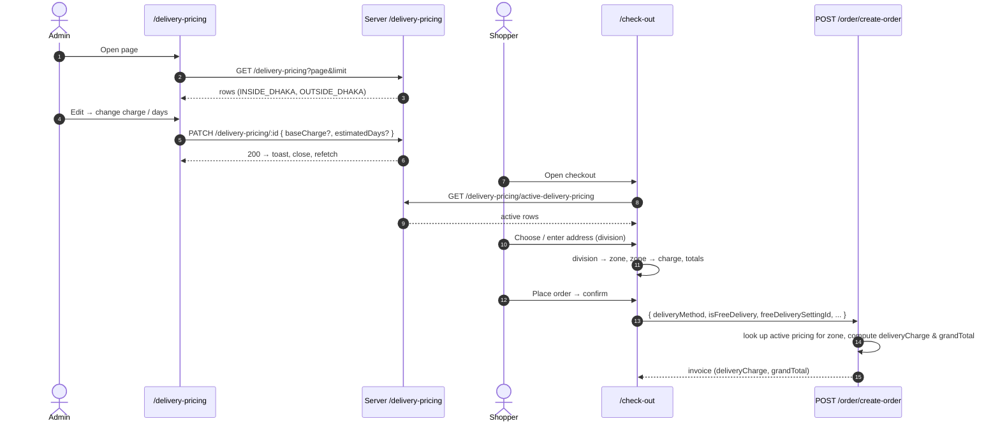

# Delivery Pricing Module — Frontend Technical Documentation

> **Scope:** everything the Natura Care client (Next.js 15, App Router) does with **delivery pricing**: the admin Delivery Pricing screen (list and edit the charge and delivery time per zone), how checkout picks the zone from the shopper's division and shows the charge, and how the charge ends up on the order, invoice and admin order screens.
>
> **Audience:** frontend engineers joining or maintaining the project. QA, product and backend engineers can use it to see the client's side of the delivery-pricing contract and the business rules the UI enforces.
>
> **Related:** [Project README](../README.md) (run, build, Docker) · [Free Delivery module](./free-delivery.md) (threshold that makes the charge Tk 0) · [Cart module](./cart.md) (subtotal, "Calculated at checkout") · [Order module](./order.md) (placing an order, invoices, zone filter) · [Promotion module](./promotion.md) (coupon discount in the same totals) · [Auth module](./auth.md) (session, route guard) · [User module](./user.md) (roles) · [Server free-delivery docs](../../natura-care-server/docs/free-delivery.md) · [Server order docs](../../natura-care-server/docs/order.md)

| | |
|---|---|
| **Module root** | [`src/modules/delivery-pricing/`](../src/modules/delivery-pricing/) |
| **Admin route** | `/delivery-pricing` (admin route group) — `ADMIN` only |
| **Storefront usage** | `/check-out`, step 3 **Delivery** and the order summary (no page of its own) |
| **Backend resource** | `/delivery-pricing` on `NEXT_PUBLIC_API_BASE_URL` (e.g. `https://api.naturacarebd.com/n-care/api/v1`) |
| **Write access (API)** | `ADMIN` only |
| **Zones** | `INSIDE_DHAKA`, `OUTSIDE_DHAKA` (Prisma enum `DeliveryMethod`) |
| **Last reviewed** | 2026-10-24 |

---

## Table of Contents

1. [Overview](#1-overview)
2. [Domain Model](#2-domain-model)
   - [2.1 What a delivery pricing row is](#21-what-a-delivery-pricing-row-is)
   - [2.2 Zones and the division → zone rule](#22-zones-and-the-division--zone-rule)
   - [2.3 How the charge combines with free delivery and coupons](#23-how-the-charge-combines-with-free-delivery-and-coupons)
   - [2.4 Snapshot on the order](#24-snapshot-on-the-order)
3. [Tech Stack Used by This Module](#3-tech-stack-used-by-this-module)
4. [File Architecture](#4-file-architecture)
5. [Routes & Role-Based Access](#5-routes--role-based-access)
   - [5.1 Page routes](#51-page-routes)
   - [5.2 Middleware rules](#52-middleware-rules)
   - [5.3 Admin sidebar](#53-admin-sidebar)
   - [5.4 API roles](#54-api-roles)
   - [5.5 Access matrix](#55-access-matrix)
6. [End-to-End Workflow](#6-end-to-end-workflow)
7. [Admin Section — Delivery Pricing List (`/delivery-pricing`)](#7-admin-section--delivery-pricing-list-delivery-pricing)
   - [7.1 Screen layout](#71-screen-layout)
   - [7.2 Data fetching, search & pagination](#72-data-fetching-search--pagination)
   - [7.3 Columns](#73-columns)
8. [Admin Section — Edit Delivery Pricing](#8-admin-section--edit-delivery-pricing)
9. [Admin Section — Add Delivery Pricing (disabled)](#9-admin-section--add-delivery-pricing-disabled)
10. [Storefront — Checkout Delivery Step](#10-storefront--checkout-delivery-step)
    - [10.1 Loading the active zones](#101-loading-the-active-zones)
    - [10.2 Picking the zone from the division](#102-picking-the-zone-from-the-division)
    - [10.3 Working out the charge](#103-working-out-the-charge)
    - [10.4 What the shopper sees](#104-what-the-shopper-sees)
    - [10.5 The order payload](#105-the-order-payload)
11. [After Checkout — Orders, Invoices & Admin Order Screens](#11-after-checkout--orders-invoices--admin-order-screens)
12. [API Reference](#12-api-reference)
13. [Types](#13-types)
14. [Validation Schema](#14-validation-schema)
15. [Constants & Label Maps](#15-constants--label-maps)
16. [Hooks](#16-hooks)
17. [Display Helpers](#17-display-helpers)
18. [Reusable Components](#18-reusable-components)
19. [Data Fetching & Cache Keys](#19-data-fetching--cache-keys)
20. [Error Handling](#20-error-handling)
21. [Business Rules Summary](#21-business-rules-summary)
22. [Known Issues & Technical Debt](#22-known-issues--technical-debt)
23. [How-To Recipes](#23-how-to-recipes)
24. [Change Log](#24-change-log)

---

## 1. Overview

Delivery pricing is the **flat courier charge per zone** that is added to every order, for example **Inside Dhaka → Tk 60, within 2 days** and **Outside Dhaka → Tk 120, within 4 days**. There is one active row per zone. Orders are delivered by Steadfast Courier.

The client works with delivery pricing in three places:

| Audience | Where | What happens |
|---|---|---|
| **Admin** | `/delivery-pricing` | See both zones with charge, delivery time, status and last update; edit the charge and estimated days with a live "checkout preview" and a before → after diff. |
| **Shopper** (guest or customer) | `/check-out`, step 3 **Delivery** | The zone is **picked automatically** from the division in the delivery address. Both zones are shown; the matching one is highlighted and the other is greyed out. |
| **Shopper** | `/check-out` order summary, mobile bottom bar, confirm dialog | The charge (or **FREE** with the normal charge struck through) is added to the grand total. |
| **Admin / customer** | Order list, View Order, Edit Order, My Orders, invoices | The charge stored on the order is displayed; it never changes after the order is placed. |

Key design decisions:

- **The server is the source of truth for the charge.** The client sends only `deliveryMethod`; the server looks up the active row for that zone and computes `deliveryCharge` itself ([§10.5](#105-the-order-payload)). The number the client shows is a preview.
- **The shopper does not choose the zone.** It follows the division (`region`) of the address: Dhaka division → `INSIDE_DHAKA`, every other division → `OUTSIDE_DHAKA` ([§2.2](#22-zones-and-the-division--zone-rule)).
- **Zones are fixed.** The admin can only edit the two existing rows. Creating rows is turned off in the UI, and the zone of a row cannot be changed ([§9](#9-admin-section--add-delivery-pricing-disabled)).
- **Orders keep the charge they were placed with.** Changing the price affects new orders only ([§2.4](#24-snapshot-on-the-order)).

---

## 2. Domain Model

### 2.1 What a delivery pricing row is

Server model `DeliveryPricing` (`natura-care-server/prisma/schema/delivery.prisma`), table `delivery_pricing`:

| Field | Type | Meaning | Edited from the UI? |
|---|---|---|---|
| `id` | `Int` | Primary key, used in `PATCH /delivery-pricing/:id` | — |
| `sid` | `String` (uuid) | Public id | — |
| `region` | `String`, **unique** | Display name set by the server on create: `"Inside Dhaka"` / `"Outside Dhaka"` | No |
| `deliveryMethod` | enum `INSIDE_DHAKA` \| `OUTSIDE_DHAKA` | The zone; the key checkout matches on | No (fixed after create) |
| `baseCharge` | `Decimal` (returned as `number`) | Courier charge in BDT, **10–1000** | **Yes** |
| `minOrderAmount` | `Decimal?` | Legacy field, not used by the client. Free delivery now lives in the Free Delivery module | No |
| `estimatedDays` | `Int` | Delivery time shown to the shopper, **≥ 1, whole days** | **Yes** |
| `isActive` | `Boolean` | Only active rows are offered at checkout and accepted by the order API | No (API only, see [§22](#22-known-issues--technical-debt)) |
| `createdAt` / `updatedAt` | `DateTime` | `updatedAt` is shown as "Last Updated" | — |

### 2.2 Zones and the division → zone rule

The address form uses the eight divisions in `orderDeliveryRegions` ([§15](#15-constants--label-maps)). The zone is derived from them:

| Address `region` (division) | Zone (`deliveryMethod`) |
|---|---|
| `DHAKA` | `INSIDE_DHAKA` |
| `CHITTAGONG`, `KHULNA`, `RAJSHAHI`, `RANGPUR`, `MYMENSINGH`, `SYLHET`, `BARISHAL` | `OUTSIDE_DHAKA` |

> "Inside Dhaka" therefore means the **Dhaka division**, not only Dhaka city, even though the admin hint text says "Orders delivered within Dhaka city". Keep this in mind when answering pricing questions from the business side.

The rule lives **only in the client** ([`CheckOut.tsx`](../src/modules/checkout/public/CheckOut.tsx), effect "DELIVERY METHOD BASED ON REGION OR DIVISION"). The server accepts whichever `deliveryMethod` it is sent ([§22](#22-known-issues--technical-debt)).

### 2.3 How the charge combines with free delivery and coupons

```
deliveryFee = isFreeDelivery ? 0 : deliveryCharge
grandTotal  = subtotal − couponDiscount + deliveryFee
```

- `deliveryCharge` — `baseCharge` of the active row for the selected zone.
- `isFreeDelivery` — a free-delivery setting is active **and** the cart subtotal ≥ its `minimumOrder` (see [Free Delivery module](./free-delivery.md)). Free delivery is zone-independent.
- `couponDiscount` — from the coupon box (see [Promotion module](./promotion.md)). Coupons never discount delivery.

The server applies the same formula with its own data: `grandTotal = subtotal + deliveryCharge − promoCodeDiscount`, with `deliveryCharge = 0` when free delivery is requested and the subtotal meets the setting's minimum.

### 2.4 Snapshot on the order

When the order is created the server writes `deliveryMethod` and `deliveryCharge` onto the order row. Later price edits do not touch existing orders. Admin order editing (changing quantities, removing items) recomputes the subtotal and discount but **keeps `order.deliveryCharge` as it is** ([`EditPlacedOrder.tsx`](../src/modules/order/admin/EditPlacedOrder.tsx)). The zone of a placed order cannot be changed from the UI.

---

## 3. Tech Stack Used by This Module

| Concern | Library | Where |
|---|---|---|
| Routing, metadata, code-splitting | Next.js 15 App Router, `next/dynamic` | [`app/(admin)/delivery-pricing/page.tsx`](../src/app/(admin)/delivery-pricing/page.tsx) |
| Server state | TanStack Query via `useGet` / `useGetAll` / `usePatch` / `usePost` | [`src/hooks/api/`](../src/hooks/api/) |
| HTTP | Axios instance with the auth interceptor | [`src/lib/axios/axiosInstance.ts`](../src/lib/axios/axiosInstance.ts) |
| Forms | React Hook Form + `zodResolver` | Edit / Add forms, checkout form |
| Validation | Zod | [`delivery-pricing.schema.ts`](../src/modules/delivery-pricing/schemas/delivery-pricing.schema.ts) |
| Table | TanStack Table through `CustomTable` | [`delivery-pricing.columns.tsx`](../src/modules/delivery-pricing/admin/delivery-pricing.columns.tsx) |
| Toasts | `sonner` | inside the API hooks, and "No changes detected!" in Edit |
| Icons | `lucide-react` (module), `react-icons` (sidebar) | |
| Styling | Tailwind CSS with project tokens (`greenPrimary`, `neutralPrimary`, `blueSecondary`) | |

---

## 4. File Architecture

```
src/
├── app/(admin)/delivery-pricing/
│   └── page.tsx                         # Route; metadata + dynamic import of the admin screen
│
├── modules/delivery-pricing/
│   ├── admin/
│   │   ├── DeliveryPricing.tsx           # List screen: query, table, Edit modal
│   │   ├── delivery-pricing.columns.tsx  # Column defs + shared display helpers (formatCharge,
│   │   │                                 #   formatDays, formatDateTime, DELIVERY_METHOD_META,
│   │   │                                 #   getMethodMeta, ActivePill)
│   │   ├── EditDeliveryPricing.tsx       # Edit modal: form, checkout preview, change diff
│   │   └── AddDeliveryPricing.tsx        # Create form — not mounted (button commented out)
│   ├── hooks/
│   │   └── useDeliveryPricing.ts         # Storefront: active zones → radio options
│   ├── schemas/
│   │   └── delivery-pricing.schema.ts    # Zod schema + DELIVERY_CHARGE_MIN / _MAX
│   └── types/
│       └── delivery-pricing.types.ts     # IDeliveryPricing
│
├── modules/checkout/                    # Consumer
│   ├── public/CheckOut.tsx               # Zone selection, charge, totals, order payload
│   ├── public/DeliveryMethod.tsx         # Step 3 "Delivery" cards (read-only)
│   ├── public/CheckoutSummary.tsx        # "Delivery · <zone>" line in the totals
│   ├── public/ConfirmOrderDialog.tsx     # Shows the zone label in the review
│   ├── schemas/checkout.schema.ts        # deliveryMethod: required string
│   └── constants/checkout.constants.ts   # orderDeliveryRegions (divisions)
│
├── modules/order/                       # Consumer (read-only display)
│   ├── utils/order.utils.ts              # DELIVERY_METHOD_LABELS
│   ├── types/order.types.ts              # IOrder.deliveryMethod / deliveryCharge
│   └── admin/order-list/OrderFilters.tsx # "Zone" filter
│
├── components/form/DeliveryMethodRadioField.tsx   # Generic RHF radio for zones (currently unused)
├── types/ui/form.types.ts                         # IDeliveryMethodRadioOption, IDeliveryMethodRadioField
├── middleware.ts                                  # "/delivery-pricing" in ADMIN_ONLY_ROUTES
└── components/layout/sidebar/AdminSidebar.tsx     # "Delivery Pricing" menu item (admin only)
```

The module follows the project's module layout (`admin/`, `hooks/`, `schemas/`, `types/`). It has no `public/` or `customer/` folder because the storefront side is rendered by the checkout module, which consumes `useDeliveryPricing`.

---

## 5. Routes & Role-Based Access

### 5.1 Page routes

| Route | File | Rendering | Purpose |
|---|---|---|---|
| `/delivery-pricing` | [`app/(admin)/delivery-pricing/page.tsx`](../src/app/(admin)/delivery-pricing/page.tsx) | Server component that `dynamic()`-imports the client `DeliveryPricing` with `LoadingPage` as fallback | Admin list + edit |
| `/check-out` | `app/(public)/check-out` | Client | Uses active pricing in step 3 and the summary |

Page metadata: `title: "Delivery Pricing | Natura Care Limited"`.

### 5.2 Middleware rules

[`src/middleware.ts`](../src/middleware.ts) decodes the `accessToken` cookie (JWT) and matches the path with `startsWith`:

- `/delivery-pricing` is in `ADMIN_ONLY_ROUTES`, **not** in `EMPLOYEE_ROUTES`.
- Not signed in → redirected to `/login`.
- `EMPLOYEE` → redirected to `EMPLOYEE_ROUTES[0]` (`/dashboard`).
- `CUSTOMER` → redirected to `/`.
- `/check-out` is in `GUEST_CUSTOMER_ONLY_ROUTES`: guests and `CUSTOMER` may open it; `ADMIN` / `EMPLOYEE` are redirected to their dashboard. Admins therefore can't preview checkout with their own account — use a customer or guest session.

### 5.3 Admin sidebar

[`AdminSidebar.tsx`](../src/components/layout/sidebar/AdminSidebar.tsx) entry:

```ts
{ label: "Delivery Pricing", href: "/delivery-pricing", icon: MdOutlineDeliveryDining }
```

It has no `employee: true` flag, so employees don't see it. Keep the sidebar and `EMPLOYEE_ROUTES` in sync if this ever changes.

### 5.4 API roles

| Endpoint | Guard |
|---|---|
| `GET /delivery-pricing/active-delivery-pricing` | **Public** (no guard) — used by checkout for guests too |
| `GET /delivery-pricing` | `JwtAuthGuard` + `RolesGuard`, `ADMIN` |
| `GET /delivery-pricing/active/:deliveryMethod` | `ADMIN` |
| `POST /delivery-pricing` | `ADMIN` |
| `PATCH /delivery-pricing/:id` | `ADMIN` |
| `PATCH /delivery-pricing/status/:id` | `ADMIN` |

### 5.5 Access matrix

| Action | Guest | CUSTOMER | EMPLOYEE | ADMIN |
|---|:-:|:-:|:-:|:-:|
| Open `/delivery-pricing` | ✗ (→ login) | ✗ (→ `/`) | ✗ (→ `/dashboard`) | ✓ |
| Edit charge / days | ✗ | ✗ | ✗ | ✓ |
| Create a zone | ✗ | ✗ | ✗ | API only (UI disabled) |
| Activate / deactivate | ✗ | ✗ | ✗ | API only (no UI) |
| See zones and charge at checkout | ✓ | ✓ | ✗ (checkout blocked) | ✗ (checkout blocked) |
| See charge on an order | own invoice | My Orders | Order List | Order List |

---

## 6. End-to-End Workflow



In words:

1. The admin sets the charge and delivery time for each zone.
2. Checkout loads the active zones once (`useDeliveryPricing`).
3. Whenever the address division changes, checkout sets the `deliveryMethod` form value to the matching zone.
4. The charge for that zone (or Tk 0 with free delivery) goes into the summary, the mobile bottom bar and the confirm dialog.
5. On submit, only the zone is sent. The server recomputes the charge and returns an invoice, which the client shows as is.

---

## 7. Admin Section — Delivery Pricing List (`/delivery-pricing`)

Component: [`DeliveryPricing.tsx`](../src/modules/delivery-pricing/admin/DeliveryPricing.tsx)

### 7.1 Screen layout

```
┌───────────────────────────────────────────────────────────────────────────┐
│ Delivery Pricing                                                          │
├───────────────────────────────────────────────────────────────────────────┤
│ [Search…]                                                                 │
│ Delivery Method        Charge    Estimated   Status            Updated  ✎ │
│ 🏢 Inside Dhaka        60 BDT    ⏱ 2 days    ● Active          Oct 5…   ✎ │
│    Orders delivered…                         Charged at checkout          │
│ 📍 Outside Dhaka       120 BDT   ⏱ 4 days    ● Active          Oct 5…   ✎ │
└───────────────────────────────────────────────────────────────────────────┘
```

- Header with the title only. The "Add Delivery Pricing" button and its modal are commented out ([§9](#9-admin-section--add-delivery-pricing-disabled)).
- `CustomTable` with the columns below.
- One `CustomModal2` holding `EditDeliveryPricing`, opened through `useHandleModalState`.

### 7.2 Data fetching, search & pagination

```ts
const queryParams = { page, limit: pageSize, search: searchTerm || undefined, sortOrder };

useGetAll<{ data: IDeliveryPricing[]; meta: IPaginationMeta }>(
  "/delivery-pricing",
  ["getDeliveryPricing", String(page), String(pageSize), searchTerm, sortOrder],
  queryParams,
);
```

- Local state: `currentPage` (1), `pageSize` (10), `searchTerm` (""), `sortOrder` ("asc").
- `CustomTable` debounces the search box by 500 ms before calling `onSearchChange`. The server searches the `region` column.
- The server sorts by `createdAt desc`. All columns have `enableSorting: false`, so `sortOrder` is sent but has no visible effect.
- The data is guarded with `Array.isArray(...)` so a bad response renders an empty table instead of crashing.
- With only two rows, pagination exists only because the shared table and endpoint are paginated.

### 7.3 Columns

Defined in [`delivery-pricing.columns.tsx`](../src/modules/delivery-pricing/admin/delivery-pricing.columns.tsx) as `deliveryPricingColumns(handleView, handleEdit)`. `handleView` is kept for the shared table signature; this module has no view modal.

| Column | Accessor | Renders |
|---|---|---|
| Delivery Method | `deliveryMethod` | Coloured icon tile + label + hint from `getMethodMeta` |
| Delivery Charge | `baseCharge` | `formatCharge` → `"60 BDT"` |
| Estimated Delivery | `estimatedDays` | Clock icon + `formatDays` → `"2 days"` / `"1 day"` |
| Status | `isActive` | `ActivePill` (Active / Inactive); active rows also show "Charged at checkout" |
| Last Updated | `updatedAt` | `formatDateTime` → locale date + time |
| Action | — | Edit button (`CustomTooltip action="edit"`) with an `aria-label` naming the zone |

---

## 8. Admin Section — Edit Delivery Pricing

Component: [`EditDeliveryPricing.tsx`](../src/modules/delivery-pricing/admin/EditDeliveryPricing.tsx), rendered in `CustomModal2` with `data = row`.

**Layout**

1. **Header** — zone icon tile, "EDIT DELIVERY PRICING" eyebrow, zone label, `ActivePill`, hint. The zone is shown here instead of as a disabled field because it can't be changed.
2. **Fields** (two columns from `md`):
   - *Delivery Charge (BDT)* — `InputField type="number"`, `Banknote` icon, `autoFocus`, inline error. Helper: "Between 10 and 1000 BDT. Now 60 BDT."
   - *Estimated Delivery (days)* — `InputField type="number"`, `CalendarDays` icon. Helper: "Whole days, at least 1. Now 2 days."
3. **Checkout preview** — a card that looks like the checkout option, built from the values being typed (`useWatch`), followed by a before → after list (`ChangeRow`) for each changed field, or "No changes yet."
4. **Note** — "New orders use the new values right away. Orders already placed keep the charge they were placed with. Last updated …".
5. **Actions** — Cancel + Save Changes. On phones they stack full width with the primary action on top (`flex-col-reverse`).

**Form**

```ts
useForm<DeliveryChargeFormType>({
  resolver: zodResolver(deliveryPricingSchema),
  defaultValues: {
    deliveryMethod: row.deliveryMethod,
    deliveryCharge: row.baseCharge,   // form name ≠ API name
    estimatedDays: row.estimatedDays,
  },
});
```

**Change detection.** React Hook Form keeps a field dirty after you type a value and then restore it, so the component also compares with the saved values:

```ts
const chargeChanged = charge != null && charge !== row.baseCharge;
const daysChanged   = days   != null && days   !== row.estimatedDays;
const hasChanges    = chargeChanged || daysChanged;
```

- Save is disabled while `!hasChanges` (passed as `isPending` to `SubmitButton`) and shows "Saving..." during the request.
- On submit, only fields that are both dirty and different from the saved value go into the payload. The form field `deliveryCharge` is sent as **`baseCharge`**.
- Empty payload → `toast.info("No changes detected!")` and the modal closes without a request.

**Request**

```ts
usePatch<IDeliveryPricing>().mutate({
  endpoint: `/delivery-pricing/${row.id}`,
  data: { baseCharge?: number, estimatedDays?: number },
});
```

On a 2xx response `usePatch` shows a success toast, then the modal closes and the list refetches. Errors show a toast (from `usePatch`) and are logged with `console.error`; the modal stays open.

**Empty state.** If the modal opens without a row it shows a truck icon and "No delivery pricing details available."

---

## 9. Admin Section — Add Delivery Pricing (disabled)

[`AddDeliveryPricing.tsx`](../src/modules/delivery-pricing/admin/AddDeliveryPricing.tsx) is a working create form, but its button and modal are commented out in `DeliveryPricing.tsx`. Both zones already exist and the server allows only one active row per zone, so the business has no reason to add rows.

If it is turned back on:

- Fields: *Delivery Method* (`SingleSelectSearch` with the local `deliveryPricing` options), *Delivery Charge*, *Estimated Days*.
- Payload: `POST /delivery-pricing { deliveryMethod, baseCharge, estimatedDays }`. The server sets `region` and `isActive: true`.
- The server rejects a zone that already has an active row (`409`, "Delivery pricing for INSIDE_DHAKA already exists and is active."). Because `region` is **unique** in the database, creating a second row for a zone also fails when the old row is only inactive.
- Clean up the leftover `console.log(payload)` first.

---

## 10. Storefront — Checkout Delivery Step

### 10.1 Loading the active zones

```ts
const { deliveryPricingOptions, isDeliveryPricingLoading } = useDeliveryPricing();
```

`useDeliveryPricing` calls `GET /delivery-pricing/active-delivery-pricing` (public) and maps each row to an `IDeliveryMethodRadioOption`:

```ts
{ label: row.region, value: row.deliveryMethod, deliveryCharge: row.baseCharge, estimatedDays: row.estimatedDays }
```

Both `CheckOut` and `DeliveryMethod` call the hook. They share the query key `getAllActiveDeliveryPricing`, so TanStack Query makes **one** request.

### 10.2 Picking the zone from the division

The address `region` comes from either the saved address the customer picked (`address.state`) or the division select in the new-address form. It defaults to `DHAKA` (`orderDeliveryRegions[0]`). Then:

```ts
useEffect(() => {
  if (deliveryRegion && deliveryPricingOptions.length > 0) {
    const isDhaka = deliveryRegion === orderDeliveryRegions[0].id;      // "DHAKA"
    const wanted = isDhaka ? "INSIDE_DHAKA" : "OUTSIDE_DHAKA";
    const method =
      deliveryPricingOptions.find((o) => o.value === wanted)?.value ??
      (isDhaka ? deliveryPricingOptions[1]?.value : deliveryPricingOptions[0]?.value); // legacy fallback
    setValue("deliveryMethod", method);
  }
}, [deliveryRegion, deliveryPricingOptions, setValue]);
```

- The match is **by value**. The position-based pick is only a fallback from older code that relied on the API order ([§22](#22-known-issues--technical-debt)).
- The form's initial `deliveryMethod` is `deliveryPricingOptions[0]?.value || ""`. On first render the options are still loading, so it starts as `""` and this effect fills it in.
- `deliveryMethod` is required in [`checkout.schema.ts`](../src/modules/checkout/schemas/checkout.schema.ts) and is part of `REQUIRED_FIELDS`. If it is still empty when the shopper presses Place order, the page scrolls to the `checkout-delivery` section.

### 10.3 Working out the charge

```ts
const deliveryCharge = useMemo(() => {
  if (!deliveryMethod || !Array.isArray(deliveryPricingOptions)) return 200; // fallback
  const selected = deliveryPricingOptions.find((o) => o.value === deliveryMethod);
  return selected ? Number(selected.deliveryCharge) : 200;
}, [deliveryMethod, deliveryPricingOptions]);

const isFreeDelivery = isFreeDeliveryAvailable && totals.total >= freeDeliveryThreshold;
const deliveryFee   = isFreeDelivery ? 0 : deliveryCharge;
const grandTotal    = totals.total - promotionInfo.promotionAmount + deliveryFee;
const zoneLabel     = ZONE_LABELS[deliveryMethod];
```

`200` is a display fallback only. It is never sent to the server.

### 10.4 What the shopper sees

**Step 3 — Delivery** ([`DeliveryMethod.tsx`](../src/modules/checkout/public/DeliveryMethod.tsx)), titled "Delivery", description "Set automatically from your division. Delivered by Steadfast Courier.":

- While loading: two pulsing placeholder cards.
- Then one card per active zone, in a `role="radiogroup"`. Each card has `role="radio"`, `aria-checked` and `aria-disabled` because it can't be clicked.
  - Selected zone: green border, filled truck icon, check badge, "Within N days", charge.
  - Other zone: grey and 60 % opacity.
  - With free delivery the selected card shows **FREE** with the normal charge struck through.

**Order summary** ([`CheckoutSummary.tsx`](../src/modules/checkout/public/CheckoutSummary.tsx)): a "Delivery · Inside Dhaka" row with a skeleton while loading, then the charge or "FREE ~~৳60~~".

**Mobile bottom bar** and **confirm dialog**: the grand total includes the delivery fee; the dialog also shows the zone label.

**Cart page** (`/my-cart`) does not know the zone yet. It shows "FREE" when the free-delivery threshold is met, otherwise "Calculated at checkout" (see [Cart module](./cart.md)).

### 10.5 The order payload

```ts
POST /order/create-order
{
  ...,
  deliveryMethod: "INSIDE_DHAKA" | "OUTSIDE_DHAKA",
  isFreeDelivery: boolean,
  freeDeliverySettingId: number | null,
  promotionId: number | null,
}
```

No charge is sent. The server:

1. Loads the **active** row for `deliveryMethod`. If there isn't one, it fails with `400` "The delivery pricing is not available."
2. Uses `baseCharge`, or `0` when `isFreeDelivery` is true, the setting is active and the subtotal reaches its minimum.
3. Stores `deliveryMethod` and `deliveryCharge` on the order (and reads the row's `estimatedDays`) and returns the invoice. The invoice modal shows the server's numbers.

---

## 11. After Checkout — Orders, Invoices & Admin Order Screens

These screens only read the snapshot on the order. They don't call the delivery-pricing API.

| Screen | File | Shows |
|---|---|---|
| Admin Order List | [`order.columns.tsx`](../src/modules/order/admin/order.columns.tsx) | "Free delivery" marker when `isFreeDelivery && deliveryCharge === 0` |
| Admin Order List filter | [`OrderFilters.tsx`](../src/modules/order/admin/order-list/OrderFilters.tsx) | "Zone" select built from `DELIVERY_METHOD_LABELS` → `deliveryMethod` query param |
| Admin View Order | [`ViewOrder.tsx`](../src/modules/order/admin/ViewOrder.tsx) | Zone label; delivery line `৳0` when free, else `formatBDT(deliveryCharge)` |
| Admin Edit Order | [`EditPlacedOrder.tsx`](../src/modules/order/admin/EditPlacedOrder.tsx) | Before/after totals; delivery stays the same |
| Customer Order Details | [`OrderDetails.tsx`](../src/modules/order/customer/OrderDetails.tsx) | Zone label and "usually within …"; delivery "Free" when `0` |
| Invoices (HTML / PDF / CSV export) | [`invoice.utils.ts`](../src/modules/order/utils/invoice.utils.ts), [`order.utils.ts`](../src/modules/order/utils/order.utils.ts) | Zone label and delivery charge |

See the [Order module](./order.md) for these screens in full.

---

## 12. API Reference

Base: `NEXT_PUBLIC_API_BASE_URL`. Responses use the standard envelope `{ statusCode, success, message, data, meta? }`.

| Method & path | Role | Used by | Request | Response `data` |
|---|---|---|---|---|
| `GET /delivery-pricing/active-delivery-pricing` | Public | `useDeliveryPricing` (checkout) | `page`, `limit`, `search` (optional) | `IDeliveryPricing[]` where `isActive = true` (+ `meta`) |
| `GET /delivery-pricing` | ADMIN | `DeliveryPricing` list | `page`, `limit`, `search`, `sortOrder` | `IDeliveryPricing[]` (+ `meta`) |
| `PATCH /delivery-pricing/:id` | ADMIN | `EditDeliveryPricing` | `{ baseCharge?: 10–1000, estimatedDays?: int ≥ 1, isActive?: boolean }` | updated row |
| `POST /delivery-pricing` | ADMIN | `AddDeliveryPricing` (not mounted) | `{ deliveryMethod, baseCharge, estimatedDays, minOrderAmount? }` | created row |
| `PATCH /delivery-pricing/status/:id` | ADMIN | — (no UI) | `{ isActive: boolean }` | updated row |
| `GET /delivery-pricing/active/:deliveryMethod` | ADMIN | — (server-side use by orders) | — | one row |

---

## 13. Types

**[`IDeliveryPricing`](../src/modules/delivery-pricing/types/delivery-pricing.types.ts)** — a row as returned by the API:

```ts
export interface IDeliveryPricing {
  id: number;
  sid: string;
  region: string;          // "Inside Dhaka" | "Outside Dhaka"
  deliveryMethod: string;  // "INSIDE_DHAKA" | "OUTSIDE_DHAKA"
  baseCharge: number;
  estimatedDays: number;
  isActive: boolean;
  createdAt: string;
  updatedAt: string;
}
```

`minOrderAmount` is returned by the server but left out on purpose.

**[`IDeliveryMethodRadioOption`](../src/types/ui/form.types.ts)** — what checkout works with:

```ts
export interface IDeliveryMethodRadioOption {
  label: string;          // region
  value: string;          // deliveryMethod
  deliveryCharge: number; // baseCharge
  estimatedDays: number;
  disabled?: boolean;
}
```

**`IDeliveryMethodRadioField<T>`** — props of the generic `DeliveryMethodRadioField` (`control`, `name`, `label`, `options`, `defaultValue`, `isRequired`, `disabled`, `requiredMessage`).

**Order side** ([`order.types.ts`](../src/modules/order/types/order.types.ts)): `IOrder.deliveryMethod: "INSIDE_DHAKA" | "OUTSIDE_DHAKA"`, `IOrder.deliveryCharge: number`, and `type DeliveryMethod = IOrder["deliveryMethod"]`. This is the only strictly typed union for zones in the client.

**`IModal`** ([`modal.types.ts`](../src/types/ui/modal.types.ts)) — the props shape of the Add/Edit modals: `setOpen`, `refetch`, `onClose`, `data`, `isLoading`.

---

## 14. Validation Schema

[`delivery-pricing.schema.ts`](../src/modules/delivery-pricing/schemas/delivery-pricing.schema.ts):

```ts
export const DELIVERY_CHARGE_MIN = 10;
export const DELIVERY_CHARGE_MAX = 1000;

export const deliveryPricingSchema = z.object({
  deliveryMethod: z.string().optional(),
  status: z.string().trim().optional(),       // unused
  deliveryCharge: z.number({ message: "Delivery charge is required" })
    .min(DELIVERY_CHARGE_MIN, "Delivery charge must be at least 10 BDT")
    .max(DELIVERY_CHARGE_MAX, "Delivery charge can't exceed 1000 BDT"),
  estimatedDays: z.number({ message: "Estimated days is required" })
    .int("Estimated days must be a whole number")
    .min(1, "Estimated days must be at least 1"),
});

export type DeliveryChargeFormType = z.infer<typeof deliveryPricingSchema>;
```

- The limits mirror the server's `CreateDeliveryPricingDto` / `UpdateDeliveryPricingDto` (`@Min(10)`, `@Max(1000)`, `@Min(1)`), so mistakes show inline instead of as an API toast. **If the server limits change, change these constants too.**
- `InputField type="number"` turns an empty input into `null`, which fails `z.number()` with the "… is required" message.
- The server accepts any positive `estimatedDays`; the "whole number" rule is client-only (the column is `Int`).

---

## 15. Constants & Label Maps

| Name | File | Value / purpose |
|---|---|---|
| `DELIVERY_CHARGE_MIN` / `DELIVERY_CHARGE_MAX` | `delivery-pricing.schema.ts` | `10` / `1000` BDT |
| `DELIVERY_METHOD_META` | `delivery-pricing.columns.tsx` | Per zone: `label`, `hint`, `Icon` (`Building2` / `MapPinned`), `tile` classes. Admin only |
| `deliveryPricing` | `AddDeliveryPricing.tsx` | `[{ id, name }]` options for the create select |
| `ZONE_LABELS` | `CheckOut.tsx` and `DeliveryMethod.tsx` (duplicated) | `INSIDE_DHAKA → "Inside Dhaka"`, `OUTSIDE_DHAKA → "Outside Dhaka"` |
| `DELIVERY_METHOD_LABELS` | `order/utils/order.utils.ts` | Same labels, typed `Record<DeliveryMethod, string>`; used by order screens, invoices, filters |
| `orderDeliveryRegions` | `checkout/constants/checkout.constants.ts` | The eight divisions; index `0` (`DHAKA`) drives the zone rule |
| `deliveryAddress` | `checkout/constants/checkout.constants.ts` | Legacy hard-coded zones (60 / 100). **Unused** |

Five maps hold the same two labels. Prefer `DELIVERY_METHOD_LABELS` in new code ([§22](#22-known-issues--technical-debt)).

---

## 16. Hooks

### `useDeliveryPricing()` — module hook

[`hooks/useDeliveryPricing.ts`](../src/modules/delivery-pricing/hooks/useDeliveryPricing.ts)

| Returns | Type | Notes |
|---|---|---|
| `deliveryPricingData` | `IDeliveryPricing[] \| undefined` | Raw active rows |
| `deliveryPricingOptions` | `IDeliveryMethodRadioOption[]` | Memoised mapping; `[]` until loaded or if the response isn't an array |
| `isDeliveryPricingLoading` | `boolean` | Drives skeletons in step 3 and the summary |

Query key: `["getAllActiveDeliveryPricing"]`. No parameters, so the server's default page size applies (fine for two rows).

### Shared hooks used

| Hook | File | Used for |
|---|---|---|
| `useGet<T>(endpoint, key, params?)` | `hooks/api/useGet.ts` | Active zones; returns the envelope's `data` |
| `useGetAll<T>(endpoint, key, params?)` | `hooks/api/useGet.ts` | Admin list; returns the whole envelope (`data` + `meta`) |
| `usePatch<T>(onSuccess?, onError?)` | `hooks/api/usePatch.ts` | Edit; `mutate({ endpoint, data })`; toasts success/error itself |
| `usePost(endpoint, onSuccess?, onError?)` | `hooks/api/usePost.ts` | Add (dormant) and placing the order; toasts every message in a `400` array |
| `useHandleModalState<T>()` | `hooks/table/useHandleModalState.ts` | `modalData`, `isOpen("edit")`, `handleOpen`, `handleClose` |
| `useFreeDelivery()` | `modules/free-delivery/hooks/useFreeDelivery.ts` | `isFreeDeliveryAvailable` and threshold at checkout |
| `useFormContext()` / `useWatch()` | React Hook Form | `DeliveryMethod` reads `deliveryMethod`; Edit previews live values |

---

## 17. Display Helpers

Exported from [`delivery-pricing.columns.tsx`](../src/modules/delivery-pricing/admin/delivery-pricing.columns.tsx) and reused by the Edit modal:

| Helper | Signature | Output |
|---|---|---|
| `formatCharge` | `(amount?: number \| string \| null) => string` | `"1,000 BDT"`, `"—"` for empty |
| `formatDays` | `(days?: number \| null) => string` | `"1 day"`, `"3 days"`, `"—"` |
| `formatDateTime` | `(value?: string) => string` | Locale `medium` date + `short` time, `"—"` |
| `getMethodMeta` | `(method?: string) => Meta` | Entry from `DELIVERY_METHOD_META`, or a neutral fallback with `formatEnumString(method)` as label |
| `ActivePill` | `({ isActive }) => JSX` | Green "Active" / red "Inactive" pill with dot |

Checkout formats money with `formatTk` from [`cart-pricing.utils.ts`](../src/modules/cart/utils/cart-pricing.utils.ts) (`"৳60"`). Order screens use `formatBDT`. The admin screen deliberately shows `"60 BDT"`.

---

## 18. Reusable Components

| Component | Path | Role here |
|---|---|---|
| `CustomTable<T>` | `components/data-display/table/CustomTable.tsx` | Admin list: loading state, debounced search, pagination, page size |
| `CustomModal2` | `components/primitives/modal/CustomModal2.tsx` | Edit (and Add) dialog; default `w-[60vw]`, scrolls inside |
| `CustomTooltip` | `components/primitives/CustomTooltip.tsx` | Edit action icon (`action="edit"`) |
| `InputField` | `components/form/InputField.tsx` | Number inputs with icon, `inlineError`, `autoFocus`, loading state |
| `SubmitButton` | `components/form/SubmitButton.tsx` | Save / Add; `isPending` disables it |
| `SingleSelectSearch` | `components/form/SingleSelectSearch.tsx` | Zone select in the Add form |
| `LoadingPage` | `components/feedback/loading/LoadingPage.tsx` | Fallback while the admin chunk loads |
| `CheckoutSection` | `modules/checkout/public/CheckoutSection.tsx` | Numbered step shell for step 3 |
| `DeliveryMethodRadioField<T>` | `components/form/DeliveryMethodRadioField.tsx` | Generic RHF radio for zones (label, "Within N days", `৳ charge`). **Not used** since zones became automatic; kept for a future "let the shopper choose" flow |
| Module-local `ActivePill`, `ChangeRow` | `delivery-pricing.columns.tsx`, `EditDeliveryPricing.tsx` | Status pill; before → after line |

---

## 19. Data Fetching & Cache Keys

| Key | Endpoint | Consumers | Invalidated by |
|---|---|---|---|
| `["getDeliveryPricing", page, limit, search, sortOrder]` | `GET /delivery-pricing` | Admin list | Manual `refetch()` after edit / add |
| `["getAllActiveDeliveryPricing"]` | `GET /delivery-pricing/active-delivery-pricing` | `CheckOut`, `DeliveryMethod` | Nothing explicit; TanStack Query defaults (refetch on mount / window focus when stale) |

The admin and the shopper are never the same browser session (admins can't open checkout), so the admin edit doesn't need to invalidate the storefront key. A shopper who already has checkout open sees the old price until the query refetches. The order still uses the new price, because the server computes it ([§22](#22-known-issues--technical-debt)).

---

## 20. Error Handling

| Situation | What the user sees | Where |
|---|---|---|
| Admin list fails to load | Toast from `useGetAll` ("Failed to fetch data." or the server message); empty table | `useGet.ts` |
| Charge/days out of range or empty | Inline field error from Zod; Save stays enabled only when values differ | Edit form |
| Nothing changed | Save disabled; if submitted anyway, `toast.info("No changes detected!")` | Edit form |
| PATCH fails (400/401/403/404) | Error toast from `usePatch`; modal stays open; `console.error` | `usePatch.ts` |
| Active zones fail to load at checkout | Toast; no zone cards; summary uses the Tk 200 fallback; Place order is blocked because `deliveryMethod` is empty | `useDeliveryPricing`, `CheckOut` |
| Zone deactivated after the shopper loaded checkout | Order request fails with "The delivery pricing is not available." toast | Server → `usePost` |
| Free-delivery setting missing its id | Server `400` "Free delivery setting ID is required when isFreeDelivery is true." | Server |

---

## 21. Business Rules Summary

1. There are exactly two zones, `INSIDE_DHAKA` and `OUTSIDE_DHAKA`, with at most one **active** row each.
2. The charge is **10–1000 BDT**; estimated delivery is **at least 1 whole day**. Enforced on both client and server (whole days client-only).
3. The zone follows the address division: **Dhaka division → Inside Dhaka, every other division → Outside Dhaka.** The shopper can't override it.
4. The charge is a flat fee per order, independent of weight, item count or subtotal.
5. Free delivery (subtotal ≥ active threshold) sets the fee to **Tk 0** for both zones.
6. Coupons discount the subtotal only, never the delivery fee.
7. The server recomputes the delivery charge when the order is placed; the client only previews it.
8. Each order stores its own `deliveryMethod` and `deliveryCharge`. Price changes apply to **new orders only**, and editing a placed order never changes its delivery charge.
9. Only `ADMIN` can view or change delivery pricing. The active zones are public so guests can check out.
10. The zone of an existing row can't be edited; there is no delete.

---

## 22. Known Issues & Technical Debt

| # | Issue | Impact | Suggested fix |
|---|---|---|---|
| 1 | The division → zone rule is client-only; the server trusts `deliveryMethod`. | A tampered request can place an Outside Dhaka address at the Inside Dhaka price. | Derive the zone on the server from the address `state` (or check that they match) in `POST /order/create-order`. |
| 2 | Tk **200** fallback charge in `CheckOut.tsx` when no zone matches. | The summary can show a price the server will never charge (it rejects the order instead). | Show "Unavailable" and disable Place order when no active zone matches. |
| 3 | Position-based fallback (`options[1]` for Dhaka) depends on the API's `createdAt desc` order. | Picks the wrong zone, or `undefined`, if one zone is inactive or rows are recreated. | Remove the fallback; match by value only. |
| 4 | No UI for `isActive`; `PATCH /delivery-pricing/status/:id` is unused. | Deactivating needs a direct API call, and a deactivated zone breaks checkout for that whole zone (see #2). | Add a guarded toggle with a warning, or remove the endpoint. |
| 5 | Zone labels duplicated in five places ([§15](#15-constants--label-maps)). | Labels can drift. | Use `DELIVERY_METHOD_LABELS` (or move it to a shared constants file) everywhere. |
| 6 | `IDeliveryPricing.deliveryMethod` is `string`, not the `DeliveryMethod` union. | No type safety on zone keys. | Type it as `DeliveryMethod`. |
| 7 | Display helpers and `ActivePill` live in the columns file. | Edit modal imports UI helpers from a table file. | Move to `delivery-pricing/utils/` and `delivery-pricing/components/`. |
| 8 | `AddDeliveryPricing` is dormant, keeps a `console.log(payload)`, and can't recreate a zone because `region` is unique on the server. | Dead code. | Delete it, or fix the server constraint and clean it up before turning it on. |
| 9 | `status` in the Zod schema and the `deliveryAddress` constant are unused. | Noise. | Remove. |
| 10 | Admin hint says "within Dhaka city" but the rule is the Dhaka **division**. | Admin may misread who pays which price. | Change the hint to "Addresses in Dhaka division". |
| 11 | Admin `sortOrder` state is sent but no column is sortable. | Dead state. | Remove, or enable sorting on charge/days. |
| 12 | An open checkout tab can show an old price after an admin edit. | Invoice total can differ from what the shopper saw. | Set a short `staleTime` on `getAllActiveDeliveryPricing`, or compare the invoice total with the preview and tell the shopper. |
| 13 | `DeliveryMethodRadioField` is unused. | Dead code. | Keep only if a shopper-chosen zone is on the roadmap. |

---

## 23. How-To Recipes

**Change the price or delivery time of a zone (ops task)**
1. Sign in as `ADMIN` → sidebar **Delivery Pricing**.
2. Click ✎ on the zone, enter the new values, check the checkout preview, **Save Changes**.
3. Open `/check-out` as a guest in a private window and pick an address in that zone to confirm.

**Change the allowed charge range**
1. Update `@Min` / `@Max` in the server's `create-` and `update-delivery-pricing.dto.ts`.
2. Update `DELIVERY_CHARGE_MIN` / `DELIVERY_CHARGE_MAX` in `delivery-pricing.schema.ts`. The helper text and messages follow automatically.

**Add a new zone (e.g. `DHAKA_SUBURBS`)**
1. Server: add the value to the `DeliveryMethod` enum, migrate, create the row, and update the order service and Steadfast mapping.
2. Client: add it to `DeliveryMethod` in `order.types.ts`, `DELIVERY_METHOD_LABELS`, `DELIVERY_METHOD_META` (label, hint, icon, tile), and the two `ZONE_LABELS` maps (or consolidate them first, see [§22](#22-known-issues--technical-debt) #5).
3. Change the division → zone effect in `CheckOut.tsx`. If a zone depends on district rather than division, the address form must send the district too.
4. The order "Zone" filter and invoices pick the label up from `DELIVERY_METHOD_LABELS`.

**Let the shopper choose the zone**
Replace the read-only cards in `DeliveryMethod.tsx` with `DeliveryMethodRadioField` (control `deliveryMethod`, options from `useDeliveryPricing`), and remove or relax the division effect in `CheckOut.tsx`. Address issue #1 on the server first.

**Debug "wrong delivery charge on an order"**
1. Check the order's `deliveryMethod` vs the address `state` in View Order. A mismatch points to issue #1 or #3.
2. Check `isFreeDelivery` and the free-delivery setting at the time of the order.
3. Remember the charge is a snapshot; compare with the pricing row's `updatedAt`.

---

## 24. Change Log

| Date | Change |
|---|---|
| 2026-10-24 | First version of this document. |

---

[↑ Back to top](#delivery-pricing-module--frontend-technical-documentation) · [Project README](../README.md)
