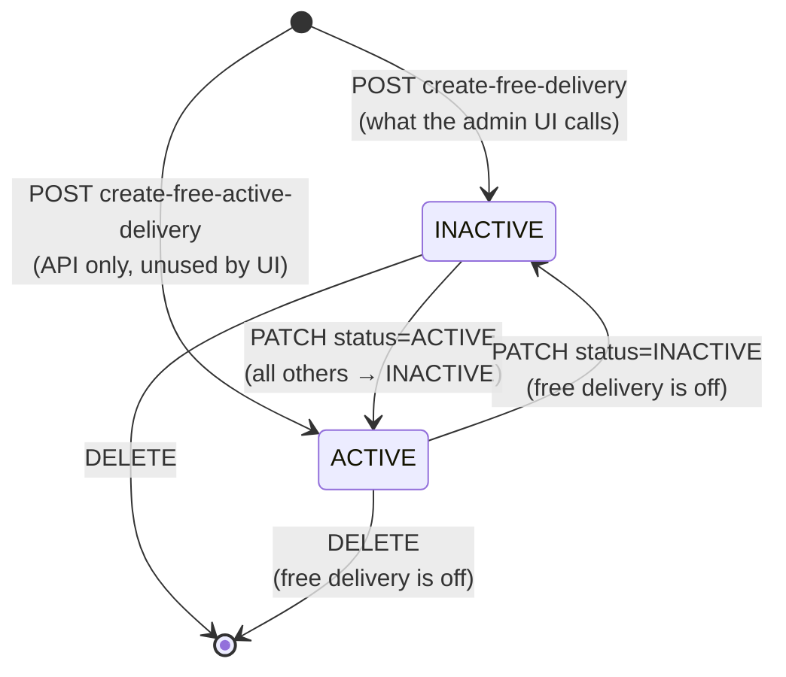
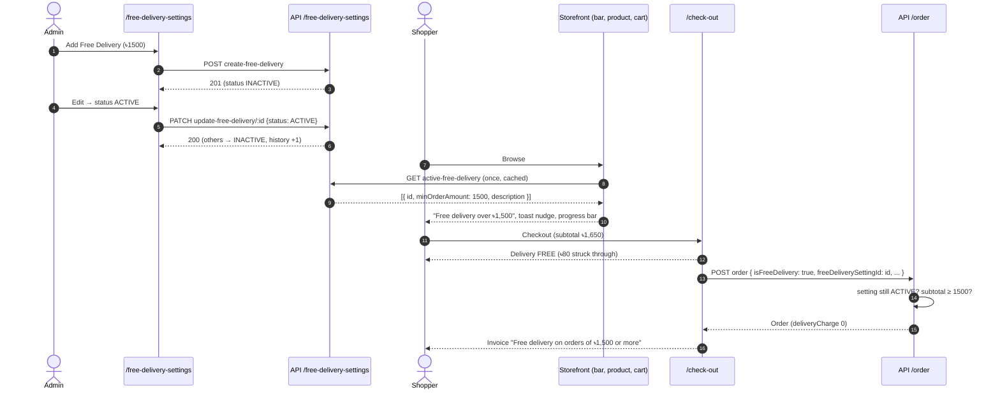

# Free Delivery Module — Frontend Technical Documentation

> **Scope:** everything the Natura Care client (Next.js 15, App Router) does with **free delivery offers**: how an admin creates, activates, deactivates and deletes a "free delivery over ৳X" setting, how the storefront advertises it (promotion bar, product page, add-to-cart toast, cart progress bar), how checkout decides to waive the delivery charge, and how a waived charge shows up on orders and invoices.
>
> **Audience:** frontend engineers joining or maintaining the project.
>
> **Related:** [Project README](../README.md) (run, build, Docker) · [Cart module](./cart.md) (cart totals, `/my-cart`, [§5.4 Free delivery](./cart.md#54-free-delivery)) · [Order module](./order.md) (placing an order, admin order list, invoices) · [Delivery pricing](./delivery-pricing.md) (the per-zone charge that free delivery waives) · [Promotion module](./promotion.md) (coupons and the promotion bar) · [Product module](./product.md) (add-to-cart buttons) · [User module](./user.md) (roles, middleware)

| | |
|---|---|
| **Module root** | [`src/modules/free-delivery/`](../src/modules/free-delivery/) |
| **Admin route** | `/free-delivery-settings` (admin route group) — **`ADMIN` only** |
| **Storefront touch points** | Promotion bar (every page), `/product-details/[slug]`, product cards, `/my-cart`, `/check-out`, invoices |
| **Backend resource** | `/free-delivery-settings/*` on `NEXT_PUBLIC_API_BASE_URL` (server module `natura-care-server/src/modules/free-delivery-settings/`) |
| **Roles** | `ADMIN` (manage) · Guest, `CUSTOMER` (see and use the offer) · `EMPLOYEE` (no access to the admin page) |
| **Last reviewed** | 2026-10-24 |

---

## Table of Contents

1. [Overview](#1-overview)
2. [Domain Model & Business Logic](#2-domain-model--business-logic)
   - [2.1 What a free delivery setting is](#21-what-a-free-delivery-setting-is)
   - [2.2 Status and the "only one active" rule](#22-status-and-the-only-one-active-rule)
   - [2.3 Immutable terms](#23-immutable-terms)
   - [2.4 When an order qualifies](#24-when-an-order-qualifies)
   - [2.5 Lifecycle](#25-lifecycle)
3. [Tech Stack Used by This Module](#3-tech-stack-used-by-this-module)
4. [File Architecture](#4-file-architecture)
5. [Routes & Role-Based Access](#5-routes--role-based-access)
   - [5.1 Page routes](#51-page-routes)
   - [5.2 Middleware rules](#52-middleware-rules)
   - [5.3 Admin sidebar](#53-admin-sidebar)
   - [5.4 API roles and the viewer model](#54-api-roles-and-the-viewer-model)
   - [5.5 Access matrix](#55-access-matrix)
6. [End-to-End Workflow](#6-end-to-end-workflow)
7. [Admin Section — Settings List (`/free-delivery-settings`)](#7-admin-section--settings-list-free-delivery-settings)
   - [7.1 Screen layout](#71-screen-layout)
   - [7.2 Data fetching, sort & pagination](#72-data-fetching-sort--pagination)
   - [7.3 Columns](#73-columns)
   - [7.4 Modals](#74-modals)
8. [Admin Section — Add Setting](#8-admin-section--add-setting)
9. [Admin Section — Edit (Status) Setting](#9-admin-section--edit-status-setting)
10. [Admin Section — Delete Setting](#10-admin-section--delete-setting)
11. [Storefront — Where the Offer Appears](#11-storefront--where-the-offer-appears)
    - [11.1 Promotion bar](#111-promotion-bar)
    - [11.2 Product details page](#112-product-details-page)
    - [11.3 Add-to-cart toast nudge](#113-add-to-cart-toast-nudge)
    - [11.4 Cart page (`/my-cart`)](#114-cart-page-my-cart)
12. [Storefront — Checkout](#12-storefront--checkout)
    - [12.1 Deciding free delivery](#121-deciding-free-delivery)
    - [12.2 What the UI shows](#122-what-the-ui-shows)
    - [12.3 Order payload](#123-order-payload)
    - [12.4 Server-side re-check](#124-server-side-re-check)
13. [After Checkout — Orders & Invoices](#13-after-checkout--orders--invoices)
14. [API Reference](#14-api-reference)
15. [Types](#15-types)
16. [Validation Schemas](#16-validation-schemas)
17. [Constants](#17-constants)
18. [Hooks](#18-hooks)
19. [Utilities & Display Helpers](#19-utilities--display-helpers)
20. [Reusable Components](#20-reusable-components)
21. [Data Fetching & Cache Keys](#21-data-fetching--cache-keys)
22. [Error Handling](#22-error-handling)
23. [Business Rules Summary](#23-business-rules-summary)
24. [Known Issues & Technical Debt](#24-known-issues--technical-debt)
25. [How-To Recipes](#25-how-to-recipes)
26. [Change Log](#26-change-log)

---

## 1. Overview

A **free delivery setting** is a single business rule: *"orders whose subtotal reaches ৳X get free delivery."* The admin can keep many settings on file, but **at most one is active**. The active one is what every shopper sees and what checkout applies.

| Audience | Where | What they can do / see |
|---|---|---|
| **Admin** | `/free-delivery-settings` | List all settings, add a new one, change a setting's status (activate / deactivate), see who created and changed it, delete it. |
| **Guest & Customer** | Promotion bar (top of every storefront page) | "Free delivery over ৳1,500" link to `/product`. |
| **Guest & Customer** | Product details page | A green "Free delivery on orders of ৳1,500 or more" info card. |
| **Guest & Customer** | Product card / product details "Add to cart" | Toast: "*X added to cart! Add ৳350 more for FREE delivery.*" |
| **Guest & Customer** | `/my-cart` | Progress bar towards the threshold; order summary shows Delivery **FREE** once reached. |
| **Guest & Customer** | `/check-out` | Compact progress bar; the active zone's charge is struck through and shown as **FREE**; grand total drops by the charge. |
| **Customer & Admin** | Invoice, My Orders, admin order list / view | "Free" delivery badge and "*Free delivery on orders of ৳1,500 or more*" explanation. |
| **Employee** | — | No access to the admin page (not in `EMPLOYEE_ROUTES`, hidden in the sidebar). |

Key design decisions:

- **One active offer, enforced by the server.** Activating a setting deactivates every other setting in the same database transaction. The client only warns about it ([§2.2](#22-status-and-the-only-one-active-rule)).
- **Terms are immutable.** After creation only `status` can change. To change the amount, create a new setting — so past orders keep the terms they were placed under ([§2.3](#23-immutable-terms)).
- **The threshold compares the subtotal *before* the coupon.** Client and server both use the item subtotal (discount prices applied, coupon not subtracted) ([§2.4](#24-when-an-order-qualifies)).
- **The client decides, the server verifies.** Checkout computes `isFreeDelivery` for display and sends it with the setting id; the server re-checks that the setting is still active and the subtotal really reaches it before setting the charge to 0 ([§12.4](#124-server-side-re-check)).
- **One read hook for the whole storefront.** Every storefront surface reads the active offer through [`useFreeDelivery`](../src/modules/free-delivery/hooks/useFreeDelivery.ts), which shares a single TanStack Query cache entry (`getActiveFreeDelivery`), so the offer is fetched once per page load.
- **Free delivery is a waiver, not a price.** The delivery charge itself comes from the [Delivery pricing](./delivery-pricing.md) module (per zone: Inside / Outside Dhaka). Free delivery only sets it to ৳0.

[↑ Back to top](#table-of-contents)

---

## 2. Domain Model & Business Logic

### 2.1 What a free delivery setting is

| Field | Type | Set by | Meaning |
|---|---|---|---|
| `id` | `number` | Server | Primary key; used in every admin URL and sent with orders as `freeDeliverySettingId`. |
| `sid` | `string` | Server | Public short id (not used by the client UI). |
| `minOrderAmount` | `number` (BDT, ≤ 2 decimals) | Admin, on create | The subtotal at or above which delivery is free. `1 … 1,000,000`. |
| `description` | `string \| null` | Admin, on create | Optional note (≤ 255 chars on the server). Shown in the admin list; returned to the storefront but not rendered there. |
| `status` | `"ACTIVE" \| "INACTIVE"` | Server on create, admin on edit | Whether checkout offers it. |
| `createdById / createdByName / createdByRole` | | Server | Who created it (name/role are `null` if the user was deleted). |
| `createdAt / updatedAt` | ISO string | Server | Timestamps. |
| `changeHistory` | `IChangedHistory[]` | Server | Append-only list of status changes with a **snapshot** of the user's name and role at the time. |

### 2.2 Status and the "only one active" rule



- At most **one** row is `ACTIVE`. The server runs `deactivateAll` and the update in **one transaction**, so there is never a moment with two active offers.
- **Zero** active rows is a valid state: free delivery is switched off store-wide. The storefront then hides every free-delivery surface.
- Sending the status a setting already has is a no-op on the server (no history entry). The client short-circuits this case with a "No changes detected!" toast ([§9](#9-admin-section--edit-status-setting)).
- `ARCHIVED` exists in the shared Prisma `Status` enum but is **not** used for this module.

### 2.3 Immutable terms

`minOrderAmount` and `description` cannot be edited — neither the client schema (`UpdateFreeDeliverySchema` has only `status`) nor the server DTO accepts them. Orders link to the setting by `freeDeliverySettingId`, and the invoice explains *why* delivery was free using that setting's amount ([§13](#13-after-checkout--orders--invoices)). Editing the amount in place would rewrite history for past orders.

**To change the threshold:** add a new setting, then activate it (the old one is deactivated automatically).

### 2.4 When an order qualifies

```text
subtotal      = Σ line unit price × quantity     (unit = discountPrice when lower than price)
qualifies     = an ACTIVE setting exists  AND  subtotal ≥ setting.minOrderAmount
deliveryFee   = qualifies ? 0 : deliveryPricing[zone].charge
grandTotal    = subtotal − couponDiscount + deliveryFee
```

- The comparison is **inclusive** (`≥`): a ৳1,500 cart qualifies for a ৳1,500 threshold.
- The **coupon discount is not subtracted** before the comparison. A ৳1,600 cart with a ৳200 coupon still gets free delivery on a ৳1,500 threshold.
- The zone (Inside / Outside Dhaka) does not matter: the waiver applies to either zone.
- On the client the subtotal is `cartTotals(cartItems).total` from [`cart-pricing.utils.ts`](../src/modules/cart/utils/cart-pricing.utils.ts) — the **same** number used by the cart page, checkout and the toast nudge, after the cart's price re-check (see [Cart §7.2](./cart.md#72-opening-the-cart-re-price--re-stock)).
- On the server the subtotal is recalculated from the database prices with `Decimal` and compared with `subtotal.gte(minOrderAmount)`.

### 2.5 Lifecycle

| Step | Actor | Result |
|---|---|---|
| 1. Add setting (৳1,500) | Admin | Saved as `INACTIVE`. Storefront unchanged. |
| 2. Edit → status `ACTIVE` | Admin | This setting becomes the offer; any previously active one becomes `INACTIVE`. History entry appended. |
| 3. Shoppers browse | Guest / Customer | Promotion bar, product page, toast, cart and checkout all show "free delivery over ৳1,500". |
| 4. Order placed with subtotal ≥ ৳1,500 | Customer | Order saved with `deliveryCharge = 0`, `isFreeDelivery = true`, `freeDeliverySettingId = id`. |
| 5. Add new setting (৳2,000) and activate | Admin | ৳1,500 setting goes `INACTIVE`; old orders still link to it and still explain "orders of ৳1,500 or more". |
| 6. Delete a setting | Admin | Row removed; orders that used it keep `deliveryCharge = 0` but lose the link (invoice falls back to "Free delivery offer applied"). |

[↑ Back to top](#table-of-contents)

---

## 3. Tech Stack Used by This Module

| Concern | Technology | Used for |
|---|---|---|
| Framework | **Next.js 15** (App Router), **React 19** | Admin route, `next/dynamic` code-splitting, `next/link` |
| Language | **TypeScript** | `IFreeDelivery`, `IChangedHistory`, schema-inferred form types |
| Server state | **TanStack Query v5** via shared [`useGet` / `useGetAll`](../src/hooks/api/useGet.ts), [`usePost`](../src/hooks/api/usePost.ts), [`usePatch`](../src/hooks/api/usePatch.ts), [`useDelete`](../src/hooks/api/useDelete.ts) | Active offer, admin list, create / status change / delete |
| HTTP | **Axios** ([`axiosInstance`](../src/lib/axios/axiosInstance.ts)) | Requests, bearer token, error envelope |
| Forms | **react-hook-form** + **zod** (`@hookform/resolvers/zod`) | Add form, status form |
| Table | **@tanstack/react-table** via project [`CustomTable`](../src/components/data-display/table/CustomTable.tsx) | Admin list with pagination |
| Styling | **Tailwind CSS** + project tokens (`greenPrimary-*`, `neutralPrimary-*`, `warningPrimary-*`, `blueSecondary-*`, `purpleSecondary-*`, `success-*`) and **tw-animate-css** (`animate-in fade-in slide-in-from-bottom-3`) | All UI, staggered modal animation |
| Icons | **lucide-react** (`Truck`, `PartyPopper`, `History`, `AlertTriangle` …), **react-icons** (`TbSettingsDollar` in the sidebar) | |
| Notifications | **sonner** | Success / error / "No changes detected!" / add-to-cart nudge |
| Access control | Next.js **middleware** ([`src/middleware.ts`](../src/middleware.ts)) + `jwt-decode` | `ADMIN`-only admin page |

[↑ Back to top](#table-of-contents)

---

## 4. File Architecture

```text
src/
├── app/(admin)/free-delivery-settings/
│   └── page.tsx                          # Route: metadata + dynamic import of <FreeDeliverySettings/>
│
├── modules/free-delivery/                 # ★ The module
│   ├── admin/
│   │   ├── FreeDeliverySettings.tsx       # ★ Admin page: header, table, add/edit/delete modals
│   │   ├── AddFreeDelivery.tsx            # Add form (amount + description) → POST create-free-delivery
│   │   ├── EditFreeDelivery.tsx           # Detail + status form + change-history timeline → PATCH
│   │   └── free-delivery.columns.tsx      # Table columns + shared display helpers
│   │                                      #   (formatAmount, formatDateTime, STATUS_STYLES, StatusPill)
│   ├── hooks/
│   │   ├── useFreeDelivery.ts             # ★ Reads the ACTIVE offer for the storefront
│   │   └── useFreeDeliveryNudge.ts        # Builds the add-to-cart toast text + duration
│   ├── schemas/
│   │   └── free-delivery.schema.ts        # Zod: CreateFreeDeliverySchema, UpdateFreeDeliverySchema
│   └── types/
│       └── free-delivery.types.ts         # FreeDeliveryStatus, IChangedHistory, IFreeDelivery
│
│   # ---------- consumers outside the module ----------
├── components/layout/
│   ├── promo-bar/PromotionBar.tsx         # "Free delivery over ৳X" in the top bar
│   └── sidebar/AdminSidebar.tsx           # "Free Delivery" menu item (admin only)
├── modules/cart/public/
│   ├── FreeDeliveryProgress.tsx           # ★ Progress bar (cart: full, checkout: compact)
│   ├── MyCart.tsx                         # Reads the threshold, renders progress + summary
│   └── OrderSummary.tsx                   # "Delivery: FREE / Calculated at checkout"
├── modules/checkout/public/
│   ├── CheckOut.tsx                       # ★ Decides isFreeDelivery, builds the order payload
│   ├── DeliveryMethod.tsx                 # Zone card: struck-through charge + "FREE"
│   ├── CheckoutSummary.tsx                # Delivery row in the summary
│   ├── Invoice.tsx / InvoicePDF.tsx       # "Free delivery on orders of ৳X or more"
├── modules/product/
│   ├── public/product-details/DetailsWithAction.tsx  # Info card + toast nudge
│   └── shared/ProductCard.tsx             # Toast nudge
├── modules/order/
│   ├── types/order.types.ts               # isFreeDelivery, freeDeliverySettingId, freeDeliveryMinOrderAmount, appliedFreeDelivery
│   ├── utils/invoice.utils.ts             # Derives delivery.isFree / freeMinOrderAmount for invoices
│   └── admin/order.columns.tsx, ViewOrder.tsx        # "Free" delivery badge for admins
└── middleware.ts                          # /free-delivery-settings in ADMIN_ONLY_ROUTES
```

**Ownership rule of thumb:** anything that *manages* settings lives in `modules/free-delivery/admin`; anything that *reads the active offer* goes through `useFreeDelivery` / `useFreeDeliveryNudge`; the progress bar lives in the cart module because it is a cart UI element fed by cart totals.

[↑ Back to top](#table-of-contents)

---

## 5. Routes & Role-Based Access

### 5.1 Page routes

| Route | File | Group | Rendered component | Notes |
|---|---|---|---|---|
| `/free-delivery-settings` | [`app/(admin)/free-delivery-settings/page.tsx`](<../src/app/(admin)/free-delivery-settings/page.tsx>) | `(admin)` | `FreeDeliverySettings` (via `next/dynamic`, `<LoadingPage/>` while loading) | Metadata: *"Free Delivery \| Natura Care Limited"*. |

The module has **no storefront route** of its own; it is embedded in existing pages ([§11](#11-storefront--where-the-offer-appears), [§12](#12-storefront--checkout)).

### 5.2 Middleware rules

From [`src/middleware.ts`](../src/middleware.ts):

| Rule | Effect on `/free-delivery-settings` |
|---|---|
| Listed in `ADMIN_ONLY_ROUTES` (`startsWith` match) | Treated as an admin route. |
| **Not** listed in `EMPLOYEE_ROUTES` | An `EMPLOYEE` is redirected to `/dashboard`. |
| Not logged in | Redirected to `/login`. |
| `CUSTOMER` | Redirected to `/`. |
| Access token expired but refresh token present | Request allowed; the axios layer refreshes the token. |

The storefront surfaces (promotion bar, product pages, `/my-cart`, `/check-out`) follow their own pages' rules. Note that `/my-cart` and `/check-out` are **guest / customer only** — admins and employees are redirected away (see [Cart §4](./cart.md#4-routing--access-control)), so staff never see the checkout waiver.

### 5.3 Admin sidebar

[`AdminSidebar.tsx`](../src/components/layout/sidebar/AdminSidebar.tsx) lists **"Free Delivery"** → `/free-delivery-settings` with the `TbSettingsDollar` icon. The item has **no `employee: true` flag**, so it is filtered out of the employee sidebar — matching the middleware.

### 5.4 API roles and the viewer model

| Endpoint | Guard | Who |
|---|---|---|
| `POST create-free-delivery`, `POST create-free-active-delivery`, `GET all-free-deliveries`, `PATCH update-free-delivery/:id`, `DELETE delete-free-delivery/:id` | `JwtAuthGuard` + `RolesGuard` + `@Roles(ADMIN)` | Admin only (401 without token, 403 for other roles) |
| `GET active-free-delivery` | `IdentifyViewerGuard` (optional token) | Public. **Admins** get the full `AdminFreeDeliveryDto`; **guests and customers** get only `id`, `minOrderAmount`, `description` (`PublicFreeDeliveryDto`). |

This is why `IFreeDelivery` documents that public callers receive a subset of fields — storefront code must only rely on `id`, `minOrderAmount` and `description`.

### 5.5 Access matrix

| Capability | Guest | Customer | Employee | Admin |
|---|:-:|:-:|:-:|:-:|
| See offer in promotion bar / product page | ✅ | ✅ | ✅ | ✅ |
| See cart / checkout progress & waiver | ✅ | ✅ | ❌ (no cart) | ❌ (no cart) |
| Get free delivery on an order | ✅ | ✅ | — | — |
| Open `/free-delivery-settings` | ❌ | ❌ | ❌ | ✅ |
| Add / activate / deactivate / delete | ❌ | ❌ | ❌ | ✅ |

[↑ Back to top](#table-of-contents)

---

## 6. End-to-End Workflow



[↑ Back to top](#table-of-contents)

---

## 7. Admin Section — Settings List (`/free-delivery-settings`)

Component: [`FreeDeliverySettings.tsx`](../src/modules/free-delivery/admin/FreeDeliverySettings.tsx)

### 7.1 Screen layout

```text
┌───────────────────────────────────────────────────────────────────────┐
│ Free Delivery Settings                           [ + Add Free Delivery ]│
├───────────────────────────────────────────────────────────────────────┤
│ Minimum Order │ Description │ Status        │ Created     │ Last Change │ Action │
│ 1,500 BDT     │ Eid offer…  │ ● active      │ (R) Rahim   │ 24 Oct 2026 │ ✎  🗑  │
│ Free delivery │             │ Shown at      │ ADMIN       │ by Rahim ·  │        │
│ at or above   │             │ checkout      │ 20 Oct 2026 │ 2 changes   │        │
├───────────────────────────────────────────────────────────────────────┤
│                                   ‹ 1 2 › · rows per page [10]       │
└───────────────────────────────────────────────────────────────────────┘
```

### 7.2 Data fetching, sort & pagination

```ts
useGetAll<{ data: IFreeDelivery[]; meta: IPaginationMeta }>(
  "/free-delivery-settings/all-free-deliveries",
  ["getAllFreeDelivery", page, limit, searchTerm, sortOrder],
  { page, limit, search, sortOrder },
);
```

| State | Default | Wired to |
|---|---|---|
| `currentPage` | `1` | `CustomTable.onPageChange` |
| `pageSize` | `10` | `CustomTable.onPageSizeChange` |
| `searchTerm` | `""` | `CustomTable.onSearchChange` — but `showSearchbar={false}`, so it is never set |
| `sortOrder` | `"asc"` | `CustomTable.onSortChange` — but every column has `enableSorting: false`, so it never changes |

> ⚠️ The server lists **newest first by default** and `sortOrder=asc` means **oldest first**. Because the client always sends `"asc"`, the admin list currently shows the **oldest** setting at the top. See [TD-2](#24-known-issues--technical-debt).

`useGetAll` returns the whole envelope, so the table reads `data.data` and `data.meta.totalPages` / `totalItems`.

### 7.3 Columns

Defined in [`free-delivery.columns.tsx`](../src/modules/free-delivery/admin/free-delivery.columns.tsx) as `FreeDeliveryColumns(handleEdit, handleDelete)`:

| Column | Accessor | Renders |
|---|---|---|
| Minimum Order | `minOrderAmount` | `formatAmount()` → "1,500 BDT" + caption "Free delivery at or above" |
| Description | `description` | Truncated to 260px with native `title` tooltip; italic "No description" if empty |
| Status | `status` | `<StatusPill/>` (pulsing green dot when active) + "Shown at checkout" for `ACTIVE` |
| Created | `createdByName` | Initial avatar, name (or "Deleted user"), role chip, `formatDateTime(createdAt)` |
| Last Change | `changeHistory` | Last entry's date, "by {name} · N changes", or "Never changed" |
| Action | — | `CustomTooltip` edit / delete buttons |

### 7.4 Modals

| Modal | Opened by | State | Component |
|---|---|---|---|
| Add | `AddButton` | local `openModal` boolean | `CustomModal2` (`w-[60vw]`) → `AddFreeDelivery` |
| Edit | Edit icon | `useHandleModalState<IFreeDelivery>()` → `handleOpen("edit", row)` | `CustomModal2` (responsive width, `max-h-[85vh]`, `scrollbar-brand`) → `EditFreeDelivery` |
| Delete | Delete icon | local `deleteTarget: IFreeDelivery \| null` | `ConfirmModal` (`variant="danger"`) |

[↑ Back to top](#table-of-contents)

---

## 8. Admin Section — Add Setting

Component: [`AddFreeDelivery.tsx`](../src/modules/free-delivery/admin/AddFreeDelivery.tsx)

| Field | Component | Rules (client) |
|---|---|---|
| Minimum Order Amount | `InputField` (`inputType="number"`, required) | `z.coerce.number().min(1).max(1_000_000)` |
| Description | `TextAreaField` | optional, empty string allowed |

Flow:

1. `react-hook-form` + `zodResolver(CreateFreeDeliverySchema)` validate on submit (and on blur via `trigger`).
2. Payload is **only** `{ minOrderAmount, description }` — the schema's `status` default is not sent.
3. `usePost("/free-delivery-settings/create-free-delivery")` → on a 2xx response the modal closes and the list refetches.
4. The new setting is **always `INACTIVE`**. The admin must open **Edit** and set it to `ACTIVE` to make it the offer.

> The server also exposes `POST create-free-active-delivery` (create + activate in one transaction). The UI does not use it yet — see [Recipe: "Add and activate in one step"](#add-and-activate-in-one-step).

[↑ Back to top](#table-of-contents)

---

## 9. Admin Section — Edit (Status) Setting

Component: [`EditFreeDelivery.tsx`](../src/modules/free-delivery/admin/EditFreeDelivery.tsx)

The edit modal is really a **detail view with a status form**. Every block fades/slides in with a staggered delay (`ENTER` class + `enterDelay(ms)`, disabled under `prefers-reduced-motion`).

| Block | Content |
|---|---|
| Hero | Truck icon, "Orders from 1,500 BDT", `StatusPill`, one-line explanation of the current status |
| Stat tiles (`StatTile`) | **Minimum Order** · **Status Changes** (count + last change date) · **Created** (date + "by Name (role)" or "Creator no longer exists") |
| Description (`Section`) | Full text with line breaks, or "No description added." |
| Status form (`Section`) | `SingleSelectSearch` with `STATUS_OPTIONS`; contextual warnings; immutability note; Cancel / Save Changes |
| Change History (`Section`) | Vertical timeline, **newest first**, each with a colored dot, `StatusPill`, date, user initial, name and role |

Contextual warnings, computed with `useWatch` on `status`:

| Condition | Warning |
|---|---|
| `willActivate` (current ≠ ACTIVE, selected = ACTIVE) | "**Only one offer can be active.** Activating this one turns off the free delivery offer that is active now." |
| `willDeactivate` (current = ACTIVE, selected = INACTIVE) | "**Free delivery will be off.** Checkout won't offer free delivery until another setting is activated." |

Submit logic:

```ts
if (!isDirty || !dirtyFields.status || formData.status === rowData.status) {
  toast.info("No changes detected!");   // no request is sent
  setOpen(false);
  return;
}
updateFreeDelivery({
  endpoint: `/free-delivery-settings/update-free-delivery/${rowData.id}`,
  data: { status: formData.status },
});
```

`usePatch` shows the server message as a success/error toast; on 2xx the modal closes and the list refetches (so the previously active row now shows `inactive`).

If the modal opens without data, it renders an empty state ("No free delivery details available.").

[↑ Back to top](#table-of-contents)

---

## 10. Admin Section — Delete Setting

Handled inside [`FreeDeliverySettings.tsx`](../src/modules/free-delivery/admin/FreeDeliverySettings.tsx) with the shared [`ConfirmModal`](../src/components/primitives/modal/ConfirmModal.tsx):

- Title: *"Delete free delivery setting?"* · Description: *"This permanently removes the setting. Orders that already used it keep their delivery charge. This can't be undone."*
- Body: a summary card ("Orders from 1,500 BDT", description, status pill).
- If the target is **ACTIVE**, an extra warning: *"This is the active offer. Checkout will stop offering free delivery until another setting is activated."*
- Confirm → `useDelete("getAllFreeDelivery")` → `DELETE /free-delivery-settings/delete-free-delivery/:id`; on success the `getAllFreeDelivery` queries are invalidated and the modal closes.

Deleting is a **hard delete**. Past orders keep `deliveryCharge = 0` and `isFreeDelivery = true`, but the link to the setting is cleared, so their invoice explanation falls back to "Free delivery offer applied" ([§13](#13-after-checkout--orders--invoices)). Prefer **deactivating** a setting over deleting it if its history matters.

[↑ Back to top](#table-of-contents)

---

## 11. Storefront — Where the Offer Appears

Every surface below derives the threshold the same way:

```ts
const { isFreeDeliveryAvailable, minimumOrderAmountForFreeDelivery } = useFreeDelivery();
const threshold = isFreeDeliveryAvailable ? Number(minimumOrderAmountForFreeDelivery) || 0 : 0;
// threshold <= 0  →  render nothing
```

### 11.1 Promotion bar

[`PromotionBar.tsx`](../src/components/layout/promo-bar/PromotionBar.tsx) builds a `freeDeliveryOffer` link ("🚚 **Free delivery** over **৳1,500**" → `/product`) when `threshold > 0`:

- **No current coupon promotion:** brand message (home "top title" or the default slogan) · dot · free-delivery link.
- **Coupon promotion running:** free-delivery link · dot · deal badge / countdown / coupon code.
- **No active setting:** the link is simply omitted; the bar keeps its fixed height either way.

### 11.2 Product details page

[`DetailsWithAction.tsx`](../src/modules/product/public/product-details/DetailsWithAction.tsx) shows a green info card under the buy buttons when `minimumOrderAmountForFreeDelivery` is truthy: *"**Free delivery** on orders of ৳1,500 or more."*

### 11.3 Add-to-cart toast nudge

[`useFreeDeliveryNudge`](../src/modules/free-delivery/hooks/useFreeDeliveryNudge.ts) is called by [`ProductCard`](../src/modules/product/shared/ProductCard.tsx) and `DetailsWithAction` **after** the line is written to `localCart`, so the new item is counted:

| Situation | Toast text | Duration |
|---|---|---|
| No active offer | "Neem Face Wash added to cart!" | 500 ms |
| Below threshold | "… added to cart! Add ৳350 more for FREE delivery." | 2,500 ms |
| At / above threshold | "… added to cart! You've unlocked FREE delivery!" | 2,500 ms |

`remaining = threshold − cartTotals(localCart.get()).total`. Note it reads the raw `localStorage` cart, whose prices are the add-time snapshot until the cart page re-prices them (see [Cart §7.2](./cart.md#72-opening-the-cart-re-price--re-stock)).

### 11.4 Cart page (`/my-cart`)

[`MyCart.tsx`](../src/modules/cart/public/MyCart.tsx):

- Renders [`FreeDeliveryProgress`](../src/modules/cart/public/FreeDeliveryProgress.tsx) (full variant) above the items when `threshold > 0`.
- Passes `freeDeliveryThreshold` to [`OrderSummary`](../src/modules/cart/public/OrderSummary.tsx), whose Delivery row reads **FREE** (green) when `total ≥ threshold`, otherwise "Calculated at checkout" plus "+ delivery charge for your area" under the subtotal.

`FreeDeliveryProgress` states:

| State | Look | Text |
|---|---|---|
| Below threshold | Amber card, truck icon, amber→green gradient bar | "Add **৳350** more for **FREE delivery**" · "Free delivery on orders of ৳1,500 or more. *Shop more*" |
| Unlocked | Green card, party-popper icon, solid green bar | "You've unlocked FREE delivery!" · "Your delivery charge will be ৳0 at checkout." |
| `compact` (checkout) | Smaller padding, second line hidden | Headline + bar only |

Accessibility: the card is `role="status" aria-live="polite"` (screen readers hear the change as quantities change) and the bar is a `role="progressbar"` with `aria-valuenow` 0–100. The bar never renders narrower than 4% so it is always visible.

[↑ Back to top](#table-of-contents)

---

## 12. Storefront — Checkout

Component: [`CheckOut.tsx`](../src/modules/checkout/public/CheckOut.tsx)

### 12.1 Deciding free delivery

```ts
const { freeDelivery, isFreeDeliveryAvailable } = useFreeDelivery();

const totals = cartTotals(cartItems);
const freeDeliveryThreshold = Number(freeDelivery?.[0]?.minimumOrder ?? 0);
const isFreeDelivery = isFreeDeliveryAvailable && totals.total >= freeDeliveryThreshold;
const deliveryFee = isFreeDelivery ? 0 : deliveryCharge;          // deliveryCharge from the zone
const grandTotal = totals.total - promotionInfo.promotionAmount + deliveryFee;
```

`deliveryCharge` is the selected zone's charge from `useDeliveryPricing()`; the zone is set automatically from the shipping division. If pricing hasn't loaded or the zone isn't found, it falls back to **৳200**.

### 12.2 What the UI shows

| Place | Free delivery | Not free |
|---|---|---|
| Top of form | `FreeDeliveryProgress compact` (only if an offer exists and threshold > 0) | same |
| [`DeliveryMethod`](../src/modules/checkout/public/DeliveryMethod.tsx) (step 3) — selected zone card | **FREE** (green) over ~~৳80~~ | ৳80 |
| [`CheckoutSummary`](../src/modules/checkout/public/CheckoutSummary.tsx) — Delivery row | **FREE** ~~৳80~~ | ৳80 (skeleton while pricing loads) |
| Grand total | excludes the charge | includes the charge |

Only the **selected** zone card shows the waiver; the other (disabled) zone card shows its normal price.

### 12.3 Order payload

```ts
{
  ...,
  items: cartItemsForOrder,
  promotionId: promotionInfo.promotionId || null,
  isFreeDelivery,                                                     // client's decision
  freeDeliverySettingId: isFreeDeliveryAvailable ? freeDelivery[0].id : null,
}
```

`freeDeliverySettingId` is sent whenever an offer exists, **even when the cart does not qualify** (`isFreeDelivery: false`).

### 12.4 Server-side re-check

The client's numbers are for display only. In `OrderService.create` the server:

1. Rejects `isFreeDelivery: true` without `freeDeliverySettingId` (400 *"Free delivery setting ID is required when isFreeDelivery is true."*).
2. If `isFreeDelivery` is true, loads the setting with `findActiveOneById` — if it was **deactivated or deleted since the page loaded**, the order is rejected with 400 *"Free delivery setting not found or no longer active"*.
3. Recomputes the subtotal from database prices and sets `deliveryCharge = 0` **only if** `isFreeDelivery && subtotal ≥ minOrderAmount`; otherwise uses the zone's base charge.
4. Stores `isFreeDelivery`, `freeDeliverySettingId` and the final `deliveryCharge` on the order.

So a tampered request can't get free delivery below the threshold; at worst a stale page gets a clear error and the shopper retries.

[↑ Back to top](#table-of-contents)

---

## 13. After Checkout — Orders & Invoices

| Where | Logic | Shows |
|---|---|---|
| [`invoice.utils.ts`](../src/modules/order/utils/invoice.utils.ts) (`buildInvoiceView`) | `isFree = charge === 0 && (freeDeliveryMinOrderAmount !== null \|\| isFreeDelivery)` | `delivery.isFree`, `delivery.freeMinOrderAmount` |
| [`Invoice.tsx`](../src/modules/checkout/public/Invoice.tsx) / [`InvoicePDF.tsx`](../src/modules/checkout/public/InvoicePDF.tsx) | from the view | Delivery (Inside Dhaka) **Free** — "Free delivery on orders of ৳1,500 or more", or "Free delivery offer applied" if the setting was deleted |
| [`order.columns.tsx`](../src/modules/order/admin/order.columns.tsx) (admin list) | `isFreeDelivery && Number(deliveryCharge) === 0` | Small green 🚚 **Free** tag next to the total |
| [`ViewOrder.tsx`](../src/modules/order/admin/ViewOrder.tsx) (admin view) | same | Delivery row "৳0" with a **Free** chip |

Free is shown **only when the charge was actually waived** (`deliveryCharge === 0`). An order that claimed `isFreeDelivery` but didn't qualify on the server is shown with its normal charge.

When an admin **edits order items** later, the server recalculates the subtotal and grand total but keeps the stored `deliveryCharge` — free delivery is **not** re-evaluated after placement (see [TD-6](#24-known-issues--technical-debt)).

[↑ Back to top](#table-of-contents)

---

## 14. API Reference

Base: `NEXT_PUBLIC_API_BASE_URL` + `/free-delivery-settings`. All responses use the standard envelope `{ statusCode, success, message, data, meta? }`.

### Endpoints used by the client

| Method & path | Role | Called from | Body / query | Returns |
|---|---|---|---|---|
| `GET /active-free-delivery` | Public (optional token) | `useFreeDelivery` | none (no pagination → all active) | `IFreeDelivery[]` — normally 0 or 1 item; public fields only for non-admins |
| `GET /all-free-deliveries` | Admin | `FreeDeliverySettings` | `page`, `limit`, `search` (matches description), `sortOrder` | `{ data: IFreeDelivery[], meta }` |
| `POST /create-free-delivery` | Admin | `AddFreeDelivery` | `{ minOrderAmount, description? }` | 201, created setting (`INACTIVE`) |
| `PATCH /update-free-delivery/:id` | Admin | `EditFreeDelivery` | `{ status: "ACTIVE" \| "INACTIVE" }` | 200, updated setting |
| `DELETE /delete-free-delivery/:id` | Admin | `FreeDeliverySettings` | — | 200 |

### Available but unused by the client

| Method & path | Purpose |
|---|---|
| `POST /create-free-active-delivery` | Create **and** activate in one transaction (deactivates all others). |

### Related endpoint owned by another module

| Method & path | Free-delivery fields |
|---|---|
| `POST /order` (Order module) | Request: `isFreeDelivery`, `freeDeliverySettingId`. Response / order reads: `isFreeDelivery`, `freeDeliverySettingId`, `freeDeliveryMinOrderAmount`, `appliedFreeDelivery` (admin). |

Server validation (create): `minOrderAmount` required, number, ≤ 2 decimals, `1 … 1,000,000`; `description` optional string ≤ 255 chars (trimmed; empty → none); unknown fields rejected. Update: `status` required, `ACTIVE` or `INACTIVE`. Non-integer `:id` → 400; unknown id → 404.

[↑ Back to top](#table-of-contents)

---

## 15. Types

[`free-delivery.types.ts`](../src/modules/free-delivery/types/free-delivery.types.ts)

```ts
export type FreeDeliveryStatus = "ACTIVE" | "INACTIVE";

/** One status change, with a snapshot of who made it. */
export interface IChangedHistory {
  status: FreeDeliveryStatus;
  updatedBy: number;
  updatedByName: string;
  updatedByRole: string;
  updatedAt: string;
}

/** Guests and customers (GET active-free-delivery) only get id, minOrderAmount and description. */
export interface IFreeDelivery {
  id: number;
  sid: string;
  minOrderAmount: number;
  status: FreeDeliveryStatus;
  description?: string | null;
  createdAt: string;
  updatedAt?: string;
  createdById: number | null;
  createdByName: string | null;
  createdByRole: string | null;
  changeHistory?: IChangedHistory[];
}
```

Related types elsewhere:

| Type | File | Free-delivery fields |
|---|---|---|
| `IModal` | [`types/ui/modal.types.ts`](../src/types/ui/modal.types.ts) | Props contract of Add/Edit: `setOpen`, `refetch`, `onClose`, `data`, `isLoading` |
| `IOrder` / `IInvoice` | [`order.types.ts`](../src/modules/order/types/order.types.ts) | `isFreeDelivery?`, `freeDeliverySettingId?`, `freeDeliveryMinOrderAmount?: number \| null`, `appliedFreeDelivery?` |
| Invoice view | [`invoice.utils.ts`](../src/modules/order/utils/invoice.utils.ts) | `delivery.isFree`, `delivery.freeMinOrderAmount` |
| `CreateFreeDeliveryType`, `UpdateFreeDeliveryType` | [`free-delivery.schema.ts`](../src/modules/free-delivery/schemas/free-delivery.schema.ts) | Inferred from the zod schemas |

[↑ Back to top](#table-of-contents)

---

## 16. Validation Schemas

[`free-delivery.schema.ts`](../src/modules/free-delivery/schemas/free-delivery.schema.ts)

| Schema | Fields | Notes |
|---|---|---|
| `StatusEnum` | `z.enum(["ACTIVE", "INACTIVE"])` | Defined locally so the client doesn't import Prisma types. |
| `CreateFreeDeliverySchema` | `minOrderAmount: z.coerce.number().min(1).max(1_000_000)` · `description: string \| "" (optional)` · `status: StatusEnum.default("INACTIVE")` | `coerce` turns the number input's string into a number. `status` is validated but **not sent**. |
| `UpdateFreeDeliverySchema` | `status: StatusEnum.default("INACTIVE")` | The only editable field. |

Client vs server gaps (the server is authoritative, its message is shown as a toast): the client does not enforce the **2-decimal** limit or the **255-character** description limit ([TD-4](#24-known-issues--technical-debt)).

[↑ Back to top](#table-of-contents)

---

## 17. Constants

| Constant | File | Value / purpose |
|---|---|---|
| `STATUS_OPTIONS` | `EditFreeDelivery.tsx` | `[{ id: "ACTIVE", name: "Active — offer it at checkout" }, { id: "INACTIVE", name: "Inactive — turn it off" }]` for `SingleSelectSearch` |
| `STATUS_STYLES` | `free-delivery.columns.tsx` | `Record<FreeDeliveryStatus, { pill, dot }>` — emerald for ACTIVE, rose for INACTIVE |
| `ENTER` / `enterDelay(ms)` | `EditFreeDelivery.tsx` | tw-animate-css entrance class and inline `animationDelay` style |
| Toast durations | `useFreeDeliveryNudge.ts` | `500` ms plain, `2500` ms with nudge |
| Fallback delivery charge | `CheckOut.tsx` | `200` (BDT) when zone pricing is missing |
| `ADMIN_ONLY_ROUTES` entry | `middleware.ts` | `"/free-delivery-settings"` |
| Query keys | various | `getActiveFreeDelivery`, `getAllFreeDelivery` ([§21](#21-data-fetching--cache-keys)) |

[↑ Back to top](#table-of-contents)

---

## 18. Hooks

### Module hooks

#### `useFreeDelivery()` — [`hooks/useFreeDelivery.ts`](../src/modules/free-delivery/hooks/useFreeDelivery.ts)

Reads `GET /free-delivery-settings/active-free-delivery` with key `["getActiveFreeDelivery"]`.

| Returns | Type | Meaning |
|---|---|---|
| `freeDeliveryData` | `IFreeDelivery[] \| undefined` | Raw active settings |
| `freeDelivery` | `{ id, minimumOrder, description }[]` | Mapped list (note the rename `minOrderAmount` → `minimumOrder`) — used by checkout |
| `isFreeDeliveryAvailable` | `boolean` | At least one active setting |
| `minimumOrderAmountForFreeDelivery` | `number \| undefined` | `freeDeliveryData[0].minOrderAmount` when available |
| `isFreeDeliveryLoading`, `freeDeliveryRefetch` | | Query status / manual refetch |

Consumers: `PromotionBar`, `MyCart`, `CheckOut`, `DetailsWithAction`, `useFreeDeliveryNudge`. Always use the first element — the server guarantees there is at most one.

#### `useFreeDeliveryNudge()` — [`hooks/useFreeDeliveryNudge.ts`](../src/modules/free-delivery/hooks/useFreeDeliveryNudge.ts)

Returns a memoized `(message: string) => { text: string; duration: number }`. Call it **after** writing to the cart. See [§11.3](#113-add-to-cart-toast-nudge).

```ts
const freeDeliveryNudge = useFreeDeliveryNudge();
// after localCart.addItem(...)
const { text, duration } = freeDeliveryNudge(`${name} added to cart!`);
toast.success(text, { duration });
```

### Shared hooks used here

| Hook | File | Used for |
|---|---|---|
| `useGet<T>(endpoint, key, params?, shouldFetch?, options?)` | [`hooks/api/useGet.ts`](../src/hooks/api/useGet.ts) | Active offer (returns `response.data`, i.e. the array) |
| `useGetAll<T>(endpoint, key, params?)` | same | Admin list (returns the whole envelope with `meta`) |
| `usePost(endpoint, onSuccess)` | [`hooks/api/usePost.ts`](../src/hooks/api/usePost.ts) | Create |
| `usePatch(onSuccess, onError)` | [`hooks/api/usePatch.ts`](../src/hooks/api/usePatch.ts) | Status change; mutate with `{ endpoint, data }`; toasts the server message |
| `useDelete(queryKeyToInvalidate)` | [`hooks/api/useDelete.ts`](../src/hooks/api/useDelete.ts) | Delete; mutate with the endpoint; invalidates `getAllFreeDelivery` |
| `useHandleModalState<T>()` | [`hooks/table/useHandleModalState.ts`](../src/hooks/table/useHandleModalState.ts) | `{ modalData, isOpen(type), handleOpen(type, data), handleClose }` for the edit modal |
| `useLocalCart()` | [`modules/cart/hooks/useLocalCart.ts`](../src/modules/cart/hooks/useLocalCart.ts) | Cart lines for the subtotal (cart page, checkout) |
| `useDeliveryPricing()` | `modules/delivery-pricing/hooks/useDeliveryPricing.ts` | Zone charge that free delivery waives |

[↑ Back to top](#table-of-contents)

---

## 19. Utilities & Display Helpers

| Helper | File | Signature / output | Used by |
|---|---|---|---|
| `formatAmount` | `free-delivery.columns.tsx` | `(amount?) => "1,500 BDT"` (en-US, ≤ 2 decimals) | Admin list, edit and delete modals |
| `formatDateTime` | `free-delivery.columns.tsx` | `(iso?) => "Oct 24, 2026, 3:15 PM"` (locale, medium date + short time) or `"—"` | Admin list, edit modal |
| `formatTk` | [`cart-pricing.utils.ts`](../src/modules/cart/utils/cart-pricing.utils.ts) | `(n) => "৳1,500"` (en-BD) | All storefront surfaces |
| `cartTotals` | `cart-pricing.utils.ts` | `(items) => { units, original, savings, total }` — `total` is the qualifying subtotal | Cart, checkout, nudge |
| `buildInvoiceView` | [`invoice.utils.ts`](../src/modules/order/utils/invoice.utils.ts) | Derives `delivery.isFree` / `freeMinOrderAmount` | Invoice, InvoicePDF |

> Admin screens format money as **"1,500 BDT"**, storefront screens as **"৳1,500"**. Keep that split when adding UI.

[↑ Back to top](#table-of-contents)

---

## 20. Reusable Components

### Defined in this module

| Component | File | Props | Notes |
|---|---|---|---|
| `StatusPill` | `free-delivery.columns.tsx` | `{ status?: FreeDeliveryStatus }` | Rounded pill with a dot; the dot **pings** for ACTIVE (`motion-reduce` aware). Returns `null` without a status. Exported for reuse. |
| `StatTile` | `EditFreeDelivery.tsx` (local) | `{ icon, label, value, hint?, className, delay? }` | Colored metric tile with entrance animation. |
| `Section` | `EditFreeDelivery.tsx` (local) | `{ icon, title, aside?, children, delay? }` | White bordered card with an icon heading. |
| `FreeDeliveryProgress` | [`modules/cart/public/FreeDeliveryProgress.tsx`](../src/modules/cart/public/FreeDeliveryProgress.tsx) | `{ subtotal: number; threshold: number; compact?: boolean }` | Returns `null` when `threshold <= 0`. Lives in the cart module; reused by checkout. |

### Shared components used here

| Component | File | Role |
|---|---|---|
| `CustomTable` | [`components/data-display/table/CustomTable.tsx`](../src/components/data-display/table/CustomTable.tsx) | Paginated table |
| `CustomModal2` | [`components/primitives/modal/CustomModal2.tsx`](../src/components/primitives/modal/CustomModal2.tsx) | Add / edit dialogs (`dialogWidth`, `dialogHeight`) |
| `ConfirmModal` | [`components/primitives/modal/ConfirmModal.tsx`](../src/components/primitives/modal/ConfirmModal.tsx) | Delete confirmation (`variant="danger"`, `children` slot for the summary) |
| `AddButton` | [`components/primitives/button/AddButton.tsx`](../src/components/primitives/button/AddButton.tsx) | "+ Add Free Delivery" |
| `CustomTooltip` | [`components/primitives/CustomTooltip.tsx`](../src/components/primitives/CustomTooltip.tsx) | Edit / delete action icons |
| `InputField`, `TextAreaField`, `SingleSelectSearch`, `SubmitButton` | [`components/form/`](../src/components/form/) | RHF-controlled form fields |
| `LoadingPage` | [`components/feedback/loading/LoadingPage.tsx`](../src/components/feedback/loading/LoadingPage.tsx) | `next/dynamic` fallback |

[↑ Back to top](#table-of-contents)

---

## 21. Data Fetching & Cache Keys

| Query key | Endpoint | Fetched by | Invalidated / refetched by |
|---|---|---|---|
| `["getActiveFreeDelivery"]` | `GET active-free-delivery` | `useFreeDelivery` (every storefront consumer shares it) | Nothing explicit — refreshed on next mount / window focus per TanStack defaults |
| `["getAllFreeDelivery", page, limit, search, sortOrder]` | `GET all-free-deliveries` | `FreeDeliverySettings` | `refetch()` after add/edit; `invalidateQueries(["getAllFreeDelivery"])` after delete |

Query client defaults ([`QueryProvider.tsx`](../src/providers/QueryProvider.tsx)): custom retry (up to 2 failures for retryable errors), mutations never retried, TanStack's default `staleTime: 0`.

Admin changes do **not** invalidate `getActiveFreeDelivery`. That's harmless for shoppers (separate browsers), but an admin viewing the storefront in the same tab may see the old offer in the promotion bar until a refetch ([TD-3](#24-known-issues--technical-debt)).

[↑ Back to top](#table-of-contents)

---

## 22. Error Handling

| Situation | What happens |
|---|---|
| `GET active-free-delivery` fails | `useGet` shows a "Failed to fetch data." (or server message) toast; `freeDeliveryData` stays undefined → every storefront surface hides itself and checkout charges the zone fee. |
| Create validation fails (client) | Field-level error from zod under the input; no request. |
| Create / update / delete fails (server) | Toast with the server's message (e.g. *"Minimum order amount must be a number with at most 2 decimal places"*); modal stays open. |
| Status unchanged on save | Info toast "No changes detected!"; modal closes; no request. |
| Setting deactivated while shopper is at checkout | Order rejected by the server: *"Free delivery setting not found or no longer active"* (toast). Reloading checkout picks up the new state. |
| Edit modal opened without data | Empty state "No free delivery details available." |
| Creator deleted | Columns show "Deleted user"; edit modal shows "Creator no longer exists". |

[↑ Back to top](#table-of-contents)

---

## 23. Business Rules Summary

| # | Rule | Enforced by |
|---|---|---|
| BR-1 | At most one setting is `ACTIVE`; activating one deactivates all others atomically. | Server (transaction); client warns |
| BR-2 | Zero active settings means free delivery is off; all storefront surfaces hide. | Server data; client `threshold <= 0` checks |
| BR-3 | New settings from the admin UI start `INACTIVE`. | Server (`create-free-delivery`) |
| BR-4 | Only `status` can be edited; amount and description are fixed after creation. | Client schema + server DTO |
| BR-5 | `minOrderAmount` is 1 – 1,000,000 BDT, ≤ 2 decimals. | Client (range), server (range + decimals) |
| BR-6 | An order qualifies when `subtotal ≥ minOrderAmount`, subtotal **before** the coupon. | Client (display), server (authoritative) |
| BR-7 | Free delivery waives the charge of either zone. | Client + server |
| BR-8 | The server rejects an order claiming free delivery with an inactive/missing setting. | Server |
| BR-9 | Every status change is logged with a name/role snapshot. | Server (`changeHistory`) |
| BR-10 | Deleting a setting keeps past orders' ৳0 charge but drops the link. | Server |
| BR-11 | "Free" is displayed on orders only when `deliveryCharge === 0`. | Client (`invoice.utils`, order admin) |
| BR-12 | Only `ADMIN` manages settings; employees cannot open the page. | Middleware, sidebar, API guards |

[↑ Back to top](#table-of-contents)

---

## 24. Known Issues & Technical Debt

| ID | Severity | Issue | Suggested fix |
|---|---|---|---|
| TD-1 | 🟡 Medium | Adding a setting always creates it `INACTIVE`; the admin must open Edit to activate it. Easy to miss — the new offer silently doesn't appear. | Add an "Activate now" toggle that calls `create-free-active-delivery` (see recipe below), or show a post-create hint. |
| TD-2 | 🟡 Medium | `sortOrder` defaults to `"asc"`, which the server treats as **oldest first**; sorting is disabled on all columns, so the admin can't change it. | Default to `"desc"` (or omit `sortOrder`). |
| TD-3 | 🟢 Low | Admin mutations don't invalidate `getActiveFreeDelivery`. | Invalidate both keys in add/edit/delete success handlers. |
| TD-4 | 🟢 Low | Client zod schema doesn't enforce 2 decimal places or the 255-char description limit; the server error appears only as a toast. | Add `.multipleOf(0.01)` (or a refine) and `.max(255)`. |
| TD-5 | 🟢 Low | `freeDeliverySettingId` is sent even when `isFreeDelivery` is false. Harmless (server ignores it), but the order stores a link to an offer that wasn't applied. | Send `isFreeDelivery ? id : null`. |
| TD-6 | 🟢 Low | Admin order edits don't re-evaluate free delivery: removing items can leave a below-threshold order with ৳0 delivery, and vice versa. | Decide the business rule; if required, re-check on the server in the order-update path. |
| TD-7 | 🟢 Low | `AddFreeDelivery` types the create response as `CategoryCreateResponse` (copy-paste). | Use a generic `ApiResponse<IFreeDelivery>`. |
| TD-8 | 🟢 Low | Display helpers (`formatAmount`, `StatusPill`, `STATUS_STYLES`) live in the columns file and are imported by the edit modal; `STATUS_STYLES` uses raw `emerald`/`rose` instead of project tokens. | Move to `free-delivery/utils/` and `free-delivery/constants/`; switch to `success-*` / `destructive-*` tokens. |
| TD-9 | 🟢 Low | `useFreeDelivery` exposes two shapes of the same data (`freeDeliveryData` with `minOrderAmount`, `freeDelivery` with `minimumOrder`). Checkout uses one, everyone else the other. | Expose a single `activeOffer: { id, minOrderAmount } \| null` and migrate consumers. |
| TD-10 | 🟢 Low | The toast nudge reads add-time prices from `localStorage`, so "Add ৳X more" can differ slightly from the cart page after a price change. | Acceptable; or compute from `useLocalCart` re-priced data where available. |
| TD-11 | 🟢 Low | Verb-style endpoints (`create-free-delivery`, `update-free-delivery/:id`…). | Move to REST paths with the server in one coordinated release. |

[↑ Back to top](#table-of-contents)

---

## 25. How-To Recipes

### Add and activate in one step

Fixes TD-1.

1. Add `activateNow: z.boolean().default(false)` to `CreateFreeDeliverySchema`.
2. Render a checkbox/switch in `AddFreeDelivery` with the same "Only one offer can be active" warning used in `EditFreeDelivery`.
3. Choose the endpoint at submit time:
   ```ts
   const endpoint = data.activateNow
     ? "/free-delivery-settings/create-free-active-delivery"
     : "/free-delivery-settings/create-free-delivery";
   ```
   (`usePost` takes the endpoint at hook time, so either create two `usePost` instances or switch to a `usePost` variant that accepts the endpoint per call.)

### Show the offer somewhere new

```ts
const { isFreeDeliveryAvailable, minimumOrderAmountForFreeDelivery } = useFreeDelivery();
const threshold = isFreeDeliveryAvailable ? Number(minimumOrderAmountForFreeDelivery) || 0 : 0;
if (threshold <= 0) return null;
```

It reuses the `getActiveFreeDelivery` cache — no extra request. Format with `formatTk` on the storefront.

### Show the progress bar in another place (e.g. a mini cart drawer)

```tsx
const { cartItems } = useLocalCart();
<FreeDeliveryProgress subtotal={cartTotals(cartItems).total} threshold={threshold} compact />
```

Always pass `cartTotals(...).total` so the number matches checkout and the server rule.

### Add the nudge to another add-to-cart button

Call `useFreeDeliveryNudge()` at the top of the component, then after `localCart.addItem(...)`:

```ts
const { text, duration } = freeDeliveryNudge(`${name} added to cart!`);
toast.success(text, { duration });
```

### Make the threshold zone-specific (e.g. Inside Dhaka only)

This changes the domain model:

1. Server: add a `zones` field to the setting, validate it in the DTOs, and check `deliveryMethod` in `OrderService.create` next to the subtotal check.
2. Client: add the field to `IFreeDelivery` and both schemas, a multi-select in `AddFreeDelivery`, and include `zones.includes(deliveryMethod)` in `isFreeDelivery` in `CheckOut.tsx`.
3. Update the storefront copy ("Free delivery inside Dhaka over ৳X") in the promotion bar, product page and progress bar.

[↑ Back to top](#table-of-contents)

---

## 26. Change Log

| Date | Change |
|---|---|
| 2026-10-24 | First version of this document. |

[↑ Back to top](#table-of-contents) · [Project README](../README.md)
