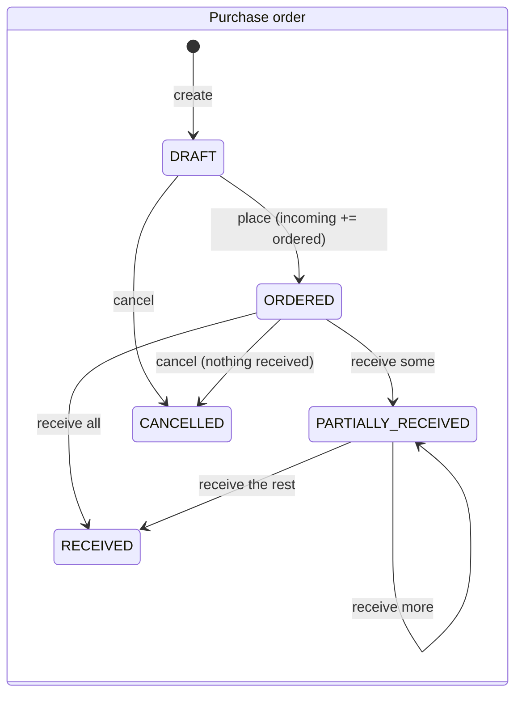
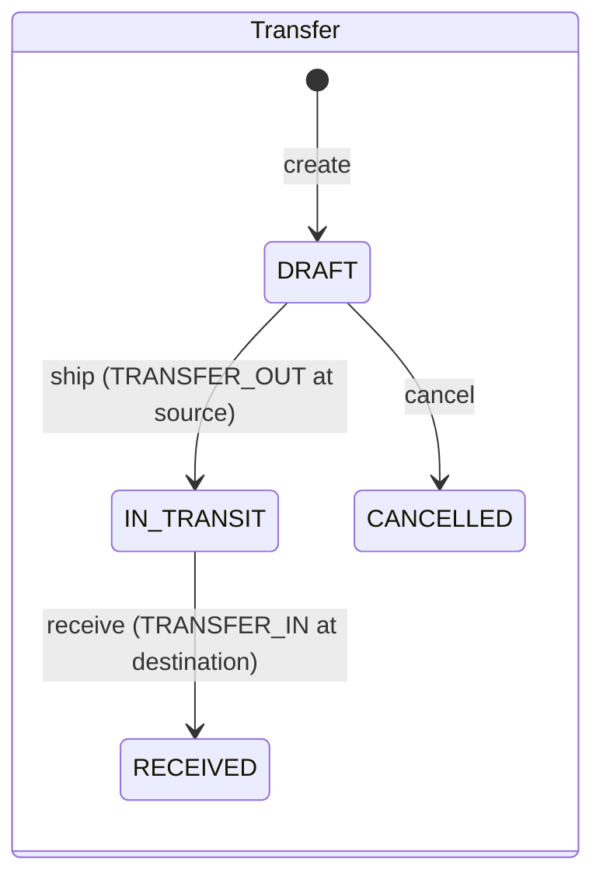
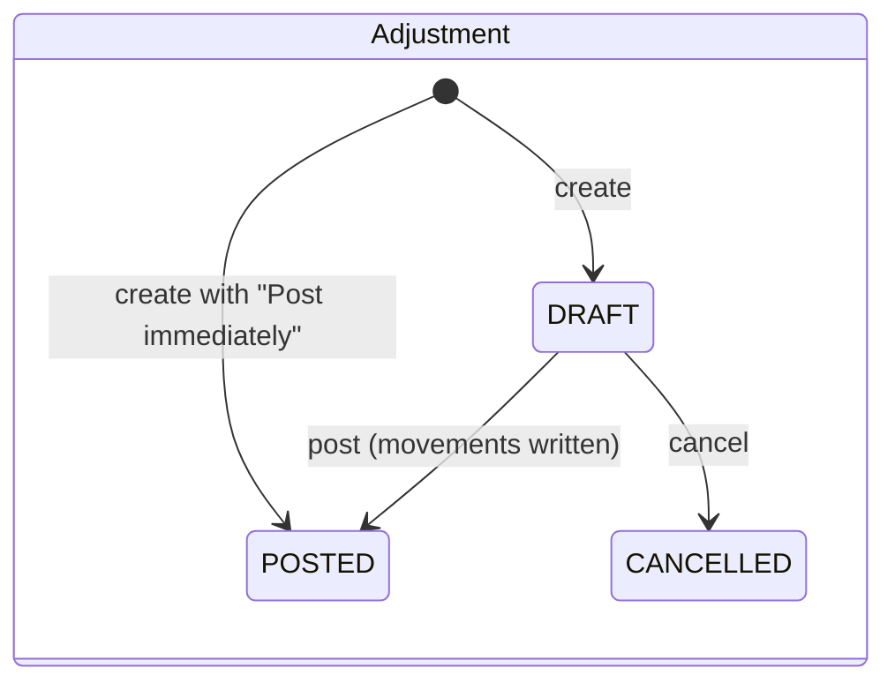
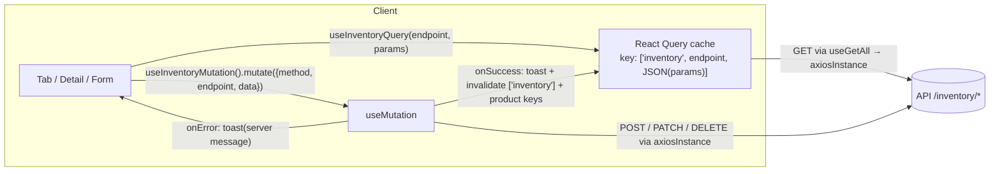
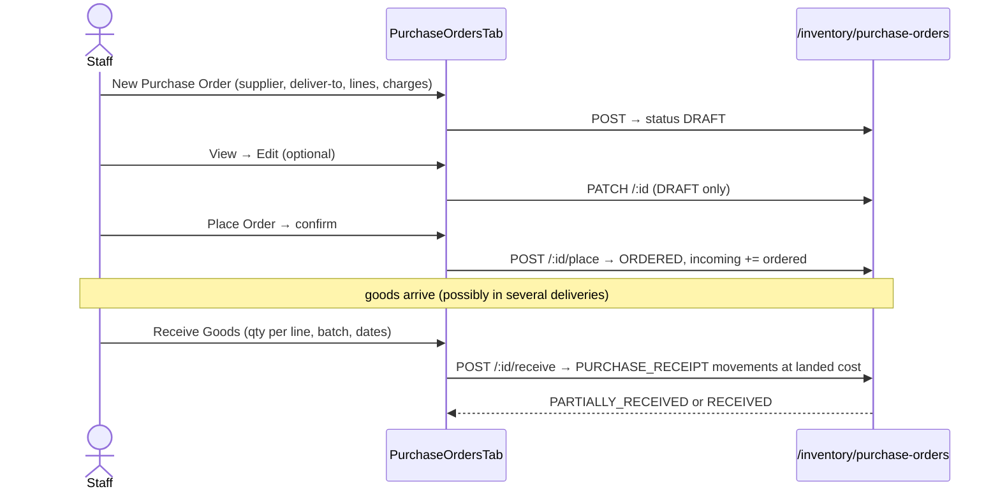

# Inventory Module — Frontend Technical Documentation

> **Scope:** everything the Natura Care client (Next.js 15, App Router) does with **inventory**: the staff-only `/inventory` screen with its KPI tiles and nine tabs: stock per warehouse, the stock ledger (history), purchase orders, transfers, adjustments, batches, warehouses, suppliers and reports. It also covers how inventory reaches the rest of the app: the product form, the storefront's stock numbers, and the dashboard.
>
> **Audience:** frontend engineers joining or maintaining the project.
>
> **Related:** [Project README](../README.md) (run, build, Docker) · [Product module](./product.md) (product form "Quantity in Stock") · [Order module](./order.md) (how orders change stock today) · [Cart module](./cart.md) (stock re-check) · [User module](./user.md) (roles) · [Auth module](./auth.md) (session, tokens) · [Server inventory module](../../natura-care-server/docs/inventory.md) (sibling repo: schema, endpoints, posting rules) · [Coding conventions](../claude-docs/basic-instructions.md)

| | |
|---|---|
| **Module root** | [`src/modules/inventory/`](../src/modules/inventory/) |
| **Admin route** | `/inventory` (admin route group), tab in `?tab=` |
| **Storefront routes** | None. The storefront reads the product's shop stock (`products.quantity`), which inventory keeps in step ([§9](#9-storefront--other-modules)) |
| **Backend resource** | `/inventory/*` on `NEXT_PUBLIC_API_BASE_URL`, plus `GET /products` for product pickers |
| **Roles** | `ADMIN` and `EMPLOYEE`: full read **and** write access. `CUSTOMER` and guests: no access |
| **Source of truth** | The server's ledger (`stock_movements`). The client never computes a balance it saves |
| **Last reviewed** | 2026-10-24 |

---

## Table of Contents

1. [Overview](#1-overview)
2. [Tech Stack](#2-tech-stack)
3. [File Architecture](#3-file-architecture)
4. [Routing & Access Control](#4-routing--access-control)
   - [4.1 Routes](#41-routes)
   - [4.2 Middleware rules](#42-middleware-rules)
   - [4.3 Sidebar entry](#43-sidebar-entry)
   - [4.4 Server-side guards](#44-server-side-guards)
   - [4.5 Role matrix](#45-role-matrix)
5. [Domain Model & Business Logic](#5-domain-model--business-logic)
   - [5.1 Glossary](#51-glossary)
   - [5.2 The stock model](#52-the-stock-model)
   - [5.3 The shop number](#53-the-shop-number)
   - [5.4 The ledger](#54-the-ledger)
   - [5.5 Documents and their lifecycles](#55-documents-and-their-lifecycles)
   - [5.6 Adjustment types](#56-adjustment-types)
   - [5.7 Costing: landed cost and moving average](#57-costing-landed-cost-and-moving-average)
   - [5.8 Batches and expiry](#58-batches-and-expiry)
   - [5.9 What is live today](#59-what-is-live-today)
6. [Data Flow & State](#6-data-flow--state)
   - [6.1 Server state (React Query keys)](#61-server-state-react-query-keys)
   - [6.2 Local UI state](#62-local-ui-state)
   - [6.3 Modal state machines](#63-modal-state-machines)
   - [6.4 Cross-tab navigation](#64-cross-tab-navigation)
7. [Workflows](#7-workflows)
   - [7.1 Set up a warehouse](#71-set-up-a-warehouse)
   - [7.2 Add a supplier](#72-add-a-supplier)
   - [7.3 Buy stock: purchase order end to end](#73-buy-stock-purchase-order-end-to-end)
   - [7.4 Move stock between warehouses](#74-move-stock-between-warehouses)
   - [7.5 Stock count, correction or write-off](#75-stock-count-correction-or-write-off)
   - [7.6 Undo a mistake: reverse a movement](#76-undo-a-mistake-reverse-a-movement)
   - [7.7 Set reorder levels](#77-set-reorder-levels)
   - [7.8 Investigate a product's stock](#78-investigate-a-products-stock)
   - [7.9 Change stock from the product form](#79-change-stock-from-the-product-form)
8. [Admin Section — `/inventory`](#8-admin-section--inventory)
   - [8.1 Page anatomy](#81-page-anatomy)
   - [8.2 KPI tiles](#82-kpi-tiles)
   - [8.3 Stock tab](#83-stock-tab)
   - [8.4 History tab (movements)](#84-history-tab-movements)
   - [8.5 Purchase Orders tab](#85-purchase-orders-tab)
   - [8.6 Transfers tab](#86-transfers-tab)
   - [8.7 Adjustments tab](#87-adjustments-tab)
   - [8.8 Batches tab](#88-batches-tab)
   - [8.9 Warehouses tab](#89-warehouses-tab)
   - [8.10 Suppliers tab](#810-suppliers-tab)
   - [8.11 Reports tab](#811-reports-tab)
9. [Storefront & Other Modules](#9-storefront--other-modules)
10. [API Reference](#10-api-reference)
11. [Types](#11-types)
12. [Constants & Style Maps](#12-constants--style-maps)
13. [Hooks](#13-hooks)
14. [Utilities](#14-utilities)
15. [Validation Schemas](#15-validation-schemas)
16. [Reusable Components](#16-reusable-components)
17. [Business Rules Summary](#17-business-rules-summary)
18. [Known Issues & Technical Debt](#18-known-issues--technical-debt)
19. [How-To Recipes](#19-how-to-recipes)

---

## 1. Overview

Inventory answers four questions for the store team: **how much do we have, where is it, what is it worth, and why did it change.** Stock is kept per **product per warehouse**. Every change is a row in an append-only **ledger**, and every ledger row comes from a **document**: a purchase order receipt, a transfer, or an adjustment.

The client is a thin, typed view over the server. It lists, filters and shows data, collects form input, validates its shape, and posts it. All stock maths (balances, the shop number, landed cost, moving average, the "is there enough stock?" check) happens on the server, inside one transaction per request.

| Audience | Where | What they can do |
|---|---|---|
| **Admin & Employee** | `/inventory` → KPI tiles | See stock value, products to reorder, batches expiring within 90 days, and whether the shop's stock matches the warehouses. Each tile opens the matching tab. |
| | **Stock** | Stock per product per warehouse (on hand, reserved, available, incoming, state, value), filtered by warehouse and state. Set reorder point / quantity / safety stock. Jump to that row's history. |
| | **History** | The ledger: every stock change with its type, quantity, running balance, cost, source document and author. **Reverse** a manual movement. |
| | **Purchase Orders** | Create a draft, edit it, **place** it, **receive** goods (partly or fully, optionally into a batch with expiry), or **cancel**. |
| | **Transfers** | Create a draft, **ship** it, **receive** it (recording any shortfall), or **cancel** the draft. |
| | **Adjustments** | Stock count, manual correction or write-off, saved as a draft or posted at once. Post or cancel drafts. |
| | **Batches** | Lot numbers with manufacture and expiry dates, and where their stock is. |
| | **Warehouses / Suppliers** | Add, edit, archive. Choose the default warehouse and which warehouses sell to the shop. |
| | **Reports** | Valuation per warehouse, stock consistency, reorder suggestions, expiring batches. |
| **Customer & Guest** | Storefront | Nothing inventory-specific. They see the product's shop stock, which inventory keeps in step ([§5.3](#53-the-shop-number)). |

Key design decisions:

- **The server owns every number.** The form previews (PO subtotal, "on hand · free" hints) are for the user only. The server recomputes totals and refuses a change that would overdraw stock, with a message the client shows as a toast.
- **Nothing is edited or deleted in place.** Warehouses and suppliers are *archived*, documents are *cancelled*, and ledger rows are *reversed* with an opposite row. The UI mirrors this: no "Delete" button anywhere in the module. The red trash-style action means *Archive*.
- **One hook pair for the whole module.** [`useInventoryQuery`](#13-hooks) for reads and [`useInventoryMutation`](#13-hooks) for writes. Every query key starts with `"inventory"`, so any successful write refreshes every inventory screen, including the KPI tiles ([§6.1](#61-server-state-react-query-keys)).
- **One page, tabs instead of routes.** The nine areas share KPI tiles and a lot of lookup data (warehouses, suppliers, products), so they live on one route. The active tab is kept in `?tab=` so links and reloads land on it.
- **Modals for every form and detail view.** Lists keep their filters and page position while a document is opened, edited or posted.
- **Forms mirror server limits.** [`INVENTORY_LIMITS`](#12-constants--style-maps) and the zod schemas copy the server's DTO rules, so a form the client accepts is not refused for its shape.

[↑ Back to top](#table-of-contents)

---

## 2. Tech Stack

| Concern | Technology | Used for |
|---|---|---|
| Framework | **Next.js 15** (App Router), **React 19** | `/inventory` route, `next/dynamic` code-splitting |
| Language | **TypeScript** | DTO interfaces mirroring the server, status unions, `Record<Status, Badge>` style maps |
| Server state | **TanStack Query v5**, through the shared [`useGetAll`](../src/hooks/api/useGet.ts) and a module-local `useMutation` wrapper | Every `/inventory/*` call |
| HTTP | **Axios** ([`axiosInstance`](../src/lib/axios/axiosInstance.ts)) | Bearer token from the `accessToken` cookie; the response interceptor unwraps the `{ statusCode, message, data, meta }` envelope |
| Tables | **TanStack Table v8** through [`CustomTable`](../src/components/data-display/table/CustomTable.tsx) | Every list tab (server-side paging, 500 ms debounced search) |
| Forms | **react-hook-form** (`useForm`, `useFieldArray`, `useWatch`) + **zod v4** via `@hookform/resolvers` | Warehouse, supplier, reorder settings, PO, receive, transfer and adjustment forms |
| Styling | **Tailwind CSS v4** + project tokens (`greenPrimary-*`, `neutralPrimary-*`, `warningPrimary-*`, `destructive-*`, `success-*`, `blueSecondary-*`) | All inventory UI |
| Icons | **lucide-react** (module), **react-icons** `LuWarehouse` (sidebar) | Tab icons, buttons, callouts |
| Notifications | **sonner** | Success toast with the server's message; error toast with the server's message(s) |
| Modals | Project [`CustomModal2`](../src/components/primitives/modal/CustomModal2.tsx) and [`ConfirmModal`](../src/components/primitives/modal/ConfirmModal.tsx) | Forms, detail views, "Place / Ship / Post / Cancel / Archive / Reverse?" confirmations |
| Access control | Next.js **middleware** ([`src/middleware.ts`](../src/middleware.ts)) + `jwt-decode`; server `JwtAuthGuard` + `RolesGuard` | Route protection by role |

[↑ Back to top](#table-of-contents)

---

## 3. File Architecture

```text
src/
├── app/(admin)/inventory/
│   └── page.tsx                              # Route: metadata + dynamic import of <Inventory/> (LoadingPage fallback)
│
├── modules/inventory/
│   ├── types/
│   │   └── inventory.types.ts                # ★ Status unions + every DTO (stock, lot, movement, PO, transfer, adjustment, reports)
│   ├── constants/
│   │   └── inventory.constants.ts            # ★ INVENTORY_API, INVENTORY_KEY, INVENTORY_LIMITS, badge maps, labels, select/filter options
│   ├── hooks/
│   │   └── useInventory.ts                   # ★ useInventoryQuery, useInventoryMutation, useInventoryOptions, useWarehouseStock
│   ├── schemas/
│   │   └── inventory.schema.ts               # zod schemas: warehouse, supplier, stock settings, PO, receive, transfer, adjustment
│   ├── utils/
│   │   └── inventory.utils.ts                # formatTk / formatQty / formatSigned / dates, expiry hint & tone, compact()
│   └── admin/
│       ├── Inventory.tsx                     # ★ Page shell: header, 4 KPI tiles, tab bar, ?tab= sync, Stock → History hand-off
│       ├── shared/
│       │   ├── InventoryUi.tsx               # StatusBadge, ProductCell, WarehouseCell, QtyDelta, FilterBar/Select/Toggle,
│       │   │                                 #   ActionButton, ModalTitle, DetailGrid, LinesTable, Callout, RowActions, MODAL_WIDTH
│       │   └── StockLinesEditor.tsx          # Product + batch + quantity line editor (transfers, adjustments); NO_LOT, lotIdOf
│       ├── stock/
│       │   ├── StockTab.tsx                  # Stock levels table + reorder-settings modal
│       │   └── StockSettingsForm.tsx         # Reorder point / quantity / safety stock
│       ├── movements/
│       │   └── MovementsTab.tsx              # Ledger table + "Reverse movement" confirm (with optional note)
│       ├── purchase-orders/
│       │   ├── PurchaseOrdersTab.tsx         # PO list + one modal switching view / form / receive
│       │   ├── PurchaseOrderDetail.tsx       # PO view: lines, totals, Cancel / Edit / Place / Receive
│       │   ├── PurchaseOrderForm.tsx         # Create or edit a DRAFT PO (lines, charges, live totals)
│       │   └── ReceivePurchaseOrderForm.tsx  # Book a delivery (per-line quantity, batch, dates)
│       ├── transfers/
│       │   ├── TransfersTab.tsx              # Transfer list + view / form modal
│       │   ├── TransferDetail.tsx            # Transfer view: Ship / Receive (inline per-line counts) / Cancel
│       │   └── TransferForm.tsx              # Create a DRAFT transfer
│       ├── adjustments/
│       │   ├── AdjustmentsTab.tsx            # Adjustment list + view / form modal
│       │   ├── AdjustmentDetail.tsx          # Adjustment view: Post / Cancel a draft
│       │   └── AdjustmentForm.tsx            # Stock count / manual / write-off, draft or posted at once
│       ├── lots/
│       │   └── LotsTab.tsx                   # Batches with expiry and per-warehouse stock
│       ├── warehouses/
│       │   ├── WarehousesTab.tsx             # Warehouse list + form modal + archive confirm
│       │   └── WarehouseForm.tsx             # Add / edit (sellable, default, location)
│       ├── suppliers/
│       │   ├── SuppliersTab.tsx              # Supplier list + form modal + archive confirm
│       │   └── SupplierForm.tsx              # Add / edit
│       └── reports/
│           └── ReportsTab.tsx                # Valuation, consistency, reorder suggestions, expiring batches
│
├── components/                               # Shared building blocks used here (see §16)
│   ├── data-display/table/CustomTable.tsx
│   ├── primitives/modal/{CustomModal2,ConfirmModal}.tsx
│   ├── primitives/{CustomTooltip.tsx, button/AddButton.tsx}
│   ├── form/{InputField,TextAreaField,SingleSelectSearch,DateInputField,ToggleButton}.tsx
│   └── layout/sidebar/AdminSidebar.tsx       # "Inventory" menu item (employee: true)
│
├── modules/promotion/admin/PromotionFormParts.tsx   # FormSection, FormActions (borrowed by every inventory form)
└── middleware.ts                             # "/inventory" in ADMIN_ONLY_ROUTES and EMPLOYEE_ROUTES
```

★ = start here when learning the module.

**Layering rule.** Tabs and forms import from `constants`, `hooks`, `schemas`, `types` and `utils`, never from each other, except a tab importing its own forms and detail views. Cross-tab behaviour (Stock → History) goes through the page shell [`Inventory.tsx`](../src/modules/inventory/admin/Inventory.tsx).

[↑ Back to top](#table-of-contents)

---

## 4. Routing & Access Control

### 4.1 Routes

| Route | File | Renders | Notes |
|---|---|---|---|
| `/inventory` | [`app/(admin)/inventory/page.tsx`](../src/app/(admin)/inventory/page.tsx) | `Inventory` (dynamic import, `LoadingPage` fallback) | Metadata title `Inventory \| Natura Care Limited`. Inherits the admin layout (fixed `AdminNavbar`, `AdminSidebar`). |
| `/inventory?tab=<value>` | same | Opens a tab | `<value>` ∈ `stock` · `movements` · `purchase-orders` · `transfers` · `adjustments` · `lots` · `warehouses` · `suppliers` · `reports`. Unknown values are ignored (Stock opens). |

There are no nested routes. Detail views and forms are modals, so documents have no shareable URL.

### 4.2 Middleware rules

[`src/middleware.ts`](../src/middleware.ts) decodes the `accessToken` cookie (`jwt-decode`) and matches the path with `startsWith`:

| Constant | Contains `/inventory`? | Effect |
|---|---|---|
| `ADMIN_ONLY_ROUTES` | Yes | Not logged in → redirect to `/login`. `CUSTOMER` → redirect to `/`. |
| `EMPLOYEE_ROUTES` | Yes | `EMPLOYEE` may open it. (Without this entry an employee would be sent to `/dashboard`.) |

An expired access token with a refresh token present is let through so the client can refresh it. Middleware is a convenience: the API enforces the same rule ([§4.4](#44-server-side-guards)).

### 4.3 Sidebar entry

[`AdminSidebar.tsx`](../src/components/layout/sidebar/AdminSidebar.tsx) lists `{ label: "Inventory", href: "/inventory", icon: LuWarehouse, employee: true }`. Items with `employee: true` are the only ones an employee sees. The flag and `EMPLOYEE_ROUTES` must stay in sync. A comment in both files says so.

### 4.4 Server-side guards

Every `/inventory/*` route except `GET /inventory/availability/:productId` uses the `StaffOnly()` decorator on the server: `JwtAuthGuard` + `RolesGuard` with `Roles(ADMIN, EMPLOYEE)`. A customer token gets **403** and a missing or expired token gets **401**, even if someone bypasses the middleware.

### 4.5 Role matrix

| Capability | Guest | Customer | Employee | Admin |
|---|:-:|:-:|:-:|:-:|
| Open `/inventory` | ✗ (→ `/login`) | ✗ (→ `/`) | ✓ | ✓ |
| Read stock, ledger, documents, reports | ✗ | ✗ | ✓ | ✓ |
| Create / place / receive / ship / post / cancel documents | ✗ | ✗ | ✓ | ✓ |
| Reverse a movement | ✗ | ✗ | ✓ | ✓ |
| Add / edit / archive warehouses and suppliers | ✗ | ✗ | ✓ | ✓ |
| Change the default warehouse | ✗ | ✗ | ✓ | ✓ |

> There is **no admin-only action inside inventory**. Employees have the same power as admins here, including archiving warehouses and reversing movements. The role description in [`EditUser.tsx`](../src/modules/user/admin/EditUser.tsx) ("Dashboard access to products, categories, inventory and orders") states this to whoever assigns the role.

[↑ Back to top](#table-of-contents)

---

## 5. Domain Model & Business Logic

These rules are **enforced by the server**. The client shows them (badges, disabled buttons, confirm-dialog wording). Full detail, including the database constraints, is in the [server inventory doc](../../natura-care-server/docs/inventory.md).

### 5.1 Glossary

| Term | Meaning |
|---|---|
| **Warehouse** | Any place that holds stock: a store room, a city hub, or a bookkeeping location such as `QUARANTINE`. Type `WAREHOUSE`, `HUB` or `VIRTUAL`. |
| **Sellable** | A warehouse whose stock is offered to customers. It must also be `ACTIVE` to count toward the shop. |
| **Default warehouse** | Exactly one. Product-form quantity edits land here, and orders will reserve from here once orders use inventory. Cannot be archived. |
| **On hand** | Units physically in the warehouse. Always equals the sum of its ledger rows. |
| **Reserved** | Units promised to open orders. Always `0` today ([§5.9](#59-what-is-live-today)). |
| **Available** | `onHand − reserved`. Computed by the server, never stored. |
| **Incoming** | Units on placed purchase orders that have not been received. Planning only, not stock. |
| **Stock item** | What Inventory counts: a product without sizes (SIMPLE, or a combo without items), or **one size** of a VARIABLE product. A combo with items has no stock of its own. Pickers use a key: `"12"` for a product, `"12:41"` for size 41 of product 12 (`stockItemKey`). |
| **Shop number** | The stock the storefront offers: `products.quantity` for a product, the size's quantity for a size. A VARIABLE product's own `quantity` is the total of its active sizes. |
| **Movement** | One ledger row: a signed quantity change of one stock item in one warehouse (optionally one batch). |
| **Document** | A purchase order, transfer or adjustment. Stock changes only when a document is posted. |
| **Batch / lot** | A lot number printed on the pack, with optional manufacture and expiry dates. Optional per receipt. |
| **Landed cost** | Supplier unit price plus its share of the PO's shipping and other charges. |
| **Drift** | The shop number disagrees with the warehouses, or a balance disagrees with its ledger. |

### 5.2 The stock model

For one stock item (a product, or one size) in one warehouse the server stores a `stock_levels` row and returns it as [`IStockLevel`](#11-types):

```text
onHand      units in the warehouse          (= Σ ledger quantity)
− reserved  units promised to open orders
= available units that can still be sold    (computed)

incoming    units on placed POs, not yet received    (planning only)
```

**Stock state** (`state`, shown as a badge) is computed by the server:

| State | When |
|---|---|
| `OUT_OF_STOCK` | `available ≤ 0` |
| `LOW_STOCK` | `available` at or below the row's `reorderPoint`, or at or below the global low-stock threshold (**10**) when no reorder point is set |
| `IN_STOCK` | Otherwise |

The State column shows "Reorder at N" under the badge when a reorder point is set, otherwise "Default threshold".

### 5.3 The shop number

The storefront, cart, checkout, Meta feed and dashboard all read `products.quantity` (and, for a size, the size's quantity). Inventory keeps those numbers in step, per stock item:

```text
shop number = Σ available, over the item's rows in warehouses that are isSellable AND ACTIVE
```

**The two screens stay in sync in both directions:**

- **Product → Inventory.** Saving the product form books its stock through the ledger: a product's "Quantity in Stock", or each size's Stock ([§7.9](#79-change-stock-from-the-product-form)). A new product or size gets its row in the default warehouse even at 0, so it is listed on the Stock tab at once.
- **Inventory → Product.** Every posted movement updates the item's shop number on the server, then re-sums a VARIABLE product's total and re-counts every combo containing the item, in the same transaction.
- **Screens.** Every inventory write also refetches the product screens (`invalidateProductQueries`), and every product save refetches the inventory screens (`invalidateProductAndInventoryQueries`), so neither shows stale numbers.

| Event | Warehouse `onHand` | Shop number | Ledger row |
|---|---|---|---|
| PO received into a sellable warehouse | `+n` | `+n` | `PURCHASE_RECEIPT` |
| PO received into a non-sellable warehouse | `+n` | no change | `PURCHASE_RECEIPT` |
| Write-off | `−n` | `−n` (if sellable) | `DAMAGE` / `EXPIRY` / `ADJUSTMENT` |
| Count or manual correction | `±Δ` | `±Δ` (if sellable) | `COUNT_CORRECTION` / `ADJUSTMENT` |
| Product form stock saved ("Quantity in Stock", or a size's Stock) | `±Δ` in the default warehouse | set to the typed value | `ADJUSTMENT` (type `PRODUCT_FORM`, one line per changed item) |
| Transfer shipped / received | `−n` source / `+n` destination | follows each side's sellability | `TRANSFER_OUT` / `TRANSFER_IN` |
| Warehouse starts or stops being sellable+active | none | `±` its available units | none |
| **Order placed / cancelled / edited** | **none** | `∓n` directly | none (legacy table) |

The last row is why the **Consistency** KPI usually shows differences ([§8.2](#82-kpi-tiles)). Orders do not go through inventory yet, so every sale lowers the shop number without touching the warehouses. The warehouse form warns the user when a save will add or remove a warehouse's stock from the shop ([§7.1](#71-set-up-a-warehouse)).

### 5.4 The ledger

The History tab is the ledger ([`IStockMovement`](#11-types)):

- **Signed quantity.** `+` adds, `−` removes, never `0`. Shown by [`QtyDelta`](#16-reusable-components) in green or red.
- **Running balance.** `onHandAfter` is the warehouse's on-hand straight after the row ("→ 207 on hand").
- **Cost.** `unitCost` per unit; `value = |quantity| × unitCost`.
- **Source.** `source.kind` is `ORDER`, `PURCHASE_ORDER`, `TRANSFER`, `ADJUSTMENT`, `REVERSAL` or `NONE`, with the document number.
- **Append-only.** A mistake is undone with a **reversal**: a new `REVERSAL` row with the opposite quantity. A row can be reversed once (`reversedById` is then set).
- **Reversible types** (client copy of the server rule, [`REVERSIBLE_MOVEMENT_TYPES`](#12-constants--style-maps)): `OPENING_BALANCE`, `ADJUSTMENT`, `COUNT_CORRECTION`, `DAMAGE`, `EXPIRY`. Receipts and transfers are undone through their documents, not by reversal.
- **Idempotent.** Each row has a unique `idempotencyKey`, so a double-click or retry is refused with 409 instead of moving stock twice.

### 5.5 Documents and their lifecycles

Stock never changes directly. It changes when a document is posted.







| Document | Number | Editable while | Stock moves when | Client actions by status |
|---|---|---|---|---|
| Purchase order | `PO-<year>-<5 digits>` | `DRAFT` | Each receipt | `DRAFT`: Edit, Place, Cancel · `ORDERED`: Receive, Cancel (if nothing received) · `PARTIALLY_RECEIVED`: Receive |
| Transfer | `TR-<year>-<5 digits>` | Never (cancel and recreate) | Ship (out), receive (in) | `DRAFT`: Ship Now, Cancel · `IN_TRANSIT`: Receive at `<dest>` |
| Adjustment | `ADJ-<year>-<5 digits>` | Never (cancel and recreate) | Post | `DRAFT`: Post, Cancel |

The client computes these permissions from `status` in each detail view. For example, in [`PurchaseOrderDetail.tsx`](../src/modules/inventory/admin/purchase-orders/PurchaseOrderDetail.tsx): `canCancel = (DRAFT || ORDERED) && every line has quantityReceived === 0`. The server repeats every check and returns 409 if the state changed in the meantime.

### 5.6 Adjustment types

| Type | Offered in form? | The line's number means | Change posted | Movement type |
|---|:-:|---|---|---|
| `STOCK_COUNT` | ✓ (default) | What was counted on the shelf (`countedQty`) | `counted − snapshot taken when the count was saved`, so sales during the count are not double-counted | `COUNT_CORRECTION`; sets `lastCountedAt` |
| `MANUAL` | ✓ | The correct on-hand (`countedQty`) | `counted − on hand at posting time` (may differ from the draft's "Change" if stock moved since) | `ADJUSTMENT` |
| `WRITE_OFF` | ✓ | Units to remove (`quantity`), reason required | `−quantity` | `DAMAGE` (reason `DAMAGED`), `EXPIRY` (`EXPIRED`), otherwise `ADJUSTMENT` |
| `PRODUCT_FORM` | ✗ (server-created) | — | Typed product-form quantity − what the ledger says the shop can sell | `ADJUSTMENT` |

Write-off reasons are limited to `DAMAGED`, `EXPIRED`, `LOST_OR_STOLEN`, `SAMPLE_OR_GIFT`, `INTERNAL_USE` ([`WRITE_OFF_REASONS`](#12-constants--style-maps)).

### 5.7 Costing: landed cost and moving average

All money is BDT, returned as numbers (costs up to 4 decimals, totals 2). The client only **displays** these values. It never calculates them, except the PO form's preview totals.

```text
landedCost = unitCost × (1 + (shippingCost + otherCost) / subtotal)          per received unit
newAvg     = (onHand × avg + n × incomingCost) / (onHand + n)                on a costed increase
```

- Stock tab "Value" = `stockValue`, with "avg Tk …" = `avgUnitCost` underneath.
- Outgoing units and uncosted increases (a count that finds extra units) leave the average unchanged.
- A transfer carries its cost: `TRANSFER_IN` is costed at the `TRANSFER_OUT` cost.
- The PO form explains this in its Charges section: "Spread over the lines by value into the landed unit cost when goods are received."

### 5.8 Batches and expiry

- Batch tracking is **optional per receipt line**. A line with a batch number books its units into that batch, and a line without one leaves them untracked. A product's batch balances therefore add up to *at most* its on-hand.
- The receive form enables the Manufactured / Expires dates only once a batch number is typed. Dates are sent only with a batch number.
- A batch number already used for the same product is **reused** (it keeps its original dates, supplier and cost). The receive form's callout says so.
- Transfers and adjustments can target a specific batch. "No batch (untracked)" is stored as `"0"` in the select and sent as `undefined` ([`NO_LOT` / `lotIdOf`](#16-reusable-components)).
- Expiry display ([`expiryHint` / `expiryTone`](#14-utilities)): red when expired, amber within 90 days, grey otherwise.

### 5.9 What is live today

| Feature | Status |
|---|---|
| Warehouses, suppliers, stock per warehouse, reorder settings | Live |
| Purchase orders (draft → place → partial receipts with batches → cancel) | Live |
| Transfers (draft → ship → receive with shortfall → cancel) | Live |
| Adjustments (count, manual, write-off; draft / post / cancel) | Live |
| Ledger, reversal of manual movements | Live |
| Reports: valuation, reorder, expiring, reconciliation | Live (on request) |
| Product form stock → `PRODUCT_FORM` adjustment | Live: SIMPLE products, combos without items, and each size of a VARIABLE product |
| Stock per size of a VARIABLE product | Live: sizes are stock items in every picker, table and report |
| Product table ↔ Inventory sync (shop numbers, size totals, combo counts, screen refetch) | Live |
| **Orders reserving and selling through inventory** (`reserved`, `SALE`, `CUSTOMER_RETURN`) | **Not built.** `reserved` is always 0 and the ledger has no `SALE` rows |
| Supplier returns, FEFO picking, close a PO short, restore archived records | Not built |

[↑ Back to top](#table-of-contents)

---

## 6. Data Flow & State



### 6.1 Server state (React Query keys)

| Key | Hook | Fetched by |
|---|---|---|
| `["inventory", endpoint, JSON.stringify(compact(params))]` | `useInventoryQuery` | Every list, detail and report |
| `["inventory", "product-options"]` | `useInventoryOptions` | Product pickers (`GET /products`, all rows, no paging), expanded into stock items |

- **One prefix, one invalidation.** `useInventoryMutation` calls `queryClient.invalidateQueries({ queryKey: ["inventory"] })` after every successful write. Lists, the open detail modal, the KPI tiles and the pickers all refetch. Simple and always correct, at the cost of a few extra requests per write.
- **Product screens follow.** The same mutation calls `invalidateProductQueries` ([`product-cache.utils.ts`](../src/modules/product/utils/product-cache.utils.ts)): `getAdminProducts`, `getProductStats`, `getAdminProduct`, `getBundleOptions`, `getFeaturedProducts`, because posted stock moves the product table's numbers. In the other direction, Add / Edit Product call `invalidateProductAndInventoryQueries`, which also refetches every `["inventory"]` query.
- **Params are compacted.** `compact()` drops `undefined`, `null` and `""` before building the key and the query string. Filters therefore use `""` for "all", and a boolean filter is sent as `flag || undefined` so `false` is not sent.
- **Shared cache between tiles and reports.** The KPI tiles and the Reports tab call the same report endpoints with the same params (`days: 90` for expiring), so opening Reports after the tiles costs no extra requests.
- **Lookups without paging.** Warehouses, suppliers and lots for pickers are fetched without `page`/`limit`, which the server treats as "return every row".

### 6.2 Local UI state

All state is component state (`useState`). There is no global store and no context.

| Where | State | Notes |
|---|---|---|
| `Inventory` | `tab`, `historyFilter { productId, warehouseId, key }` | `tab` mirrored to `?tab=` with `history.replaceState` (no navigation, no history entry) |
| Each list tab | `page`, `limit`, `search`, its filters | Lost on reload or tab switch (tabs unmount) |
| Each list tab | `modal` / `formTarget` / `archiveTarget` / `settingsTarget` | Which modal is open and for which record |
| `MovementsTab` | `reverseTarget`, `note` | Reverse dialog |
| `TransferDetail` | `receiving`, `received: Record<itemId, string>` | Inline receive mode |

**Filter change resets the table.** Every tab passes `key={filterKey}` to `CustomTable`. A filter change remounts the table, which returns it to page 1 and clears the search box (the search state follows 500 ms later through the debounced callback).

### 6.3 Modal state machines

The Purchase Orders tab uses **one** `CustomModal2` whose content switches on a discriminated union, so moving from "view" to "edit" or "receive" swaps the content without closing and reopening:

```ts
type ModalState =
  | { kind: "view"; id: number }
  | { kind: "form"; po?: IPurchaseOrder }   // po undefined → new
  | { kind: "receive"; po: IPurchaseOrder }
  | null;
```

The width follows the kind (`MODAL_WIDTH.view` for views, `MODAL_WIDTH.form` otherwise). Transfers and Adjustments use the same pattern with `view | form`. Warehouses and Suppliers use `formTarget: Record | "new" | null`.

After a write:

| Action | Modal afterwards |
|---|---|
| Form saved (create / edit / receive) | Closes (`onClose` passed as the mutation's success callback) |
| Place / Ship / Post / Cancel from a detail view | Confirm closes; the detail view stays open and refetches, so the user sees the new status |
| Transfer receipt confirmed | Leaves receive mode; detail view refetches |

### 6.4 Cross-tab navigation

`StockTab` receives `onShowHistory(productId, warehouseId)`. The page shell stores them in `historyFilter`, bumps `historyFilter.key`, and switches to `movements`. `MovementsTab` is rendered with `key={historyFilter.key}`, so it remounts with the new initial filters even if History was opened before. KPI tiles navigate with the same `go(tab)` helper.

[↑ Back to top](#table-of-contents)

---

## 7. Workflows

Each workflow lists what the user does, what the client sends, and what changes.

### 7.1 Set up a warehouse

1. **Warehouses → Add Warehouse.** Fill in code (letters, digits, hyphens; uppercased on save), name, type and status.
2. **Selling:** *Sell from this stock* (`isSellable`) and *Default warehouse* (`isDefault`).
   - When editing, if the save would change whether the warehouse counts toward the shop (`isSellable && ACTIVE` flips), a warning callout says *"Saving adds/removes this warehouse's available stock to/from the shop's stock."*
   - The default toggle is disabled on the current default: *"To change the default, make another warehouse the default."*
3. Location fields are optional. Empty strings are sent as `null` so they clear on the server.
4. `POST /inventory/warehouses` or `PATCH /inventory/warehouses/:id`.

**Archive** (`DELETE /inventory/warehouses/:id`) is disabled for the default warehouse and for archived rows. The server also requires the warehouse to be empty, with no open POs, transfers or draft adjustments. Otherwise the toast shows its 409 message. Archived rows are read-only.

### 7.2 Add a supplier

**Suppliers → Add Supplier.** Code, company name, status, lead time (days, 0–365), optional contact details and notes. Only `ACTIVE` suppliers appear in the PO supplier picker. Archive is refused while the supplier has POs in progress.

### 7.3 Buy stock: purchase order end to end



1. **Create.** Supplier and deliver-to warehouse are required. A VARIABLE product is bought per size: the product picker lists each size ("Body Lotion - 350ml"). Each product or size may appear once (zod refine). The form shows each line total and a live **Subtotal / Total** (subtotal + shipping + duty/other). These are a preview; the server computes the saved totals. Saved as `DRAFT`.
2. **Edit** (DRAFT only). Same form, prefilled; dates converted with `toPickerDate`.
3. **Place.** Confirm dialog: *"The ordered units show as incoming until they are received. The order can no longer be edited."*
4. **Receive.** Only lines with outstanding units are shown, each defaulting to the full outstanding quantity. The user edits for a partial delivery. Lines left at 0 are dropped; if none remain, the form shows *"Enter a received quantity on at least one line"* and sends nothing. Optional batch number plus manufacture/expiry dates (expiry must be after manufacture). The submit button reads *"Receive N units"*.
5. **Cancel.** Allowed for `DRAFT`, or `ORDERED` with nothing received. *"This can't be undone."*

The Received column in the list shows `received / ordered` with a progress bar.

### 7.4 Move stock between warehouses

1. **Transfers → New Transfer.** Choose From and To (must differ). Add product (or size) lines, optionally per batch. Each line shows what the **source** holds: *"N on hand · M free"*, or *"N in batch"* when a batch is chosen. Saved as `DRAFT`.
2. **Ship Now** → confirm: *"N units leave SRC now. If it sells to the shop, the shop's stock drops until DEST receives them."* Writes `TRANSFER_OUT`, status `IN_TRANSIT`.
3. **Receive at DEST.** The lines table switches to editable "Arrived" inputs prefilled with the sent quantity; the Short column updates live. Confirm Receipt is disabled while any value is not a whole number between 0 and the sent quantity. Only lines that arrived short are sent (`{ transferItemId, quantityReceived }`); the server treats the rest as fully received. Writes `TRANSFER_IN`. The shortfall is shown as "Lost in transit".
4. **Cancel** is only possible for drafts. No stock has moved yet.

### 7.5 Stock count, correction or write-off

1. **Adjustments → New Adjustment.** Choose the type; the section help text changes:
   - *Stock count:* "Type what you counted on the shelf…"
   - *Manual correction:* "Type the correct on-hand number…"
   - *Write-off:* "Type how many units to remove. A reason is required."
2. Changing the type clears the reason, because a reason valid for one type may not be valid for a write-off. The reason picker switches to the five write-off reasons.
3. Lines use `StockLinesEditor`; hints show what the system holds in the chosen warehouse. Each stock item + batch pair may appear once; sizes of a VARIABLE product are separate items. A write-off needs ≥ 1 unit per line.
4. **Post immediately** toggle: off → *Save Draft*; on → *Create & Post*, with a warning that posting can only be undone by reversing its movements.
5. The payload sends `countedQty` for count/manual and `quantity` for write-off.
6. A draft is reviewed from the list ("Review & post") and posted or cancelled from its detail view.

### 7.6 Undo a mistake: reverse a movement

**History → Reverse** (shown only for reversible types that have not been reversed). The confirm dialog describes the opposite movement (*"Records an opposite movement of −30 for X in MAIN. The original stays in the history."*) and takes an optional note, capped at 500 characters. `POST /inventory/movements/:id/reverse`. The original row then shows *"Reversed by #id"*.

To undo a purchase receipt or a transfer, use the documents' own flows. Those movements are not reversible.

### 7.7 Set reorder levels

**Stock → edit icon (Reorder settings).** Reorder point, reorder quantity (≥ 1) and safety stock, for that stock item (product, or size) in that warehouse. An empty field is sent as `null`, which clears the setting and brings back the global threshold of 10. `PATCH /inventory/stock/:productId/warehouses/:warehouseId` (`?variantId=` for a size, via `INVENTORY_API.stockSettings(productId, warehouseId, variantId)`). These values drive the `LOW_STOCK` state and the Reorder Suggestions report. Safety stock is recorded only and has no effect yet.

### 7.8 Investigate a product's stock

1. **Stock** tab → search by name, slug or SKU, or filter by warehouse/state.
2. Row **eye icon (Stock history)** → History opens filtered on that stock item (product, or size) and warehouse ([§6.4](#64-cross-tab-navigation)).
3. Read the running balance (`→ N on hand`), the source document and who made each change.
4. Check **Reports → Stock Consistency** if the storefront number looks wrong.

### 7.9 Change stock from the product form

Not part of this screen, but it writes to inventory. The product form's stock fields are saved by the server through the ledger, inside the product save's transaction, as **one** `PRODUCT_FORM` adjustment in the **default** warehouse:

| Product type | Field | Ledger line |
|---|---|---|
| SIMPLE (and combos without items) | **Quantity in Stock** ([`ProductInventory.tsx`](../src/modules/product/admin/product-form/ProductInventory.tsx)) | the product |
| VARIABLE | each size's **Stock** ([`ProductVariation.tsx`](../src/modules/product/admin/product-form/ProductVariation.tsx)) | that size |
| COMBO with items | none (derived from the items) | — |

- Edit Product sends a size's stock **only when it was edited** (`toVariantsPayload(variants, initialVariants)`), so a form opened before a sale can't put the sold units back.
- Every product and size gets its default-warehouse row on save (even at 0), so it appears on the Stock tab.
- The server refuses the save (400) if there is no active, sellable default warehouse, or a decrease needs more units than the default warehouse holds ("Reduce the other warehouses from Inventory.").
- A size can be removed in the form (or the product changed from Variable) once its stock is 0; a size with history is archived and shows in movements and batches as "size removed" (`sizeStatus = "ARCHIVED"`, [`InventoryUi.tsx`](../src/modules/inventory/admin/shared/InventoryUi.tsx)). A product that still has product-level stock in Inventory can't become VARIABLE or a combo with items until that stock is 0.
- Saving the form also repairs that item's drift. After the save, the product and inventory screens both refetch.

[↑ Back to top](#table-of-contents)

---

## 8. Admin Section — `/inventory`

### 8.1 Page anatomy

```text
┌───────────────────────────────────────────────────────────────────────┐
│ Inventory                                                             │
│ Stock across warehouses, what is on order and in transit, …          │
├──────────────┬──────────────┬──────────────────┬──────────────────────┤
│ STOCK VALUE  │ TO REORDER   │ EXPIRING ≤ 90 D  │ CONSISTENCY          │  ← KPI tiles (clickable)
│ Tk 4,12,500  │ 3            │ 2                │ In sync / 5 differ   │
├──────────────┴──────────────┴──────────────────┴──────────────────────┤
│ [Stock][History][Purchase Orders][Transfers][Adjustments][Batches]    │  ← tab bar (scrolls on mobile)
│ [Warehouses][Suppliers][Reports]                                      │
├───────────────────────────────────────────────────────────────────────┤
│ FilterBar (selects / toggles)                         [+ Add …]       │
│ CustomTable (search, rows, pagination)                                │
└───────────────────────────────────────────────────────────────────────┘
```

Only the active tab is mounted. Switching tabs unmounts the previous one and discards its filters and page.

### 8.2 KPI tiles

Rendered by the local `Kpi` component in [`Inventory.tsx`](../src/modules/inventory/admin/Inventory.tsx). Each shows `…` until its query resolves.

| Tile | Value | Hint | Tone | Click → |
|---|---|---|---|---|
| Stock value | `formatTk(valuation.totalValue)` | "N units on hand" | neutral | Reports |
| To reorder | `reorder.length` | "At or below reorder point" | warning if > 0 | Reports |
| Expiring ≤ 90 days | `expiring(days: 90).length` | "K already expired" or "Batches with stock" | danger if any expired, warning if any expiring | Batches |
| Consistency | "In sync" or "N differ" (shop drift + ledger drift) | "Shop stock vs warehouses" | success / warning | Reports |

> While orders bypass inventory ([§5.9](#59-what-is-live-today)), **Consistency** shows "N differ" after any sale. That is expected. The Reports card explains it to the user.

### 8.3 Stock tab

[`StockTab.tsx`](../src/modules/inventory/admin/stock/StockTab.tsx) · `GET /inventory/stock` · page size 10

| Filters | Search |
|---|---|
| Warehouse (all / each), State (all / out / low / in stock), toggle "Only rows with stock" | Product name, slug or SKU, or a size's SKU |

| Column | Content |
|---|---|
| Product | Name + SKU (or `#id`), plus status if not active |
| Warehouse | Code + name ("· not sellable" when applicable) |
| On hand / Reserved / Available / Incoming | Tabular numbers. Reserved is blue when > 0; incoming is "—" when 0 |
| State | Badge + "Reorder at N" / "Default threshold" |
| Value | `stockValue` + "avg Tk …" |
| Last movement | Date-time |
| Action | 👁 Stock history ([§7.8](#78-investigate-a-products-stock)) · ✏ Reorder settings ([§7.7](#77-set-reorder-levels)) |

### 8.4 History tab (movements)

[`MovementsTab.tsx`](../src/modules/inventory/admin/movements/MovementsTab.tsx) · `GET /inventory/movements` · page size 20 · no search box

Filters: Product (stock items: products and each size), Warehouse, Type (all 12 movement types), plus a **Clear** button when any filter is set. The product filter sends `productId` and, for a size, `variantId`.

| Column | Content |
|---|---|
| When | `occurredAt` + `#id` |
| Type | Movement badge + "Reversed by #id" |
| Product | `ProductCell` |
| Warehouse / batch | `WarehouseCell` + "Batch LOT-123" |
| Change | `QtyDelta` + "→ N on hand" |
| Value | `value` + "@ unitCost" |
| Source | Kind label + document number (`#id` for reversals) |
| Note / by | Note (2 lines) + author name or "System" |
| Action | **Reverse** ([§7.6](#76-undo-a-mistake-reverse-a-movement)) |

### 8.5 Purchase Orders tab

[`PurchaseOrdersTab.tsx`](../src/modules/inventory/admin/purchase-orders/PurchaseOrdersTab.tsx) · `GET /inventory/purchase-orders` · search PO or invoice number

Filters: Status, Supplier. **New Purchase Order** button.

| Column | Content |
|---|---|
| PO | Number + created date |
| Supplier | Name + "to WAREHOUSE" |
| Status | `PO_STATUS_BADGE` |
| Received | `received / ordered` + progress bar |
| Total | `formatTk(total)` |
| Expected | Date |
| Action | 👁 View · ✏ Edit draft (DRAFT only) |

**Detail modal:** header (PO number, supplier → warehouse, status), detail grid (supplier, deliver to, expected, invoice, placed, fully received, received/ordered units, created by), lines (ordered, received, outstanding in amber, unit cost, line total), totals (subtotal, shipping, duty & other, total), and the status-dependent actions ([§5.5](#55-documents-and-their-lifecycles)).

### 8.6 Transfers tab

[`TransfersTab.tsx`](../src/modules/inventory/admin/transfers/TransfersTab.tsx) · `GET /inventory/transfers` · search number or notes

Filters: Status, Warehouse (either side). Columns: Transfer (number + created), Route (`SRC → DEST`), Units (sent, lines, "N lost in transit"), Status, Shipped / received dates, View. Detail modal per [§7.4](#74-move-stock-between-warehouses).

### 8.7 Adjustments tab

[`AdjustmentsTab.tsx`](../src/modules/inventory/admin/adjustments/AdjustmentsTab.tsx) · `GET /inventory/adjustments` · search number or notes

Filters: Type (all four, including `PRODUCT_FORM`), Status, Warehouse. Columns: Adjustment (number + type label), Warehouse, Reason, Net change (`QtyDelta` + line count), Status, Date (posted, else created, + user), action labelled "Review & post" for drafts and "View" otherwise.

Detail modal: lines show Expected → After → Change and the per-line reason. Drafts of type MANUAL carry the note that the change is recomputed at posting time.

### 8.8 Batches tab

[`LotsTab.tsx`](../src/modules/inventory/admin/lots/LotsTab.tsx) · `GET /inventory/lots` · search batch number · read-only

Filters: Expiry (any / already expired / 30 / 90 / 180 days), toggle "Only batches with stock" (**on** by default). Columns: Batch (+ received date), Product (with the size, for a size's batch), Supplier, Expiry (date + coloured hint), Made, Unit cost, On hand (+ per-warehouse split "MAIN 120 · DHK 30").

Batches are created only by PO receipts, so there is no Add button.

### 8.9 Warehouses tab

[`WarehousesTab.tsx`](../src/modules/inventory/admin/warehouses/WarehousesTab.tsx) · `GET /inventory/warehouses` · search code, name or city

Filter: Status (default "Active & inactive"; Archived on request). Columns: Warehouse (code, ★ Default badge, name), Type, Sells to shop, Location, Status, Created, actions (Edit, Archive). See [§7.1](#71-set-up-a-warehouse).

### 8.10 Suppliers tab

[`SuppliersTab.tsx`](../src/modules/inventory/admin/suppliers/SuppliersTab.tsx) · `GET /inventory/suppliers` · search code, name, contact, phone or email

Filter: Status. Columns: Supplier (code + name), Contact (person, phone, email), Lead time, Notes, Status, actions (Edit, Archive).

### 8.11 Reports tab

[`ReportsTab.tsx`](../src/modules/inventory/admin/reports/ReportsTab.tsx) · four cards in a 2-column grid (1 column below `xl`)

| Card | Endpoint | Shows | Empty state |
|---|---|---|---|
| Stock Value | `reports/valuation` | Per warehouse: products, units, value; total row | — |
| Stock Consistency | `reports/reconciliation` | Green "Everything matches", or a warning + shop drift table per stock item (Shop / Warehouses / Diff; sizes listed as "Name - size") + ledger-drift count ("should never happen; please report it") | — |
| Reorder Suggestions | `reports/reorder` | Product ("Name - size" for a size), warehouse, available (red if ≤ 0), on order, reorder at, **buy** (suggested qty) | "Nothing to reorder. Set reorder points on the Stock tab…" |
| Expiring Batches | `reports/expiring?days=` | Batch, product, warehouse, units, expiry + hint. Window select: 30 / 90 / 180 / 365 days (default 90) | "No batch with stock expires in this window." |

[↑ Back to top](#table-of-contents)

---

## 9. Storefront & Other Modules

Inventory has **no customer-facing UI**. It affects the rest of the app through the shop number (`products.quantity`).

| Module | Relationship |
|---|---|
| **Storefront product pages** ([product.md](./product.md)) | Show in stock / low stock / out of stock from `products.quantity`. The server also exposes a public, role-aware `GET /inventory/availability/:productId`, which **the client does not call yet**. |
| **Cart** ([cart.md](./cart.md)) | `useLocalCart` re-checks price and quantity from the product API (`inventoryByProductId`), and `CartCard` caps quantities and warns "Only N left in stock". It reads the shop number, not warehouse stock. |
| **Order** ([order.md](./order.md)) | Checkout, cancel and admin edits change `products.quantity` directly (legacy path). The admin edit modal says "Stock and inventory history follow every change." This refers to the legacy stock history, not the inventory ledger. |
| **Product form** ([product.md](./product.md)) | "Quantity in Stock" and each size's Stock are saved through the ledger as a `PRODUCT_FORM` adjustment ([§7.9](#79-change-stock-from-the-product-form)). Saves refetch the inventory screens, and inventory writes refetch the product screens. |
| **Dashboard** | The "Inventory health" card ([`LowStock.tsx`](../src/modules/dashboard/admin/LowStock.tsx)) uses `IDashboardOverview.inventory` (counts and alerts from `products.quantity`, `lowStockThreshold` from the API). It links to `/products`, not `/inventory`. |
| **User** ([user.md](./user.md)) | Role assignment decides who can open inventory ([§4.5](#45-role-matrix)). |

[↑ Back to top](#table-of-contents)

---

## 10. API Reference

All paths are relative to `NEXT_PUBLIC_API_BASE_URL` (e.g. `https://api.naturacarebd.com/n-care/api/v1`). All are staff-only. Constants live in [`INVENTORY_API`](../src/modules/inventory/constants/inventory.constants.ts).

| Method | Path | Used by | Body / params |
|---|---|---|---|
| GET | `/inventory/warehouses` | Warehouses tab, pickers | `page, limit, search, status` |
| POST | `/inventory/warehouses` | WarehouseForm | `code, name, type, status, isSellable, isDefault, street, city, phone` |
| PATCH | `/inventory/warehouses/:id` | WarehouseForm | same |
| DELETE | `/inventory/warehouses/:id` | Archive | — |
| GET / POST | `/inventory/suppliers` | Suppliers tab, pickers / SupplierForm | `page, limit, search, status` / `code, name, status, contactName, phone, email, address, leadTimeDays, notes` |
| PATCH / DELETE | `/inventory/suppliers/:id` | SupplierForm / Archive | same / — |
| GET | `/inventory/stock` | Stock tab, `useWarehouseStock` | `page, limit, search, warehouseId, state, onlyWithStock` |
| PATCH | `/inventory/stock/:productId/warehouses/:warehouseId[?variantId=]` | StockSettingsForm | `reorderPoint, reorderQty, safetyStock` (`null` clears) |
| GET | `/inventory/lots` | Batches tab, batch pickers | `page, limit, search, expiringWithinDays, onlyWithStock` |
| GET | `/inventory/movements` | History tab | `page, limit, productId, variantId, warehouseId, type` |
| POST | `/inventory/movements/:id/reverse` | Reverse | `{ note? }` |
| GET / POST | `/inventory/adjustments` | Adjustments tab / AdjustmentForm | `page, limit, search, type, status, warehouseId` / `type, warehouseId, reason?, notes, post, items[{ productId, variantId?, lotId?, countedQty \| quantity }]` |
| GET | `/inventory/adjustments/:id` | AdjustmentDetail | — |
| POST | `/inventory/adjustments/:id/post` · `/cancel` | AdjustmentDetail | — |
| GET / POST | `/inventory/purchase-orders` | PO tab / PurchaseOrderForm | `page, limit, search, status, supplierId` / `supplierId, warehouseId, expectedAt (YYYY-MM-DD), supplierInvoiceNo, shippingCost, otherCost, notes, items[{ productId, variantId?, quantityOrdered, unitCost }]` |
| GET / PATCH | `/inventory/purchase-orders/:id` | PurchaseOrderDetail / PurchaseOrderForm (draft) | — / same as create |
| POST | `/inventory/purchase-orders/:id/place` · `/cancel` | PurchaseOrderDetail | — |
| POST | `/inventory/purchase-orders/:id/receive` | ReceivePurchaseOrderForm | `items[{ purchaseOrderItemId, quantity, lotNumber?, manufacturedAt?, expiresAt? }], supplierInvoiceNo?, note?` |
| GET / POST | `/inventory/transfers` | Transfers tab / TransferForm | `page, limit, search, status, warehouseId` / `fromWarehouseId, toWarehouseId, notes, items[{ productId, variantId?, lotId?, quantity }]` |
| GET | `/inventory/transfers/:id` | TransferDetail | — |
| POST | `/inventory/transfers/:id/ship` · `/cancel` | TransferDetail | — |
| POST | `/inventory/transfers/:id/receive` | TransferDetail | `items[{ transferItemId, quantityReceived }]` (short lines only) |
| GET | `/inventory/reports/valuation` · `/reorder` · `/reconciliation` | KPI tiles, Reports | — |
| GET | `/inventory/reports/expiring` | KPI tiles, Reports | `days` |
| GET | `/products` | `useInventoryOptions` (pickers) | none (all rows, with `variants` and `bundleItems`) |

`variantId` is required on a line for a VARIABLE product and refused for any other product; the forms send it by splitting the picker's stock-item key (`splitStockItemKey`).

**Envelope.** Success: `{ statusCode, success, message, data, meta }`. `meta` (paging) only on lists: `{ totalItems, itemCount, itemsPerPage, totalPages, currentPage }`. Errors: `{ statusCode, message }`, where `message` may be an **array** for validation errors. `useInventoryMutation` joins arrays with `", "`.

**Status codes the user will meet:** 400 bad input (e.g. inactive warehouse), 404 missing record, **409** when the current state refuses the request (not enough stock, no longer a draft, already reversed, code already used, a concurrent change). 409 messages are written for end users and are shown as-is, e.g. *"Not enough stock of Onion Hair Oil in MAIN: 207 available (207 on hand, 0 reserved for orders), 250 needed"*.

[↑ Back to top](#table-of-contents)

---

## 11. Types

All in [`inventory.types.ts`](../src/modules/inventory/types/inventory.types.ts). They mirror the server's `admin-inventory-response.dto.ts`. Money is BDT and already a `number`.

| Group | Types |
|---|---|
| Status unions | `RecordStatus` (`ACTIVE \| INACTIVE \| ARCHIVED`), `WarehouseType`, `ProductStatus`, `StockLevelState`, `StockMovementType` (12), `PurchaseOrderStatus` (5), `StockTransferStatus` (4), `StockAdjustmentType` (4), `StockDocumentStatus` (`DRAFT \| POSTED \| CANCELLED`), `AdjustmentReason` (9) |
| Embedded references | `IInventoryUser`, `IWarehouseRef`, `IProductRef`, `ISupplierRef`, `ILotRef` |
| Master data | `IWarehouse`, `ISupplier` |
| Stock | `IStockLevel`, `IStockLot` (with `warehouses[]` split and `daysToExpiry`), `IMovementSource`, `IStockMovement` |
| Documents | `IStockAdjustment` + `IStockAdjustmentItem`, `IPurchaseOrder` + `IPurchaseOrderItem`, `IStockTransfer` + `IStockTransferItem` |
| Reports | `IValuationReport`, `IReorderSuggestion`, `IExpiringLot`, `IReconciliationReport` (`shopDrift[]`, `ledgerDrift[]`, `healthy`, `checkedAt`) |

Conventions:

- `IProductRef` is a **stock item**: besides the product fields it carries `variantId`, `size` and `sizeStatus` (all `null` for a product without sizes); `sku` is the size's own SKU when it has one. Show it with `stockItemName()` or `ProductCell`. `IReorderSuggestion` and the reconciliation rows carry `variantId` and `size` too.
- Nullable fields are always present as `null`. Audit users (`createdByUser`, `updatedByUser`, `postedByUser`) are **optional** (left out when unknown), so render them as `?.name ?? "—"`.
- Calendar dates (`expectedAt`, `manufacturedAt`, `expiresAt`) are `YYYY-MM-DD` strings; timestamps are ISO UTC.
- `IStockLevel.version` is returned but not used yet ([§18](#18-known-issues--technical-debt)).
- Form types are inferred from zod: `WarehouseFormType`, `SupplierFormType`, `StockSettingsFormType`, `PurchaseOrderFormType`, `ReceivePurchaseOrderFormType`, `TransferFormType`, `AdjustmentFormType`.

[↑ Back to top](#table-of-contents)

---

## 12. Constants & Style Maps

All in [`inventory.constants.ts`](../src/modules/inventory/constants/inventory.constants.ts).

| Constant | Purpose |
|---|---|
| `INVENTORY_API` | Every endpoint; functions for parameterised paths (`stockSettings(productId, warehouseId, variantId?)`, `reverseMovement(id)`) |
| `INVENTORY_KEY` | `"inventory"`, the first element of every query key |
| `INVENTORY_LIMITS` | Server-mirrored limits: `CODE_MAX 32`, `NAME_MAX 255`, `NOTE_MAX 500`, `NOTES_MAX 5000`, `LINES_MAX 200`, `QUANTITY_MAX 1,000,000`, `MONEY_MAX 10,000,000`, `LEAD_TIME_MAX 365`, … |
| Badge maps | `RECORD_STATUS_BADGE`, `STOCK_STATE_BADGE`, `PO_STATUS_BADGE`, `TRANSFER_STATUS_BADGE`, `DOCUMENT_STATUS_BADGE`, `MOVEMENT_TYPE_BADGE`. Each value is `{ label, pill, dot }` built from a private `tone` palette (green, red, amber, blue, grey, brand) |
| Label maps | `ADJUSTMENT_TYPE_LABEL`, `ADJUSTMENT_REASON_LABEL`, `WAREHOUSE_TYPE_LABEL` (`HUB` → "Hub / shop") |
| Rule lists | `REVERSIBLE_MOVEMENT_TYPES`, `WRITE_OFF_REASONS` (copies of server rules) |
| Select options `{ id, name }` | `warehouseTypeOptions`, `settableStatusOptions` (Active/Inactive only; archive is a separate action), `adjustmentTypeOptions` (STOCK_COUNT, MANUAL, WRITE_OFF; not PRODUCT_FORM), `adjustmentReasonOptions`, `writeOffReasonOptions` |
| Filter options `{ value, label }` | `stockStateFilterOptions`, `movementTypeFilterOptions`, `poStatusFilterOptions`, `transferStatusFilterOptions`, `documentStatusFilterOptions`, `adjustmentTypeFilterOptions`. The first option is always `""` = all; most are derived from the badge or label maps so they stay in sync |

Colour language used across the module:

| Tone | Means |
|---|---|
| Green | Good / done / stock added (In stock, Received, Posted, Purchase receipt) |
| Blue | In progress / moving (Ordered, In transit, Sale, Transfer out) |
| Amber | Needs attention (Low stock, Partly received, Inactive, Adjustment) |
| Red | Lost or closed (Out of stock, Cancelled, Damage, Expiry) |
| Grey | Neutral / not started (Draft, Archived, Opening balance, Reversal) |

[↑ Back to top](#table-of-contents)

---

## 13. Hooks

All in [`useInventory.ts`](../src/modules/inventory/hooks/useInventory.ts).

### `useInventoryQuery<T>(endpoint, params = {}, enabled = true)`

GET wrapper over the shared `useGetAll`. Compacts params, builds the key `["inventory", endpoint, JSON.stringify(params)]`, and returns `{ data, meta, isLoading, isFetching, refetch }` with `data` already unwrapped from the envelope.

```ts
const { data, meta, isLoading } = useInventoryQuery<IStockLevel[]>(
  INVENTORY_API.STOCK,
  { page, limit, search, warehouseId, state, onlyWithStock: onlyWithStock || undefined },
);
```

### `useInventoryMutation<T>(onSuccess?)`

`useMutation` for `{ method?: "post" | "patch" | "delete", endpoint, data? }` (default `post`). On success: `toast.success(server message)`, invalidate every `inventory` query and the product queries (`invalidateProductQueries`), then `onSuccess(result.data)`. On error: `toast.error(message)`, joining array messages.

```ts
const { mutate, isPending } = useInventoryMutation(onClose);
mutate({ method: "patch", endpoint: `${INVENTORY_API.WAREHOUSES}/${id}`, data: payload });
```

### `useInventoryOptions({ withLots = false })`

Lookup data for pickers. Fetches warehouses, suppliers, products and (when `withLots`) lots with stock. Returns:

| Field | Content |
|---|---|
| `warehouses` | Raw `IWarehouse[]` (all statuses), used by list filters |
| `activeWarehouseOptions` | `{ id, name: "CODE · Name" }`, ACTIVE only |
| `supplierOptions` | `{ id, name: "CODE · Name" }`, ACTIVE only |
| `productOptions` | Stock items of every non-archived product: `{ id: "12", name: "Name (SKU)" }` for a product without sizes, `{ id: "12:41", name: "Name - 100ml (SKU)" }` for each size ("(inactive)" marks an inactive size). Combos with items are left out: they hold no stock |
| `productName(key)` | "Name" or "Name - 100ml" for a stock-item key |
| `lots` | `IStockLot[]` with stock (only when `withLots`) |
| `isLoading` | Warehouses, suppliers or products still loading |

### `useWarehouseStock(warehouseId?)`

`Map<stockItemKey, IStockLevel>` for one warehouse (keys as in `productOptions`). Disabled until a warehouse is chosen. Feeds the "on hand · free" hints in `StockLinesEditor`.

[↑ Back to top](#table-of-contents)

---

## 14. Utilities

All in [`inventory.utils.ts`](../src/modules/inventory/utils/inventory.utils.ts). Every formatter returns `"—"` for `null` / `undefined`.

| Function | Example |
|---|---|
| `formatTk(v)` | `1250.5` → `"Tk 1,250.5"` (max 2 decimals, `en-US` grouping) |
| `formatQty(v)` | `1250` → `"1,250"` |
| `formatSigned(v)` | `250` → `"+250"`, `-30` → `"-30"` |
| `formatDate(v)` | `"14 Oct 2026"` |
| `formatDateTime(v)` | `"14 Oct 2026, 3:05 pm"` |
| `expiryHint(days)` | `"Expires in 21 days"`, `"Expires today"`, `"Expired 5 days ago"`, `"No expiry date"` |
| `expiryTone(days)` | Tailwind text class: red (< 0), amber (≤ 90), grey |
| `toDateOnly(iso)` | `DateInputField` value (ISO at UTC midnight) → `"2026-10-25"` for the API |
| `toPickerDate(ymd)` | `"2026-10-25"` → ISO string for `DateInputField` |
| `compact(obj)` | Drops `undefined`, `null`, `""`; used for query params |
| `stockItemKey(productId, variantId?)` | `"12"`, or `"12:41"` for a size: the picker value of a stock item |
| `splitStockItemKey(key)` | `"12:41"` → `{ productId: 12, variantId: 41 }`; `"12"` → `{ productId: 12 }`. Spread into line payloads |
| `stockItemName(product)` | `"Onion Hair Oil"`, or `"Body Lotion - 350ml"` when `size` is set |

> Always convert dates with `toDateOnly` / `toPickerDate`. Sending the picker's ISO string makes the server reject it, or shift the date by the timezone offset.

[↑ Back to top](#table-of-contents)

---

## 15. Validation Schemas

All in [`inventory.schema.ts`](../src/modules/inventory/schemas/inventory.schema.ts) (zod v4). Shared builders keep the messages consistent: `requiredId`, `optionalId`, `optionalText(label, max)`, `quantity(label, min)`, `money(label)`, `code(label)`.

> **Select ids are strings.** `SingleSelectSearch` stores the picked id as a string, so schemas validate ids as strings and the submit handlers convert them with `Number(...)`. Line `productId` fields hold a **stock-item key** (`"12"` or `"12:41"`), validated by the `stockItem()` builder and split with `splitStockItemKey` on submit, so "each product once" also means "each size once".

| Schema | Notable rules |
|---|---|
| `warehouseSchema` | `code`: 1–32, `^[A-Za-z0-9][A-Za-z0-9-]*$`. Type enum. Status `ACTIVE \| INACTIVE` only. Booleans `isSellable`, `isDefault` |
| `supplierSchema` | Same code rule. Optional email must be valid. `leadTimeDays` 0–365 whole days |
| `stockSettingsSchema` | All optional whole numbers ≥ 0; `reorderQty` ≥ 1 |
| `purchaseOrderSchema` | Supplier and warehouse required. 1–200 lines. `quantityOrdered` ≥ 1, `unitCost` 0–10M. **Each product (or size) once** |
| `receivePurchaseOrderSchema` | Per line: `quantity` 0…`outstanding` ("More than is outstanding"). `expiresAt > manufacturedAt`. The "at least one line > 0" rule is checked in the submit handler |
| `transferSchema` | From ≠ To ("Source and destination must be different"). 1–200 lines, quantity ≥ 1 |
| `adjustmentSchema` | Type `STOCK_COUNT \| MANUAL \| WRITE_OFF`. Amount ≥ 0. Write-off needs a reason and ≥ 1 per line. **Each stock item + batch pair once** |

[↑ Back to top](#table-of-contents)

---

## 16. Reusable Components

### Module-local ([`InventoryUi.tsx`](../src/modules/inventory/admin/shared/InventoryUi.tsx))

| Component | Props | Use |
|---|---|---|
| `StatusBadge` | `badge: { label, pill, dot }`, `className?` | Every status / type pill. Pass an entry of a badge map |
| `ProductCell` | `product: IProductRef` | Name + a size pill (for a size) + SKU (or `#id`) + non-active product / "size inactive" |
| `WarehouseCell` | `warehouse: IWarehouseRef` | Mono code + name, "· not sellable" |
| `QtyDelta` | `value: number` | Signed green/red quantity |
| `FilterBar` | `children` | White card wrapping filters |
| `FilterSelect` | `label, value, onChange, options[{ value, label }]` | Native select; `""` = all |
| `FilterToggle` | `label, checked, onChange` | Checkbox styled like the selects |
| `ActionButton` | `variant: primary \| secondary \| danger \| info`, `icon?`, `isPending?`, `disabled?`, `type?` | Detail-view actions; shows a spinner while pending |
| `ModalTitle` | `title, subtitle?, aside?` | Modal header (aside = status badge) |
| `DetailGrid` | `items[{ label, value }]` | 2/4-column label–value grid |
| `LinesTable` | `headers[{ label, align? }]`, `children` (rows) | Document lines and report tables |
| `Callout` | `tone: info \| warning \| danger \| success`, `icon?` | Explanations and warnings |
| `RowActions` | `children` | Flex row for table action icons |
| `MODAL_WIDTH` | `form \| view \| small` | Consistent modal widths |

### [`StockLinesEditor.tsx`](../src/modules/inventory/admin/shared/StockLinesEditor.tsx)

A generic `react-hook-form` field-array editor for **stock item + batch + amount** lines, shared by transfers and adjustments. The line's `productId` holds a stock-item key; `stock` is the `Map<stockItemKey, IStockLevel>` from `useWarehouseStock`.

```tsx
<StockLinesEditor<TransferFormType>
  control={control} trigger={trigger}
  name="items" amountName="quantity" amountLabel="Quantity"
  title="Products" description="…"
  productOptions={options.productOptions} lots={options.lots}
  stock={useWarehouseStock(fromId)} warehouseId={fromId}
  newLine={{ productId: "", lotId: null, quantity: 1 }}
  error={formState.errors.items?.message ?? formState.errors.items?.root?.message}
/>
```

- The batch picker is disabled until a product is chosen. It lists that stock item's batches (a size's batches only for a size) with "exp date · N here", plus **"No batch (untracked)"** (`NO_LOT = "0"`).
- The right-hand hint reads "N in batch" or "N on hand · M free" for the selected warehouse.
- The last remaining line cannot be removed.
- Export `lotIdOf(value)` turns the select value into `number | undefined` for the payload.

### Shared app components used here

| Component | Path | Use in inventory |
|---|---|---|
| `CustomTable` | [`components/data-display/table/CustomTable.tsx`](../src/components/data-display/table/CustomTable.tsx) | Every list. Server paging via `pageCount`, `totalItems`, `onPageChange`, `onPageSizeChange`; debounced `onSearchChange`; `showSearchbar={false}` on History. Sorting is disabled per column (`enableSorting = false`) |
| `CustomModal2` | [`components/primitives/modal/CustomModal2.tsx`](../src/components/primitives/modal/CustomModal2.tsx) | Form and detail modals; `dialogHeight` keeps the top clear of the 80 px admin navbar |
| `ConfirmModal` | [`components/primitives/modal/ConfirmModal.tsx`](../src/components/primitives/modal/ConfirmModal.tsx) | Place / Ship / Post / Cancel / Archive / Reverse; `variant` info / warning / danger; accepts `children` (the reverse note) |
| `CustomTooltip` | `components/primitives/CustomTooltip.tsx` | Row icons (`action="view" \| "edit" \| "delete"`) |
| `AddButton` | `components/primitives/button/AddButton.tsx` | "Add Warehouse", "New Purchase Order", … |
| `InputField`, `TextAreaField`, `SingleSelectSearch`, `DateInputField`, `ToggleButton` | `components/form/` | All form fields |
| `FormSection`, `FormActions` | [`modules/promotion/admin/PromotionFormParts.tsx`](../src/modules/promotion/admin/PromotionFormParts.tsx) | Titled form card; Cancel + Submit buttons with pending state |
| `LoadingPage` | `components/feedback/loading/LoadingPage.tsx` | Route-level fallback while the module chunk loads |

[↑ Back to top](#table-of-contents)

---

## 17. Business Rules Summary

| # | Rule | Enforced by |
|---|---|---|
| 1 | Only `ADMIN` and `EMPLOYEE` can open or call inventory; both have full write access | Middleware, sidebar, server guards |
| 2 | Stock changes only through documents (receipt, transfer, adjustment) or the product form | Server; UI has no direct "edit quantity" |
| 3 | The ledger is append-only; mistakes are reversed, once | Server; UI hides Reverse after reversal |
| 4 | Only opening balances, adjustments, count corrections, damage and expiry are reversible | Server + `REVERSIBLE_MOVEMENT_TYPES` |
| 5 | Shop stock = available units in sellable, active warehouses | Server |
| 6 | Exactly one default warehouse; it cannot be archived or un-defaulted directly | Server + disabled toggle/archive |
| 7 | A warehouse can be archived only when empty with no open documents | Server (409) |
| 8 | Only active warehouses and suppliers can be picked for new documents | `useInventoryOptions` + server |
| 9 | A PO is editable only as a draft; cancellable only before anything is received | Detail view + server |
| 10 | A receipt cannot exceed the outstanding quantity of a line | zod + server |
| 11 | A stock item (product, or size) appears once per PO; once per item+batch in an adjustment | zod + server |
| 19 | A VARIABLE product's stock is handled per size; a combo with items holds no stock and isn't offered | `useInventoryOptions` + server |
| 20 | The product table and Inventory always agree: form stock goes through the ledger, every movement updates the product's numbers, and both screens refetch after a write | Server + query invalidation |
| 12 | Transfers need two different warehouses; shortfalls are recorded as lost in transit | zod + server |
| 13 | A write-off needs a reason from the write-off list and ≥ 1 unit per line | zod + server |
| 14 | A stock count posts the difference from the snapshot at save time; a manual correction from the on-hand at posting | Server (explained in form help and detail view) |
| 15 | Removing stock fails if the warehouse, the batch, or the shop number has too few units | Server (409 with exact numbers) |
| 16 | Low stock = at or below the reorder point, or ≤ 10 without one | Server |
| 17 | Costs: landed cost on receipt, moving average per warehouse | Server |
| 18 | Codes are letters, digits and hyphens, stored uppercase | zod + submit handler + server |

[↑ Back to top](#table-of-contents)

---

## 18. Known Issues & Technical Debt

**Product / domain gaps (server side, visible in the UI)**

1. **Orders bypass inventory.** Every sale causes shop drift, so **Consistency** shows "N differ" in normal operation and `reserved` is always 0. Fixing this means routing checkout, cancel and order edits through inventory on the server. The client then needs nothing new beyond the existing Reserved column and `SALE` badge.
2. ~~**VARIABLE products are not tracked per size**~~ Done (2026-10-24): pickers offer each size as its own stock item and leave out combos with items; the server refuses a VARIABLE line without a size.
3. **A partly received PO cannot be closed short.** Its outstanding units stay in "incoming", and its supplier and warehouse cannot be archived. A "Close" action needs a server endpoint first.
4. **Archived warehouses and suppliers cannot be restored** (`settableStatusOptions` has no Archived, and the server refuses edits to archived rows).

**Client-side**

5. **Detail modals show "Loading…" forever on error.** `PurchaseOrderDetail`, `TransferDetail` and `AdjustmentDetail` render the loading text when `isLoading || !data`, so a 404 or network error never shows an error state. Show an error message when the query errors.
6. **Generic error toast on failed reads.** The axios interceptor rejects with a plain `{ statusCode, message }` object, while `useGetAll` only reads the message when `error instanceof Error`. Failed GETs therefore show "Failed to fetch data." instead of the server's reason. Writes are fine, because `useInventoryMutation` reads `error.message` directly. The fix belongs in [`useGet.ts`](../src/hooks/api/useGet.ts) and affects every module.
7. **Only the tab is in the URL.** Filters, page, search and the open document are lost on reload, and documents cannot be linked to. Other admin screens (e.g. the customer order list) keep state in the query string.
8. **`?tab=` is applied after the first render.** `Inventory` reads it in a `useEffect`, so a deep link briefly renders the Stock tab and fires its query before switching. `useSearchParams` (inside `<Suspense>`) would avoid the extra request.
9. **Changing a filter clears the search.** Tabs reset paging by remounting `CustomTable` with `key`. `CustomTable` now supports `pageResetKey`, which resets the page without dropping the search text.
10. **Form parts are borrowed from the promotion module.** Every inventory form imports `FormSection` / `FormActions` from `modules/promotion/admin/PromotionFormParts`. Move them to `src/components/form/` so modules do not depend on each other.
11. **The History product filter is a native `<select>` of every product**, with no search. It will be hard to use as the catalogue grows; `SingleSelectSearch` or a searchable combobox would scale.
12. **Low-stock threshold copy is hard-coded** ("default low-stock level of 10" in `StockSettingsForm`, and in the product form). The dashboard already receives `lowStockThreshold` from the API; read it from there.
13. **Optimistic concurrency is not used.** `IStockLevel.version` is returned, but the reorder-settings form does not send it, so two staff can overwrite each other's settings (the server does not check it yet either).
14. **Transfer receipt inputs bypass react-hook-form / zod.** Invalid values only disable "Confirm Receipt", without a message saying which line is wrong.
15. **Every write refetches every inventory query**, including the four report endpoints behind the KPI tiles. This is fine at the current data size; scope the invalidation if reports get slow.
16. **`StockLinesEditor` uses two `any` casts** around `useFieldArray` / `append` for its generic field path (with eslint-disable comments).

[↑ Back to top](#table-of-contents)

---

## 19. How-To Recipes

### Add a new tab

1. Create `admin/<area>/<Area>Tab.tsx` following `SuppliersTab`: local `page/limit/search/filters`, `useInventoryQuery`, `ColumnDef[]` with `enableSorting = false`, `FilterBar` + `CustomTable` with `key={filterKey}`.
2. Add `{ value, label, icon }` to `TABS` in [`Inventory.tsx`](../src/modules/inventory/admin/Inventory.tsx) and render it in the tab switch.
3. Add the endpoint to `INVENTORY_API`. The query key gets the `inventory` prefix automatically.

### Add a document action (e.g. "Close PO")

1. Add the endpoint (or a path builder) to `INVENTORY_API`.
2. In the detail view, derive a `canX` flag from `status`, add an `ActionButton`, and add a `ConfirmModal` that explains what will happen to stock.
3. Call `action.mutate({ endpoint })`. The toast, refetch and confirm-close are handled by `useInventoryMutation`.
4. Update the lifecycle diagram and table in [§5.5](#55-documents-and-their-lifecycles).

### Add a new movement type, status or reason

1. Add it to the union in `inventory.types.ts`.
2. TypeScript will then flag every `Record<…>` map in `inventory.constants.ts` (badge or label) until you add an entry. The filter options derive from those maps.
3. If it is reversible or a write-off reason, update `REVERSIBLE_MOVEMENT_TYPES` / `WRITE_OFF_REASONS` **to match the server**.

### Add a form field

1. Add it to the zod schema, reusing the builders and an `INVENTORY_LIMITS` entry that matches the server DTO.
2. Add a default value, the field component, and the payload mapping (`|| null` to clear text, `Number()` for select ids, `toDateOnly()` for dates).

### Add a report

1. Add the type to `inventory.types.ts` and the endpoint to `INVENTORY_API`.
2. Add a `ReportCard` in [`ReportsTab.tsx`](../src/modules/inventory/admin/reports/ReportsTab.tsx), with `LinesTable` and an `Empty` state.
3. Optionally add a KPI tile in `Inventory.tsx` that uses the **same params**, so it shares the cache.

### Link into a filtered History from another tab

Call the `onShowHistory(itemKey, warehouseId)` pattern (`itemKey` = `stockItemKey(product.id, product.variantId)`): lift a callback to `Inventory.tsx`, set `historyFilter` with a new `key`, and `go("movements")`.

[↑ Back to top](#table-of-contents)
