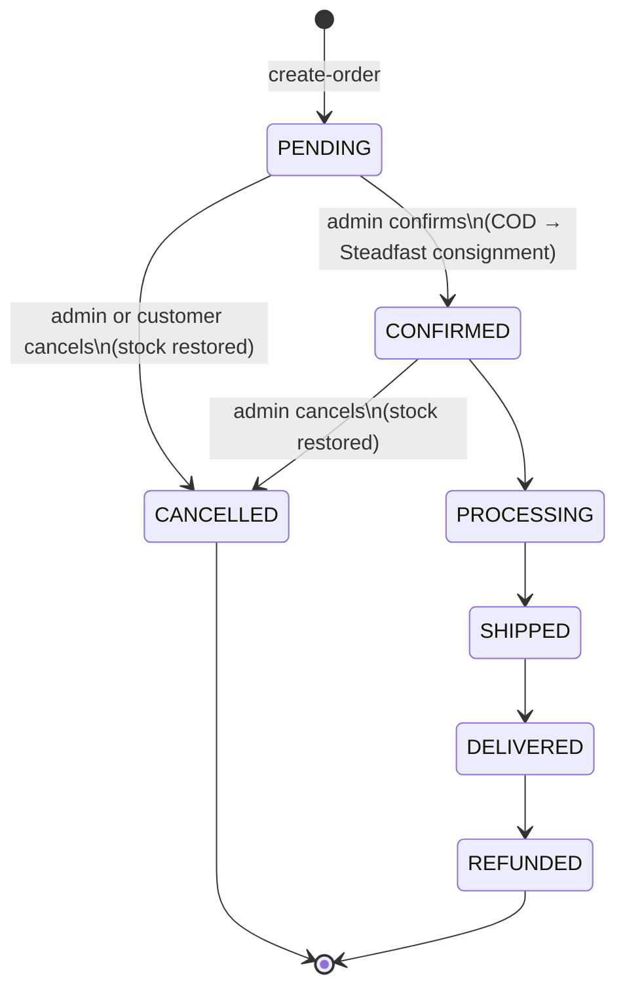
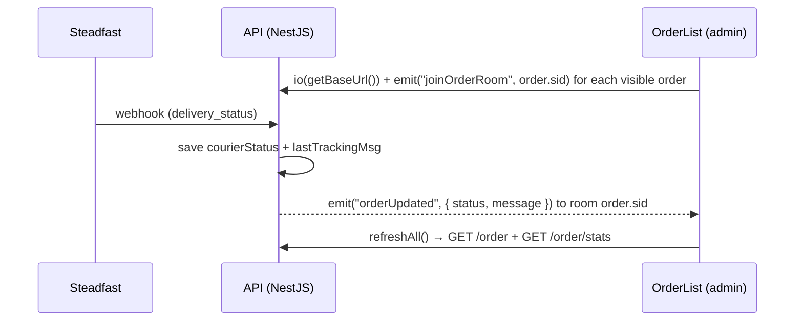
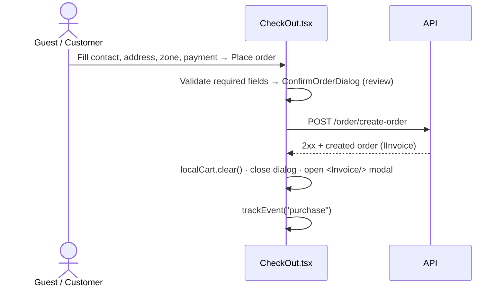
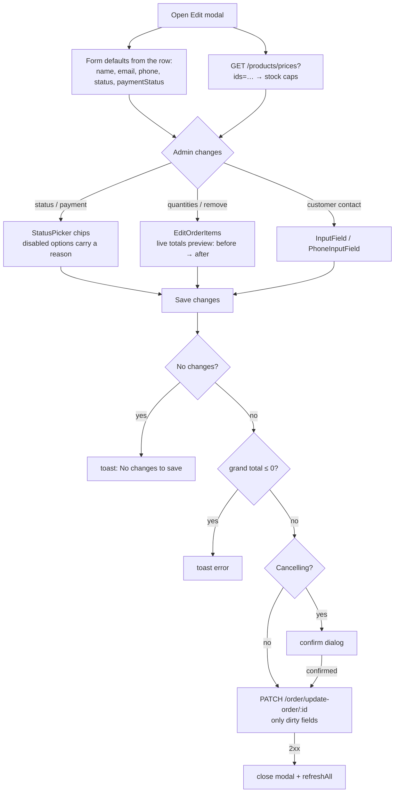

# Order Module — Frontend Technical Documentation

> **Scope:** everything the Natura Care client (Next.js 15, App Router) does with **orders** after the cart: how an order is placed from checkout, the admin **Order List** (stats, filters, confirm / cancel, edit, courier tracking, invoices, CSV export, live updates), and the customer's **My Orders** area (list, order details, progress tracker, cancel, buy again, invoice).
>
> **Audience:** frontend engineers joining or maintaining the project.
>
> **Related:** [Project README](../README.md) (run, build, Docker) · [Cart module](./cart.md) (local cart, checkout hand-off) · [Product module](./product.md) (product types, sizes, stock) · [User module](./user.md) (roles, session, customer account) · [Auth module](./auth.md) · [Analytics / GTM concepts](./concepts/analytics-gtm-ga4.md) · [Coding conventions](../claude-docs/basic-instructions.md)

| | |
|---|---|
| **Module root** | [`src/modules/order/`](../src/modules/order/) |
| **Admin route** | `/order-list` (admin route group) |
| **Customer routes** | `/my-account/order`, `/my-account/order/[id]` (customer route group) |
| **Order is created from** | `/check-out` → [`CheckOut.tsx`](../src/modules/checkout/public/CheckOut.tsx) (`POST /order/create-order`) |
| **Backend resource** | `/order/*` on `NEXT_PUBLIC_API_BASE_URL`, plus a Socket.IO gateway on the API host |
| **Courier** | Steadfast (consignment created by the server when a COD order is confirmed) |
| **Roles** | Guest & `CUSTOMER` place orders · `CUSTOMER` sees own orders · `ADMIN` & `EMPLOYEE` manage all orders |
| **Last reviewed** | 2026-10-24 |

---

## Table of Contents

1. [Overview](#1-overview)
2. [Tech Stack](#2-tech-stack)
3. [File Architecture](#3-file-architecture)
4. [Routing & Access Control](#4-routing--access-control)
   - [4.1 Routes](#41-routes)
   - [4.2 Middleware rules](#42-middleware-rules)
   - [4.3 Server-side guards](#43-server-side-guards)
   - [4.4 Navigation entry points](#44-navigation-entry-points)
5. [Domain Model & Business Logic](#5-domain-model--business-logic)
   - [5.1 Anatomy of an order](#51-anatomy-of-an-order)
   - [5.2 Order status lifecycle](#52-order-status-lifecycle)
   - [5.3 Payment status & methods](#53-payment-status--methods)
   - [5.4 Money: subtotal, delivery, coupon, grand total](#54-money-subtotal-delivery-coupon-grand-total)
   - [5.5 Courier (Steadfast)](#55-courier-steadfast)
   - [5.6 Stock side effects](#56-stock-side-effects)
   - [5.7 Who can cancel, and when](#57-who-can-cancel-and-when)
6. [Data Flow & State](#6-data-flow--state)
   - [6.1 Server state (React Query keys)](#61-server-state-react-query-keys)
   - [6.2 Local UI state](#62-local-ui-state)
   - [6.3 Real-time channel (Socket.IO)](#63-real-time-channel-socketio)
7. [Workflows](#7-workflows)
   - [7.1 Placing an order (checkout)](#71-placing-an-order-checkout)
   - [7.2 Admin confirms an order](#72-admin-confirms-an-order)
   - [7.3 Admin cancels an order](#73-admin-cancels-an-order)
   - [7.4 Admin edits an order](#74-admin-edits-an-order)
   - [7.5 Live courier check](#75-live-courier-check)
   - [7.6 Export CSV](#76-export-csv)
   - [7.7 Invoice (on screen & PDF)](#77-invoice-on-screen--pdf)
   - [7.8 Customer browses orders](#78-customer-browses-orders)
   - [7.9 Customer cancels an order](#79-customer-cancels-an-order)
   - [7.10 Buy again](#710-buy-again)
8. [Admin Section — `/order-list`](#8-admin-section--order-list)
   - [8.1 Page anatomy](#81-page-anatomy)
   - [8.2 Stat tiles](#82-stat-tiles)
   - [8.3 Status tabs & filters](#83-status-tabs--filters)
   - [8.4 Table columns & row actions](#84-table-columns--row-actions)
   - [8.5 View Order modal](#85-view-order-modal)
   - [8.6 Edit Order modal](#86-edit-order-modal)
9. [Customer Section (Storefront) — My Orders](#9-customer-section-storefront--my-orders)
   - [9.1 `/my-account/order` — order list](#91-my-accountorder--order-list)
   - [9.2 `/my-account/order/[id]` — order details](#92-my-accountorderid--order-details)
   - [9.3 Account overview & sidebar](#93-account-overview--sidebar)
10. [API Reference](#10-api-reference)
11. [Types](#11-types)
12. [Constants & Style Maps](#12-constants--style-maps)
13. [Hooks](#13-hooks)
14. [Utilities](#14-utilities)
15. [Validation Schema](#15-validation-schema)
16. [Reusable Components](#16-reusable-components)
17. [Analytics Events](#17-analytics-events)
18. [Business Rules Summary](#18-business-rules-summary)
19. [Known Issues & Technical Debt](#19-known-issues--technical-debt)
20. [How-To Recipes](#20-how-to-recipes)

---

## 1. Overview

An **order** is the server's record of a purchase. The client never computes what an order costs: checkout sends product ids, size ids and quantities, and the API prices the order, applies the coupon and free delivery, takes stock, and returns the finished order. From then on, every screen reads the order the server sends back.

| Audience | Where | What they can do |
|---|---|---|
| **Guest & Customer** | `/check-out` | Place an order (Cash on Delivery). See the invoice and download it as a PDF right away. |
| **Customer** | `/my-account/order` | List own orders with tabs (All / In progress / Delivered / Cancelled), search by order number, paginate. |
| **Customer** | `/my-account/order/[id]` | Progress tracker, status history, items, totals, payment, address, Steadfast tracking with live refresh, **Invoice** PDF, **Buy again**, **Cancel order** (while allowed). |
| **Customer** | `/my-account` (overview) & sidebar | Order counts, total spent, last 3 orders, "active orders" badge. |
| **Admin & Employee** | `/order-list` | Stat tiles, status tabs with counts, search + filters, paginated table, quick **Confirm** / **Cancel**, **View** (with status history and live courier check), **Edit** (status, payment status, quantities, remove lines, customer contact), **Invoice** PDF, **Export CSV**, live courier updates. |

Key design decisions:

- **The server is the source of truth for money, stock and status rules.** The client mirrors a few rules to grey out buttons (e.g. "a cancelled order can't be reopened"), but the API enforces them and its error message is shown when they disagree.
- **One status vocabulary, two voices.** Admin and customer screens share the colors in `ORDER_STATUS_STYLES`; the customer screens swap in friendlier wording from `CUSTOMER_STATUS_COPY` ("Pending" → "Order placed", "Shipped" → "On the way") ([§12](#12-constants--style-maps)).
- **Two order DTOs.** Admins receive the full order (`IOrder` / `IOrderDetails`, with `lastTrackingMsg` and who changed each status); customers receive a reduced view (`ICustomerOrderDetails`) with per-line `productSlug` / `isAvailable` and a server-computed `canCancel` flag ([§11](#11-types)).
- **One invoice model for every screen.** `buildInvoiceView()` turns an order into what the invoice shows, so the checkout invoice, the PDF from "My orders" and the PDF from the admin table always agree ([§7.7](#77-invoice-on-screen--pdf)).
- **Modals, not pages, on the admin side.** View and Edit open over the table, so filters and page position are kept.
- **URL-driven state on the customer side.** Tab, page and search live in the query string (`?status=active&page=2&q=NC-1`) so Back, refresh and shared links work.

[↑ Back to top](#table-of-contents)

---

## 2. Tech Stack

| Concern | Technology | Used for |
|---|---|---|
| Framework | **Next.js 15** (App Router), **React 19** | Routes, `next/dynamic` code-splitting, `next/image`, `next/link`, `useSearchParams` |
| Language | **TypeScript** | Order DTOs, status unions, style maps keyed by status |
| Server state | **TanStack Query v5** via the shared [`useGet` / `useGetAll`](../src/hooks/api/useGet.ts), [`usePatch`](../src/hooks/api/usePatch.ts), [`usePost`](../src/hooks/api/usePost.ts) hooks, plus a raw `useMutation` for customer cancel | Every `/order/*` call |
| HTTP | **Axios** ([`axiosInstance`](../src/lib/axios/axiosInstance.ts)) | Auth header, error envelope; direct calls for CSV export and the admin live courier check |
| Real time | **socket.io-client** | Admin list refreshes on courier updates |
| Tables | **TanStack Table v8** through [`CustomTable`](../src/components/data-display/table/CustomTable.tsx) | Admin order table |
| Forms | **react-hook-form** + **zod** (`@hookform/resolvers`) | Admin edit-order form |
| PDF | **@react-pdf/renderer** + **file-saver** | Invoice download (lazy-loaded on the customer side) |
| Search debounce | **lodash.debounce** (admin), `setTimeout` (customer) | 400 ms search |
| Styling | **Tailwind CSS** + project tokens (`greenPrimary-*`, `neutralPrimary-*`, `destructive-*`, `success-*`) + `tw-animate-css` | All order UI |
| UI primitives | **shadcn/ui** (`DropdownMenu`, `Skeleton`), **lucide-react** icons | Row menu, loading states, icons |
| Notifications | **sonner** | Success / error toasts (also raised automatically by `useGet`/`usePatch`) |
| Confirmation | Project [`useConfirm`](../src/hooks/useConfirm.ts) (promise-based) and [`ConfirmModal`](../src/components/primitives/modal/ConfirmModal.tsx) | "Confirm order?", "Cancel order?" |
| Analytics | GTM `dataLayer` via [`trackEvent`](../src/lib/analytics/gtm.events.ts) | `purchase` on a successful order |
| Access control | Next.js **middleware** ([`src/middleware.ts`](../src/middleware.ts)) + `jwt-decode`; API guards | Route protection by role |

[↑ Back to top](#table-of-contents)

---

## 3. File Architecture

```text
src/
├── app/
│   ├── (admin)/order-list/
│   │   └── page.tsx                         # Route: metadata + dynamic import of <OrderList/>
│   └── (customer)/my-account/order/
│       ├── page.tsx                         # Route: <Suspense> + dynamic <Order/> (reads useSearchParams)
│       └── [id]/page.tsx                    # Route: validates id → notFound(), dynamic <OrderDetails/>
│
├── modules/order/
│   ├── types/
│   │   └── order.types.ts                   # ★ IOrder, IOrderItem, status unions, admin & customer DTOs, IInvoice
│   ├── constants/
│   │   └── order.constants.ts               # ORDER_STATUS (statuses offered in the edit form), ORDER_PAYMENT_STATUS (unused)
│   ├── hooks/
│   │   └── useUserOrders.ts                 # Customer: useUserOrders, useUserOrderSummary, useUserOrderDetails + query keys
│   ├── schemas/
│   │   └── order-update.schema.ts           # zod schema of the admin edit form
│   ├── utils/
│   │   ├── order.utils.ts                   # ★ Badge styles, labels, ORDER_FLOW, formatters, CSV export
│   │   ├── customer-order.utils.ts          # Customer wording, tabs, progress steps, timeline helpers, image URLs
│   │   └── invoice.utils.ts                 # buildInvoiceView() + INVOICE_COMPANY (shared by screen & PDF invoices)
│   ├── admin/                               # Dashboard UI (ADMIN, EMPLOYEE)
│   │   ├── OrderList.tsx                    # ★ Page: data, filters state, socket, export, modals
│   │   ├── order.columns.tsx                # Table columns, row actions menu, <ItemThumb/>
│   │   ├── ViewOrder.tsx                    # View modal: hero, progress, customer, items, payment, courier, history
│   │   ├── EditPlacedOrder.tsx              # Edit modal: status, items, totals preview, customer, address (read-only)
│   │   ├── order-list/
│   │   │   ├── OrderStatsCards.tsx          # Today / To confirm / Revenue / Unpaid tiles (clickable shortcuts)
│   │   │   ├── OrderStatusTabs.tsx          # Status tabs with counts
│   │   │   └── OrderFilters.tsx             # Search, date presets, selects, active-filter chips
│   │   ├── edit-placed-order-form/
│   │   │   ├── StatusPicker.tsx             # Radio-group of status chips (reusable)
│   │   │   ├── EditOrderItems.tsx           # Quantity steppers, remove / undo, stock caps
│   │   │   ├── CustomerPersonalInformation.tsx  # First/last name, phone, email inputs
│   │   │   ├── OrderDeliveryAddress.tsx     # Read-only address
│   │   │   └── OrderedItem.tsx              # Old item editor — NOT USED
│   │   └── OrderTracking.tsx                # Socket demo — NOT USED
│   └── customer/                            # Storefront account UI (CUSTOMER)
│       ├── Order.tsx                        # "My orders": tabs, search, list, pagination
│       ├── OrderCard.tsx                    # One order card (also used on the account overview, `compact`)
│       ├── OrderDetails.tsx                 # Order page: header, progress, items, courier, history, summary, actions
│       ├── OrderProgress.tsx                # Placed → Confirmed → Packed → Shipped → Delivered tracker
│       └── CancelOrderDialog.tsx            # Reason chips + textarea → PATCH cancel
│
├── modules/checkout/public/
│   ├── CheckOut.tsx                         # Builds the order payload, POST /order/create-order, shows invoice
│   ├── Invoice.tsx                          # On-screen invoice (uses buildInvoiceView)
│   └── InvoicePDF.tsx                       # PDF invoice (uses buildInvoiceView) — imported by the order module
│
├── modules/account/customer/
│   ├── AccountUI.tsx                        # AccountCard, EmptyPanel, OrderStatusBadge, button classes
│   └── AccountOverview.tsx                  # Uses useUserOrderSummary + useUserOrders + <OrderCard compact/>
│
├── components/layout/sidebar/
│   ├── AdminSidebar.tsx                     # "Order List" link (employee: true)
│   └── CustomerSidebar.tsx                  # "My Orders" link with active-orders badge
│
└── middleware.ts                            # /order-list in ADMIN_ONLY_ROUTES + EMPLOYEE_ROUTES; /my-account in CUSTOMER_ROUTES
```

**Ownership rules**

- The order module owns the **order types**, **status vocabulary** (`ORDER_STATUS_STYLES`, `CUSTOMER_STATUS_COPY`) and **formatters** (`formatBDT`, `formatDateTime`). Other modules (account, checkout, wishlist, dashboard) import them instead of redefining labels or colors.
- Checkout owns the **order-creation form** and the **invoice components**; the order module owns the **invoice data model** (`invoice.utils.ts`).
- Admin components live under `admin/`, customer components under `customer/`; neither imports from the other. `ItemThumb` (admin) and `OrderStatusBadge` (account) are the only shared visual pieces.

[↑ Back to top](#table-of-contents)

---

## 4. Routing & Access Control

### 4.1 Routes

| Path | File | Rendering |
|---|---|---|
| `/order-list` | [`app/(admin)/order-list/page.tsx`](../src/app/(admin)/order-list/page.tsx) | Server component exporting `metadata` (`"Orders \| Natura Care Limited"`), renders `<OrderList/>` via `next/dynamic` with `<LoadingPage/>`. |
| `/my-account/order` | [`app/(customer)/my-account/order/page.tsx`](../src/app/(customer)/my-account/order/page.tsx) | Wraps the dynamic `<Order/>` in `<Suspense>` — required because `Order` reads `useSearchParams()`. Title `"My Orders \| Natura Care Limited"`. |
| `/my-account/order/[id]` | [`app/(customer)/my-account/order/[id]/page.tsx`](../src/app/(customer)/my-account/order/[id]/page.tsx) | Async server component. `id` must be a positive integer, otherwise `notFound()`. Passes the numeric `orderId` to the dynamic `<OrderDetails/>`. |

The customer URLs use the order's **numeric database `id`**, not the human order number (`orderId`, e.g. `NC-…`). `/my-account/` is disallowed in [`robots.ts`](../src/app/robots.ts).

### 4.2 Middleware rules

From [`src/middleware.ts`](../src/middleware.ts):

```ts
const CUSTOMER_ROUTES  = ["/my-account"];                 // startsWith → covers /my-account/order/<id>
const ADMIN_ONLY_ROUTES = [/* … */ "/order-list" /* … */];
const EMPLOYEE_ROUTES  = ["/dashboard", "/products", "/inventory", "/order-list", "/category", "/profile"];
const GUEST_CUSTOMER_ONLY_ROUTES = ["/my-cart", "/check-out"];
```

| Visitor | `/check-out` (place order) | `/my-account/order/*` | `/order-list` |
|---|---|---|---|
| Guest (no `accessToken`) | ✅ | ↪ `/login` | ↪ `/login` |
| `CUSTOMER` | ✅ | ✅ (own orders only — enforced by the API) | ↪ `/` |
| `EMPLOYEE` | ↪ `/dashboard` | ↪ `/` | ✅ |
| `ADMIN` | ↪ `/dashboard` | ↪ `/` | ✅ |

> Employees have **the same order powers as admins** in the UI (view, edit, confirm, cancel, export). The API allows both roles on every admin order endpoint ([§4.3](#43-server-side-guards)).

### 4.3 Server-side guards

The middleware only decides which pages open. The API decides what data comes back:

| Endpoint group | Guard |
|---|---|
| `POST /order/create-order` | `NoAdminEmployeeGuard` — guests and customers only. |
| `GET /order`, `GET /order/stats`, `GET /order/order-details/:id`, `PATCH /order/update-order/:id` | JWT + `ADMIN` / `EMPLOYEE`. |
| `GET /order/user-order*`, `PATCH /order/user-order/:id/cancel` | JWT; the server filters by the caller's user id (another customer's order → 404). |
| `GET /order/:id/delivery-status` | JWT + `ADMIN` / `EMPLOYEE` / `CUSTOMER`; a customer gets 403 for an order that isn't theirs. |

### 4.4 Navigation entry points

| Where | Link | Notes |
|---|---|---|
| [`AdminSidebar`](../src/components/layout/sidebar/AdminSidebar.tsx) | "Order List" → `/order-list` | `employee: true`, so it is shown to employees too. |
| Dashboard ([`OrderPipeline`](../src/modules/dashboard/admin/OrderPipeline.tsx), [`RecentOrders`](../src/modules/dashboard/admin/RecentOrders.tsx)) | → `/order-list` | Dashboard has its own endpoints/types; it only links here. |
| [`CustomerSidebar`](../src/components/layout/sidebar/CustomerSidebar.tsx) / [`account-nav.constants.ts`](../src/modules/account/constants/account-nav.constants.ts) | "My Orders" → `/my-account/order` | Badge = `orderSummary.activeOrders`. |
| [`AccountOverview`](../src/modules/account/customer/AccountOverview.tsx) | → `/my-account/order`, `/my-account/order?status=active` | Stat tiles + "Recent orders". |
| [`AccountHero`](../src/modules/account/customer/AccountHero.tsx) | Breadcrumb "My Orders" on the details page | Page title "Order Details" from `account-nav.constants.ts`. |

[↑ Back to top](#table-of-contents)

---

## 5. Domain Model & Business Logic

### 5.1 Anatomy of an order

```text
IOrder
├── identity        id (number, used in URLs/API) · sid (public uid, socket room) · orderId (human number, shown everywhere)
├── customer        customerId? (absent → guest) · firstName · lastName · email · phone
├── address         street · city (district) · state (division id, e.g. "DHAKA") · zipCode · country
├── delivery        deliveryMethod (INSIDE_DHAKA | OUTSIDE_DHAKA) · deliveryCharge · estimatedDays
│                   isFreeDelivery · freeDeliverySettingId · freeDeliveryMinOrderAmount · appliedFreeDelivery
├── payment         paymentMethod (CASH_ON_DELIVERY | SSLCOMMERZ) · paymentStatus · transactionId? · paidAt?
├── money           subtotal · discount · grandTotal · promotionId? · couponCode? · couponTitle?
├── lifecycle       status · statusHistory[] · createdAt · updatedAt · deliveredAt?
├── courier         trackingId? (Steadfast consignment id) · courierStatus? · lastTrackingMsg? (admin only)
├── notes
└── orderItems[]    IOrderItem: productId? · productName (snapshot, includes size) · variantId? · variantSize?
                                price (unit price at purchase) · quantity · total · sku · imageUrl
```

- **Order lines are snapshots.** Name, size, SKU, price and image are copied at purchase time; later product edits don't change past orders. `productId` can be missing if the product was deleted.
- **Guest vs registered** is simply `customerId` present or not (`order.customerId ? "Registered" : "Guest"`).
- **Amounts may arrive as Decimal strings.** Every formatter and calculation coerces with `Number(x)` first.

### 5.2 Order status lifecycle



`ORDER_FLOW = ["PENDING", "CONFIRMED", "PROCESSING", "SHIPPED", "DELIVERED"]` is the normal path; `CANCELLED` and `REFUNDED` leave it.

| Status | Admin label / hint | Customer label / hint | Customer tab |
|---|---|---|---|
| `PENDING` | Pending — "Waiting for you to confirm" | Order placed | In progress |
| `CONFIRMED` | Confirmed — "Accepted; COD orders are sent to Steadfast" | Confirmed | In progress |
| `PROCESSING` | Processing — "Being packed" | Packing | In progress |
| `SHIPPED` | Shipped — "With the courier" | On the way | In progress |
| `DELIVERED` | Delivered — "Received by the customer" | Delivered | Delivered |
| `CANCELLED` | Cancelled — "Will not be delivered" | Cancelled | Cancelled |
| `REFUNDED` | Refunded — "Money returned" | Refunded | Cancelled |

**Transition rules the client mirrors** (the server enforces them):

| Rule | Where in the client |
|---|---|
| Only `PENDING` orders show **Confirm order** in the row menu. | `order.columns.tsx` — `canConfirm` |
| Only `PENDING` / `CONFIRMED` orders show **Cancel order** in the row menu. | `order.columns.tsx` — `canCancel` |
| A `CANCELLED` order can't move to any other status. | `EditPlacedOrder` — `reopening` disables the options |
| A `CONFIRMED` or `CANCELLED` order can't go back to `PENDING`. | `EditPlacedOrder` — `NO_RETURN_TO_PENDING` |
| Item changes can't be sent on an order that is, or is becoming, cancelled. | `EditPlacedOrder` — `itemsLocked`; choosing Cancelled clears pending item edits |
| An order needs at least one line. | `EditOrderItems` — last remaining line's remove button is disabled |

> ⚠️ The edit form only offers **Pending / Confirmed / Cancelled** (`ORDER_STATUS`), and the Steadfast webhook currently stores only the courier status. So in practice nothing in the app moves an order to `PROCESSING`, `SHIPPED` or `DELIVERED` today — see [§19 #1](#19-known-issues--technical-debt).

Every status change (and every admin edit, even one that keeps the status) adds a row to `statusHistory`. The admin timeline shows all rows with notes and who made the change; the customer timeline collapses consecutive rows with the same status (`statusChanges()`).

### 5.3 Payment status & methods

| `paymentStatus` | Label | Notes |
|---|---|---|
| `PENDING` | **Unpaid** | Customer screen shows **"Pay on delivery"** when the method is COD. |
| `PROCESSING` | Processing | |
| `COMPLETED` | **Paid** | Setting it in the edit form records `paidAt` = now (server). Blocks customer cancellation. |
| `FAILED` | Failed | |
| `REFUNDED` | Refunded | |

| `paymentMethod` | Label | Availability |
|---|---|---|
| `CASH_ON_DELIVERY` | Cash on delivery (table: "COD") | The only method checkout offers today. |
| `SSLCOMMERZ` | Online (SSLCommerz) | Shown as **"Coming soon"** at checkout; types and labels are ready. |

Payment status is independent of order status; admins change it in the edit form.

### 5.4 Money: subtotal, delivery, coupon, grand total

```text
grandTotal = subtotal + deliveryCharge − discount
subtotal   = Σ orderItems[i].price × quantity          (server-priced at create time)
discount   = coupon amount (promotionId / couponCode)
deliveryCharge = zone price, or 0 when a free-delivery offer applied
```

| Rule | Implementation |
|---|---|
| Totals are calculated by the **server** at create time and after every admin item edit. | `POST /order/create-order`, `PATCH /order/update-order/:id` |
| Delivery is shown as **free** only when the charge is 0 **and** an offer waived it (`freeDeliveryMinOrderAmount != null` or `isFreeDelivery`). | `buildInvoiceView().delivery.isFree`; table/ViewOrder use `isFreeDelivery && deliveryCharge === 0` |
| When an admin changes quantities, the **coupon keeps the same percentage** of the subtotal: `newDiscount = newSubtotal × oldDiscount / oldSubtotal`. The delivery charge does not change. | `EditPlacedOrder` `preview` ("same maths as the server") |
| The edited grand total must stay above ৳0. | `EditPlacedOrder.onSubmit` |
| Amount due on the invoice is 0 when paid, cancelled or refunded; otherwise the grand total. | `buildInvoiceView().payment.amountDue` |
| Currency: `৳1,234.5` (`en-BD`, max 2 decimals); compact `৳412.4K` for stat tiles. | `formatBDT`, `formatBDTCompact` |

### 5.5 Courier (Steadfast)

| Field | Meaning |
|---|---|
| `trackingId` | Steadfast **consignment id**. Present once the server has created the consignment. |
| `courierStatus` | Last courier status stored on the order (`pending`, `in_review`, `hold`, `delivered`, `partial_delivered`, `cancelled`, …). Shown with `formatCourierStatus()` ("In Review") and `courierBadgeClass()`. `null` → "Not sent". |
| `lastTrackingMsg` | Last webhook message (admin only). |
| `liveCourierStatus` | Returned by `GET /order/:id/delivery-status`: asked from Steadfast right now. The server also saves it to `courierStatus` if it changed. |

When it is sent: **when a `CASH_ON_DELIVERY` order with no `trackingId` is set to `CONFIRMED`**. The server creates the consignment inside the same transaction — **if Steadfast refuses, nothing is saved** and the admin sees the error. Online-paid orders are not sent automatically.

How it is updated: Steadfast calls the API webhook → the server stores `courierStatus` + `lastTrackingMsg` and emits `orderUpdated` to the order's socket room ([§6.3](#63-real-time-channel-socketio)). Admins and customers can also press **Check live status / Refresh** ([§7.5](#75-live-courier-check)).

### 5.6 Stock side effects

All stock movements happen on the server and are recorded in inventory history. The client shows them so staff know what a save will do:

| Action | Stock effect | Client message |
|---|---|---|
| Place order | Units taken from stock. | — |
| Cancel (admin or customer) | **Every line restocked** (size and combo contents included). | "All of its items will be put back into stock. A cancelled order can't be reopened." |
| Admin raises a quantity | Extra units taken from stock. | "Was 2 · takes 1 more from stock" |
| Admin lowers a quantity | Difference returned to stock. | "Was 3 · returns 1 to stock" |
| Admin removes a line | Its units returned to stock. | "Will be removed · 2 units go back to stock" |

The quantity stepper is capped at **original quantity + current shop stock** (from `GET /products/prices`), because units already reserved by this order can be reused. Low stock (≤ 5) is hinted: "3 more in stock".

### 5.7 Who can cancel, and when

| Actor | Allowed when | How |
|---|---|---|
| **Customer** | `status === PENDING` **and** no `trackingId` **and** `paymentStatus !== COMPLETED`. The server sends this as `canCancel`; the client only reads the flag. | "Cancel order" on the order page → `CancelOrderDialog` (optional reason, max 500 chars). |
| **Admin / Employee** | Order is not already cancelled (row menu offers it for `PENDING` / `CONFIRMED`; the edit form for any non-cancelled order). | Row menu → confirm dialog, or Edit → Order status = Cancelled. |

If a customer's order is `PENDING` but `canCancel` is false (e.g. already handed to the courier), the page says *"Need to change or cancel it? Contact us and we'll help."*

[↑ Back to top](#table-of-contents)

---

## 6. Data Flow & State

There is **no global store** for orders. Server data lives in the TanStack Query cache; screens keep only UI state locally.

### 6.1 Server state (React Query keys)

| Key | Endpoint | Used by | Invalidated / refetched by |
|---|---|---|---|
| `["getAllCustomerOrders", JSON(queryParams)]` | `GET /order` | `OrderList` | `refreshAll()` (Refresh button, socket event, any successful patch) |
| `["getOrderStats"]` | `GET /order/stats` | `OrderList` (tiles + tab counts) | `refreshAll()` |
| `["getOrderDetails", id]` | `GET /order/order-details/:id` | `ViewOrder` | Remount (opening the modal again) |
| `["getOrderItemStock", ids]` | `GET /products/prices?ids=…` | `EditPlacedOrder` | Remount |
| `[CUSTOMER_ORDERS_KEY, page, limit, search, group]` = `"getUserOrders"` | `GET /order/user-order` | `Order`, `AccountOverview` | Customer cancel |
| `[CUSTOMER_ORDER_SUMMARY_KEY]` = `"getUserOrderSummary"` | `GET /order/user-order/summary` | `Order`, `AccountOverview`, `CustomerSidebar` | Customer cancel |
| `[CUSTOMER_ORDER_DETAILS_KEY, id]` = `"getUserOrderDetails"` | `GET /order/user-order/:id` | `OrderDetails` | Customer cancel (success **and** error) |
| `["customerOrderLiveStatus", id]` | `GET /order/:id/delivery-status` | `CourierCard` | Manual `refetch()` only (`enabled: false`) |

Notes:

- Customer queries are `enabled: !!userId` — they wait for the session.
- `useUserOrders` uses `placeholderData: previous` so the old page stays on screen (dimmed, `aria-busy`) while the next one loads.
- `useUserOrderDetails` uses `retry: false` so a wrong or foreign id shows "Order not found" at once.
- `useGet` / `useGetAll` / `usePatch` **toast errors themselves**; components don't need their own error toast for those calls.

### 6.2 Local UI state

| Component | State | Why local |
|---|---|---|
| `OrderList` | `currentPage`, `pageSize`, `searchTerm`, `sortOrder`, `filters: IOrderFilters`, `isLive`, `isExporting`, modal state (`useHandleModalState<IOrder>`) | Admin filters are per visit; not in the URL. |
| `OrderFilters` | `text` (input before debounce), `showMore` | Typing shouldn't refetch on every key. |
| `ViewOrder` | `live` (latest `IOrderLiveStatus`), `isChecking` | Result of a one-off courier check, merged over the row. |
| `EditPlacedOrder` | RHF form values, `quantities: Record<itemId, qty>`, `removed: itemId[]` | Only changed values are sent. |
| `Order` (customer) | `searchInput` (tab/page/search themselves are in the URL) | URL is the source of truth. |
| `OrderDetails` | `isCancelOpen`, `isDownloading` | — |

### 6.3 Real-time channel (Socket.IO)



- The header pill shows **Live** while the socket is connected, **Offline** otherwise ("Live updates are off; use Refresh").
- Rooms are joined only for orders on the current page.
- The customer screens don't use the socket; they offer a **Refresh** button on the courier card.

> ⚠️ The socket URL is the API base URL including the `/n-care/api/v1` path, which Socket.IO reads as a namespace; the gateway listens on the default namespace. See [§19 #2](#19-known-issues--technical-debt).

[↑ Back to top](#table-of-contents)

---

## 7. Workflows

### 7.1 Placing an order (checkout)

The form itself belongs to the checkout module; this is the part that creates the order.



Payload built in `CheckOut.onSubmit`:

```ts
{
  firstName, lastName, email, phone,
  // signed in + saved address  → { addressId }
  // signed in + new address, or guest → { newAddress: { street, city, state: region, zipCode, country } }
  deliveryMethod,                 // "INSIDE_DHAKA" | "OUTSIDE_DHAKA"
  paymentMethod,                  // "CASH_ON_DELIVERY" (only option today)
  items: [{ productId, variantId?, quantity }],   // from useLocalCart → cartItemsForOrder
  promotionId: number | null,     // applied coupon
  isFreeDelivery: boolean,
  freeDeliverySettingId: number | null,
}
```

The order starts as `PENDING` / payment `PENDING`. The cart is cleared only on a 2xx response. See [Cart §7.5](./cart.md#75-checkout-hand-off--clearing-after-an-order).

### 7.2 Admin confirms an order

1. Row menu → **Confirm order** (only for `PENDING`), or Edit → Order status = **Confirmed**.
2. A confirm dialog (row menu) warns: *"It will be sent to Steadfast for pickup right away."* when the order is COD and has no `trackingId`. The edit form shows the same notice inline: *"Saving sends this order to Steadfast for pickup. If Steadfast refuses it, nothing is saved."*
3. `PATCH /order/update-order/:id` with `{ status: "CONFIRMED" }`.
4. Server: updates the status, adds a history row, creates the Steadfast consignment (COD only), stores `trackingId` + `courierStatus`.
5. Client: success toast from `usePatch` → `refreshAll()`. The Courier column now shows the status and a copyable `#trackingId`.

### 7.3 Admin cancels an order

1. Row menu → **Cancel order** (`PENDING` / `CONFIRMED`), or Edit → **Cancelled**.
2. Warning dialog (`variant: "warning"`, buttons *Cancel order* / *Keep order*).
3. `PATCH /order/update-order/:id` with `{ status: "CANCELLED" }` (the edit form drops any pending item edits first).
4. Server restocks every line and records it; the order can't be reopened.

### 7.4 Admin edits an order



Only changed fields are sent:

```ts
{
  firstName?, lastName?, email?, phone?,         // form field `userEmail` is sent as `email`
  status?, paymentStatus?,
  itemsToUpdate?: [{ itemId, quantity }],        // only lines whose quantity differs from the original
  itemsToRemove?: number[],                      // order item ids
}
```

- The **delivery address is read-only** after placement (the server rejects changes).
- The sticky footer counts unsaved changes; **Discard** resets the form, quantities and removals; with no changes the button reads **Close**.

### 7.5 Live courier check

| Screen | Trigger | Behavior |
|---|---|---|
| Admin `ViewOrder` | **Check live status** (only when `trackingId` exists) | Direct `axiosInstance.get('/order/:id/delivery-status')`; result merged over the order; toast *"Steadfast says: Delivered"*; if `courierStatus` changed → `onChanged()` refreshes the list. Error → *"Couldn't reach Steadfast. Please try again."* |
| Customer `CourierCard` | **Refresh** | `useGet(..., enabled: false)` + `refetch()`; shows `liveCourierStatus` and "Updated just now". |

### 7.6 Export CSV

1. **Export CSV** in the list header.
2. `GET /order` with the **current filters but no `page` / `limit`** — the API returns every matching order, not just the visible page.
3. `ordersToCsv(rows)` → `Blob` with a UTF-8 BOM (opens cleanly in Excel) → `saveAs(blob, "orders-YYYY-MM-DD.csv")` (Dhaka date).
4. Columns: Order, Placed, Customer, Phone, Email, Customer type, Address, Delivery zone, Items (`"Name ×2; …"`), Subtotal, Delivery, Discount, Grand total, Coupon, Payment method, Payment, Status, Tracking ID, Courier status.
5. Empty result → *"No orders to export"*.

### 7.7 Invoice (on screen & PDF)

```text
order (IInvoice) ──► buildInvoiceView() ──► IInvoiceView ──┬──► <Invoice/>     (checkout success modal, formats ৳)
                                                          └──► <InvoicePDF/>  (react-pdf; font has no ৳ glyph)
```

| Where | How |
|---|---|
| Checkout success | `<Invoice invoiceData={createdOrder}/>` in a modal. |
| Admin table row / ViewOrder | `pdf(<InvoicePDF invoiceData={orderToInvoice(order)}/>).toBlob()` → `invoice-<orderId>.pdf`. Static imports. |
| Customer order page | Same, but `@react-pdf/renderer`, `InvoicePDF` and `file-saver` are **dynamically imported** on click (large bundle). |

`buildInvoiceView()` decides: address lines (division omitted when it repeats the city), coupon line (only when `discount > 0`), free-delivery reason, `amountDue` and `dueLabel` ("Pay in cash when the parcel arrives", "Paid in full", "Nothing to pay: this order was cancelled", …). Company details and terms come from `INVOICE_COMPANY`.

### 7.8 Customer browses orders

1. `/my-account/order` reads `?status=` (`all` / `active` / `delivered` / `cancelled`, case-insensitive), `?page=`, `?q=`.
2. Tabs call `setQuery({ status, page: 1 })` → `router.replace(..., { scroll: false })`. Defaults (`ALL`, page 1, empty search) are removed from the URL.
3. Search is debounced 400 ms, then written to `?q=` and page reset to 1.
4. `useUserOrders({ page, limit: 5, search, group })` → `OrderCard` per order; `CustomPagination` when `totalPages > 1`, with "Showing 6–10 of 23 orders".
5. Empty states: no orders at all (`summary.totalOrders === 0`) → "No orders yet" + **Start shopping**; empty tab → "Nothing here yet" + **See all orders**; no search match → "No matching orders" + **Clear search**.

### 7.9 Customer cancels an order

1. **Cancel order** is shown only when `order.canCancel` is true.
2. `CancelOrderDialog`: quick-reason chips (*Ordered by mistake*, *Want to change items*, *Want to change the address*, *Found a better price*, *Delivery takes too long*) toggle into the textarea; free text up to 500 characters; optional.
3. `PATCH /order/user-order/:id/cancel` with `{ reason?: string }`.
4. Success → toast *"Order NC-… has been cancelled"*, invalidate details / list / summary, close.
5. Error (e.g. the shop confirmed it a moment ago) → toast with the server message and **refetch the details** so the page shows the real state.

### 7.10 Buy again

- Header **Buy again** (when any line `isAvailable`) or the per-line **Buy again** link.
- Each available line → `localCart.addItem({ id: productId, variantId, size, name, price, image, quantity })`. The stored price is a placeholder; the cart re-prices from the API ([Cart §7.2](./cart.md#72-opening-the-cart-re-price--re-stock)).
- Unavailable lines (product gone, off sale or out of stock) are skipped and counted in the toast. More than one line → navigate to `/my-cart`.

[↑ Back to top](#table-of-contents)

---

## 8. Admin Section — `/order-list`

### 8.1 Page anatomy

```text
┌───────────────────────────────────────────────────────────────────────┐
│ Orders  ● Live            [Newest first] [⟳ Refresh] [⇩ Export CSV]  │  header
├───────────────────────────────────────────────────────────────────────┤
│ [Today]      [To confirm]      [Revenue]      [Unpaid]                │  OrderStatsCards
├───────────────────────────────────────────────────────────────────────┤
│ All 120 | ● Pending 4 | ● Confirmed | ● Processing | … | ● Refunded    │  OrderStatusTabs
│ [🔍 Order no., phone, name or email…] (Today)(Last 7 days)(Last 30)  ⚙ │  OrderFilters
│   Payment ▾  Method ▾  Zone ▾  Customer ▾  From 📅  To 📅             │    (expanded)
│   [Payment: Unpaid ×] [Placed: 1 Oct – 7 Oct ×] ["01711" ×] Clear all │    chips
├───────────────────────────────────────────────────────────────────────┤
│ Order │ Customer │ Items │ Total │ Payment │ Status │ Courier │ Action│  CustomTable
└───────────────────────────────────────────────────────────────────────┘
  View modal (CustomModal2)            Edit modal (CustomModalStaticTitleFooter)
```

Request: `GET /order?page&limit&search&sortOrder&status&paymentStatus&paymentMethod&deliveryMethod&customerType&dateFrom&dateTo` — unset values are `undefined` and dropped by axios.

- Any filter, tab or search change resets to page 1 (`applyFilters`, `applySearch`).
- `CustomTable` gets `key={JSON.stringify({ filterParams, pageSize })}` so its own pagination resets when filters change.
- The table's built-in search bar is hidden (`showSearchbar={false}`); search lives in `OrderFilters`.

### 8.2 Stat tiles

From `GET /order/stats` (`IOrderStats`). Tiles are buttons only when there is something to show.

| Tile | Value | Hint | Click |
|---|---|---|---|
| **Today** | `todayOrders` | "৳X in sales today" | `dateFrom = dateTo = dhakaToday()` |
| **To confirm** | `statusCounts.PENDING` (amber when > 0) | "Pending orders waiting for you" / "All caught up" | `status = PENDING` |
| **Revenue** | `formatBDTCompact(revenue)` (full value in tooltip) | "Avg. order ৳X" | — |
| **Unpaid** | `unpaidOrders` | "of N orders · M by guests" | `paymentStatus = PENDING`, clears `status` |

### 8.3 Status tabs & filters

- **Tabs**: All + the 7 statuses, each with a dot color and count from `stats.statusCounts`. Counts always cover **all** orders, not the filtered set. The Pending count is highlighted amber when > 0. The tab's `title` is the admin hint.
- **Search**: order number, phone, name or email; debounced 400 ms.
- **Date presets**: Today / Last 7 days / Last 30 days, computed in **Asia/Dhaka** (`dhakaToday(offset)`); clicking the active preset clears it.
- **More filters** (toggle shows a count badge): Payment status, Method, Zone, Customer type (Registered / Guest), From / To dates (`max` = today, `To.min` = From).
- **Chips** for every active filter, each removable; **Clear all** when more than one.

### 8.4 Table columns & row actions

| Column | Shows |
|---|---|
| **Order** | `orderId` (button → View) · "5 min ago · 3 items" (full date on hover) |
| **Customer** | Initials avatar (grey for guests) · name · **Guest** tag · `tel:` phone link |
| **Items** | Up to 3 overlapping `ItemThumb`s + "+N"; tooltip lists every line |
| **Total** | `grandTotal` · "COD" / method · coupon chip (`−৳` in tooltip) · **Free** delivery chip |
| **Payment** | Payment status badge |
| **Status** | Order status badge; `PENDING` dot pings to draw attention |
| **Courier** | Courier status badge + `#trackingId` (click to copy); "Not sent" when none |
| **Action** | View · Edit · Download invoice · ⋯ menu |

⋯ menu: **Confirm order** (`PENDING`), **Cancel order** (`PENDING`/`CONFIRMED`), **Copy order number**, **Copy phone**, **Copy name & address** (multi-line, ready for a courier slip).

### 8.5 View Order modal

`ViewOrder` renders the list row immediately, then merges in `GET /order/order-details/:id` (adds `statusHistory` with `changedByUser`) and any live courier result: `order = { ...row, ...details, ...live }`.

| Block | Content |
|---|---|
| Hero | Order number (copy), placed date + "time ago", status / payment / courier badges, grand total, item count + method, **Edit** and **Invoice** buttons |
| Progress | 5-step `ORDER_FLOW` stepper; for cancelled/refunded a red notice instead |
| Customer | Avatar, name, Guest / Registered tag, phone (`tel:` + copy), email (`mailto:`) |
| Delivery | Address (copy), zone + "within N days", delivered date |
| Items | Thumb, name, SKU, `price × qty`, line total |
| Payment | Subtotal, delivery (Free chip), coupon, grand total, method, status + paid date, transaction id |
| Courier (Steadfast) | Consignment (copy), status, live check result, last webhook message; explanatory text when not sent |
| Notes | Customer note |
| Status history | Newest first; badge, date, note, "by {name}" / "by user #id" / "by the system / customer" |

Blocks fade in with staggered delays (`ENTER` + `enterDelay(ms)`; disabled under `prefers-reduced-motion`).

### 8.6 Edit Order modal

| Card | Fields | Rules |
|---|---|---|
| **Status** | Order status (`StatusPicker`, options from `ORDER_STATUS` + the current status), Payment status (all 5) | Disabled chips explain why on hover; "current" tag on the original value; COD-confirm and cancel notices; "Marking as paid records the order as paid now." |
| **Items** | `EditOrderItems`: stepper (min 1, max original + stock), remove / **Undo**, per-line change notes | Locked (read-only) for cancelled/cancelling orders; last line can't be removed ("Cancel the order instead"). |
| Totals preview | Subtotal / Delivery / Coupon / Grand total, old value struck through when items changed | Coupon prorated; note shown when a coupon exists. |
| **Customer** | First name *, Last name, Phone *, Email | zod schema ([§15](#15-validation-schema)). |
| **Delivery address** | Read-only list | 🔒 "can't be changed after the order is placed". |

Each card shows an amber **Edited** badge when its values changed.

[↑ Back to top](#table-of-contents)

---

## 9. Customer Section (Storefront) — My Orders

Both pages render inside the customer layout (`CustomerSidebar` + `AccountHero`) and use the account UI kit from [`AccountUI.tsx`](../src/modules/account/customer/AccountUI.tsx).

### 9.1 `/my-account/order` — order list

| Element | Detail |
|---|---|
| Header | `AccountPageHeader` "My Orders" — "Track deliveries, see what you ordered and get your invoices." |
| Tabs | `CUSTOMER_ORDER_TABS`: All orders (`totalOrders`), In progress (`activeOrders`), Delivered, Cancelled — counts from the summary. `group` sent as `ACTIVE` / `DELIVERED` / `CANCELLED` (server groups: ACTIVE = Pending…Shipped; CANCELLED = Cancelled + Refunded). |
| Search | "Search by order number", clear (×) button. |
| List | `OrderCard` × 5 per page; skeletons on first load. |
| Pagination | `CustomPagination` + range text; scrolls to top on change. |

**`OrderCard`** (whole card is a link to the details page):

- Header: order number, "Placed 12 Oct 2026", `OrderStatusBadge` (customer wording).
- Up to 4 thumbnails (+N), first product name "+ N more", item count · total.
- Active orders: "Estimated delivery by Thu, 16 Oct" (from `createdAt + estimatedDays`; hidden once shipped) and a 5-segment mini progress bar with step labels; others: the status hint.
- Button: **Track order** (active) / **View details**.
- `compact` mode (account overview) hides the ETA line, labels and button.

### 9.2 `/my-account/order/[id]` — order details

```text
← Back to my orders
┌ Order NC-1234  [On the way]                    [Invoice] [Buy again] [Cancel order] ┐
│ Placed on … · 3 items · ৳1,450                                                     │
│ ┌ 🚚 Your order is with the courier… Estimated delivery by Thu, 16 Oct ┐            │
│ ● Placed ── ● Confirmed ── ● Packed ── ◎ Shipped (Up next) ── ○ Delivered           │
└────────────────────────────────────────────────────────────────────────────────────┘
┌ Items (3)                         ┐  ┌ Order summary  ┐
│ img  Name (link to product)  ৳…   │  │ Subtotal/Delivery/Discount/Total │
│      ৳450 × 2   ⟳ Buy again       │  ├ Payment        ┤  Method, "Pay on delivery", paid on, txn
├ Delivery tracking  [⟳ Refresh]    ┤  ├ Delivery address┤  Name, street, city/division/zip, phone, email, note
│ Steadfast · Tracking ID (copy)    │  └ Problem with this order? Contact us and mention NC-1234 ┘
├ Order history                     ┤
│ ● On the way   14 Oct 2026, 3:10  │
└───────────────────────────────────┘
```

| Element | Logic |
|---|---|
| Status panel | Icon + `CUSTOMER_STATUS_COPY[status].hint`; red for cancelled/refunded, green for delivered; ETA for active orders; "Delivered on …"; the "Contact us" hint for pending-but-not-cancellable. |
| `OrderProgress` | Hidden for cancelled/refunded. Reached steps ticked with the date they were **first** reached (`firstReachedAt`); next step marked **Up next**; `PENDING` falls back to `createdAt` for old orders without a history row. Horizontal ≥ `sm`, vertical on phones. |
| Items | Image/name link to `/product-details/<productSlug>` when the product still exists; "Currently unavailable" otherwise. |
| Courier card | Only when `trackingId` exists ([§7.5](#75-live-courier-check)). |
| Order history | `statusChanges()` (duplicates collapsed), newest first. |
| Division name | `state` id → name via `orderDeliveryRegions` (checkout constants). |
| Not found | Error or no data → `EmptyPanel` "Order not found — This order doesn't exist or isn't linked to your account." |

### 9.3 Account overview & sidebar

- [`AccountOverview`](../src/modules/account/customer/AccountOverview.tsx) — tiles from `useUserOrderSummary()` (total, active → `?status=active`, total spent via `formatBDT`) and the last 3 orders via `useUserOrders({ page: 1, limit: 3 })` rendered as `<OrderCard compact/>`.
- [`CustomerSidebar`](../src/components/layout/sidebar/CustomerSidebar.tsx) — "My Orders" badge = `activeOrders`; footer "Questions about an order? Contact us."

[↑ Back to top](#table-of-contents)

---

## 10. API Reference

Base: `NEXT_PUBLIC_API_BASE_URL` (e.g. `https://api.naturacarebd.com/n-care/api/v1`). Responses use the project envelope; `axiosInstance` unwraps it.

| Method & path | Caller | Params / body | Returns |
|---|---|---|---|
| `POST /order/create-order` | `CheckOut` (`usePost`) | Order payload ([§7.1](#71-placing-an-order-checkout)) | Created order (`IInvoice`) |
| `GET /order` | `OrderList` (`useGetAll`), export (`axiosInstance`) | `page?`, `limit?`, `search?`, `sortOrder` (`asc`/`desc`), `status?`, `paymentStatus?`, `paymentMethod?`, `deliveryMethod?`, `customerType?` (`GUEST`/`REGISTERED`), `dateFrom?`, `dateTo?` (YYYY-MM-DD, Dhaka). No page/limit → all rows. | `{ data: IOrder[], meta: IPaginationMeta }` |
| `GET /order/stats` | `OrderList` | — | `IOrderStats` |
| `GET /order/order-details/:id` | `ViewOrder` | — | `IOrderDetails` |
| `PATCH /order/update-order/:id` | `OrderList` (quick status), `EditPlacedOrder` (`usePatch`) | `{ status?, paymentStatus?, firstName?, lastName?, email?, phone?, itemsToUpdate?, itemsToRemove? }` | Updated `IOrder` |
| `GET /order/:id/delivery-status` | `ViewOrder`, `CourierCard` | — | `IOrderLiveStatus` (order + `liveCourierStatus`) |
| `GET /order/user-order` | `useUserOrders` | `page`, `limit`, `search?`, `group?` (`ACTIVE`/`DELIVERED`/`CANCELLED`) | `{ data: IOrder[], meta }` |
| `GET /order/user-order/summary` | `useUserOrderSummary` | — | `ICustomerOrderSummary` |
| `GET /order/user-order/:id` | `useUserOrderDetails` | — | `ICustomerOrderDetails` |
| `PATCH /order/user-order/:id/cancel` | `CancelOrderDialog` | `{ reason?: string }` (≤ 500) | Updated details |
| `GET /products/prices?ids=1,2` | `EditPlacedOrder` | Product ids | `{ id, quantity, variants?[] }[]` (stock) |
| Socket `joinOrderRoom` / `orderUpdated` | `OrderList` | emit `order.sid` | `{ status, message }` |

Not used by the client: `PATCH /order/update-order-payment-status/:id` (payment status goes through `update-order`).

[↑ Back to top](#table-of-contents)

---

## 11. Types

All in [`order.types.ts`](../src/modules/order/types/order.types.ts).

| Type | Shape / purpose |
|---|---|
| `IOrder` | The full order ([§5.1](#51-anatomy-of-an-order)). Admin list rows and customer list rows. |
| `IOrderItem` | One line (snapshot). |
| `IOrderStatusHistory` | `{ id, sid, orderId, status, notes?, createdAt, changedBy?, changedByUser? }` — admin history row. |
| `OrderStatus`, `PaymentStatus`, `PaymentMethod`, `DeliveryMethod` | Unions derived from `IOrder[...]`. Use these, not string literals. |
| `CustomerType` | `"GUEST" \| "REGISTERED"` — admin filter. |
| `IOrderDetails` | `IOrder` with `statusHistory` (admin details endpoint). |
| `IOrderLiveStatus` | `IOrder` + `liveCourierStatus: string`. |
| `IOrderStats` | `{ totalOrders, statusCounts: Record<OrderStatus, number>, revenue, averageOrderValue, todayOrders, todayRevenue, unpaidOrders, guestOrders }` |
| `IOrderFilters` | Admin filter state = `GET /order` query params. |
| `IInvoice` | `Omit<IOrder, "statusHistory">` — what both invoices render. |
| `CustomerOrderGroup` | `"ACTIVE" \| "DELIVERED" \| "CANCELLED"` |
| `ICustomerOrderSummary` | `{ totalOrders, activeOrders, deliveredOrders, cancelledOrders, totalSpent, statusCounts, lastOrderAt }` |
| `ICustomerOrderItem` | `IOrderItem` + `productSlug: string \| null`, `isAvailable: boolean`. |
| `IOrderTimelineEntry` | `{ status, createdAt }` — customer history (no notes / actor). |
| `ICustomerOrderDetails` | `IOrder` with customer items + timeline + `canCancel: boolean`. |

Other module types: `IInvoiceView` ([`invoice.utils.ts`](../src/modules/order/utils/invoice.utils.ts)), `IStatusOption` ([`StatusPicker.tsx`](../src/modules/order/admin/edit-placed-order-form/StatusPicker.tsx)), `OrderRowActions` ([`order.columns.tsx`](../src/modules/order/admin/order.columns.tsx)), `UpdateOrderFormType` ([§15](#15-validation-schema)). Shared: `IPaginationMeta`, `IModal`, `IConfirmOptions`, `IGenericErrorResponse`, `ResponseSuccessType` from `@/types`.

[↑ Back to top](#table-of-contents)

---

## 12. Constants & Style Maps

**[`order.constants.ts`](../src/modules/order/constants/order.constants.ts)**

| Constant | Value | Used by |
|---|---|---|
| `ORDER_STATUS` | `[PENDING, CONFIRMED, CANCELLED]` (`{ id, name }`); Processing/Shipped/Delivered commented out | Edit form status options |
| `ORDER_PAYMENT_STATUS` | All 5 payment statuses | **Unused** (edit form reads `PAYMENT_STATUS_STYLES`) |

**[`order.utils.ts`](../src/modules/order/utils/order.utils.ts)** — shared vocabulary

| Constant | Shape | Notes |
|---|---|---|
| `BADGE_BASE` | Tailwind classes | Base pill for every status badge. |
| `ORDER_STATUS_STYLES` | `Record<OrderStatus, { label, badge, dot, hint }>` | Admin labels + hints; **colors shared** with customer screens. |
| `PAYMENT_STATUS_STYLES` | `Record<PaymentStatus, { label, badge, dot }>` | `PENDING` → "Unpaid", `COMPLETED` → "Paid". |
| `PAYMENT_METHOD_LABELS` | `Record<PaymentMethod, string>` | |
| `DELIVERY_METHOD_LABELS` | `Record<DeliveryMethod, string>` | |
| `ORDER_FLOW` | `OrderStatus[]` | Normal path, admin stepper. |
| `COURIER_STYLES` (private) | `Record<string, classes>` | Read through `courierBadgeClass()`. |

**[`customer-order.utils.ts`](../src/modules/order/utils/customer-order.utils.ts)**

| Constant | Shape | Notes |
|---|---|---|
| `CUSTOMER_STATUS_COPY` | `Record<OrderStatus, { label, hint, icon: LucideIcon }>` | Customer wording + icon. |
| `CUSTOMER_ORDER_TABS` | `{ label, value, countKey }[]` | Tabs ↔ summary fields. |
| `ORDER_PROGRESS_STEPS` | `{ status, label }[]` | Placed, Confirmed, Packed, Shipped, Delivered. |

**Component-level constants**

| Constant | File | Purpose |
|---|---|---|
| `VIEW_MODAL_WIDTH`, `EDIT_MODAL_WIDTH` | `OrderList.tsx` | Responsive modal widths shared with product/promotion modals. |
| `HEADER_BUTTON`, `PRIMARY_BUTTON` | `OrderList.tsx` | Header button styles (separate color sets on purpose — see comment). |
| `SELECTS`, `DATE_PRESETS`, `CONTROL` | `OrderFilters.tsx` | Filter definitions built from the label maps. |
| `TABS` | `OrderStatusTabs.tsx` | Admin status tabs. |
| `NO_RETURN_TO_PENDING`, `FORM_ID` | `EditPlacedOrder.tsx` | Transition guard; form id for the footer submit. |
| `QUICK_REASONS`, `REASON_MAX = 500` | `CancelOrderDialog.tsx` | Cancel reasons (matches server `CANCEL_REASON_MAX`). |
| `PAGE_SIZE = 5` | `customer/Order.tsx` | Customer list page size. |
| `MAX_THUMBS = 4` | `OrderCard.tsx` | Thumbnails per card. |
| `INVOICE_COMPANY` | `invoice.utils.ts` | Company name, address, email, phone, return terms on invoices. |

[↑ Back to top](#table-of-contents)

---

## 13. Hooks

### Module hooks — [`useUserOrders.ts`](../src/modules/order/hooks/useUserOrders.ts)

| Hook | Signature | Returns |
|---|---|---|
| `useUserOrders` | `({ page = 1, limit = 10, search?, group? } = {})` | `{ customerOrders: IOrder[], meta?, isUserOrdersLoading, isUserOrdersFetching, userOrdersRefetch }` |
| `useUserOrderSummary` | `()` | `{ orderSummary?: ICustomerOrderSummary, isOrderSummaryLoading }` |
| `useUserOrderDetails` | `(orderId?: number)` | `{ order?: ICustomerOrderDetails, isOrderLoading, isOrderError, orderRefetch }` |

Exported keys: `CUSTOMER_ORDERS_KEY`, `CUSTOMER_ORDER_SUMMARY_KEY`, `CUSTOMER_ORDER_DETAILS_KEY` — use them for invalidation.

There is no admin hook; `OrderList` calls `useGetAll` / `useGet` directly.

### Shared hooks used

| Hook | From | Used for |
|---|---|---|
| `useGet<T>(endpoint, key, params?, shouldFetch?, options?)` | [`hooks/api/useGet.ts`](../src/hooks/api/useGet.ts) | Stats, details, stock, customer queries. Returns `response.data`. Toasts errors. |
| `useGetAll<T>(endpoint, key, params?, options?, shouldFetch?)` | same | Paginated lists (keeps `{ data, meta }`). **Note the different argument order** from `useGet`. |
| `usePatch<T>(onSuccess?, onError?)` → `mutate({ endpoint, data })` | [`hooks/api/usePatch.ts`](../src/hooks/api/usePatch.ts) | `update-order`. Toasts success/failure itself. |
| `usePost(endpoint, onSuccess)` | [`hooks/api/usePost.ts`](../src/hooks/api/usePost.ts) | `create-order` (checkout). |
| `useHandleModalState<T>()` | [`hooks/table/useHandleModalState.ts`](../src/hooks/table/useHandleModalState.ts) | `{ modalData, isOpen(type), handleOpen(type, data), handleClose }` for View/Edit. |
| `useConfirm()` | [`hooks/useConfirm.ts`](../src/hooks/useConfirm.ts) | `await confirm(IConfirmOptions)` → boolean. Needs `<ConfirmProvider>`. |
| `useUser()` | `modules/user/hooks/useUser` | `userId` gate for customer queries. |
| `useLocalCart()` / `localCart` | [Cart module](./cart.md) | Order items for checkout; Buy again. |

[↑ Back to top](#table-of-contents)

---

## 14. Utilities

**[`order.utils.ts`](../src/modules/order/utils/order.utils.ts)**

| Export | Signature | Returns / notes |
|---|---|---|
| `formatBDT` | `(value: number \| string \| null \| undefined)` | `"৳1,234.5"` |
| `formatBDTCompact` | same | `"৳412.4K"` |
| `formatDateTime` | `(value?: string \| null)` | `"12 Oct 2026, 3:05 pm"` or `"—"` |
| `timeAgo` | `(value?: string \| null)` | "just now", "5 min ago", "3 h ago", "2 days ago", then the date |
| `customerName` / `initials` | `(order)` | "Samiha Rahman" / "SR" (`"?"` when empty) |
| `itemCount` | `(order)` | Total **units** (Σ quantity), not lines |
| `fullAddress` | `(order)` | Street, city, state, zip, country joined by ", " |
| `dhakaToday` | `(offsetDays = 0)` | `YYYY-MM-DD` in Asia/Dhaka — matches server date filters |
| `courierBadgeClass` / `formatCourierStatus` | `(status?)` | Badge classes / "In Review" or "Not sent" |
| `orderToInvoice` | `(order: IInvoice) => IInvoice` | Identity today; kept as the single adapter point |
| `ordersToCsv` | `(orders: IOrder[]) => Blob` | CSV with BOM, quoted cells |

**[`customer-order.utils.ts`](../src/modules/order/utils/customer-order.utils.ts)**

| Export | Signature | Notes |
|---|---|---|
| `progressIndex` | `(status) => number` | Index in `ORDER_PROGRESS_STEPS`; `-1` for cancelled/refunded (use as "stopped" check) |
| `firstReachedAt` | `(timeline) => Partial<Record<OrderStatus, string>>` | First time each status was reached |
| `statusChanges` | `(timeline) => timeline` | Drops consecutive same-status rows |
| `estimatedDelivery` | `(createdAt, estimatedDays) => string \| undefined` | "Thu, 16 Oct" |
| `formatOrderDate` | `(value?)` | "12 Oct 2026" |
| `orderImageUrl` | `(url?) => string \| null` | Turns `/uploads/...` into an absolute URL on the API host (images rendered `unoptimized`) |

**[`invoice.utils.ts`](../src/modules/order/utils/invoice.utils.ts)** — `buildInvoiceView(invoice: IInvoice): IInvoiceView` and `INVOICE_COMPANY` ([§7.7](#77-invoice-on-screen--pdf)).

[↑ Back to top](#table-of-contents)

---

## 15. Validation Schema

[`order-update.schema.ts`](../src/modules/order/schemas/order-update.schema.ts) — admin edit form:

| Field | Rule | Message |
|---|---|---|
| `firstName` | trimmed, 1–100 chars | "First name is required" |
| `lastName` | optional | — |
| `userEmail` | optional, `validateEmail` | "Please enter a valid email address" |
| `phone` | required, `validatePhone` | "Valid phone number (e.g., +88017XXXXXXX or 017XXXXXXX) is required" |
| `orderStatus`, `paymentStatus` | optional strings | — |

The address is deliberately **not** in the schema. Business checks (no changes, total ≤ 0, cancel confirmation) run in `onSubmit`, not in zod.

[↑ Back to top](#table-of-contents)

---

## 16. Reusable Components

### Shared components used by this module

| Component | From | Used in |
|---|---|---|
| `CustomTable` | `components/data-display/table/CustomTable` | Admin order table |
| `CustomPagination` | `components/data-display/pagination/CustomPagination` | Customer order list |
| `CustomModal2` | `components/primitives/modal/CustomModal2` | View modal; checkout invoice modal |
| `CustomModalStaticTitleFooter` | `components/primitives/modal/CustomModalStaticTitleFooter` | Edit modal |
| `ConfirmModal` | `components/primitives/modal/ConfirmModal` | Customer cancel dialog |
| `CustomTooltip` | `components/primitives/CustomTooltip` | Row action icons (view / edit / download) |
| `CancelButton` | `components/primitives/button/CancelButton` | View modal "Close" |
| `InputField`, `PhoneInputField` | `components/form/*` | Edit form customer fields |
| `LoadingPage` | `components/feedback/loading/LoadingPage` | Route fallbacks |
| `DropdownMenu*`, `Skeleton` | `components/ui/*` (shadcn) | Row menu, loading |
| `AccountCard`, `AccountCardTitle`, `AccountPageHeader`, `EmptyPanel`, `OrderStatusBadge`, `primaryButtonClass`, `outlineButtonClass` | `modules/account/customer/AccountUI` | Customer screens |
| `InvoicePDF`, `Invoice` | `modules/checkout/public/*` | Invoice download / display |

### Module components designed for reuse

| Component | Props | Reuse notes |
|---|---|---|
| [`ItemThumb`](../src/modules/order/admin/order.columns.tsx) | `item: IOrderItem`, `size = 36`, `className?` | Falls back to an icon if the image is missing or fails to load. |
| [`StatusPicker`](../src/modules/order/admin/edit-placed-order-form/StatusPicker.tsx) | `label`, `value?`, `original?`, `options: IStatusOption[]`, `onChange` | Accessible radio group of chips; disabled options show `disabledReason` on hover; marks the "current" value. Works for any enum. |
| [`OrderStatsCards`](../src/modules/order/admin/order-list/OrderStatsCards.tsx) | `stats?`, `isLoading?`, `onShowPending`, `onShowUnpaid`, `onShowToday` | Internal `StatTile` renders a `<button>` only when clickable. |
| [`OrderStatusTabs`](../src/modules/order/admin/order-list/OrderStatusTabs.tsx) | `value?`, `stats?`, `onChange` | |
| [`OrderFilters`](../src/modules/order/admin/order-list/OrderFilters.tsx) | `filters`, `search`, `onFiltersChange(patch)`, `onSearchChange`, `onReset` | Controlled; owns only the debounced input. |
| [`ViewOrder`](../src/modules/order/admin/ViewOrder.tsx) | `data?`, `onClose`, `onEdit?`, `onDownloadInvoice?`, `onChanged?` | Can be opened from anywhere with an `IOrder` (e.g. the dashboard). Hide Edit/Invoice by omitting the callbacks. |
| [`OrderCard`](../src/modules/order/customer/OrderCard.tsx) | `order: IOrder`, `compact?` | Customer card; `compact` for overview widgets. |
| [`OrderProgress`](../src/modules/order/customer/OrderProgress.tsx) | `status`, `timeline`, `createdAt` | Responsive step tracker. |
| [`CancelOrderDialog`](../src/modules/order/customer/CancelOrderDialog.tsx) | `orderId`, `orderNumber`, `open`, `onOpenChange` | Self-contained mutation + cache invalidation. |
| `OrderStatusBadge` ([AccountUI](../src/modules/account/customer/AccountUI.tsx)) | `status`, `className?` | Customer-worded status pill. |

[↑ Back to top](#table-of-contents)

---

## 17. Analytics Events

| Event | When | Where | Params |
|---|---|---|---|
| `begin_checkout` | Checkout opens with items (once) | `CheckOut.tsx` | `value`, `currency: "BDT"`, `items[{ item_id: String(id), item_name, quantity, price }]` |
| `purchase` | `create-order` returns 2xx | `CheckOut.tsx` | `transaction_id: orderId \|\| sid`, `value: grandTotal`, `currency: "BDT"`, `items[{ item_id: sku \|\| "PROD_<productId>", item_name, quantity, price }]` |

No events are sent from admin screens or for customer cancellations. See [Analytics / GTM concepts](./concepts/analytics-gtm-ga4.md).

[↑ Back to top](#table-of-contents)

---

## 18. Business Rules Summary

1. Guests and customers can place orders; admins and employees cannot (middleware + API guard).
2. The server prices every order; the client sends only product id, size id and quantity per line.
3. Every new order starts `PENDING` with payment `PENDING`; Cash on Delivery is the only live payment method.
4. Confirming a COD order with no tracking id creates a Steadfast consignment in the same save; if Steadfast refuses, the order is not confirmed.
5. Cancelling restocks every line, and a cancelled order can never be reopened.
6. A confirmed or cancelled order can't go back to pending.
7. Customers may cancel only while the order is pending, not handed to the courier, and not paid (`canCancel`).
8. Admin item edits re-price the order on the server; the coupon keeps its percentage, the delivery charge is unchanged, and the total must stay above ৳0.
9. An order must keep at least one line; the delivery address can't be edited after placement.
10. Quantities can be raised only up to what the order already holds plus current stock.
11. Customers see only their own orders; admins and employees see all orders.
12. Every status change and admin edit is recorded in the status history.
13. Admin date filters and "today" use the Asia/Dhaka calendar day.
14. All invoices (checkout, customer, admin) are built from the same `buildInvoiceView()`.

[↑ Back to top](#table-of-contents)

---

## 19. Known Issues & Technical Debt

| # | Issue | Impact | Suggested fix |
|---|---|---|---|
| 1 | **Orders can't reach `PROCESSING` / `SHIPPED` / `DELIVERED`.** The edit form offers only Pending / Confirmed / Cancelled (`ORDER_STATUS`), and the Steadfast webhook (`updateOrderByTrackingId`) stores only `courierStatus`. The server's status-mapping method `updateStatusFromSteadfast` exists but is not called. | Customer progress stops at "Confirmed"; "Delivered" tab, `deliveredAt`, delivery KPIs and the Delivered count stay empty; orders never leave "In progress". | Either map courier status → order status in the webhook (server), or un-comment the later statuses in `ORDER_STATUS` (the API already accepts `DELIVERED` and sets `deliveredAt`). |
| 2 | Socket connects to `getBaseUrl()` (`…/n-care/api/v1`). Socket.IO treats the path as a **namespace**; the gateway is on the default namespace `/`. | The live pill very likely stays **Offline** and courier updates don't refresh the list (check the browser's network tab for an "Invalid namespace" error). | Connect to the origin only: `io(new URL(getBaseUrl()).origin)`. |
| 3 | The socket effect depends on `orderData?.data`, so it **disconnects and reconnects on every refetch**. | Connection churn; events can be missed between reconnects. | Open one socket on mount; join/leave rooms in a separate effect when the visible order ids change. |
| 4 | Toggling **Newest/Oldest** (and changing page size) doesn't reset `currentPage`, while the table remounts on page 1 (its `key` includes `sortOrder` / `pageSize`). | On page 3, toggling sort fetches page 3 but the pager shows page 1. | Reset `currentPage` to 1 in the sort toggle and in `onPageSizeChange`. |
| 5 | Edit-form stock caps use the **product-level** `quantity` from `/products/prices`, keyed by `productId`. Sized products carry stock per size in `variants[]` (the cart uses that). | For VARIABLE products the cap can be wrong; two sizes of one product share one cap. The server still rejects over-stock saves. | Look up `variants.find(v => v.id === item.variantId)` when `item.variantId` is set, key by `cartLineKey`-style `${productId}:${variantId}`. |
| 6 | The totals preview re-implements the server maths (prorated coupon). | If the server rule changes, the preview silently disagrees. | Add a server "preview" endpoint, or label the preview "estimate". |
| 7 | Dead code: `OrderTracking.tsx` (hard-coded `http://localhost:3001`, `alert`, `console.log`), `OrderedItem.tsx` (`console.log`), `ORDER_PAYMENT_STATUS`. `orderToInvoice` is an identity function. | Noise; `OrderTracking` would break if imported. | Delete; keep `orderToInvoice` only if an adapter is planned. |
| 8 | `useGet` toasts every error. On a wrong/foreign customer order id the page shows "Order not found" **and** a "Failed to fetch" toast. | Double feedback. | Allow a `silent` option in `useGet`, or catch 404 in `useUserOrderDetails`. |
| 9 | Admin filters aren't in the URL (unlike the customer list). | Refresh or sharing a link loses filters. | Mirror the customer `setQuery` pattern with `useSearchParams`. |
| 10 | Order number isn't used in customer URLs (`/my-account/order/42`). | Less readable links. | Optional: route by `orderId`/`sid` if the API adds a lookup. |
| 11 | `robots.ts` disallows `/order-details/`, a route that doesn't exist; `/order-list` isn't listed (protected by auth anyway). | Cosmetic. | Replace with `/order-list/`. |
| 12 | `ViewOrder` status history doesn't refetch after a live check or edit (key is only the id, cached). | Re-opening right after an edit may show the cached history until refetch. | Invalidate `["getOrderDetails", id]` in `refreshAll()`. |
| 13 | `begin_checkout` uses `String(item.id)` as `item_id`, `purchase` uses SKU / `PROD_<id>`. | GA4 item reports don't join. | One `productItemId()` helper for both. |
| 14 | `CustomerType` filter values and `group` values are duplicated between client and server as string literals. | Drift risk. | Generate types from the API's OpenAPI spec. |

[↑ Back to top](#table-of-contents)

---

## 20. How-To Recipes

### Show an order status badge anywhere

```tsx
import { BADGE_BASE, ORDER_STATUS_STYLES } from "@/modules/order/utils/order.utils";

const style = ORDER_STATUS_STYLES[order.status];
<span className={`${BADGE_BASE} ${style.badge}`} title={style.hint}>
  <span className={`h-1.5 w-1.5 rounded-full ${style.dot}`} />
  {style.label}
</span>
// Customer-facing wording instead:  <OrderStatusBadge status={order.status} />  (AccountUI)
```

### Add a new order status

1. Add it to the `status` union in `IOrder` and `IOrderStatusHistory` (and to the server enum).
2. Add entries to `ORDER_STATUS_STYLES` and `CUSTOMER_STATUS_COPY` — both are `Record<OrderStatus, …>`, so TypeScript will point at every missing entry.
3. Decide whether it is on the normal path (`ORDER_FLOW`, `ORDER_PROGRESS_STEPS`) and which customer tab it belongs to (server `CUSTOMER_ORDER_GROUPS`).
4. Add it to `TABS` in `OrderStatusTabs` and, if admins may set it, to `ORDER_STATUS`.
5. Review the transition guards in `EditPlacedOrder` and `order.columns.tsx`.

### Let admins set Processing / Shipped / Delivered

Un-comment the entries in [`order.constants.ts`](../src/modules/order/constants/order.constants.ts). `StatusPicker` and the history timeline need no other change; the server already records `deliveredAt` for `DELIVERED`. Consider also adding row-menu shortcuts next to **Confirm order**.

### Add an admin filter

1. Add the field to `IOrderFilters` (it becomes a `GET /order` query param automatically).
2. Add a `SELECTS` entry in `OrderFilters.tsx` (options from a label map) — the chip and "Filters" count follow.
3. Make sure the API accepts the parameter.

### Add a column to the CSV export

Append to `header` and to the row array in `ordersToCsv()` at the same position. Use the label maps (`PAYMENT_METHOD_LABELS`, …) rather than raw enum values.

### Add a field to the invoice

1. Make sure the order DTO returns it (add to `IOrder` / `IInvoice`).
2. Add it to `IInvoiceView` and compute it in `buildInvoiceView()`.
3. Render it in **both** `Invoice.tsx` and `InvoicePDF.tsx` (the PDF font has no `৳`; format amounts there separately).

### Refresh customer order data after a new mutation

```ts
const queryClient = useQueryClient();
queryClient.invalidateQueries({ queryKey: [CUSTOMER_ORDER_DETAILS_KEY] });
queryClient.invalidateQueries({ queryKey: [CUSTOMER_ORDERS_KEY] });
queryClient.invalidateQueries({ queryKey: [CUSTOMER_ORDER_SUMMARY_KEY] }); // sidebar badge + tab counts
```

### Open the admin order viewer from another screen (e.g. dashboard)

```tsx
const { modalData, isOpen, handleOpen, handleClose } = useHandleModalState<IOrder>();
// handleOpen("view", order)
<CustomModal2 open={isOpen("view")} onOpenChange={handleClose} dialogWidth="…">
  <ViewOrder data={modalData} onClose={handleClose} />
</CustomModal2>
```

[↑ Back to top](#table-of-contents)
