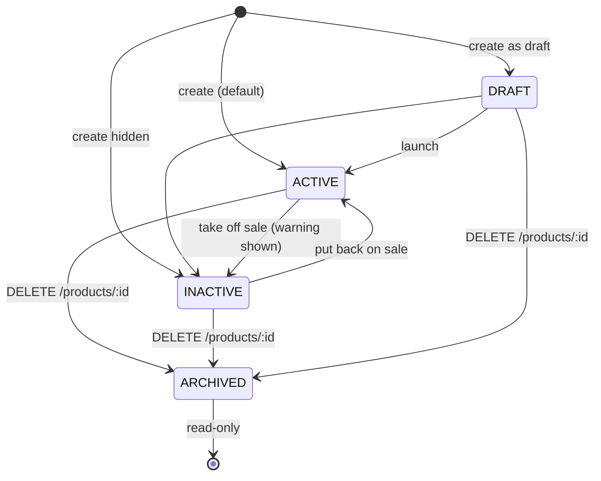
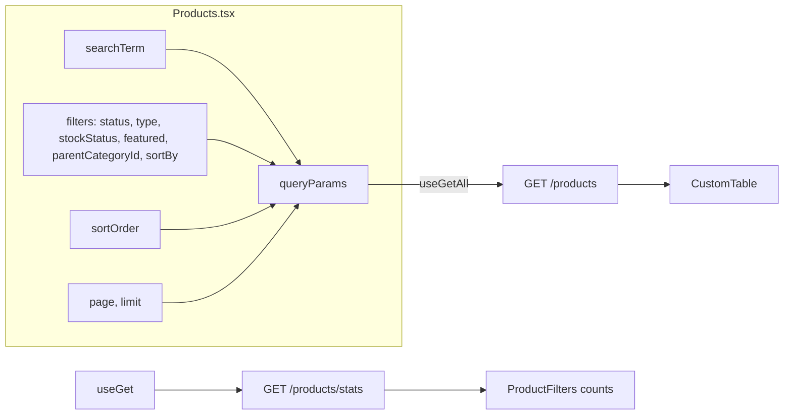
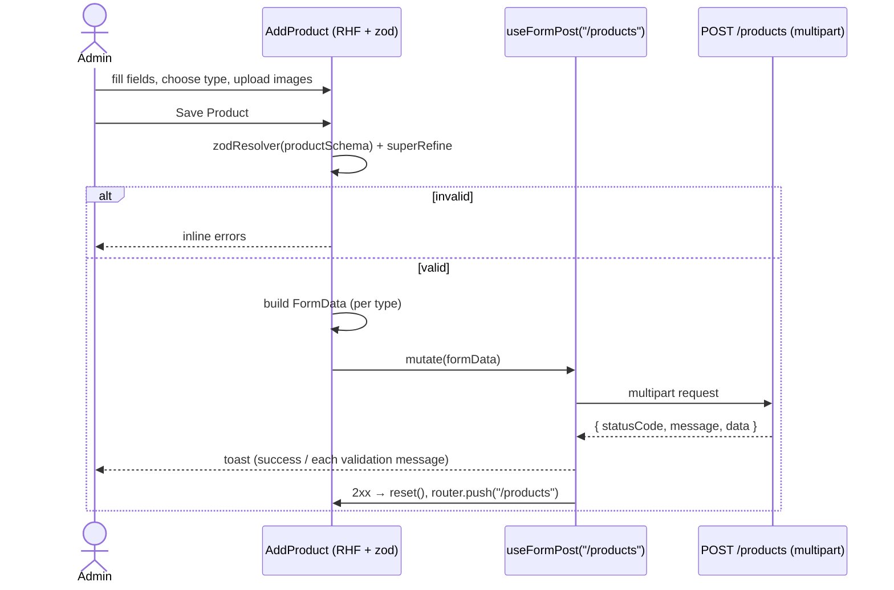
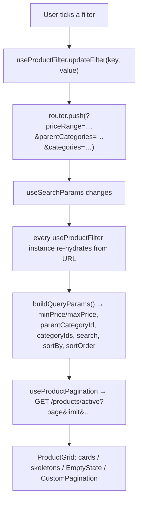

# Product Module — Frontend Technical Documentation

> **Scope:** everything the Natura Care client (Next.js 15, App Router) does with **products**: the admin catalogue (list, view, add, edit), the storefront shop grid and product details page, the product card used across the site, and the hand-off to the cart, wishlist and analytics.
>
> **Audience:** frontend engineers joining or maintaining the project.
>
> **Related:** [Project README](../README.md) (run, build, Docker) · [User module](./user.md) (roles, session, middleware) · [Auth module](./auth.md) · [SEO notes](./concepts/seo.md) · [Analytics / GTM concepts](./concepts/analytics-gtm-ga4.md) · [Coding conventions](../claude-docs/basic-instructions.md)

| | |
|---|---|
| **Module root** | [`src/modules/product/`](../src/modules/product/) |
| **Admin routes** | `/products`, `/products/add-product`, `/products/edit/[slug]` (admin route group) |
| **Storefront routes** | `/product`, `/product-details/[slug]` (public route group) · home page "Our Must-Haves" |
| **Backend resource** | `/products` on `NEXT_PUBLIC_API_BASE_URL` (e.g. `https://api.naturacarebd.com/n-care/api/v1`) |
| **Roles** | `ADMIN`, `EMPLOYEE` (manage) · `CUSTOMER`, guest (browse & buy) |
| **Last reviewed** | 2026-10-24 |

---

## Table of Contents

1. [Overview](#1-overview)
2. [Tech Stack](#2-tech-stack)
3. [File Architecture](#3-file-architecture)
4. [Routing & Access Control](#4-routing--access-control)
5. [Domain Model & Business Logic](#5-domain-model--business-logic)
   - [5.1 Product types](#51-product-types)
   - [5.2 Status lifecycle](#52-status-lifecycle)
   - [5.3 Pricing rules](#53-pricing-rules)
   - [5.4 Stock rules](#54-stock-rules)
6. [Admin — Product List (`/products`)](#6-admin--product-list-products)
   - [6.1 Table, search & filters](#61-table-search--filters)
   - [6.2 View product modal](#62-view-product-modal)
7. [Admin — Add & Edit Product](#7-admin--add--edit-product)
   - [7.1 Form layout](#71-form-layout)
   - [7.2 Type-driven sections](#72-type-driven-sections)
   - [7.3 Create workflow](#73-create-workflow)
   - [7.4 Edit workflow](#74-edit-workflow)
   - [7.5 Delete (archive)](#75-delete-archive)
8. [Storefront — Shop (`/product`)](#8-storefront--shop-product)
9. [Storefront — Product Details Page](#9-storefront--product-details-page)
10. [Product Card & Home Carousels](#10-product-card--home-carousels)
11. [Cart Integration](#11-cart-integration)
12. [Analytics Events](#12-analytics-events)
13. [API Reference](#13-api-reference)
14. [Types](#14-types)
15. [Validation Schemas](#15-validation-schemas)
16. [Constants](#16-constants)
17. [Hooks](#17-hooks)
18. [Utilities](#18-utilities)
19. [Reusable Components](#19-reusable-components)
20. [Business Rules Summary](#20-business-rules-summary)
21. [Known Issues & Technical Debt](#21-known-issues--technical-debt)
22. [How-To Recipes](#22-how-to-recipes)

---

## 1. Overview

The product module sits on one backend resource (`/products`) and serves two very different audiences:

| Audience | Where | What they can do |
|---|---|---|
| **Admin & Employee** | `/products` | Search, filter, sort and page through **every** product (all statuses); see live counts; open a read-only detail modal. |
| **Admin & Employee** | `/products/add-product`, `/products/edit/[slug]` | Create and edit Simple, Variable (sizes) and Combo (bundle) products, with images, rich-text descriptions, status and "featured" flag. |
| **Customer & Guest** | `/product` | Browse **active** products with price, category and product-type filters kept in the URL. |
| **Customer & Guest** | `/product-details/[slug]` | View gallery, pick a size, see stock, add to cart / buy now, save to wishlist, see related products. |
| **Customer & Guest** | `/` (home) | "Our Must-Haves" carousel of featured products, tabbed by parent category. |

Key design decisions:

- **Three product types, one form.** `SIMPLE`, `VARIABLE` and `COMBO` share one form ([`ProductFormFields`](../src/modules/product/admin/product-form/ProductFormFields.tsx)); the selected type swaps the pricing/stock cards ([§7.2](#72-type-driven-sections)).
- **The server is the source of truth for derived values.** `stockStatus`, a combo's `quantity`, a size's `discountPrice` and `publishedAt` are computed server-side. The client only previews them (e.g. "Current Price", "Combos available now").
- **Admin and storefront use different endpoints.** Admin reads `GET /products` (all statuses, admin fields like `costPrice`, `createdByUser`); the shop reads `GET /products/active` and `GET /products/slug/:slug` (live products only, active sizes only).
- **Soft delete only.** Deleting sets status `ARCHIVED` (read-only). The delete button is currently **switched off** pending a business policy ([§7.5](#75-delete-archive)).
- **The cart is client-side.** Add-to-cart writes to `localStorage` and prices are re-validated against `GET /products/prices` ([§11](#11-cart-integration)).
- **Edit is a full page, not a modal**, addressed by slug: `/products/edit/[slug]`.

[↑ Back to top](#table-of-contents)

---

## 2. Tech Stack

| Concern | Library | Notes |
|---|---|---|
| Framework | Next.js 15 (App Router), React 19 | Page files only set `metadata` and `dynamic()`-import the module component. |
| Server state | `@tanstack/react-query` v5 | Wrapped by in-house hooks in [`src/hooks/api/`](../src/hooks/api/) (`useGet`, `useGetAll`, `useFormPost`, `useFormPatch`, `useDelete`). |
| HTTP | `axios` | Shared instance with auth header, envelope unwrapping and 401 → refresh: [`src/lib/axios/axiosInstance.ts`](../src/lib/axios/axiosInstance.ts). |
| Forms | `react-hook-form` + `@hookform/resolvers/zod` | `FormProvider` + `useFormContext` so each form card is its own component; `useFieldArray` for sizes and combo lines. |
| Validation | `zod` v4 | [`product.schema.ts`](../src/modules/product/schemas/product.schema.ts), with a `superRefine` for type-specific rules. |
| Tables | `@tanstack/react-table` via `CustomTable` | Server-side pagination and search. |
| Rich text | `react-quill-new` via `TextEditor` | Short description and description are stored as HTML. |
| Carousels | `embla-carousel-react` (shadcn `Carousel`) | Home "Our Must-Haves" and "You May Also Like". |
| Toasts | `sonner` | Success/error feedback from API hooks and add-to-cart. |
| Icons | `lucide-react`, `react-icons` | |
| Styling | Tailwind CSS v4 | Brand tokens such as `greenPrimary-*`, `neutralPrimary-*`, `bg-addToCart`. |

[↑ Back to top](#table-of-contents)

---

## 3. File Architecture

The project uses a **feature-module** layout: `src/app` holds routing only; all logic and UI live in `src/modules/<feature>/`, split by audience (`admin/`, `public/`, `shared/`) and by kind (`hooks/`, `types/`, `schemas/`, `constants/`, `utils/`).

```text
natura-care-client/
├── src/
│   ├── middleware.ts                              # Role-based route guard (see §4)
│   │
│   ├── app/
│   │   ├── (admin)/products/
│   │   │   ├── page.tsx                           # → modules/product/admin/Products
│   │   │   ├── add-product/page.tsx               # → modules/product/admin/product-form/AddProduct
│   │   │   └── edit/[slug]/page.tsx               # → modules/product/admin/product-form/EditProductPage
│   │   └── (public)/
│   │       ├── product/page.tsx                   # → modules/product/public/product/Product
│   │       └── product-details/[slug]/page.tsx    # → modules/product/public/product-details/ProductDetails
│   │
│   ├── modules/product/
│   │   ├── admin/
│   │   │   ├── Products.tsx                       # Admin list page: header, sort, refresh, table, view modal
│   │   │   ├── product.columns.tsx                # TanStack columns + PRODUCT_STATUS / STOCK_STATUS / PRODUCT_TYPE badge maps
│   │   │   ├── ViewProduct.tsx                    # Read-only detail modal (gallery, stats, pricing, audit)
│   │   │   ├── AddStock.tsx                       # Unused stub (see §21)
│   │   │   ├── product-list/
│   │   │   │   └── ProductFilters.tsx             # Status / Stock / Featured toolbar (Type commented out)
│   │   │   └── product-form/
│   │   │       ├── AddProduct.tsx                 # Create page: defaults, FormData build, POST
│   │   │       ├── EditProductPage.tsx            # Loads product by slug, guards not-found / archived
│   │   │       ├── EditProduct.tsx                # Edit form: dirty-field diff, images, PATCH
│   │   │       ├── ProductFormHeader.tsx          # Sticky header + phone bottom action bar
│   │   │       ├── ProductFormFields.tsx          # Form body; switches cards by product type
│   │   │       ├── FormSection.tsx                # Card wrapper (title + hint + children)
│   │   │       ├── GeneralInformation.tsx         # Name, short description, description
│   │   │       ├── ProductPricing.tsx             # Selling / discount price + "Customers pay" preview
│   │   │       ├── ProductInventory.tsx           # Quantity + pack size (SIMPLE only)
│   │   │       ├── ProductVariation.tsx           # Size rows (VARIABLE only)
│   │   │       ├── ComboItems.tsx                 # Bundle lines + availability preview (COMBO only)
│   │   │       ├── ProductDropdowns.tsx           # Sidebar: status, featured, category, type
│   │   │       └── FeaturedSwitch.tsx             # Accessible on/off switch for `featured`
│   │   ├── public/
│   │   │   ├── product/
│   │   │   │   ├── Product.tsx                    # Shop page shell (hero + sidebar + grid)
│   │   │   │   ├── ProductSidebar.tsx             # Desktop filters + mobile drawer
│   │   │   │   ├── PriceRange.tsx                 # Price radio group
│   │   │   │   ├── ShopByCategory.tsx             # Parent-category checkboxes
│   │   │   │   ├── ShopByProduct.tsx              # Sub-category ("product type") checkboxes
│   │   │   │   └── ProductGrid.tsx                # Grid, skeletons, empty state, pagination
│   │   │   └── product-details/
│   │   │       ├── ProductDetails.tsx             # Page: fetch, breadcrumb, JSON-LD, related products
│   │   │       ├── ProductImages.tsx              # Gallery: thumbnails, swipe, keyboard, zoom
│   │   │       ├── ProductImagesSkeleton.tsx
│   │   │       ├── DetailsWithAction.tsx          # Buy box: price, size picker, stock, qty, cart, buy now
│   │   │       ├── ProductDescription.tsx         # Rich-text description with "Read more"
│   │   │       ├── CarouselWithTitle.tsx          # "You May Also Like" carousel
│   │   │       ├── product-details.utils.ts       # productPricing, productStock, productItemId
│   │   │       └── Details.tsx                    # Unused hard-coded copy (see §21)
│   │   ├── shared/
│   │   │   ├── ProductCard.tsx                    # Card used by grid and carousels (add to cart, wishlist)
│   │   │   └── ProductCardSkeleton.tsx
│   │   ├── hooks/
│   │   │   ├── useProduct.ts                      # Featured products grouped by parent category (home)
│   │   │   ├── useProductFilter.ts                # Shop filters ⇄ URL query string
│   │   │   └── useProductPagination.ts            # Shop grid data + pagination
│   │   ├── schemas/product.schema.ts              # zod schemas, empty rows, payload serialisers, sale price
│   │   ├── types/
│   │   │   ├── product.types.ts                   # IProduct, IProductVariant, IProductBundleItem, filters, stats
│   │   │   └── product-filter.types.ts            # Legacy, unused (see §21)
│   │   ├── constants/
│   │   │   ├── product-admin.constants.ts         # Status / type / size-status options, archive message
│   │   │   └── product.constants.ts               # Shop filter options (categories, types, price ranges)
│   │   └── utils/product-text.utils.ts            # toPlainText (rich text → plain)
│   │
│   ├── components/                                # Shared UI used by this module (see §19)
│   ├── hooks/api/ , hooks/table/                  # useGet, useGetAll, useFormPost, useFormPatch, useTableModals
│   └── lib/
│       ├── axios/axiosInstance.ts                 # Envelope { statusCode, success, message, data, meta }
│       ├── analytics/gtm.events.ts                # trackEvent → GTM dataLayer
│       └── utils/slug.utils.ts                    # createSlug
```

**Consumers outside the module**

| File | Uses |
|---|---|
| [`modules/home/public/OurMustHaves.tsx`](../src/modules/home/public/OurMustHaves.tsx) | `useProduct` → featured products by category tab |
| [`components/data-display/carousel/CustomCarousel.tsx`](../src/components/data-display/carousel/CustomCarousel.tsx) | `ProductCard`, `ProductCardSkeleton` |
| [`modules/cart/hooks/useLocalCart.ts`](../src/modules/cart/hooks/useLocalCart.ts) | `GET /products/prices` to re-price cart lines |
| [`modules/order/admin/EditPlacedOrder.tsx`](../src/modules/order/admin/EditPlacedOrder.tsx) | `GET /products/prices` when editing an order |
| [`modules/inventory/hooks/useInventory.ts`](../src/modules/inventory/hooks/useInventory.ts) | `GET /products` for product pickers |
| [`modules/dashboard/admin/LowStock.tsx`](../src/modules/dashboard/admin/LowStock.tsx) | Links to `/products/edit/[slug]` |
| `modules/cart`, `modules/promotion` types | Import `IProduct` |

**Page convention.** Every page file only sets `metadata` and lazy-loads the module component with a full-page loader:

```tsx
// src/app/(admin)/products/page.tsx
const DynamicProducts = dynamic(() => import("@/modules/product/admin/Products"), {
  loading: () => <LoadingPage />,
});
export default function ProductsPage() {
  return <DynamicProducts />;
}
```

[↑ Back to top](#table-of-contents)

---

## 4. Routing & Access Control

Access is enforced in [`src/middleware.ts`](../src/middleware.ts) by decoding the `accessToken` cookie's `role`. Full flow, token refresh and route-group constants are documented in the [User module §4](./user.md#4-routing--access-control); this section covers what matters for products.

### Routes

| Route | Route group | Middleware list | Component |
|---|---|---|---|
| `/products` | `(admin)` | `ADMIN_ONLY_ROUTES` + `EMPLOYEE_ROUTES` | `admin/Products` |
| `/products/add-product` | `(admin)` | prefix of `/products` | `admin/product-form/AddProduct` |
| `/products/edit/[slug]` | `(admin)` | prefix of `/products` | `admin/product-form/EditProductPage` |
| `/product` | `(public)` | `PUBLIC_ROUTES` (exact match) | `public/product/Product` |
| `/product-details/[slug]` | `(public)` | `isProductDetailsPage` (prefix) | `public/product-details/ProductDetails` |

### Role matrix

| Route / action | ADMIN | EMPLOYEE | CUSTOMER | Guest |
|---|:-:|:-:|:-:|:-:|
| `/products/**` (manage catalogue) | ✅ | ✅ | ❌ → `/` | ❌ → `/login` |
| `/product`, `/product-details/*` (browse) | ✅ | ✅ | ✅ | ✅ |
| Add to cart / Buy now | ❌ toast | ❌ toast | ✅ | ✅ |
| Wishlist | — | — | ✅ | prompts sign-in |
| `/my-cart`, `/check-out` | ❌ → `/dashboard` | ❌ → `/dashboard` | ✅ | ✅ |

Notes:

- **Employees have full product rights in the UI.** `/products` is in `EMPLOYEE_ROUTES`, and the sidebar entry is flagged `employee: true` in [`AdminSidebar`](../src/components/layout/sidebar/AdminSidebar.tsx). Any finer-grained limit (e.g. employees cannot change price) must be enforced by the API.
- **Staff can browse but not buy.** `ProductCard` and `DetailsWithAction` compute `canAddToCart = !userInfo?.role || userInfo.role === "CUSTOMER"` and show *"Admins and employees cannot add items to cart"*. `useLocalCart` also clears any cart a staff user carries.
- **`/product` vs `/products`.** `/product` is matched exactly against `PUBLIC_ROUTES`; `/products` is matched with `startsWith` against the admin lists. The two don't collide because `"/product".startsWith("/products")` is false.
- **Hiding a link is cosmetic.** The middleware is the client-side guard; the API is the real one.

[↑ Back to top](#table-of-contents)

---

## 5. Domain Model & Business Logic

### 5.1 Product types

| Type | Price lives on | Stock lives on | Pack size | Admin form cards |
|---|---|---|---|---|
| `SIMPLE` (default) | Product (`price`, `discountPrice`) | Product (`quantity`) | Product (`size`, number in g/ml) | Pricing + Inventory |
| `VARIABLE` | Each size (`variants[].price`, `discountPrice`) | Each size (`variants[].quantity`) | Size label (`"100ml"`) | Variation |
| `COMBO` | Product (`price`, `discountPrice`) | **Derived** from items | — | Combo products + Pricing |

**Variable products**

- Each size has `size` (label), `price` (base), `discountPrice` (optional, lower than `price`), `quantity` and `status` (`ACTIVE` / `INACTIVE`).
- The discount is entered as a **price**, the same as on a simple product (empty / `0` = no discount). The server stores it and derives `discountPercent` from it. The form previews what customers pay with `variantSalePrice()`.
- **Size order is display order.** The first active size is the default; the product-level `price`, `discountPrice` and `quantity` mirror it, so the shop grid shows that size's price.
- **Inactive sizes** are hidden from the shop but keep their stock. Public reads return active sizes only.
- **Each size is an Inventory stock item.** A size's Stock is booked through the inventory ledger (a `PRODUCT_FORM` adjustment in the default warehouse) and moved by every inventory document for that size, so the product table and Inventory always show the same number. To remove a size (or change a Variable product to Simple / Combo), set its stock to 0 and save first; the server then archives a size that has orders or stock history (it disappears from the form and Inventory pickers, and comes back with its history if a size with the same label is added later).
- On update, the server **upserts by id**: sizes with an `id` are updated, sizes without one are added, and sizes **left out are removed**. The client therefore always sends the full list ([§7.4](#74-edit-workflow)).

**Combo products**

- A combo is a list of `bundleItems`: `{ productId, variantId?, quantity }`. Items can be Simple products or one size of a Variable product. A combo cannot contain another combo (`GET /products/bundle-options` returns only `SIMPLE` / `VARIABLE`), and cannot contain itself (the edit form passes `excludeId`).
- **Stock is not typed in.** `quantity` = how many complete combos the items' stock allows. Selling one combo deducts each item's units from that item's stock (server-side).
- On the storefront, `bundleItems[].productSlug` is `null` while that item is hidden from the shop, so the "What's in this combo" list renders it as plain text instead of a link.

### 5.2 Status lifecycle



| Status | In shop? | Orderable? | Editable? | Meaning |
|---|:-:|:-:|:-:|---|
| `DRAFT` | ❌ | ❌ | ✅ | Not launched yet. |
| `ACTIVE` | ✅ | ✅ (if in stock) | ✅ | Live. `publishedAt` is set the first time a product goes live. |
| `INACTIVE` | ❌ | ❌ | ✅ | Taken off sale; still visible in customers' past orders. |
| `ARCHIVED` | ❌ | ❌ | ❌ | Soft-deleted. Kept for order history; its **name can be reused** by a new product. |

Rules enforced by the UI ([`ProductDropdowns`](../src/modules/product/admin/product-form/ProductDropdowns.tsx)):

- **No way back to Draft.** Once a product has been saved as `ACTIVE` or `INACTIVE` (`savedStatus`), `DRAFT` is removed from the status options.
- **Hide warning.** When a saved `ACTIVE` product is switched to another status, an amber notice says saving will remove it from the shop, search and carts.
- **`ARCHIVED` is never selectable.** It is only reachable through delete; the schema's `productStatus` enum excludes it.
- **Archived products are locked.** The table disables Edit for them, and `EditProductPage` shows a "This product has been deleted" screen instead of the form. The server refuses edits as well.

**Featured.** `featured: true` puts an `ACTIVE` product in the home page's "Our Must-Haves" carousel. Featured has no effect on non-active products.

### 5.3 Pricing rules

All prices are BDT (৳). Prices can arrive as Decimal **strings**, so every consumer coerces with `Number()` before maths or formatting.

| Rule | Where |
|---|---|
| `discountPrice` of `0` / empty means **no discount**. The client sends `"0"` when the field is empty. | `AddProduct`, `EditProduct` |
| A discount must be **lower** than the selling price (validated client- and server-side). | `productSchema.superRefine` |
| **What the customer pays** = `discountPrice` if `0 < discountPrice < price`, else `price`. | `productPricing()`, `pricingOf()`, `ProductCard`, `ProductPricing` preview |
| **Percent off** = `round((price − discount) / price × 100)`. | Same helpers |
| **Size sale price** = `discountPrice` if `0 < discountPrice < price`, else `price` (same rule as a simple product). | `variantSalePrice()` |
| **Profit / unit** = selling − `costPrice`; **margin** = profit / selling. Shown only when a cost price is recorded. | `ViewProduct` → `pricingOf()` |
| **Combo "bought separately"** = Σ (item's effective unit price × units). Shown to help the admin set a combo price. | `ComboItems` summary |

### 5.4 Stock rules

`stockStatus` is **derived by the server** from `quantity`; the client never sends it.

| `stockStatus` | Quantity | Shop behaviour |
|---|---|---|
| `IN_STOCK` | > 10 | "In stock" |
| `LOW_STOCK` | 1 – 10 | "Hurry, only N left" |
| `OUT_OF_STOCK` | 0 | Card and buy box show a disabled "Out of Stock" button; image dimmed; wishlist still available. |

- On the details page, **quantity is the source of truth** for out-of-stock: `isOutOfStock = quantity === 0 || stockStatus === "OUT_OF_STOCK"` ([`productStock()`](../src/modules/product/public/product-details/product-details.utils.ts)).
- The quantity stepper is clamped to `[1, available]`. Switching size resets the quantity to 1, because each size has its own stock.
- For Variable products, the details page starts on the **first size that has stock**, falling back to the first size.

[↑ Back to top](#table-of-contents)

---

## 6. Admin — Product List (`/products`)

Component: [`Products.tsx`](../src/modules/product/admin/Products.tsx).

### 6.1 Table, search & filters



**Header actions**

| Control | Behaviour |
|---|---|
| **Sort field** `<select>` | `Date added` (default, not sent), `Last updated`, `Name`, `Price`, `Stock quantity` → `sortBy`. |
| **Order toggle** | Flips `sortOrder` (`desc` default). The label is context-aware via `SORT_LABELS` (e.g. "Price high–low"). |
| **Category** `<select>` | "All categories" + every active category from `useCategory().allActiveCategory` → `parentCategoryId` (server matches the whole subtree). Same style as the sort select; too many categories for a segmented group. |
| **Refresh** | Refetches list and stats in parallel, keeps the spinner up for at least 600 ms, then toasts "Products are up to date" or an error. |
| **Add Product** | Links to `/products/add-product`. |

**Toolbar filters** ([`ProductFilters.tsx`](../src/modules/product/admin/product-list/ProductFilters.tsx)), built from `SegmentedFilter` groups with live counts from `GET /products/stats`:

| Group | Values | Count source |
|---|---|---|
| Status | All · Active · Draft · Inactive | `statusCounts`; "All" = `totalProducts − ARCHIVED` |
| Stock | All · In stock · Low · Out | `inStock`, `lowStock`, `outOfStock` |
| Featured | All · Featured · Not featured | `featured`, `notFeatured` |

`Archived` is deliberately not offered as a filter. The **Type** group (All · Simple · Variable · Combo) is commented out in `ProductFilters.tsx`; `IProductFilters.type` and the API param still work, so uncommenting it (and the `ProductType` alias) brings it back. The **Category** filter lives in the header row (above).

**Responsive:** on narrow screens a `SegmentedFilter`'s label wraps above its buttons, and the button strip scrolls sideways (scrollbar hidden) instead of overflowing the card. Buttons use slightly less padding below `sm`.

**State rules**

- Any filter, search or sort change resets to **page 1** (`applyFilters`, `applySearch`, and the `pageResetKey` passed to `CustomTable`).
- Undefined values are dropped by axios, so only active filters are sent.
- The query key is `["getAdminProducts", JSON.stringify(queryParams)]`, so each filter combination is cached separately.
- Search placeholder: *"Search by name, slug or SKU…"* (the server decides which fields match).

**Columns** ([`product.columns.tsx`](../src/modules/product/admin/product.columns.tsx)): Product (primary image + name + SKU) · Type (Simple / Variable / Combo badge) · Category (child + parent) · Price (SIMPLE / COMBO: effective price, struck-through base when discounted; VARIABLE: selling-price range of the active sizes, e.g. `৳330 – ৳450`, plus an "N sizes" button that opens a popover with each size's selling price, struck-through base, stock, and inactive sizes dimmed) · Stock (units + stock badge) · Status badge · Featured badge · Actions (View, Edit; Edit disabled for archived). Sorting is server-side; column sorting is disabled.

### 6.2 View product modal

[`ViewProduct.tsx`](../src/modules/product/admin/ViewProduct.tsx) renders inside `CustomModal2` (responsive width, height capped below the fixed navbar). It is read-only and uses the row data already loaded, with no extra request.

| Block | Content |
|---|---|
| Hero | Gallery, category trail, name, status / type / featured pills, customer price with % off, short description (plain text). **Variable:** price range over active sizes (what customers pay), and size count. |
| Attention banner | Shown when the product is not `ACTIVE` ("Not on the shop") or not `IN_STOCK` ("Out of stock" / "Running low"). **Variable:** also lists active sizes with 0 stock. |
| Stat tiles | Stock · Stock value (units × selling price) · Profit / unit · Margin. **Variable:** Stock (all active sizes) · Stock value (summed per size) · Sizes (active / inactive). |
| Flags | Storefront (visible?) · Orderable (in stock?) · Published (`publishedAt`) · Featured. |
| Description | Rich text. |
| Pricing breakdown | Regular, discount, customer saves, customer pays, cost price, profit. Not shown for Variable products (it would only describe the default size). |
| Sizes & Pricing (Variable only) | `VariantsTable`, in `sortOrder`: size (+ SKU), base price, discount price with % off, customer pays, profit / unit (only when a size has a cost price), stock (coloured by stock status), Active / Inactive. Inactive sizes are dimmed. Scrolls sideways on phones. |
| Product details | Type, SKU, barcode, URL slug, image count, tags. |
| Audit | Created / last updated, with `createdByUser` / `updatedByUser`. |

[↑ Back to top](#table-of-contents)

---

## 7. Admin — Add & Edit Product

### 7.1 Form layout

Both pages share [`ProductFormHeader`](../src/modules/product/admin/product-form/ProductFormHeader.tsx) and [`ProductFormFields`](../src/modules/product/admin/product-form/ProductFormFields.tsx) inside a `FormProvider`.

```text
┌──────────────────────────── ProductFormHeader (sticky under navbar ≥ sm) ─────────────────────┐
│ ← Products   Add Product / Edit Product                               [Cancel] [Save]        │
└───────────────────────────────────────────────────────────────────────────────────────────────┘
┌──────────── main (lg: 2/3) ─────────────────────────┐  ┌──── aside (lg: 1/3, sticky if tall) ──┐
│ Product details   (GeneralInformation)              │  │ Status   (status select + hint,       │
│ Variation         (VARIABLE)                        │  │           hide warning, Featured)     │
│ Combo products    (COMBO)                           │  │ Organization (category, product type  │
│ Pricing           (SIMPLE, COMBO)                   │  │               + type hint)            │
│ Inventory & packaging (SIMPLE)                      │  └───────────────────────────────────────┘
│ Media             (ImageInput, ≥1 image, ≤5 MB each)│
└─────────────────────────────────────────────────────┘
```

- **Phones:** the header scrolls away and Cancel/Save move to a bar fixed at the bottom of the screen (thumb reach). Pages add `PHONE_ACTION_BAR_SPACE` (`pb-24 sm:pb-0`) so content isn't hidden under it.
- **Sidebar stickiness** is applied only when the viewport is at least 760 px tall, so short laptops can still reach Product Type.
- **Category options** are *child* categories only (`useCategory().childrenCategories`). A product always belongs to a leaf category; its parent is derived.
- Validation mode is `onChange`; most inputs use `inlineError`.

### 7.2 Type-driven sections

`ProductFormFields` watches `productType` and renders:

| Type | Cards | Required fields (from `superRefine`) |
|---|---|---|
| `SIMPLE` | Pricing + Inventory | `price`, `quantity`, `size` |
| `VARIABLE` | Variation | ≥ 1 size; each: unique non-empty `size`, `price`, `quantity` |
| `COMBO` | Combo products + Pricing | `price`; ≥ 1 line; each: `productId`, unique product+size, `quantity ≥ 1` |

Both the `variants` and `bundleItems` arrays are always present in form state, each seeded with one empty row. **Switching type keeps the other type's rows**, so switching back restores them; only the active type's data is submitted. Switching is only possible on Add Product: on Edit Product the Product Type select is disabled (`ProductDropdowns` `lockType`, set when `productId` is passed) with the hint "The type can't be changed after the product is created", and the server refuses a type change.

**Variation card** ([`ProductVariation.tsx`](../src/modules/product/admin/product-form/ProductVariation.tsx))

- One row per size: Size · Base Price · Discount Price · **Current Price** (live preview) · Stock · Status. Stock is the size's shop number; saving it books the difference into Inventory ([§ Product ↔ Inventory sync](#product--inventory-sync)).
- Layout uses **container queries** on the size list (`@container`), not screen breakpoints, because the card sits beside the sticky aside and is narrow even on a laptop: a bordered block with 2 columns by default, 3 columns from `@xl` (36rem), a single inline row with the delete icon from `@3xl` (48rem).
- *Add Variation* is disabled until every row has a size and a base price above 0.
- The last row can't be removed ("A variable product needs at least one size").

**Combo card** ([`ComboItems.tsx`](../src/modules/product/admin/product-form/ComboItems.tsx))

- Options come from `GET /products/bundle-options`. Non-active products are labelled "(Draft)" / "(Inactive)"; inactive sizes are labelled "(Inactive)".
- Picking a different product clears that line's size. The Size select is enabled and required only for Variable products.
- Under each Qty: "*N in stock*", or "*Not on sale*" in red when the product/size isn't active. It is also red when stock is below the units needed.
- Summary: **Combos available now** = `min(floor(stock / units))` across lines (0 for any unsellable line), and **Items bought separately** = Σ unit price × units.

### 7.3 Create workflow



**Defaults:** `productType: "SIMPLE"`, `productStatus: "ACTIVE"`, `featured: false`, one empty size row and one empty combo line.

**Create payload** (`multipart/form-data`):

| Field | When | Value |
|---|---|---|
| `name` | always | product name |
| `slug` | always | `createSlug(name)` (lower-case, spaces → `-`) |
| `description`, `shortDescription` | always | HTML from the editor (`""` if empty) |
| `categoryId` | always | child category id |
| `type` | always | `SIMPLE` / `VARIABLE` / `COMBO` |
| `status`, `featured` | always | `"true"` / `"false"` for featured |
| `price`, `discountPrice` | SIMPLE, COMBO | `discountPrice` is `"0"` when empty |
| `quantity`, `size` | SIMPLE | |
| `variants` | VARIABLE | JSON string from `toVariantsPayload()` |
| `bundleItems` | COMBO | JSON string from `toBundleItemsPayload()` |
| `images` | always | one entry per new `File` |

> `useFormPost` calls `onSuccess` for every resolved response, including 4xx envelopes. That is why `AddProduct` re-checks `statusCode` before redirecting.

### 7.4 Edit workflow

1. **Load.** [`EditProductPage`](../src/modules/product/admin/product-form/EditProductPage.tsx) reads `slug` from the URL and calls `GET /products/admin/slug/:slug` (any status). The query uses `gcTime: 0` and `refetchOnWindowFocus: false`: the form takes its default values once, so a cached or mid-edit refetch must never feed it stale or shifting data.
2. **Guard.** Loading → `LoadingPage`. Error/missing → "Product not found". `ARCHIVED` → "This product has been deleted" (no form).
3. **Map to form.** [`EditProduct`](../src/modules/product/admin/product-form/EditProduct.tsx) converts the API shape to form shape: images become `{ filePath, name, attachId }`, numeric strings become numbers, select ids become strings, and empty `variants` / `bundleItems` become one empty row.
4. **Submit only what changed.** No changes → `toast.info("No changes to save.")` and no request. Otherwise a `FormData` is built from `dirtyFields`:

| Field | Sent when |
|---|---|
| `name` + `slug` | name dirty (the slug is regenerated, so the product URL changes) |
| `description`, `shortDescription`, `categoryId`, `status`, `featured` | that field is dirty |
| `variants` (full list) | VARIABLE and the serialised list differs from the initial list. Built with `toVariantsPayload(variants, initialVariants)`: an existing size's `quantity` is **left out unless it was edited**, so the server leaves that size's stock alone and a form opened before a sale can't undo it |
| `price`, `discountPrice` | non-VARIABLE and dirty |
| `quantity`, `size` | SIMPLE and dirty |
| `bundleItems` (full list) | COMBO and the list differs |
| `newImages` | one per newly added `File` |
| `imageOrder` | JSON array of remaining existing image ids, in their current order (always sent when images exist) |
| `deleteImageIds` | JSON array of ids removed in this session |

### Product ↔ Inventory sync

The product table and the Inventory screens show the same stock because both go through the server's inventory ledger:

| Direction | What happens | Client side |
|---|---|---|
| Product form → Inventory | The server books every typed stock number (SIMPLE "Quantity in Stock", or each size's Stock) as one `PRODUCT_FORM` adjustment in the default warehouse, in the same transaction as the save, and gives every product / size its default-warehouse row even at 0 | Add / Edit Product call `invalidateProductAndInventoryQueries` ([`product-cache.utils.ts`](../src/modules/product/utils/product-cache.utils.ts)) on success |
| Inventory → product table | Every posted receipt, transfer, adjustment or reversal updates the product's (or size's) `quantity`, re-sums a VARIABLE product's total and re-counts combos containing it | `useInventoryMutation` calls `invalidateProductQueries` (`getAdminProducts`, `getProductStats`, `getAdminProduct`, `getBundleOptions`, `getFeaturedProducts`) |

The server refuses a save (400) when there is no active, sellable default warehouse, when a decrease needs more units than the default warehouse holds, when a removed size still holds stock or is in a combo, or when a product that still has product-level stock in Inventory becomes VARIABLE or a combo with items. See [inventory.md §7.9](./inventory.md#79-change-stock-from-the-product-form).

5. **PATCH** `/products/:id` via `useFormPatch`; on 2xx → `router.push("/products")`.

> **Never strip `variants[].id`.** The server matches sizes by id; a size sent without its id is treated as new, and the old one is deleted.

### 7.5 Delete (archive)

Delete is a **soft delete**: `DELETE /products/:id` sets `status = ARCHIVED`. It is **currently disabled** in the UI until there is a business policy for it. The wiring is kept but commented out in three places:

- `Products.tsx`: `useDelete("getAdminProducts")` + `window.confirm(ARCHIVE_CONFIRM_MESSAGE)`.
- `product.columns.tsx`: an optional `handleDelete` argument; passing it brings the button back.
- `EditProduct.tsx` → `ProductFormHeader`'s `onDelete` / `isDeleting` props.

To re-enable, uncomment those blocks; see the [recipe](#re-enable-product-delete-archive).

[↑ Back to top](#table-of-contents)

---

## 8. Storefront — Shop (`/product`)

Component tree: `Product` → `Hero("Our Products")` + `ProductSidebar` (filters) + `ProductGrid`.



**Filters** (desktop sidebar; on mobile, a left drawer opened by "Filter"):

| UI | URL param | API param(s) | Source of options |
|---|---|---|---|
| Price (radio) | `priceRange` | `under-100` → `maxPrice=99`; `100-199`; `200-299`; `300-plus` → `minPrice=300` | `PRICE_RANGES` |
| Shop by Category (checkbox) | `parentCategories=1,2` | `parentCategoryId` (**first id only**, see [§21](#21-known-issues--technical-debt)) | `PARENT_CATEGORIES` (hard-coded) |
| Shop By Products (checkbox) | `categories=5,6` | `categoryIds` (JSON array) | `PRODUCT_TYPES` (hard-coded, disabled when not under a selected parent) |
| *(not in UI yet)* | `search`, `sortBy`, `sortOrder`, `page`, `limit` | same | — |

**Behaviour**

- The **URL is the single source of truth** for filters, so a filtered view can be shared or bookmarked. Each filter component calls `useProductFilter()` independently and re-hydrates from `useSearchParams`.
- Changing any filter (except `page`) resets to page 1. *Reset Filters* / *Clear All* pushes the bare pathname.
- Page size is 9. "Showing X–Y from N" appears only when there is more than one page; changing page smooth-scrolls to the top.
- "Active Filters" chips summarise the selected category count and price range.

[↑ Back to top](#table-of-contents)

---

## 9. Storefront — Product Details Page

Component: [`ProductDetails.tsx`](../src/modules/product/public/product-details/ProductDetails.tsx) → `ProductImages` + [`DetailsWithAction`](../src/modules/product/public/product-details/DetailsWithAction.tsx) + `ProductDescription` + `CarouselWithTitle`.

**Data loading**

| Request | When | Purpose |
|---|---|---|
| `GET /products/slug/:slug` | on mount | The product (active only; active sizes only). Query key = slug. |
| `GET /products/filter?categoryId=…&status=ACTIVE` | after the product loads | Related products: same category, current product removed, max 12 (`RELATED_LIMIT`). |

**Page sections**

| Section | Behaviour |
|---|---|
| Hero + breadcrumb | Category name as heading. A compact breadcrumb replaces the hero below `lg`. |
| Gallery (`ProductImages`) | Active images only, primary first then `order`. Thumbnails, arrow keys, touch swipe (40 px threshold), hover zoom at cursor. Discount % and out-of-stock overlays. |
| Buy box (`DetailsWithAction`) | Category link, name, SKU, price block (unit price, struck base, "Save ৳X (Y%)"), **size picker** (Variable), stock badge, short description (plain text), **combo contents** (Combo), quantity stepper, **Add to Cart**, **Buy Now**, wishlist button, free-delivery banner (from `useFreeDelivery`), tags. |
| Sticky mobile bar | Below `lg`, an add-to-cart bar slides up once the main buttons scroll out of view (`IntersectionObserver`). |
| Description | Admin HTML rendered with `dangerouslySetInnerHTML`; collapsed at 420 px with "Read more" when long (`ResizeObserver`). |
| You May Also Like | Carousel of related products; renders nothing when empty. |
| Not found | "Product not found" with a "Browse all products" link when the request errors or returns nothing. |
| JSON-LD | `schema.org/Product` with name, SKU, description (`seoDescription` or short description), images, brand "Natura Care", and an `Offer` (BDT, unit price, availability). `<` is escaped to prevent script injection. |

**Buy actions**

| Action | Effect |
|---|---|
| Add to Cart | `localCart.addItem({ id, variantId, size, name: "Name - Size", price, discountPrice, image, quantity: qty })` → `add_to_cart` event → toast with free-delivery nudge → button shows "Added" for 2 s. |
| Buy Now | Same add, then `router.push("/check-out")`. |
| Staff user | Neither action proceeds; an info toast is shown. |

[↑ Back to top](#table-of-contents)

---

## 10. Product Card & Home Carousels

[`ProductCard`](../src/modules/product/shared/ProductCard.tsx) is the single card used by the shop grid, "You May Also Like" and the home "Our Must-Haves" carousel (via `CustomCarousel`).

| Element | Rule |
|---|---|
| Image | First image, `object-contain`, dimmed when out of stock; links to `/product-details/[slug]`. |
| Discount badge | `-N%` when discounted and in stock. |
| Wishlist heart | `WishlistButton`, rendered **outside** the `<a>` (a button inside a link is invalid HTML). |
| Button | "Out of Stock" (disabled) when `quantity === 0`; otherwise "Add to Cart" → "Added!" for 2 s. |
| Variable products | **One size:** added directly as that size. **Several sizes:** the button navigates to the details page so the customer picks one. |
| Price | Effective price in green; base price struck through when discounted. |

**Home "Our Must-Haves"**: [`useProduct`](../src/modules/product/hooks/useProduct.ts) calls `GET /products/active?featured=true&limit=100` and groups the result into `hairCare` / `skinCare` / `bodyCare` / `others` by `categoryName` or `categoryParentId` (1/2/3). [`OurMustHaves`](../src/modules/home/public/OurMustHaves.tsx) renders one tab per group.

[↑ Back to top](#table-of-contents)

---

## 11. Cart Integration

The cart lives in `localStorage` (`local_cart`) and is owned by the cart module; the product module only **adds lines**.

- **A line is a product or one size of it.** `cartLineKey = "${id}:${variantId ?? ""}"`, so two sizes of one product are two lines. Adding an existing line increases its quantity.
- The size is stored twice: as `variantId` / `size`, and inside `name` ("Onion Hair Oil - 100ml"), so cart and checkout UIs need no extra lookup.
- `localCart.set` dispatches a `cart-updated` window event; navbar badges listen to it.
- **Prices are re-validated.** [`useLocalCart`](../src/modules/cart/hooks/useLocalCart.ts) calls `GET /products/prices?ids=…`, overwrites stale `price` / `discountPrice`, and keeps current stock for quantity limits. The price captured at add-to-cart time is never trusted for checkout.
- **Staff carts are cleared.** If an `ADMIN` / `EMPLOYEE` session holds cart items, they are removed.

[↑ Back to top](#table-of-contents)

---

## 12. Analytics Events

Events are pushed to the GTM `dataLayer` via `trackEvent()` from [`lib/analytics/gtm.events.ts`](../src/lib/analytics/gtm.events.ts). Direct Meta Pixel calls are kept commented out as `LEGACY` for rollback. See [Analytics / GTM concepts](./concepts/analytics-gtm-ga4.md).

| Event | Fired from | Params |
|---|---|---|
| `view_item` | `ProductDetails` (once the product loads) | `item_id` (SKU or `PROD_<id>`), `item_name`, `value` (`product.price`), `currency: "BDT"` |
| `add_to_cart` | `ProductCard` | `item_id`, `item_name`, `quantity: 1`, `value` (`product.price`), `currency` |
| `add_to_cart` | `DetailsWithAction` (Add to Cart and Buy Now) | `item_id`, `item_name` (with size), `quantity`, `value` (base price × qty), `currency` |

`productItemId()` keeps `item_id` consistent: SKU when set, otherwise `PROD_<id>`.

[↑ Back to top](#table-of-contents)

---

## 13. API Reference

All responses go through the axios interceptor and become `{ statusCode, success, message, data, meta }`. Note the difference between the two read hooks:

- `useGet<T>` returns **`data` only** (`T`).
- `useGetAll<T>` returns the **whole envelope**, so paginated calls are typed `useGetAll<{ data: IProduct[]; meta: IPaginationMeta }>`.

### Admin

| Method & path | Used by | Params / body | Returns |
|---|---|---|---|
| `GET /products` | `Products`, inventory pickers | `page`, `limit`, `search`, `sortBy`, `sortOrder`, `status`, `type`, `stockStatus`, `featured`, `parentCategoryId` | `IProduct[]` + `meta` (all statuses, admin fields) |
| `GET /products/stats` | `Products` | — | `IProductStats` |
| `GET /products/admin/slug/:slug` | `EditProductPage` | — | `IProduct` (any status) |
| `GET /products/bundle-options` | `ComboItems` | — | `IBundleOption[]` |
| `POST /products` | `AddProduct` | multipart ([§7.3](#73-create-workflow)) | created product |
| `PATCH /products/:id` | `EditProduct` | multipart, changed fields only ([§7.4](#74-edit-workflow)) | updated product |
| `DELETE /products/:id` | *(disabled)* | — | soft delete → `ARCHIVED` |

### Storefront

| Method & path | Used by | Params | Returns |
|---|---|---|---|
| `GET /products/active` | `useProductPagination`, `useProduct` | `page`, `limit` (default 9, max 100), `minPrice`, `maxPrice`, `parentCategoryId`, `categoryIds` (JSON), `search`, `sortBy`, `sortOrder`, `featured` | live products + `meta` |
| `GET /products/slug/:slug` | `ProductDetails` | — | `IProduct` (active, active sizes) |
| `GET /products/filter` | `ProductDetails` (related) | `categoryId`, `status=ACTIVE` | `IProduct[]` |
| `GET /products/prices` | cart, order edit | `ids=1,2,3` | current price / discount / stock per product (and size) |

### Error handling

- Read hooks show `toast.error(message)` on failure and rethrow, so pages also render their own not-found state.
- `useFormPost` toasts every message of a 4xx `message[]` array (class-validator style). `useFormPatch` toasts `message` or "Update failed".

[↑ Back to top](#table-of-contents)

---

## 14. Types

Defined in [`product.types.ts`](../src/modules/product/types/product.types.ts).

### `IProduct`

| Field | Type | Notes |
|---|---|---|
| `id`, `sid`, `slug`, `name` | | `sid` = public string id. |
| `status` | `"DRAFT" \| "ACTIVE" \| "INACTIVE" \| "ARCHIVED"` | [§5.2](#52-status-lifecycle) |
| `type` | `"SIMPLE" \| "VARIABLE" \| "COMBO"` | [§5.1](#51-product-types) |
| `publishedAt` | `string \| null` | First time it went live. |
| `featured` | `boolean` | Home "Our Must-Haves". |
| `description`, `shortDescription` | `string?` | HTML from the editor. Use `toPlainText` for excerpts. |
| `price`, `discountPrice?`, `costPrice?` | number / Decimal string | Coerce with `Number()`. |
| `quantity`, `stockStatus` | | Kept equal to Inventory's sellable stock. `stockStatus` derived by the server. For VARIABLE, `quantity` is the total of the active sizes; for COMBO with items, complete combos available. |
| `size` | `number \| null` | Pack size in g/ml (SIMPLE). |
| `sku`, `barcode`, `tags`, `seoTitle`, `seoDescription`, `dimensions`, `metadata` | | |
| `categoryId`, `category`, `categoryName`, `categorySlug`, `categoryParentId`, `categoryParentName` | | Child category + denormalised parent. |
| `images` | `IProductImage[]` | `{ id, url, altText, order, isPrimary, isActive }` |
| `variants` | `IProductVariant[]` | VARIABLE only. |
| `bundleItems` | `IProductBundleItem[]` | COMBO only. |
| `createdByUser`, `updatedByUser` | `IProductUser?` | Admin responses only. |

### Other types

| Type | Purpose |
|---|---|
| `IProductVariant` | One size: `size`, `price`, `discountPrice`, `discountPercent` (derived by the server), `quantity`, `stockStatus`, `sortOrder`; admin-only `sid`, `status`, `costPrice`, `sku`. |
| `IProductBundleItem` | One combo line: `productId`, `variantId`, `quantity`, `productName`, `productSlug` (null when hidden), `size`, `imageUrl`; admin-only `productStatus`, `stock`, `sizeStatus`. |
| `IBundleOption` | A pickable product for the combo form, with its sizes. |
| `IProductStats` | Counts for the admin toolbar. |
| `IProductFilters` | Admin table filters (query params of `GET /products`). |
| `IProductFilterOptions`, `TProductPriceRange`, `TProductSize` | Storefront filter state. |
| `IProductFilter` | Props for the mobile filter drawer (`isFilterOpen`, `setIsFilterOpen`). |
| `IProductCard` | `ProductCard` props. |
| `ProductFormData`, `VariantFormData`, `BundleItemFormData` | Inferred from the zod schemas (form shape ≠ API shape). |

[↑ Back to top](#table-of-contents)

---

## 15. Validation Schemas

[`product.schema.ts`](../src/modules/product/schemas/product.schema.ts)

| Field | Rule |
|---|---|
| `productName` | trimmed, 3–100 chars |
| `shortDescription` | optional; if present, **visible text** 10–500 chars (HTML tags and `&nbsp;` ignored via `htmlTextLength`) |
| `description` | optional HTML |
| `productImages` | non-empty array of `File` (new) or `{ filePath, name, attachId }` (existing) |
| `price` | positive; required unless VARIABLE |
| `discountPrice` | positive or empty; must be `< price` |
| `quantity` | ≥ 0; required for SIMPLE |
| `size` | positive; required for SIMPLE |
| `productCategory` | required (string id) |
| `productStatus` | `DRAFT` / `ACTIVE` / `INACTIVE` |
| `productType` | `SIMPLE` / `VARIABLE` / `COMBO` |
| `featured` | boolean |
| `variants[]` | `id?`, `size` ≤ 50 chars, `price` > 0, `discountPrice` ≥ 0 and (when > 0) below `price`, `quantity` integer ≥ 0, `status`; for VARIABLE: ≥ 1 row, labels required and unique (case-insensitive) |
| `bundleItems[]` | `productId`, `variantId?`, `quantity` integer ≥ 1; for COMBO: ≥ 1 line, product required, product+size unique |

**Why fields are `nullish` and checked in `superRefine`:** number inputs emit `null` when cleared. A plain "required number" would fail type-checking first and stop zod before the refinement, which would hide the other messages.

**Helpers exported from the schema file**

| Export | Purpose |
|---|---|
| `emptyVariant()` / `emptyBundleItem()` | New rows; numbers are `null` (not `0`) so inputs show placeholders. |
| `toVariantsPayload(variants, initial?)` | JSON for the API: keeps `id` when set, trims `size`, defaults `discountPrice` / `quantity` to 0. With `initial` (Edit Product), an existing size's `quantity` is omitted when unchanged. |
| `invalidateProductQueries(qc)` / `invalidateProductAndInventoryQueries(qc)` | [`product-cache.utils.ts`](../src/modules/product/utils/product-cache.utils.ts): refetch every product screen (and every inventory screen) after stock changed. |
| `toBundleItemsPayload(items)` | JSON for the API: numeric ids, `variantId` only when set, `quantity` defaults to 1. |
| `variantSalePrice(price, pct)` | Same rounding as the server. |

[↑ Back to top](#table-of-contents)

---

## 16. Constants

| Constant | File | Used by |
|---|---|---|
| `productStatus` | [`product-admin.constants.ts`](../src/modules/product/constants/product-admin.constants.ts) | Status select (`DRAFT`, `ACTIVE`, `INACTIVE`; never `ARCHIVED`). |
| `productTypes` | same | Product Type select. |
| `variantStatus` | same | Size row status. |
| `ARCHIVE_CONFIRM_MESSAGE` | same | Delete confirmation (feature disabled). |
| `PARENT_CATEGORIES` | [`product.constants.ts`](../src/modules/product/constants/product.constants.ts) | Shop "Shop by Category" (ids 1–4, hard-coded). |
| `PRODUCT_TYPES` | same | Shop "Shop By Products" (sub-category ids with `parentId`, hard-coded). |
| `PRICE_RANGES` | same | Shop price radio. |
| `PRODUCT_STATUS`, `STOCK_STATUS`, `PRODUCT_TYPE` | [`product.columns.tsx`](../src/modules/product/admin/product.columns.tsx) | Badge label/colour/dot maps, shared by the table and toolbar. |
| `SORT_FIELDS`, `SORT_LABELS` | `Products.tsx` (local) | Admin sort control. |
| `TYPE_HINT`, `STATUS_HINT`, `HIDE_WARNING` | `ProductDropdowns.tsx` (local) | Sidebar helper text. |
| `RELATED_LIMIT = 12` | `ProductDetails.tsx` | Related product cap. |

Unused: `products` mock arrays in both constants files, the local `IProduct` in `product-admin.constants.ts`, `productStockStatus`, `SIZE_OPTIONS` (see [§21](#21-known-issues--technical-debt)).

[↑ Back to top](#table-of-contents)

---

## 17. Hooks

### Module hooks

| Hook | Returns | Notes |
|---|---|---|
| [`useProduct()`](../src/modules/product/hooks/useProduct.ts) | `productData`, `hairCare`, `skinCare`, `bodyCare`, `others`, `isProductLoading`, `productDataRefetch` | Featured active products (≤ 100), grouped for the home tabs. |
| [`useProductFilter()`](../src/modules/product/hooks/useProductFilter.ts) | `filters`, `updateFilter(key, value)`, `clearFilters()`, `buildQueryParams()`, `selectedCategories`, `selectedProductTypes`, `selectedPriceRanges`, `isAnyFilterActive` | URL-synced shop filters. `updateFilter` resets `page` to 1 for any key except `page`. |
| [`useProductPagination()`](../src/modules/product/hooks/useProductPagination.ts) | `products`, `productData`, `metaData`, `isProductLoading`, `refetchProduct`, `currentPage`, `setCurrentPage`, `pageSize`, `setPageSize` | Shop grid data from `/products/active`; resets to page 1 when the filter params change. |

### Shared hooks used

| Hook | Purpose here |
|---|---|
| `useGet` / `useGetAll` ([`hooks/api/useGet.ts`](../src/hooks/api/useGet.ts)) | All reads. Signatures differ: `useGet(endpoint, key, params, shouldFetch, options)` vs `useGetAll(endpoint, key, params, options, shouldFetch)`. |
| `useFormPost` / `useFormPatch` | Multipart create / update with toasts. |
| `useDelete` | Archive (disabled). |
| `useTableModals<IProduct>()` ([`hooks/table/useTableModals.ts`](../src/hooks/table/useTableModals.ts)) | View modal state (`viewData`, `modals.view`, `handleView`). |
| `useCategory()` (category module) | `childrenCategories` for the form, `allActiveCategory` for the admin filter. |
| `useUser()` (user module) | JWT role for `canAddToCart`. |
| `useFreeDelivery()`, `useFreeDeliveryNudge()` (free-delivery module) | Banner on the details page and add-to-cart toast text. |

[↑ Back to top](#table-of-contents)

---

## 18. Utilities

| Function | File | Purpose |
|---|---|---|
| `toPlainText(html)` | [`utils/product-text.utils.ts`](../src/modules/product/utils/product-text.utils.ts) | Rich text → plain text (`DOMParser` in the browser, regex fallback on the server). Used for short descriptions in the buy box, admin modal and JSON-LD. |
| `productPricing(p)` | [`product-details.utils.ts`](../src/modules/product/public/product-details/product-details.utils.ts) | `{ price, unit, hasDiscount, savings, percentOff }`. Works on a product or a size. |
| `productStock(p)` | same | `{ available, isOutOfStock, isLowStock }`. |
| `productItemId(p)` | same | Analytics `item_id`: SKU or `PROD_<id>`. |
| `variantSalePrice(price, pct)` | `product.schema.ts` | Size sale price preview. |
| `createSlug(name)` | [`lib/utils/slug.utils.ts`](../src/lib/utils/slug.utils.ts) | Product slug sent on create/rename. |
| `pricingOf(p)` | `ViewProduct.tsx` (local) | Adds cost, profit and margin to the pricing maths. |
| `resolveLine(line, options)` | `ComboItems.tsx` (local) | A combo line's stock, unit price and sellable flag. |

[↑ Back to top](#table-of-contents)

---

## 19. Reusable Components

### Shared components used by this module

| Component | Path | Used for |
|---|---|---|
| `CustomTable` | `components/data-display/table/` | Admin list: server pagination, debounced search, `toolbar` slot, `pageResetKey`. |
| `CustomModal2` | `components/primitives/modal/` | View product modal (`dialogWidth`, `dialogHeight`). |
| `SegmentedFilter<V>` | `components/form/SegmentedFilter.tsx` | Admin toolbar groups (`{ value, label, count, dot, title }` options). |
| `CustomTooltip` | `components/primitives/` | Row action icons (`action="view" \| "edit" \| "delete"`). |
| `CommonButton` | `components/primitives/button/` | "Add Product". |
| `InputField` | `components/form/` | Text/number inputs with `inlineError`. |
| `SingleSelectSearch` | `components/form/` | Status, type, category, combo product/size selects (`onSelectionChange`, `isDisabled`). |
| `TextEditor` | `components/form/` | Quill editor (`compact` for the short description). |
| `ImageInput` | `components/form/file-upload/` | Multi-image upload with reorder/remove (`onRemoveImage`, `maxFileSize`). |
| `SubmitButton` | `components/form/` | Save button with pending state. |
| `fieldBox`, `fieldLabel` | `components/form/formStyles.ts` | Styling for the read-only "Current Price" box. |
| `Hero`, `CustomBreadCrumb` | `components/layout/hero/`, `components/primitives/` | Storefront headers. |
| `CustomPagination` | `components/data-display/pagination/` | Shop grid. |
| `CustomCarousel` | `components/data-display/carousel/` | Home "Our Must-Haves". |
| `EmptyState` | `components/feedback/placeholders/` | No products found. |
| `LoadingPage` | `components/feedback/loading/` | Route-level and edit-page loader. |
| shadcn `Carousel`, `RadioGroup`, `Skeleton` | `components/ui/` | Related carousel, price filter, skeletons. |
| `WishlistButton` | `modules/wishlist/shared/` | Heart on cards (`variant` default) and full-width button on the details page (`variant="button"`). |

### Module components designed for reuse

| Component | Reuse notes |
|---|---|
| `ProductCard` / `ProductCardSkeleton` | Any product listing. The skeleton mirrors the card's layout to avoid layout shift. |
| `CarouselWithTitle` | Any titled product carousel; shows skeletons while loading and renders nothing when empty. |
| `FormSection` | Card wrapper for admin forms (title + optional hint). |
| `FeaturedSwitch` | Accessible `role="switch"`; neutral grey when off, because "off" isn't an error state. |
| `ProductFormHeader` | Add/edit page header with a phone bottom action bar and optional delete. |

[↑ Back to top](#table-of-contents)

---

## 20. Business Rules Summary

1. Products are `SIMPLE`, `VARIABLE` (sizes) or `COMBO` (bundle). Type decides where price and stock live.
2. Only `ACTIVE` products appear in the shop, search, carts and home carousels. `DRAFT` = not launched; `INACTIVE` = off sale; `ARCHIVED` = deleted and read-only.
3. A launched product (saved as `ACTIVE` / `INACTIVE`) can't go back to `DRAFT`.
4. Deleting archives (soft delete); the name becomes reusable. The UI delete is currently off.
5. Archived products can be viewed but not edited.
6. A discount must be lower than the selling price; `0` means none. Customers pay the discount price when it applies.
7. Size prices use a discount **price**, like simple products; it must be lower than the size's base price. The server derives `discountPercent` from it.
8. A Variable product needs ≥ 1 size with a unique label; the first active size is the default shown in listings.
9. Inactive sizes are hidden from customers but keep their stock.
10. A combo needs ≥ 1 line, can't include itself or another combo, and its stock = complete combos the items allow.
11. Stock status is server-derived: > 10 in stock, 1–10 low, 0 out.
12. At least one image is required, each ≤ 5 MB; the first is the main photo.
13. `featured` + `ACTIVE` → home "Our Must-Haves".
14. Only guests and customers can add to cart; staff can browse only.
15. Cart lines are product + size; prices are re-checked against the server before checkout.
16. Admins **and** employees can create and edit products.

[↑ Back to top](#table-of-contents)

---

## 21. Known Issues & Technical Debt

| # | Issue | Impact | Suggested fix |
|---|---|---|---|
| TD-1 | **Multi-select category filter sends one id.** "Shop by Category" lets users tick several parents, but `buildQueryParams` sends only `parentCategoryIds[0]` as `parentCategoryId`. | Second and later categories are ignored | Send all ids (e.g. `parentCategoryIds` JSON) once the API supports it, or make the UI single-select. |
| TD-2 | **Hard-coded category ids on the storefront.** `PARENT_CATEGORIES`, `PRODUCT_TYPES` and `useProduct`'s grouping (`categoryParentId == "1" / "2" / "3"`) assume fixed DB ids. | Filters/tabs break or mislead when categories are added, renamed or re-seeded | Build the filter lists and home tabs from `useCategory()`. |
| TD-3 | **Shop filter state is duplicated per component.** Each `useProductFilter()` call holds its own state, hydrated from the URL in an effect. The first render fetches unfiltered, and `useProductPagination`'s `currentPage` is local, so a `?page=` deep link is ignored and paging doesn't update the URL. | Extra request, unshareable page numbers | Derive filters directly from `useSearchParams` (no local state), and read/write `page` through the URL. |
| TD-4 | **Card stock for Variable products** uses `product.quantity`, which mirrors the default size. If that size is sold out but others aren't, the card shows "Out of Stock". | Lost sales | Treat a Variable product as in stock when any active size has stock. |
| TD-5 | **Analytics `value` is inconsistent.** `view_item` and the card's `add_to_cart` use `product.price` (base, ignoring discount and size). The details page uses base price × qty. | Overstated revenue in GA/ads | Use `productPricing(priced).unit × qty` everywhere. |
| TD-6 | **Slug generation differs from the server.** `createSlug` only lower-cases and hyphenates spaces ("Clear & Glow" → `clear-&-glow`), while `categorySlug` mirrors the server's `slugify`. Renaming also changes the URL with no redirect. | Ugly/unsafe URLs; broken old links | Confirm whether the API re-slugifies. If it doesn't, use the `categorySlug` algorithm and consider slug history. |
| TD-7 | **View modal ignores combo lines.** Sizes are shown (Sizes & Pricing), but for a Combo `ViewProduct` still shows only the combo's own price/stock, not its contents. | Admins can't review a combo's items without opening Edit | Add a Combo section listing `bundleItems`. |
| TD-8 | **Unsanitised HTML.** `ProductDescription` renders admin HTML with `dangerouslySetInnerHTML`. | Stored XSS if an admin account or the editor is compromised | Sanitise (e.g. DOMPurify) on save or render. |
| TD-9 | **Storefront is client-rendered with static metadata.** Product pages fetch after hydration; every page has the title "Product Details". | SEO and LCP (see [SEO notes](./concepts/seo.md)) | Server-fetch in `page.tsx` with `generateMetadata`. |
| TD-10 | **Dead code.** `product-filter.types.ts`, `admin/AddStock.tsx`, `public/product-details/Details.tsx`, the `products` mock arrays and the local `IProduct` in `product-admin.constants.ts` (name clashes with the real type), `productStockStatus`, `SIZE_OPTIONS`, a second `IProductCard` in `types/ui/components.types.ts`, and large commented-out legacy versions in `ProductCard`, `DetailsWithAction` and `useProductPagination`. | Noise; wrong imports by autocomplete | Delete. |
| TD-11 | **Duplication.** `formatBDT` is redefined in five files; `STOCK_STYLES` in `ViewProduct` duplicates `STOCK_STATUS`; badge maps live in a columns file. | Visual and behavioural drift | Move to `product/utils/product-format.utils.ts` and `product/constants/product-status.constants.ts`. |
| TD-12 | **Double error feedback.** `useGet` toasts on every failure, so an invalid slug shows an error toast *and* the "Product not found" screen. | Noisy UX | Add an option to suppress the toast for 404s. |
| TD-13 | **Delete is disabled** with the wiring commented out in three files. | Feature gap; risk of the code rotting | Decide the policy, then re-enable ([recipe](#re-enable-product-delete-archive)) or remove the code. |
| TD-14 | **Employees have full product rights in the UI.** | May be broader than intended | Confirm with the business; if needed, gate fields such as price/status by role and enforce it in the API. |

[↑ Back to top](#table-of-contents)

---

## 22. How-To Recipes

### Add a field to the product form

1. Add it to `IProduct` (if new) and to `productSchema` (plus a `superRefine` rule if it is type-specific).
2. Add a default in `AddProduct` and map it from `rowData` in `EditProduct`'s `defaultValues`.
3. Render it in the right `FormSection` card using `useFormContext<ProductFormData>()`.
4. Append it to `FormData` in `AddProduct.onSubmit`, and in `EditProduct.onSubmit` **only when `dirtyFields.<field>`** is set.
5. Show it in `ViewProduct` if admins should see it.

### Add a column or filter to the admin list

1. Column: append a `ColumnDef<IProduct>` in `productColumns`. Keep `enableSorting: false` (sorting is server-side through the header select).
2. Filter: add the key to `IProductFilters`, then add a `SegmentedFilter` group in `ProductFilters` calling `onChange({ key })`. It's sent automatically as a query param; confirm the API accepts it.
3. For live counts, extend `IProductStats` and the `/products/stats` response.
4. New sort: add to `IProductFilters["sortBy"]`, `SORT_FIELDS` and `SORT_LABELS`.

### Add a storefront filter

1. Extend `IProductFilterOptions`.
2. In `useProductFilter`: read it in the URL-hydration effect, write it in `updateUrl`, and map it in `buildQueryParams`.
3. Create a component under `public/product/` that calls `updateFilter("<key>", value)`, and render it in both the desktop and mobile sections of `ProductSidebar`.

### Show products somewhere new

```tsx
"use client";
import { useGet } from "@/hooks/api/useGet";
import { IProduct } from "@/modules/product/types/product.types";
import CarouselWithTitle from "@/modules/product/public/product-details/CarouselWithTitle";

export function NewArrivals() {
  const { data = [], isLoading } = useGet<IProduct[]>(
    "/products/active",
    ["newArrivals"],
    { sortBy: "createdAt", sortOrder: "desc", limit: 8 },
  );
  return <CarouselWithTitle title="New Arrivals" products={data} isLoading={isLoading} />;
}
```

Always read from `/products/active` (or `/products/slug/:slug`) on the storefront, never `/products`, which returns drafts and admin-only fields.

### Re-enable product delete (archive)

1. `Products.tsx`: uncomment the `useDelete` / `ARCHIVE_CONFIRM_MESSAGE` imports and `handleDelete`, then pass it as the third argument to `productColumns(handleView, handleEdit, handleDelete)`.
2. `EditProduct.tsx`: uncomment `useDelete` and `handleDelete`, then pass `onDelete={handleDelete}` and `isDeleting={isDeleting}` to `ProductFormHeader`.
3. Consider replacing `window.confirm` with the shared `useConfirm` hook for a consistent dialog.
4. Also invalidate `getProductStats` so the toolbar counts update.

### Add a new product type

1. Backend first: the new `type` value, its payload and its stock rule.
2. Extend the `type` unions in `product.types.ts`, `productTypes`, `TYPE_HINT`, `TYPE_LABELS` (`ViewProduct`) and the Type `SegmentedFilter` (currently commented out in `ProductFilters`).
3. Add its rules to `productSchema.superRefine`, a card under `product-form/`, and a branch in `ProductFormFields`, `AddProduct.onSubmit` and `EditProduct.onSubmit`.
4. Storefront: handle it in `DetailsWithAction` and in `ProductCard.handleAddToCart`.

[↑ Back to top](#table-of-contents)
