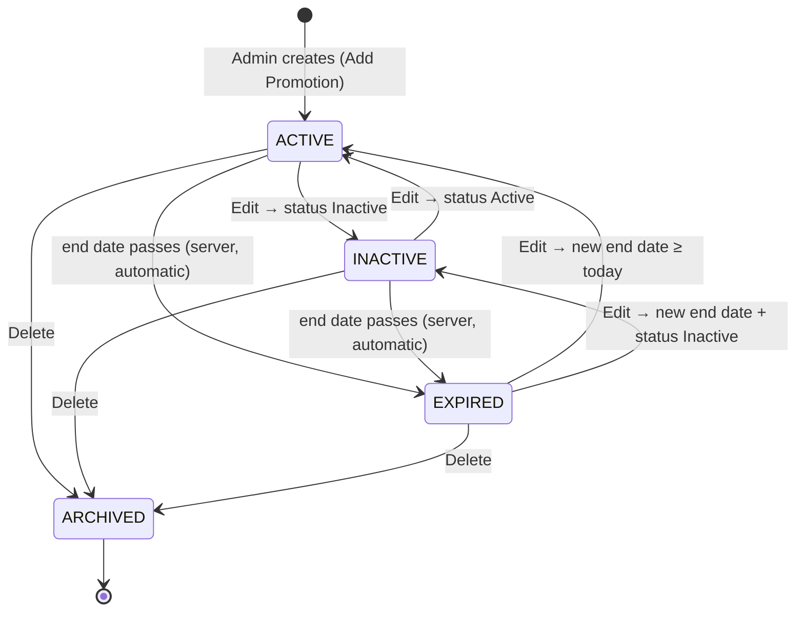
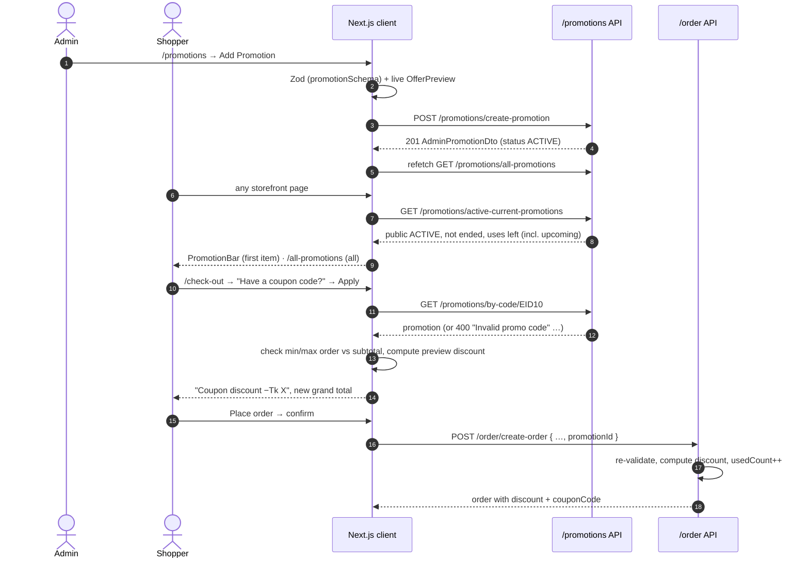

# Promotion Module — Frontend Technical Documentation

> **Scope:** everything the Natura Care client (Next.js 15, App Router) does with **promotions (coupon codes)**: the admin Promotions screen (list, add, edit, view, delete), the storefront promotion bar and the **Coupons & Offers** page, the coupon box at checkout, and how the applied coupon flows into the order, invoices and dashboard.
>
> **Audience:** frontend engineers joining or maintaining the project. QA, product and backend engineers can use it to see the client's side of the promotion contract and the business rules the UI enforces.
>
> **Related:** [Project README](../README.md) (run, build, Docker) · [Home module](./home.md) (promotion bar shell, Top Title) · [Cart module](./cart.md) (subtotal & savings) · [Order module](./order.md) (placing an order, coupon on invoices) · [Auth module](./auth.md) (session, route guard) · [User module](./user.md) (roles) · [Server promotion docs](../../natura-care-server/docs/promotion.md) (API contract, DB schema, error messages)

| | |
|---|---|
| **Module root** | [`src/modules/promotion/`](../src/modules/promotion/) |
| **Admin route** | `/promotions` (admin route group) — `ADMIN` only |
| **Storefront routes** | `/all-promotions` (Coupons & Offers) · promotion bar on every `(public)` and `(customer)` page · coupon box on `/check-out` |
| **Backend resource** | `/promotions` on `NEXT_PUBLIC_API_BASE_URL` (e.g. `https://api.naturacarebd.com/n-care/api/v1`) |
| **Write access (API)** | `ADMIN` only |
| **Last reviewed** | 2026-10-24 |

---

## Table of Contents

1. [Overview](#1-overview)
2. [Domain Model](#2-domain-model)
   - [2.1 What a promotion is](#21-what-a-promotion-is)
   - [2.2 Status, phase and visibility](#22-status-phase-and-visibility)
   - [2.3 Lifecycle](#23-lifecycle)
   - [2.4 Locked vs editable terms](#24-locked-vs-editable-terms)
   - [2.5 How dates work](#25-how-dates-work)
3. [Tech Stack Used by This Module](#3-tech-stack-used-by-this-module)
4. [File Architecture](#4-file-architecture)
5. [Routes & Role-Based Access](#5-routes--role-based-access)
   - [5.1 Page routes](#51-page-routes)
   - [5.2 Middleware rules](#52-middleware-rules)
   - [5.3 Admin sidebar](#53-admin-sidebar)
   - [5.4 API roles and the viewer model](#54-api-roles-and-the-viewer-model)
   - [5.5 Access matrix](#55-access-matrix)
6. [End-to-End Workflow](#6-end-to-end-workflow)
7. [Admin Section — Promotion List (`/promotions`)](#7-admin-section--promotion-list-promotions)
   - [7.1 Screen layout](#71-screen-layout)
   - [7.2 Data fetching, search, sort & pagination](#72-data-fetching-search-sort--pagination)
   - [7.3 Columns](#73-columns)
   - [7.4 Modals](#74-modals)
8. [Admin Section — Add Promotion](#8-admin-section--add-promotion)
9. [Admin Section — Edit Promotion](#9-admin-section--edit-promotion)
10. [Admin Section — View Promotion](#10-admin-section--view-promotion)
11. [Admin Section — Delete (Archive)](#11-admin-section--delete-archive)
12. [Storefront — Promotion Bar](#12-storefront--promotion-bar)
13. [Storefront — Coupons & Offers Page (`/all-promotions`)](#13-storefront--coupons--offers-page-all-promotions)
14. [Storefront — Checkout Coupon Box](#14-storefront--checkout-coupon-box)
15. [After Checkout — Orders, Invoices & Dashboard](#15-after-checkout--orders-invoices--dashboard)
16. [API Reference](#16-api-reference)
17. [Types](#17-types)
18. [Validation Schemas](#18-validation-schemas)
19. [Constants](#19-constants)
20. [Hooks](#20-hooks)
21. [Utilities](#21-utilities)
22. [Reusable Components](#22-reusable-components)
23. [Data Fetching & Cache Keys](#23-data-fetching--cache-keys)
24. [Error Handling](#24-error-handling)
25. [Business Rules Summary](#25-business-rules-summary)
26. [Known Issues & Technical Debt](#26-known-issues--technical-debt)
27. [How-To Recipes](#27-how-to-recipes)
28. [Change Log](#28-change-log)

---

## 1. Overview

A promotion is a **coupon code** a shopper types (or taps) at checkout to get money off the whole order, for example **EID10 → 10% off up to Tk 300 on orders over Tk 500, 5–31 Oct**. The client works with promotions in four places:

| Audience | Where | What happens |
|---|---|---|
| **Admin** | `/promotions` | List every promotion in every status, search, add a code, edit what is still editable (status, end date, usage limit, visibility), view full details with usage and schedule, and delete (archive). |
| **Shopper** (guest or customer) | Promotion bar (desktop, top of every storefront page) | See the current public deal with a live countdown and copy its code; jump to "All deals" when there is more than one. |
| **Shopper** | `/all-promotions` | Browse every public coupon that is running or coming soon, with conditions, expiry and remaining uses, and copy a code. |
| **Shopper** | `/check-out` order summary | Type any code (public **or private**) or tap a suggested public one; see the saving in the totals; the `promotionId` goes with the order. |

Key design decisions:

- **The server is the source of truth for the discount.** The client looks the code up, checks min/max order locally for a friendly message, and previews the saving. The server re-validates and recomputes the discount when the order is placed ([§14](#14-storefront--checkout-coupon-box)).
- **Terms are frozen once created.** Discount, order limits and start date can't be edited because orders may already have used them. Only status, end date, usage limit (raise only) and visibility change ([§2.4](#24-locked-vs-editable-terms)).
- **Delete is a soft delete.** "Delete" sets status `ARCHIVED`; the row stays so past orders keep their coupon reference, and the code becomes free to reuse ([§11](#11-admin-section--delete-archive)).
- **Public vs private is about listing, not usage.** A private code is hidden from the promo bar and offers page but still works for anyone who types it at checkout.
- **One coupon per order.** The checkout box holds exactly one applied code.
- **Form limits mirror the server DTO.** [`PROMOTION_LIMITS`](../src/modules/promotion/schemas/promotion.schema.ts) and the Zod rules match `CreatePromotionDto` / `UpdatePromotionDto`, so a value the form accepts is not rejected for its shape ([§18](#18-validation-schemas)).

[↑ Back to top](#table-of-contents)

---

## 2. Domain Model

### 2.1 What a promotion is

| Field | Meaning | Editable after create |
|---|---|---|
| `couponCode` | 3–30 chars, letters/digits/`-`/`_`, at least one letter. Stored upper-case; matched case-insensitively. | No |
| `title`, `description` | Internal name and note. **Admin-only** — the API never returns them to shoppers. | No |
| `discountType` | `PERCENTAGE` or `FIXED` (`CAP_LIMIT`, `SHIPPING` exist in the enum but are not offered). | No |
| `discountValue` | Percent (≤ 100) or Tk amount. | No |
| `maxDiscountAmount` | Cap for a percentage discount ("10% up to Tk 300"). Not allowed on `FIXED`. | No |
| `minPurchase` / `maxPurchase` | Order subtotal window the code works in. | No |
| `usageLimit` | Total orders that may use the code; `null` = unlimited. | Raise only |
| `usedCount` | Orders that used it (server-maintained). | — |
| `startDate` / `endDate` | Whole calendar days, both inclusive. | End date only |
| `status` | See [§2.2](#22-status-phase-and-visibility). | Active ↔ Inactive |
| `isPublic` | Listed on the storefront or not. | Yes |

### 2.2 Status, phase and visibility

Three independent axes decide what a shopper sees.

**Status** (stored, `PromotionStatus`):

| Status | Label | Meaning | Usable at checkout |
|---|---|---|---|
| `ACTIVE` | Active | Switched on. | Yes, if the phase is `RUNNING` |
| `INACTIVE` | Inactive | Paused by an admin. | No |
| `EXPIRED` | Expired | End date passed; set automatically by the server on read. | No |
| `ARCHIVED` | **Deleted** | Soft-deleted. Read-only forever. | No |

**Phase** (derived on the client by [`promotionPhase()`](../src/modules/promotion/utils/promotion.utils.ts), only for `ACTIVE`): status says it is switched on; phase says whether a customer can use it **today**.

| Phase | Rule | Badge in the table |
|---|---|---|
| `UPCOMING` | start day is after today | "Upcoming" (blue) |
| `USED_UP` | `usageLimit` set and `usedCount >= usageLimit` | "Used up" (orange) |
| `RUNNING` | otherwise | none (it's the normal case) |

**Visibility** (`isPublic`):

| | Promo bar | Offers page | Checkout suggestions | Typed at checkout |
|---|---|---|---|---|
| Public | ✅ | ✅ | ✅ (if running & not used up) | ✅ |
| Private | ❌ | ❌ | ❌ | ✅ |

### 2.3 Lifecycle



Inside `ACTIVE` the phase moves `UPCOMING → RUNNING → USED_UP` on its own as days pass and orders use the code. Raising the usage limit moves a `USED_UP` promotion back to `RUNNING`.

### 2.4 Locked vs editable terms

The Edit modal shows the locked terms in a grey **Locked Terms** card and only offers the four editable fields. The rule — and the reason — is printed in the UI: *"Fixed once created, because orders may already have used them. To change them, delete this promotion and create a new one."*

| Locked | Editable |
|---|---|
| coupon code, title, note, discount type & value, max discount, min/max order, start date | status (Active/Inactive), end date, usage limit (raise only, never below `usedCount`, never removed once set), `isPublic` |

### 2.5 How dates work

Promotions run by **whole calendar days**. Three things make this work across time zones:

1. [`DateInputField`](../src/components/form/DateInputField.tsx) writes the picked day as **UTC midnight ISO** (`2026-10-05T00:00:00.000Z`).
2. The server stores each day as Dhaka local midnight in UTC (prints as `18:00` the day before). The client reads them as calendar days.
3. [`toPickerDate()`](../src/modules/promotion/utils/promotion.utils.ts) converts a stored date back to the UTC-midnight form the picker expects, so the Edit form shows the same day as the table. All "days left / starts in" math goes through `startOfDay()` / `daysBetween()` (local midnight), never raw millisecond differences.

`durationDays(start, end)` is inclusive: 5 Oct → 5 Oct is **1 day**.

[↑ Back to top](#table-of-contents)

---

## 3. Tech Stack Used by This Module

| Concern | Library | Where |
|---|---|---|
| Framework / routing | Next.js 15 App Router, `next/dynamic` | `src/app/(admin)/promotions`, `src/app/(public)/all-promotions` |
| Server state | TanStack Query via `useGet` / `useGetAll` / `usePost` / `usePatch` / `useDelete` | list, storefront list, mutations |
| HTTP | `axiosInstance` (response interceptor unwraps the envelope to `{ statusCode, success, message, data, meta }`) | all calls; checkout lookup calls it directly |
| Forms | React Hook Form + `@hookform/resolvers/zod` | Add / Edit |
| Validation | Zod (v4 `error:` syntax) | `promotion.schema.ts` |
| Table | TanStack Table (`ColumnDef`) inside `CustomTable` | `promotion.columns.tsx` |
| UI | Tailwind CSS (brand tokens `greenPrimary-*`, `neutralPrimary-*`…), shadcn `Skeleton`, `tw-animate-css` | everywhere |
| Icons | `lucide-react` (sidebar uses `react-icons` `RiCouponLine`) | everywhere |
| Toasts | `sonner` | mutations, copy, errors |
| Confirm dialog | `useConfirm()` context | delete |

[↑ Back to top](#table-of-contents)

---

## 4. File Architecture

```text
natura-care-client/
├── src/
│   ├── app/
│   │   ├── (admin)/promotions/page.tsx            # Admin page: metadata + dynamic(<Promotions/>)
│   │   ├── (public)/all-promotions/page.tsx       # Storefront page: metadata + dynamic(<AllPromotions/>)
│   │   ├── (public)/layout.tsx                    # Mounts <PromotionBar/> above the navbar
│   │   └── (customer)/layout.tsx                  # Also mounts <PromotionBar/>
│   │
│   ├── modules/promotion/                         # ★ MODULE ROOT
│   │   ├── admin/
│   │   │   ├── Promotions.tsx                     # List screen: table, search, pagination, add/view/edit modals, delete
│   │   │   ├── promotion.columns.tsx              # TanStack column defs (coupon, discount, validity, usage, status, visibility, actions)
│   │   │   ├── AddPromotion.tsx                   # Create form (5 sections + live customer preview)
│   │   │   ├── EditPromotion.tsx                  # Edit form (locked terms card + 4 editable fields)
│   │   │   ├── ViewPromotion.tsx                  # Read-only details: hero, notices, stat tiles, terms, timeline, usage, audit
│   │   │   ├── PromotionFormParts.tsx             # FormSection, FieldHint, OfferPreview, FormActions (shared by Add/Edit)
│   │   │   └── PromotionDuration.tsx              # ⚠ Unused, hardcoded "5 days" (see TD-6)
│   │   ├── public/
│   │   │   └── AllPromotions.tsx                  # Coupons & Offers page (available now / coming soon)
│   │   ├── hooks/
│   │   │   └── useCurrentPromotion.ts             # Storefront list + "current" (first) promotion
│   │   ├── schemas/
│   │   │   └── promotion.schema.ts                # PROMOTION_LIMITS, promotionSchema (create), editPromotionSchema(current)
│   │   ├── types/
│   │   │   └── promotion.types.ts                 # IPromotion, PromotionStatus, PromotionDiscountType, link types
│   │   ├── constants/
│   │   │   └── promotion.constants.ts             # Select options: discount types, settable statuses
│   │   └── utils/
│   │       └── promotion.utils.ts                 # Status styles, date math, formatting, phase, usage helpers
│   │
│   ├── components/layout/
│   │   ├── promo-bar/PromotionBar.tsx             # Site-wide bar: Top Title + current promotion + free delivery
│   │   └── sidebar/AdminSidebar.tsx               # "Promotions" nav item (admin only)
│   │
│   ├── modules/checkout/
│   │   ├── public/Promotion.tsx                   # Coupon box: lookup by code, suggestions, applied state
│   │   ├── public/CheckoutSummary.tsx             # Renders the box + "Coupon discount" line + savings banner
│   │   └── public/CheckOut.tsx                    # Holds promotionInfo state, grand total, sends promotionId
│   │
│   ├── modules/order/                             # Reads couponCode / couponTitle / discount from orders
│   │   ├── admin/order.columns.tsx · ViewOrder.tsx · EditPlacedOrder.tsx
│   │   ├── customer/OrderDetails.tsx
│   │   └── utils/invoice.utils.ts · order.utils.ts
│   │
│   └── middleware.ts                              # /promotions → ADMIN; /all-promotions → public
└── docs/promotion.md                              # ← this file
```

**Layering inside the module** (same convention as the other modules):

| Layer | Folder | Rule |
|---|---|---|
| Page | `src/app/**/page.tsx` | Metadata + lazy import only. No logic. |
| Screen / feature | `admin/`, `public/` | Owns UI state, calls hooks, composes components. |
| Hooks | `hooks/` | Data access shared by several screens. |
| Schemas | `schemas/` | Zod rules + inferred form types. |
| Types | `types/` | API shapes. |
| Constants | `constants/` | Static option lists. |
| Utils | `utils/` | Pure functions, no React. Safe to import anywhere, including outside the module (checkout does). |

[↑ Back to top](#table-of-contents)

---

## 5. Routes & Role-Based Access

### 5.1 Page routes

| Route | Route group | Page file | Renders | Title |
|---|---|---|---|---|
| `/promotions` | `(admin)` | [`page.tsx`](../src/app/(admin)/promotions/page.tsx) | [`Promotions`](../src/modules/promotion/admin/Promotions.tsx) (dynamic, `LoadingPage` fallback) | Promotions \| Natura Care Limited |
| `/all-promotions` | `(public)` | [`page.tsx`](../src/app/(public)/all-promotions/page.tsx) | [`AllPromotions`](../src/modules/promotion/public/AllPromotions.tsx) (dynamic) | Coupons \| Natura Care Limited |
| every `(public)` / `(customer)` page | — | layouts | [`PromotionBar`](../src/components/layout/promo-bar/PromotionBar.tsx) | — |
| `/check-out` | `(public)` | — | [`checkout/public/Promotion.tsx`](../src/modules/checkout/public/Promotion.tsx) inside the order summary | — |

Links into the module: promo bar "All deals" → `/all-promotions`; checkout "View details" → `/all-promotions` (new tab); offers page empty state → `/product`.

### 5.2 Middleware rules

[`src/middleware.ts`](../src/middleware.ts) decodes the `accessToken` cookie (JWT `role`) and routes by prefix:

| List | Contains | Effect for promotions |
|---|---|---|
| `PUBLIC_ROUTES` | `/all-promotions` | Anyone, logged in or not. |
| `ADMIN_ONLY_ROUTES` | `/promotions` | Guests → `/login`. Customers → `/`. |
| `EMPLOYEE_ROUTES` | *does not include* `/promotions` | Employees are redirected to `/dashboard`. |
| `GUEST_CUSTOMER_ONLY_ROUTES` | `/check-out`, `/my-cart` | Guests and customers only; admins/employees are redirected to their dashboard — so **staff can't apply coupons** on the storefront. |

> Prefix matching: `/promotions` uses `startsWith`, so any future `/promotions/<id>` page is covered automatically. `/all-promotions` is an exact match in `PUBLIC_ROUTES`; a sub-page would need adding.

### 5.3 Admin sidebar

[`AdminSidebar.tsx`](../src/components/layout/sidebar/AdminSidebar.tsx#L58) — `{ label: "Promotions", href: "/promotions", icon: RiCouponLine }`, **without** `employee: true`, so it only appears for `ADMIN`. Keep the sidebar flag and `EMPLOYEE_ROUTES` in sync.

### 5.4 API roles and the viewer model

The middleware only hides pages; the API enforces access.

- **Write and admin-list endpoints** use `JwtAuthGuard + RolesGuard + @Roles(ADMIN)`.
- **Storefront read endpoints** (`active-current-promotions`, `by-code/:code`) use `IdentifyViewerGuard`: public, but the **response shape depends on who asks**. Guests, customers and employees get `PublicPromotionDto` (no `title`, `description`, `status`, `isPublic` or audit fields). An admin token gets `AdminPromotionDto`.

Consequence for the UI: on the storefront, `title` / `description` are `null` for shoppers, so the offers page cards show only the discount, conditions and code ([TD-7](#26-known-issues--technical-debt)).

### 5.5 Access matrix

| Action | Guest | Customer | Employee | Admin |
|---|:-:|:-:|:-:|:-:|
| See promo bar / offers page | ✅ | ✅ | ✅ | ✅ (full view) |
| Apply coupon at checkout | ✅ | ✅ | ❌ (redirected) | ❌ (redirected) |
| Open `/promotions` | ❌ → `/login` | ❌ → `/` | ❌ → `/dashboard` | ✅ |
| Create / edit / delete | ❌ | ❌ | ❌ (403) | ✅ |

[↑ Back to top](#table-of-contents)

---

## 6. End-to-End Workflow



[↑ Back to top](#table-of-contents)

---

## 7. Admin Section — Promotion List (`/promotions`)

Component: [`Promotions.tsx`](../src/modules/promotion/admin/Promotions.tsx)

### 7.1 Screen layout

```text
┌──────────────────────────────────────────────────────────────────────────┐
│ Promotions                                              [+ Add Promotion] │
├──────────────────────────────────────────────────────────────────────────┤
│ 🔍 Search code, title, status or type...                                 │
├────────────┬───────────┬──────────────────┬─────────┬─────────┬────────┬───────┤
│ Coupon     │ Discount  │ Validity         │ Usage   │ Status  │ Visib. │ Action│
│ [EID10]    │ 10% OFF   │ 5 Oct – 31 Oct   │ 37/200  │ ● Active│ 🌐Public│ 👁 ✎ 🗑│
│ Eid Sale   │ Up to 300 │ 7 days left      │ ▓▓░░░░  │ UPCOMING│        │       │
└────────────┴───────────┴──────────────────┴─────────┴─────────┴────────┴───────┘
                                              ‹ 1 2 3 › · rows per page 10
```

### 7.2 Data fetching, search, sort & pagination

```ts
useGetAll<{ data: IPromotion[]; meta: IPaginationMeta }>(
  "/promotions/all-promotions",
  ["getAllPromotions", page, limit, search, sortOrder],
  { page, limit, search, sortOrder },
);
```

| UI control | State | Query param | Server behaviour |
|---|---|---|---|
| Search box | `searchTerm` | `search` | Substring of title / description / code; prefix of status or type (`exp` → `EXPIRED`, `fi` → `FIXED`). |
| Sort click | `sortOrder` (`"asc"` initially) | `sortOrder` | Sorts by `createdAt`. The clicked column is ignored. See [TD-2](#26-known-issues--technical-debt). |
| Pager | `currentPage`, `pageSize` (10) | `page`, `limit` | `meta.totalPages`, `meta.totalItems`. |

Every list read also makes the server mark past-end-date promotions `EXPIRED`, so the table is always current. The API also supports `status` and `discountType` filters, which the UI doesn't expose yet ([TD-3](#26-known-issues--technical-debt)).

### 7.3 Columns

Defined in [`promotion.columns.tsx`](../src/modules/promotion/admin/promotion.columns.tsx). Sorting is disabled per column.

| Column | Content | Helpers |
|---|---|---|
| **Coupon** | Dashed code chip + truncated title | — |
| **Discount** | `10%` / `Tk 150` + `off`/`flat`; hints "Up to Tk 300 · Min. order Tk 500" | `formatDiscount`, `formatTk`, `isPercentage` |
| **Validity** | `5 Oct 2026 – 31 Oct 2026`; for Active/Inactive also "7 days left", "Starts in 3 days", "Last day today" | `formatDate`, `scheduleHint` |
| **Usage** | `37 / 200` + progress bar (green < 80%, amber ≥ 80%, red 100%) or "Unlimited" | `usagePercent`, `usageBarClass` |
| **Status** | Status pill + phase badge when not `RUNNING` | `PROMOTION_STATUS_STYLES`, `promotionPhase` |
| **Visibility** | 🌐 Public / 🔒 Private chip with tooltip | — |
| **Action** | View · Edit (tooltip "Deleted (read-only)" when archived) · Delete (disabled when archived) | `CustomTooltip` |

### 7.4 Modals

| Modal | Opened by | Width | Component |
|---|---|---|---|
| Add | `AddButton` → local `openModal` | `FORM_MODAL_WIDTH` (`max-w-3xl`) | `AddPromotion` |
| View | row 👁 → `handleOpen("view", row)` | `VIEW_MODAL_WIDTH` (`max-w-5xl`) | `ViewPromotion` |
| Edit | row ✎ → `handleOpen("edit", row)` | `FORM_MODAL_WIDTH` | `EditPromotion` |
| Delete | row 🗑 → `confirmDelete(...)` | confirm dialog | — |

View/Edit state comes from [`useHandleModalState<IPromotion>()`](../src/hooks/table/useHandleModalState.ts): one `activeModal` + `modalData`, so only one modal is open at a time. All modals use `CustomModal2` with `max-h-[90vh] scrollbar-brand`. Modal widths step down from near-full-width on phones to a reading width on desktop; the Order module reuses the same values.

[↑ Back to top](#table-of-contents)

---

## 8. Admin Section — Add Promotion

Component: [`AddPromotion.tsx`](../src/modules/promotion/admin/AddPromotion.tsx) · Schema: `promotionSchema` · Endpoint: `POST /promotions/create-promotion`

**Form sections** (each a [`FormSection`](../src/modules/promotion/admin/PromotionFormParts.tsx) card, two columns on `md+`):

| Section | Fields | Notes shown to the admin |
|---|---|---|
| **Coupon** | Coupon Code\*, Title, Internal Note | 3–30 chars; saved in capitals; title/note are admin-only. |
| **Discount** | Discount Type\* (`Percentage`/`Fixed`), Discount (%) or (Tk)\*, Maximum Discount (Tk) — *percentage only* | "Caps a percentage discount, e.g. 10% off up to Tk 300." |
| **Conditions** | Minimum Order, Maximum Order, Usage Limit | Empty = no limit. Usage limit "can be raised later, not lowered". |
| **Schedule** | Start Date\*, End Date\* | Both days included; hint "Runs for N days". |
| **Visibility** | Show on Storefront (toggle, default **off**) | "Private codes still work for anyone who types them at checkout." |

**Live customer preview** — [`OfferPreview`](../src/modules/promotion/admin/PromotionFormParts.tsx) shows the code and a sentence built by `describeOffer()`, e.g. *"10% off (up to Tk 300) on orders over Tk 500 — Valid 5 Oct 2026 – 31 Oct 2026"*, updating as the admin types (`useWatch`).

**Behaviour details:**

- Switching the type to `FIXED` clears `maxDiscountAmount` (`useEffect` on `isPercent`) because a fixed discount can't have a cap.
- **Submit payload** ([`onSubmit`](../src/modules/promotion/admin/AddPromotion.tsx#L76)): code is trimmed and upper-cased; empty optional fields are **deleted from the payload** so the server applies its defaults; `maxDiscountAmount` is only sent for percentages.
- On 2xx: close the modal and `refetch()` the list. The server message is toasted by `usePost`.
- The new promotion starts `ACTIVE`; if its start date is in the future it shows as **Upcoming**.

```jsonc
// POST /promotions/create-promotion
{
  "couponCode": "EID10",
  "discountType": "PERCENTAGE",
  "discountValue": 10,
  "maxDiscountAmount": 300,
  "minPurchase": 500,
  "usageLimit": 200,
  "startDate": "2026-10-05T00:00:00.000Z",
  "endDate": "2026-10-31T00:00:00.000Z",
  "isPublic": true,
  "title": "Eid Hair Care Sale"
}
```

[↑ Back to top](#table-of-contents)

---

## 9. Admin Section — Edit Promotion

Component: [`EditPromotion.tsx`](../src/modules/promotion/admin/EditPromotion.tsx) · Schema: `editPromotionSchema(current)` · Endpoint: `PATCH /promotions/update-promotion/:id`

**Layout:** header (code chip + status pill) → state notice → **Locked Terms** card (discount, max discount, min/max order, start, used count) → **Availability** section with the four editable fields → actions.

**State-dependent behaviour:**

| Current status | Notice | Status select | Fields | Submit |
|---|---|---|---|---|
| `ACTIVE` | — | Active / Inactive | editable | "Save Changes" |
| `INACTIVE` | "Paused. Customers can't use it until the status is set to Active." | Active / Inactive | editable | status is **always** sent (server requires it for a paused promotion) |
| `EXPIRED` | "Expired. Pick an end date from today onward to switch it back on…" | Active / Inactive + read-only "Expired (pick a new end date)" | editable | a new end date re-activates it; hint shows "it will be re-activated" |
| `ARCHIVED` | "This promotion was deleted. It can no longer be edited or used." | disabled | all disabled | hidden; Cancel becomes "Close" |

**Submit logic — dirty fields only** ([`onSubmit`](../src/modules/promotion/admin/EditPromotion.tsx#L130)):

1. Build the payload from RHF `dirtyFields`: `status` (only if `ACTIVE`/`INACTIVE` — `SETTABLE_STATUSES` stops `EXPIRED` from being sent), `endDate`, `usageLimit` (when not null), `isPublic`.
2. Empty payload → `toast.info("No changes detected!")` and close; no request.
3. If the promotion is `INACTIVE` and status wasn't touched, add the current status anyway.
4. `PATCH`; on 2xx close and `refetch()`.

The schema is **built from the current row** (`useMemo`), so its rules know the existing usage limit, used count, start date and status ([§18](#18-validation-schemas)).

[↑ Back to top](#table-of-contents)

---

## 10. Admin Section — View Promotion

Component: [`ViewPromotion.tsx`](../src/modules/promotion/admin/ViewPromotion.tsx) — read-only, uses only the row already in the table (no extra request).

| Block | What it shows |
|---|---|
| **Hero** | Big discount badge, title, copy-to-clipboard code (`CopyCode`), status pill (pinging dot when Active), Public/Private chip, `describeOffer()` sentence. |
| **Notices** | One per situation: Deleted · Expired on <date> · Paused · Not started yet ("customers see it as coming soon" if public) · Usage limit reached. |
| **Stat tiles** | Discount (cap / "No cap" / "Flat amount") · Used (`37/200`, "163 uses left") · Duration (`27d`, schedule hint) · Min. Order (and max). |
| **Offer Terms** | Discount type, discount, max discount, min/max order, visibility — as label/value rows. |
| **Schedule** | `Timeline`: progress bar from start to end, "Day 6 of 27" / "Starts in 3 days" / "Ran for 27 days". |
| **Usage** | Usage bar and "Used in 37 of 200 allowed orders" or "No usage limit". |
| **Internal Note** | `description` or "No note added." |
| **Audit** | Created / Last Updated — date-time, name and role (`createdByName`, `createdByRole`…). |

Blocks fade/slide in with a staggered delay (`ENTER` + `enterDelay(ms)`); every animation has a `motion-reduce:` fallback.

[↑ Back to top](#table-of-contents)

---

## 11. Admin Section — Delete (Archive)

```ts
confirmDelete({
  title: `Delete coupon "${code}"?`,
  description: "It will be archived and can no longer be used.",
  onConfirm: () => deletePromotion(`/promotions/delete-promotion/${id}`),
});
```

- `useDelete("getAllPromotions")` invalidates the list query on success and toasts "Deleted successfully.". The confirm dialog shows a spinner while the request runs.
- Server sets `status = ARCHIVED`; the row stays, past orders keep their coupon, and the code can be reused by a new promotion.
- An archived row: Delete button disabled ("Already deleted"), Edit opens read-only, status pill reads **Deleted**.

[↑ Back to top](#table-of-contents)

---

## 12. Storefront — Promotion Bar

Component: [`PromotionBar.tsx`](../src/components/layout/promo-bar/PromotionBar.tsx) — mounted in the `(public)` and `(customer)` layouts, fixed above the navbar. **Desktop only** (`max-lg:hidden`). The shared shell (`BAR_CLASS`, fixed `h-12`) keeps the same height in every state so the navbar never jumps. The bar also belongs to the Home module: see [Home §16](./home.md#16-storefront--promotion-bar).

**Data sources:**

| Source | Hook |
|---|---|
| Current promotion + count | `useCurrentPromotion()` → `currentPromotion` = first item of `active-current-promotions` |
| Top Title text | `useHomeContent().promotionBar[0]?.title` |
| Free delivery threshold | `useFreeDelivery()` |

**States:**

| State | Content |
|---|---|
| Loading | Three white skeleton pills. |
| No promotion | ✨ Top Title (fallback "Embrace the essence of nature with Natura Care") · 🚚 Free delivery over Tk X |
| Running promotion | Top Title (`xl+` only) · Free delivery · **10% OFF** badge · ⏱ "Ends in 3 days" · `[CODE EID10 | Copy]` · "All deals (n) →" when n > 1 |
| Upcoming promotion | Same, but badge reads **Coming soon** and the timer says "Starts in … · 10% OFF" |

**Countdown** (`useCountdown`): shows whole days ("3 days"); inside the final 24 hours it becomes a live `HH:MM:SS` ticking every second (otherwise every minute). It starts at `null` and fills in after mount, so server and client render the same markup (no hydration mismatch). Copy uses `navigator.clipboard`, flips to "Copied!" for 2 s, and announces it through an `aria-live` region.

[↑ Back to top](#table-of-contents)

---

## 13. Storefront — Coupons & Offers Page (`/all-promotions`)

Component: [`AllPromotions.tsx`](../src/modules/promotion/public/AllPromotions.tsx)

```text
Coupons & Offers
Copy a code below and paste it in the coupon box at checkout. One coupon per order.

[1. Copy a code] [2. Fill your cart] [3. Paste at checkout]

Available now (2)                          Coming soon (1)
┌───────┬──────────────────────────────┐   ┌┄┄┄┄┄┄┄┬┄┄┄┄┄┄┄┄┄┄┄┄┄┄┄┄┄┄┄┄┄┄┐
│  10%  │ (Min. order Tk 500)(Save up  │   ┆  Tk   ┆ (No minimum order)       ┆
│  OFF  │  to Tk 300)                  │   ┆  150  ┆ [ NEWYEAR ] [Copy] (off) ┆
│       │ [ EID10      ] [Copy]        │   ┆  OFF  ┆ Starts 1 Jan · starts in ┆
│       │ ⏳ Valid till 31 Oct · 163 left│   └┄┄┄┄┄┄┄┴┄┄┄┄┄┄┄┄┄┄┄┄┄┄┄┄┄┄┄┄┄┄┘
└───────┴──────────────────────────────┘
```

**Logic:**

1. Fetch with `useCurrentPromotion()` (same cache entry as the promo bar).
2. Drop used-up coupons (`isUsedUp`).
3. Split by `isUpcoming` (server flag; falls back to comparing start day with today):
   - **Available now** — sorted by end date (soonest first).
   - **Coming soon** — sorted by start date; dashed grey card; Copy disabled.
4. Conditions chips from `conditionsOf()`: "Min. order Tk 500", "Orders up to Tk 5,000", "Save up to Tk 300", or "No minimum order".
5. Urgency cues: **ending soon** (≤ 3 days left) turns the expiry red and uses the schedule hint; **few left** (≤ max(5, 20% of limit)) shows "Only N left" in red.
6. Copy → clipboard + toast "EID10 copied. Paste it at checkout." (falls back to an error toast asking to type it).
7. Loading → 3 `CouponSkeleton`s. Empty → "No coupons right now" + "Browse products" link.

[↑ Back to top](#table-of-contents)

---

## 14. Storefront — Checkout Coupon Box

Component: [`checkout/public/Promotion.tsx`](../src/modules/checkout/public/Promotion.tsx), rendered inside [`CheckoutSummary`](../src/modules/checkout/public/CheckoutSummary.tsx#L121). State lives in [`CheckOut.tsx`](../src/modules/checkout/public/CheckOut.tsx) as:

```ts
interface IPromotionInfo { promotionId?: number | null; promotionAmount: number }
```

**UI states:**

| State | Shows |
|---|---|
| Collapsed | Link "🏷 Have a coupon code?" + "N available" pill (public coupons running today). |
| Open | Upper-cased input (Enter applies, doesn't submit the order form), **Apply** button with spinner, inline error, and the "Available coupons" list with one-tap Apply and "View details" → `/all-promotions`. |
| Applied | Green dashed card: code, "10% off · you save Tk X", ✕ to remove. |

Suggestions are greyed out with a reason when the cart doesn't qualify: "Add Tk 120 more to use" or "For orders up to Tk 5,000".

**Apply flow** ([`applyCode`](../src/modules/checkout/public/Promotion.tsx#L49)):

```text
code ─trim─► empty? ──► "Enter a coupon code"
          │
          ▼
GET /promotions/by-code/:code   (encodeURIComponent; public OR private codes)
          │ 400 ► show server message ("Invalid promo code", "This promo code is not active yet", usage limit reached)
          ▼
subTotal < minPurchase ► "Add Tk X more to use this code (minimum Tk Y)."
subTotal > maxPurchase ► "This code works on orders up to Tk Y."
          ▼
promotionAmount = PERCENTAGE ? subTotal × value / 100 : value
setPromotionInfo({ promotionId, promotionAmount })
```

**Totals** (`CheckOut.tsx`):

```ts
grandTotal = totals.total - promotionInfo.promotionAmount + deliveryFee;
```

- `subTotal` passed to the box is `cartTotals(cartItems).total` — the item subtotal **after** product sale prices.
- Free delivery is decided on `totals.total` **before** the coupon.
- The summary shows a "Coupon discount −Tk X" row and a "🎉 You save Tk Y on this order" banner that adds product savings and the coupon.
- The order payload sends `promotionId` (or `null`). The **amount is never sent**; the server recomputes it, re-checks status, dates, min/max and usage, and increments `usedCount` inside the order transaction.

> ⚠ The preview does **not** apply `maxDiscountAmount` — and neither does the server today. See [TD-1](#26-known-issues--technical-debt).

[↑ Back to top](#table-of-contents)

---

## 15. After Checkout — Orders, Invoices & Dashboard

The order stores `promotionId` and `discount`; order responses add `couponCode` and `couponTitle` ([`IOrder`](../src/modules/order/types/order.types.ts)).

| Where | File | What it shows |
|---|---|---|
| Admin order table | [`order.columns.tsx`](../src/modules/order/admin/order.columns.tsx) | Coupon chip with tooltip "Coupon EID10: −Tk X". |
| Admin order details | [`ViewOrder.tsx`](../src/modules/order/admin/ViewOrder.tsx) | "Coupon EID10" line in the totals. |
| Admin edit placed order | [`EditPlacedOrder.tsx`](../src/modules/order/admin/EditPlacedOrder.tsx) | Before/after coupon line in the change preview. |
| Customer order details | [`OrderDetails.tsx`](../src/modules/order/customer/OrderDetails.tsx) | "Discount (EID10)". |
| Invoice | [`invoice.utils.ts`](../src/modules/order/utils/invoice.utils.ts) | Coupon code, title and amount. |
| CSV export / search | [`order.utils.ts`](../src/modules/order/utils/order.utils.ts) | Coupon code column. |
| Dashboard KPI | [`MetricStrip.tsx`](../src/modules/dashboard/admin/MetricStrip.tsx) | "Discounts given" (share of gross). |

See the [Order module](./order.md) for these screens.

[↑ Back to top](#table-of-contents)

---

## 16. API Reference

Base: `NEXT_PUBLIC_API_BASE_URL` + `/promotions`. Every response uses the standard envelope `{ statusCode, success, message, data, meta? }`, which the axios interceptor flattens.

### Endpoints used by the client

| Method & path | Guard | Used by | Request | Response `data` |
|---|---|---|---|---|
| `GET /promotions/all-promotions` | ADMIN | `Promotions` | `page, limit, search, sortOrder` (`status`, `discountType` supported, unused) | `AdminPromotionDto[]` + `meta` |
| `POST /promotions/create-promotion` | ADMIN | `AddPromotion` | create payload ([§8](#8-admin-section--add-promotion)) | `AdminPromotionDto` |
| `PATCH /promotions/update-promotion/:id` | ADMIN | `EditPromotion` | any of `status, endDate, usageLimit, isPublic` | `AdminPromotionDto` |
| `DELETE /promotions/delete-promotion/:id` | ADMIN | `Promotions` | — | `AdminPromotionDto` (status `ARCHIVED`) |
| `GET /promotions/active-current-promotions` | viewer-aware | `useCurrentPromotion` | none (all) | public ACTIVE, not ended, uses left, incl. upcoming; running first |
| `GET /promotions/by-code/:couponCode` | viewer-aware | checkout `Promotion` | code (case-insensitive) | one usable promotion, public or private |

### Available but unused by the client

| Method & path | Note |
|---|---|
| `GET /promotions/:id` | Admin, any status. The View/Edit modals reuse the table row instead. |

### Related endpoint owned by another module

| Method & path | Promotion field |
|---|---|
| `POST /order/create-order` | `promotionId: number \| null` |

Full contract, status codes and every error message: [server promotion docs](../../natura-care-server/docs/promotion.md).

[↑ Back to top](#table-of-contents)

---

## 17. Types

File: [`promotion.types.ts`](../src/modules/promotion/types/promotion.types.ts)

```ts
type PromotionStatus = "ACTIVE" | "INACTIVE" | "EXPIRED" | "ARCHIVED";
type PromotionDiscountType = "PERCENTAGE" | "FIXED" | "CAP_LIMIT" | "SHIPPING";

interface IPromotion {
  id: number; sid: string;
  couponCode: string;
  title?: string | null; description?: string | null;   // admin view only
  discountType: PromotionDiscountType; discountValue: number;
  maxDiscountAmount?: number | null;
  minPurchase?: number | null; maxPurchase?: number | null;
  usageLimit?: number | null; usedCount: number;
  startDate: Date; endDate: Date;
  status: PromotionStatus; isPublic: boolean;            // admin view only
  isUpcoming?: boolean;                                   // start date still ahead
  createdAt: Date; updatedAt: Date;
  createdById?, createdByName?, createdByRole?,           // admin view only (flat audit)
  updatedById?, updatedByName?, updatedByRole?;
  promotionProducts?: PromotionProduct[];                 // unused (TD-8)
  promotionCategories?: PromotionCategory[];              // unused (TD-8)
}
```

One interface covers both API views. On the storefront the admin-only fields arrive as `undefined`/`null`.

Other types:

| Type | File | Purpose |
|---|---|---|
| `PromotionFormType` | `promotion.schema.ts` | `z.infer` of the create schema. |
| `EditPromotionFormType` | `promotion.schema.ts` | `z.infer` of the edit schema factory. |
| `PromotionPhase` | `promotion.utils.ts` | `"UPCOMING" \| "RUNNING" \| "USED_UP" \| null`. |
| `IPromotionInfo` | `checkout/public/Promotion.tsx` | Applied coupon state at checkout. |
| `IModal` | `@/types` | Shared modal props (`data`, `setOpen`, `onClose`, `refetch`, `isLoading`). |

[↑ Back to top](#table-of-contents)

---

## 18. Validation Schemas

File: [`promotion.schema.ts`](../src/modules/promotion/schemas/promotion.schema.ts)

```ts
PROMOTION_LIMITS = { TITLE_MAX: 100, DESCRIPTION_MAX: 255, COUPON_CODE_MIN: 3, COUPON_CODE_MAX: 30, PERCENTAGE_MAX: 100 }
```

### `promotionSchema` (create)

| Field | Rule | Message |
|---|---|---|
| `couponCode` | required, trim, 3–30, `/^(?=.*[A-Za-z])[A-Za-z0-9_-]+$/` | "Use letters, numbers, - and _ only, with at least one letter (no spaces)" |
| `title` / `description` | optional, trim, ≤ 100 / ≤ 255 | "… must be at most N characters" |
| `discountType` | `PERCENTAGE \| FIXED` | "Discount type is required" |
| `discountValue` | number > 0 | "Discount value must be greater than 0" |
| `maxDiscountAmount`, `minPurchase`, `maxPurchase` | optional number > 0, nullable | "… must be greater than 0" |
| `usageLimit` | optional int ≥ 1, nullable | "Usage limit must be a whole number" |
| `startDate`, `endDate` | required, parseable date | "… is required" |
| `isPublic` | boolean | — |

Cross-field (`superRefine`):

- `PERCENTAGE` and value > 100 → "A percentage discount can't be more than 100%"
- `FIXED` with `maxDiscountAmount` → "A fixed discount can't have a maximum discount"
- `minPurchase > maxPurchase` → on `maxPurchase`: "Maximum order can't be lower than the minimum order"
- `startDate > endDate` → on `endDate`: "End date can't be before the start date"

> Not checked on the client: "start/end date in the past" and "code already used by a live promotion". The server rejects those and the message is toasted.

### `editPromotionSchema(current)` (edit — a factory)

Takes `{ status, startDate, usageLimit, usedCount }` of the current promotion.

| Rule | Message |
|---|---|
| Had a limit, field cleared | "A usage limit can't be removed; keep it at N or raise it" |
| New limit < current limit | "Usage limit can only be raised (currently N)" |
| New limit < `usedCount` | "Already used N times; the limit can't be lower" |
| End day < start day (calendar-day compare) | "End date can't be before the start date" |
| Was `EXPIRED`, end day < today | "Pick an end date from today onward to re-activate it" |

[↑ Back to top](#table-of-contents)

---

## 19. Constants

File: [`promotion.constants.ts`](../src/modules/promotion/constants/promotion.constants.ts) — `{ id, name }` option lists for `SingleSelectSearch`.

| Constant | Values | Used by |
|---|---|---|
| `promotionDiscountTypes` | `PERCENTAGE` Percentage · `FIXED` Fixed (`CAP_LIMIT`, `SHIPPING` commented out) | Add |
| `promotionStatus` | `ACTIVE` Active · `INACTIVE` Inactive (`EXPIRED` commented out — it's set by the server) | Edit |

Other constants:

| Constant | File | Purpose |
|---|---|---|
| `PROMOTION_LIMITS` | `schemas/promotion.schema.ts` | Length/percent limits mirrored from the server DTO. |
| `PROMOTION_STATUS_STYLES` | `utils/promotion.utils.ts` | Pill/dot classes + label per status (`ARCHIVED` → "Deleted"). |
| `PHASE_BADGE` | `admin/promotion.columns.tsx` | Phase badge label/colour. |
| `SETTABLE_STATUSES` | `admin/EditPromotion.tsx` | Statuses the client may send (`ACTIVE`, `INACTIVE`). |
| `FORM_MODAL_WIDTH`, `VIEW_MODAL_WIDTH` | `admin/Promotions.tsx` | Responsive modal widths. |
| `COPIED_RESET_MS`, `BAR_CLASS` | `promo-bar/PromotionBar.tsx` | Copy feedback duration; fixed bar shell. |

[↑ Back to top](#table-of-contents)

---

## 20. Hooks

### Module hook

| Hook | File | Returns | Used by |
|---|---|---|---|
| `useCurrentPromotion()` | [`useCurrentPromotion.ts`](../src/modules/promotion/hooks/useCurrentPromotion.ts) | `promotions` (array, never undefined), `currentPromotion` (first item or `null`), `promotionData`, `isPromotionLoading`, `promotionRefetch` | `PromotionBar`, `AllPromotions`, checkout `Promotion` |

Wraps `useGet<IPromotion[]>("/promotions/active-current-promotions", ["getCurrentPromotion"])`. All three consumers share one cache entry, so a page with the bar and the coupon box makes **one** request.

### Shared hooks used here

| Hook | File | Use in this module |
|---|---|---|
| `useGet` / `useGetAll` | `src/hooks/api/useGet.ts` | Storefront list (`data` unwrapped) / admin list (keeps `meta`). Both toast on fetch error. |
| `usePost` | `src/hooks/api/usePost.ts` | Create. Toasts the server message (or each message of an array). |
| `usePatch` | `src/hooks/api/usePatch.ts` | Edit. |
| `useDelete(key)` | `src/hooks/api/useDelete.ts` | Archive + invalidate `getAllPromotions`. |
| `useHandleModalState<T>()` | `src/hooks/table/useHandleModalState.ts` | View/Edit modal state. |
| `useConfirm()` | `src/hooks/useConfirm.ts` | Promise-based delete confirmation. |
| `useHomeContent()` | `src/modules/home/hooks/useHomeContent.ts` | Top Title in the bar. |
| `useFreeDelivery()` | `src/modules/free-delivery/hooks/useFreeDelivery.ts` | Free-delivery threshold in the bar. |
| `useCountdown(target)` | local to `PromotionBar.tsx` | Days / live HH:MM:SS countdown. |

[↑ Back to top](#table-of-contents)

---

## 21. Utilities

File: [`promotion.utils.ts`](../src/modules/promotion/utils/promotion.utils.ts) — pure functions, safe on the server and in other modules.

| Function | Example | Notes |
|---|---|---|
| `startOfDay(d)` | → local midnight | Base of all day math. |
| `daysBetween(a, b)` | 5 Oct → 8 Oct = `3` | Negative when `b` is earlier. |
| `durationDays(start, end)` | 5 → 5 Oct = `1` | Inclusive; `null` if either missing. |
| `toPickerDate(d)` | → `"2026-10-05T00:00:00.000Z"` | Stored date → `DateInputField` format. |
| `formatDate(d)` | `"5 Oct 2026"` | `en-GB`; `"—"` when empty. |
| `formatDateTime(d)` | `"Oct 5, 2026, 3:12 PM"` | Audit rows. |
| `formatTk(n)` | `"Tk 1,500"` | `"—"` when null. (Checkout and the bar use the cart module's `formatTk`.) |
| `isPercentage(p)` | `true` | |
| `formatDiscount(p)` | `"10%"` / `"Tk 150"` | Anything not `PERCENTAGE` is shown as Tk. |
| `describeOffer(p)` | `"10% off (up to Tk 300) on orders over Tk 500"` | One-line customer wording. |
| `isUsedUp(p)` | `true` when `usedCount >= usageLimit` | |
| `usagePercent(p)` | `0–100` or `null` (unlimited) | |
| `usageBarClass(pct)` | green / amber (≥ 80) / red (≥ 100) | |
| `promotionPhase(p)` | `"UPCOMING" \| "RUNNING" \| "USED_UP" \| null` | Only for `ACTIVE`. |
| `scheduleHint(p)` | `"Starts in 3 days"`, `"Last day today"`, `"12 days left"`, `"Ended 6 days ago"` | |

Local helpers: `conditionsOf`, `isUpcoming`, `byEndDate` in `AllPromotions.tsx`; `formatShortDate`, `pad` in `PromotionBar.tsx`.

[↑ Back to top](#table-of-contents)

---

## 22. Reusable Components

### Defined in this module

| Component | File | Props | Use it for |
|---|---|---|---|
| `FormSection` | `admin/PromotionFormParts.tsx` | `icon, title, description?, children` | A titled card that lays fields in 1 → 2 columns. Extra row gap leaves room for absolutely placed field errors. |
| `FieldHint` | same | `children` | Small full-width hint under a field row. |
| `OfferPreview` | same | `code?, offer, validity?` | "Customer preview" ticket. |
| `FormActions` | same | `onCancel, submitTitle, isPending, cancelLabel?, hideSubmit?` | Cancel + submit; stacked full-width on phones, primary on top. |
| `StatusPill`, `StatTile`, `Section`, `Rule`, `Notice`, `AuditRow`, `CopyCode`, `Timeline` | `admin/ViewPromotion.tsx` (file-local) | — | Building blocks of the View modal. Lift them out if another details modal needs them. |
| `LockedTerm` | `admin/EditPromotion.tsx` (file-local) | `label, value` | Read-only term in the Locked Terms card. |
| `HowItWorks`, `CouponSection`, `CouponGrid`, `CouponCard`, `CouponSkeleton`, `EmptyState` | `public/AllPromotions.tsx` (file-local) | — | Offers page pieces. |

### Shared components used here

| Component | Path | Where |
|---|---|---|
| `CustomTable` | `@/components/data-display/table/CustomTable` | List (search, pagination, sort callbacks) |
| `CustomModal2` | `@/components/primitives/modal/CustomModal2` | Add / View / Edit |
| `AddButton`, `CancelButton` | `@/components/primitives/button/*` | List header, View close |
| `CustomTooltip` | `@/components/primitives/CustomTooltip` | Row action icons |
| `InputField`, `TextAreaField`, `SingleSelectSearch`, `DateInputField`, `ToggleButton`, `SubmitButton` | `@/components/form/*` | Add / Edit |
| `Skeleton` | `@/components/ui/skeleton` | Bar, offers page |
| `LoadingPage` | `@/components/feedback/loading/LoadingPage` | Page-level dynamic import fallback |

[↑ Back to top](#table-of-contents)

---

## 23. Data Fetching & Cache Keys

| Query key | Endpoint | Consumers | Invalidated / refreshed by |
|---|---|---|---|
| `["getAllPromotions", page, limit, search, sortOrder]` | `all-promotions` | admin list | `refetch()` after add/edit; `useDelete("getAllPromotions")` after delete |
| `["getCurrentPromotion"]` | `active-current-promotions` | bar, offers page, checkout box | TanStack defaults (refetch on mount / window focus) |

The checkout lookup (`by-code`) is a one-off `axiosInstance.get`, not cached — every Apply asks the server.

[↑ Back to top](#table-of-contents)

---

## 24. Error Handling

| Situation | Where it shows |
|---|---|
| Form field invalid | Inline under the field (Zod via RHF). |
| Server rejects create/edit (past dates, duplicate code, lower usage limit…) | `usePost` / `usePatch` toast with the server message; one toast per message when it's an array. Modal stays open. |
| Edit with no changes | Info toast "No changes detected!"; no request. |
| Delete fails | `useDelete` error toast; dialog closes without changes. |
| List / storefront fetch fails | `useGet` toast "Failed to fetch data." (or the error message). The bar falls back to its no-promotion state. |
| Checkout code invalid / not started / used up | Inline red message under the input with the server text (`role="alert"`, `aria-invalid`). |
| Cart outside min/max | Inline message with the exact Tk needed. |
| Clipboard blocked | View modal: toast "Couldn't copy the code"; offers page: "Couldn't copy. Please type the code at checkout."; bar: console only. |
| Order rejected because the coupon became invalid between Apply and Place order | Order module error toast (server re-validates). |

[↑ Back to top](#table-of-contents)

---

## 25. Business Rules Summary

1. A code is 3–30 chars of letters, digits, `-`, `_`, with at least one letter; stored upper-case, matched case-insensitively.
2. Only one live (`ACTIVE`/`INACTIVE`) promotion may hold a code; an archived code is free to reuse.
3. Percentage ≤ 100; a cap is allowed only on percentages; min order ≤ max order; start ≤ end; dates not in the past (server).
4. New promotions start `ACTIVE`; usable from start day to end day inclusive.
5. After create, only status (Active/Inactive), end date, usage limit and visibility change.
6. Usage limit can only go up, never below `usedCount`, and can't be removed once set.
7. An `INACTIVE` promotion can only be edited with a status in the same request (client adds it automatically).
8. An `EXPIRED` promotion is revived by a new end date ≥ today; it becomes `ACTIVE` unless `INACTIVE` is chosen.
9. Delete = archive; archived promotions are read-only and never usable.
10. Public = listed (bar, offers page, checkout suggestions). Private = works only when typed.
11. Storefront lists show public `ACTIVE` promotions that haven't ended and have uses left, including upcoming ones; the bar shows the first.
12. One coupon per order. Min/max order is checked against the item subtotal after product discounts.
13. Free delivery is decided before the coupon discount.
14. The client previews; the server decides. Only `promotionId` is sent with the order.
15. Only `ADMIN` manages promotions; staff can't use checkout.

[↑ Back to top](#table-of-contents)

---

## 26. Known Issues & Technical Debt

| ID | Severity | Issue | Suggested fix |
|---|---|---|---|
| **TD-1** | 🔴 High | **`maxDiscountAmount` is ignored at checkout.** The preview in [`Promotion.tsx`](../src/modules/checkout/public/Promotion.tsx#L86) computes `subTotal × value / 100` with no cap, and the server's `OrderService` does the same. "10% up to Tk 300" gives Tk 500 off a Tk 5,000 order, while the offers page and admin preview promise "Save up to Tk 300". | Apply `Math.min(discount, maxDiscountAmount)` on the server first (server Known Gap #1), then mirror it in the preview — ideally a shared `computeCouponDiscount(p, subtotal)` in `promotion.utils.ts`. |
| TD-2 | 🟡 Medium | Admin list starts with `sortOrder = "asc"` (oldest first) while the server default is newest first; the sort callback ignores the clicked column. | Default to `"desc"`; send `sortBy` or disable sort UI. |
| TD-3 | 🟡 Medium | No status / discount type filters in the UI although the API supports them. | Add `CustomTable` toolbar filters → `status`, `discountType` params and the query key. |
| TD-4 | 🟡 Medium | The applied amount is computed once at Apply time; if the subtotal changes while on checkout, the shown discount is stale (the server still charges correctly). | Derive `promotionAmount` from `subTotal` + the applied promotion in render, and re-check min/max on change. |
| TD-5 | 🟢 Low | Promotion bar is `max-lg:hidden` — phone and tablet shoppers never see the current coupon outside checkout. | Add a compact mobile variant or a home-page coupon strip. |
| TD-6 | 🟢 Low | `PromotionDuration.tsx` is unused and hardcodes "5 days". | Delete. |
| TD-7 | 🟢 Low | Offers page renders `title`/`description`, which the public API never returns — dead for shoppers, and an admin browsing the storefront sees internal notes. | Remove those lines, or add a public `headline` field on the server. |
| TD-8 | 🟢 Low | `CAP_LIMIT`, `SHIPPING`, `PromotionProduct`, `PromotionCategory` exist in types but aren't implemented; `formatDiscount` treats every non-percentage as Tk. | Remove with the server cleanup, or implement product/category targeting end-to-end. |
| TD-9 | 🟢 Low | ~260 lines of commented-out legacy multi-coupon UI in `checkout/public/Promotion.tsx`; `checkoutSchema.promotionId` is unused (state lives in `promotionInfo`). | Delete; keep git history as the reference. |
| TD-10 | 🟢 Low | Verb-style endpoints (`create-promotion`, `update-promotion/:id`…). | Move to REST paths together with the server in one coordinated release. |

[↑ Back to top](#table-of-contents)

---

## 27. How-To Recipes

### Add a toolbar filter (e.g. status) — fixes TD-3

1. Add `const [status, setStatus] = useState<PromotionStatus | "">("")` in `Promotions.tsx`.
2. Add `status: status || undefined` to `queryParams` **and** `status` to the query key array (or the cache won't split).
3. Render a `SingleSelectSearch` (or the table's filter slot) using an options list in `promotion.constants.ts`.
4. Reset `currentPage` to 1 when the filter changes.

### Cap the coupon discount — fixes TD-1 (after the server fix)

```ts
// promotion.utils.ts
export const couponDiscount = (p: IPromotion, subtotal: number) => {
  const raw = isPercentage(p) ? (subtotal * p.discountValue) / 100 : p.discountValue;
  const capped = isPercentage(p) && p.maxDiscountAmount ? Math.min(raw, p.maxDiscountAmount) : raw;
  return Math.min(capped, subtotal);
};
```

Use it in `checkout/public/Promotion.tsx` instead of the inline formula.

### Make a field editable after creation (e.g. `title`)

1. Server: allow it in `UpdatePromotionDto`.
2. Client: add it to `editPromotionSchema`, the form `defaultValues`, and the dirty-field payload block in `EditPromotion.onSubmit`.
3. Move it out of the Locked Terms card into the Availability section.

### Add a new table column

Append a `ColumnDef<IPromotion>` in `promotion.columns.tsx`; put any formatting in `promotion.utils.ts` so the View modal can reuse it.

### Show the current coupon somewhere new

Call `useCurrentPromotion()` — it reuses the `getCurrentPromotion` cache, so there's no extra request. Filter with `isUsedUp` / `isUpcoming` like the offers page does.

### Add a storefront page under `/all-promotions/...`

`/all-promotions` is an exact match in `PUBLIC_ROUTES`. Add the new path (or a `startsWith` check like the details pages) in `middleware.ts`, or logged-out users will be sent to `/login`.

[↑ Back to top](#table-of-contents)

---

## 28. Change Log

| Date | Change |
|---|---|
| 2026-10-24 | First version of this document. |

[↑ Back to top](#table-of-contents) · [Project README](../README.md)
