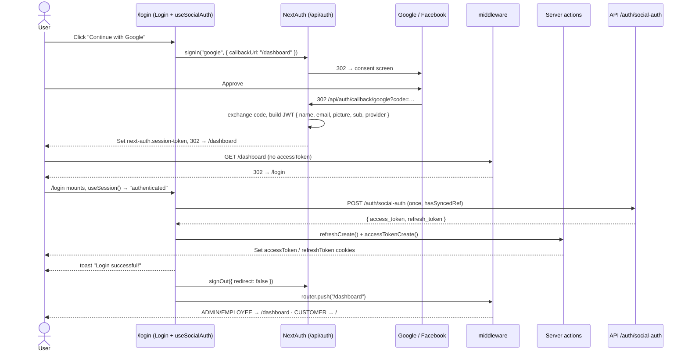
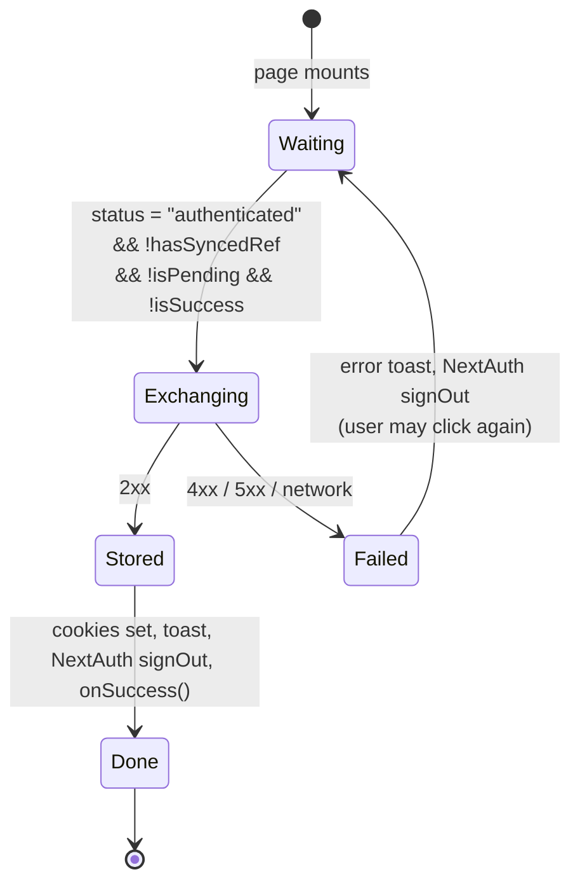

# Third-Party Login (Google & Facebook) — Frontend Technical Documentation

> **Scope:** everything the Natura Care client (Next.js 15, App Router) does to sign a visitor in with **Google** or **Facebook**: the buttons on `/login` and `/create-account`, the NextAuth OAuth round-trip, the exchange of the provider identity for the app's own JWT (`POST /auth/social-auth`), how accounts are created or linked, where the user lands, how the session behaves afterwards, and how social accounts appear in the admin and customer screens.
>
> **Audience:** frontend engineers joining or maintaining the project. Also useful to QA, DevOps (OAuth app setup, env vars) and backend engineers who own the other half of the contract.
>
> **Related:** [Project README](../README.md) (run, build, Docker) · [Auth module](./auth.md) (email login, signup + OTP, refresh, logout — this doc expands its [§8](./auth.md#8-social-sign-in-google--facebook)) · [User module](./user.md) (roles, profile, admin user management) · [Coding conventions](../claude-docs/basic-instructions.md)

| | |
|---|---|
| **Module root** | [`src/modules/auth/`](../src/modules/auth/) (hook, config, service) |
| **Storefront routes** | `/login` (Google + Facebook) · `/create-account` (Google) |
| **OAuth handler** | `/api/auth/[...nextauth]` → [`route.ts`](../src/app/api/auth/[...nextauth]/route.ts) |
| **Library** | `next-auth` **v4** (`^4.24.13`), JWT session strategy, no database adapter |
| **Backend endpoint** | `POST /auth/social-auth` on `NEXT_PUBLIC_API_BASE_URL` (e.g. `https://api.naturacarebd.com/n-care/api/v1`) |
| **Providers** | `google`, `facebook` (backend enum also has `APPLE`, not wired on the client) |
| **Roles** | Creates `CUSTOMER`s; signs in existing `ADMIN` / `EMPLOYEE` / `CUSTOMER` by email |
| **Last reviewed** | 2026-10-24 |

---

## Table of Contents

1. [Overview](#1-overview)
2. [Tech Stack](#2-tech-stack)
3. [File Architecture](#3-file-architecture)
4. [Routes & Access Control](#4-routes--access-control)
   - [4.1 Routes](#41-routes)
   - [4.2 Role matrix](#42-role-matrix)
   - [4.3 Middleware rules that matter here](#43-middleware-rules-that-matter-here)
5. [Architecture: Two Sessions, One Source of Truth](#5-architecture-two-sessions-one-source-of-truth)
6. [End-to-End Workflow](#6-end-to-end-workflow)
   - [6.1 From the Login page](#61-from-the-login-page)
   - [6.2 From the Create Account page](#62-from-the-create-account-page)
   - [6.3 `useSocialAuth` state machine](#63-usesocialauth-state-machine)
   - [6.4 Where the user lands](#64-where-the-user-lands)
7. [NextAuth Configuration](#7-nextauth-configuration)
8. [Token Exchange: `POST /auth/social-auth`](#8-token-exchange-post-authsocial-auth)
   - [8.1 Request mapping](#81-request-mapping)
   - [8.2 Response and tokens](#82-response-and-tokens)
9. [Account Creation & Linking (Business Logic)](#9-account-creation--linking-business-logic)
10. [Storefront UI](#10-storefront-ui)
11. [Admin & Account Screens](#11-admin--account-screens)
12. [Session After Sign-in: Refresh & Logout](#12-session-after-sign-in-refresh--logout)
13. [Error Handling & Edge Cases](#13-error-handling--edge-cases)
14. [API Reference](#14-api-reference)
15. [Types](#15-types)
16. [Constants & Configuration](#16-constants--configuration)
    - [16.1 Environment variables](#161-environment-variables)
    - [16.2 OAuth app setup (Google / Meta)](#162-oauth-app-setup-google--meta)
    - [16.3 Cookies](#163-cookies)
17. [Hooks](#17-hooks)
18. [Services, Server Actions & Utilities](#18-services-server-actions--utilities)
19. [Reusable Components](#19-reusable-components)
20. [Business Rules Summary](#20-business-rules-summary)
21. [Security Considerations](#21-security-considerations)
22. [Known Issues & Technical Debt](#22-known-issues--technical-debt)
23. [How-To Recipes & Troubleshooting](#23-how-to-recipes--troubleshooting)

---

## 1. Overview

Social sign-in lets a visitor skip the email + password + OTP flow and authenticate with an account they already have.

| Audience | Where | What happens |
|---|---|---|
| **New visitor** | `/login` or `/create-account` → **Continue with Google / Facebook** | Provider consent → a new **active, email-verified `CUSTOMER`** is created → signed in → home page. No OTP. |
| **Returning social user** | `/login` | Matched by email or provider id → signed in. |
| **Existing email/password user** | `/login` → Google/Facebook with the **same email** | Signed in to the existing account. The account keeps `authProvider: EMAIL` and its password still works. |
| **Admin / Employee** | `/login` → Google with their staff email | Signed in with their staff role → `/dashboard`. |
| **Admin** | `/all-users`, `/profile` | Sees how each account signs in ("via Google"), the provider account id, and that social accounts have no password. |

Key design decisions:

- **NextAuth is a bridge, not the session.** NextAuth only completes the OAuth handshake. Its identity is immediately swapped for the backend's own JWT pair, and the NextAuth session is then signed out. Every guard in the app (middleware, axios interceptor, `useCurrentUser`) reads only the `accessToken` cookie ([§5](#5-architecture-two-sessions-one-source-of-truth)).
- **One hook does the exchange.** [`useSocialAuth`](../src/modules/auth/hooks/useSocialAuth.ts) watches `useSession()`; the moment NextAuth reports `authenticated`, it posts the identity to `/auth/social-auth`, stores the tokens and signs NextAuth out. Any page used as an OAuth `callbackUrl` must mount this hook.
- **Sign-in and sign-up are the same call.** The backend upserts by email **or** provider id, so the Login page's buttons also register new users ([§9](#9-account-creation--linking-business-logic)).
- **The backend owns account rules.** The client sends what the provider returned; role, status, linking and token lifetimes are decided server-side.
- **No database adapter.** NextAuth uses its default JWT strategy; nothing about the OAuth account is stored by NextAuth itself. The only persistent record is the backend `User` row (`authProvider`, `providerId`).

[↑ Back to top](#table-of-contents)

---

## 2. Tech Stack

| Concern | Library | Notes |
|---|---|---|
| Framework | Next.js 15.5 (App Router), React 19 | OAuth endpoints are a Route Handler under `app/api/auth/[...nextauth]`. |
| OAuth | `next-auth` v4 | `GoogleProvider`, `FacebookProvider`; `signIn` / `signOut` / `useSession` from `next-auth/react`. |
| Session context | `SessionProvider` | Wrapped by [`NextAuthProvider`](../src/providers/NextAuthProvider.tsx) in [`app/layout.tsx`](../src/app/layout.tsx). |
| Token exchange | `@tanstack/react-query` v5 `useMutation` | Inside `useSocialAuth`. |
| HTTP | `axios` (shared instance) | [`axiosInstance.ts`](../src/lib/axios/axiosInstance.ts): unwraps the `{ statusCode, success, message, data }` envelope; lists `/auth/social-auth` as a credential endpoint. |
| Cookie writes | Next.js Server Actions (`"use server"`) | [`auth.actions.ts`](../src/modules/auth/actions/auth.actions.ts) → `cookies().set(...)`. |
| JWT decoding | `jwt-decode` v4 | Middleware decodes `role` / `exp`; never verifies the signature. |
| Toasts | `sonner` | "Login successful!" / error message. |
| Icons | `react-icons` | `FcGoogle`, `FaFacebook`. |

[↑ Back to top](#table-of-contents)

---

## 3. File Architecture

Social login is part of the **auth** feature module. `src/app` holds routing only; logic lives in `src/modules/auth/`.

```text
natura-care-client/
├── src/
│   ├── middleware.ts                              # Signed in = accessToken cookie only (NextAuth cookie ignored)
│   │
│   ├── app/
│   │   ├── layout.tsx                             # <QueryProvider><NextAuthProvider>…</NextAuthProvider></QueryProvider>
│   │   ├── api/auth/[...nextauth]/route.ts        # NextAuth(authOptions) → GET + POST handlers
│   │   └── (public)/(auth)/
│   │       ├── login/page.tsx                     # → modules/auth/public/login/Login
│   │       └── create-account/page.tsx            # → modules/auth/public/create-account/CreateAccount
│   │
│   ├── providers/
│   │   └── NextAuthProvider.tsx                   # "use client" <SessionProvider>
│   │
│   ├── modules/auth/
│   │   ├── config/auth.config.ts                  # authOptions: providers, jwt/session callbacks, pages.signIn
│   │   ├── hooks/
│   │   │   ├── useSocialAuth.ts                   # NextAuth session → POST /auth/social-auth → cookies → signOut
│   │   │   └── useAuth.ts                         # Email/password twin (same token storage)
│   │   ├── services/
│   │   │   ├── auth-api.service.ts                # authService.socialLogin(data)
│   │   │   └── auth.service.ts                    # logout(), endExpiredSession(), getUserInfo()
│   │   ├── actions/auth.actions.ts                # Server actions: accessTokenCreate / refreshCreate / *Delete
│   │   ├── constants/auth.constants.ts            # authKey = "accessToken", refreshKey = "refreshToken"
│   │   ├── utils/session.utils.ts                 # getUserSession() → getServerSession(authOptions) (unused)
│   │   ├── types/next-auth.d.ts                   # Session.user.role augmentation (legacy, never populated)
│   │   └── public/
│   │       ├── login/Login.tsx                    # Google + Facebook buttons
│   │       └── create-account/CreateAccount.tsx   # Google button
│   │
│   ├── modules/user/
│   │   ├── types/user.types.ts                    # IUser.authProvider, IUser.providerId
│   │   ├── admin/user.columns.tsx                 # "via Google" under the phone column
│   │   ├── admin/ViewUser.tsx                     # "Signs In With", "Provider Account ID"
│   │   ├── admin/profile/Profile.tsx              # Hides password change for social accounts
│   │   └── customer/AccountInformation.tsx        # Reuses Profile (variant="customer")
│   │
│   ├── components/
│   │   ├── primitives/CustomNavDropdown.tsx       # Navbar logout (app cookies + NextAuth signOut)
│   │   └── layout/sidebar/CustomerSidebar.tsx     # My Account logout (same sequence)
│   │
│   ├── lib/axios/axiosInstance.ts                 # CREDENTIAL_ENDPOINTS includes /auth/social-auth
│   └── config/env.config.ts                       # NEXTAUTH_*, GOOGLE_*, FACEBOOK_* env bindings
```

**Backend counterpart** (`natura-care-server`, for reference):

| File | Role |
|---|---|
| `src/modules/auth/auth.controller.ts` → `socialAuth` | `POST /auth/social-auth`, sets an `httpOnly` refresh cookie on the API domain, returns the envelope. |
| `src/modules/auth/auth.service.ts` → `socialLogin` | Upserts the user, signs the token pair. |
| `src/modules/auth/dto/social-auth.dto.ts` | `SocialAuthDto` validation. |
| `src/modules/user/user.service.ts` → `upsertSocialUser` | Create/link rules ([§9](#9-account-creation--linking-business-logic)). |
| `src/modules/user/user.repository.ts` → `upsertByEmailOrProviderId` | Transactional `findFirst(email OR providerId)` → update or create. |

[↑ Back to top](#table-of-contents)

---

## 4. Routes & Access Control

### 4.1 Routes

| Route | Kind | Guarded by middleware? | Purpose |
|---|---|:-:|---|
| `/login` | Page, `(public)/(auth)` | ✅ (`PUBLIC_ROUTES`, `AUTH_ROUTES`) | Google + Facebook buttons; mounts `useSocialAuth`. |
| `/create-account` | Page, `(public)/(auth)` | ✅ (`PUBLIC_ROUTES`) | Google button; mounts `useSocialAuth`. |
| `/api/auth/signin/:provider` | NextAuth | ❌ (matcher excludes `api`) | Starts OAuth (CSRF-checked POST from `signIn()`). |
| `/api/auth/callback/:provider` | NextAuth | ❌ | Provider redirects here; NextAuth sets its session cookie and redirects to `callbackUrl`. |
| `/api/auth/session` | NextAuth | ❌ | Polled by `useSession()`. |
| `/api/auth/signout` | NextAuth | ❌ | Called by `signOut()`. |
| `/api/auth/csrf`, `/api/auth/providers` | NextAuth | ❌ | Internals used by `signIn()`. |

The middleware matcher is `/((?!api|_next/static|_next/image|favicon.ico|.*\\.).*)`, so **every `/api/auth/*` request bypasses role checks** — required, since the user has no app JWT yet during OAuth.

### 4.2 Role matrix

| Action | Guest | CUSTOMER | EMPLOYEE | ADMIN |
|---|:-:|:-:|:-:|:-:|
| See social buttons on `/login`, `/create-account` | ✅ | ❌ redirected to `/my-account`¹ | ❌ → `/dashboard`¹ | ❌ → `/dashboard`¹ |
| Create an account via Google/Facebook | ✅ (always `CUSTOMER`) | — | — | — |
| Sign in via Google/Facebook to an existing account | ✅ | — | ✅ (role kept) | ✅ (role kept) |
| See an account's sign-in method / provider id | — | own (`/my-account/account-information`) | own (`/profile`) | everyone (`/all-users`) |

¹ The middleware's `AUTH_ROUTES` is `["/login", "/signup"]`, so a signed-in user is bounced off `/login` but **can still open `/create-account`** ([auth.md TD-10](./auth.md#23-known-issues--technical-debt)).

### 4.3 Middleware rules that matter here

[`src/middleware.ts`](../src/middleware.ts):

```ts
// We ONLY treat the user as logged in when our own backend accessToken exists.
// NextAuth's session cookie is a temporary bridge and must NOT count.
let isLoggedIn = !!accessToken;
```

1. **NextAuth cookie ≠ logged in.** If the NextAuth cookie counted, a user mid-OAuth would be redirected away from `/login` and the exchange would never run.
2. **`/dashboard` without `accessToken` → `/login`.** This is what bounces the OAuth callback from `/dashboard` back to `/login`, where `useSocialAuth` is mounted ([§6.1](#61-from-the-login-page)).
3. **After the exchange, the role decides the landing page** ([§6.4](#64-where-the-user-lands)).
4. The middleware only **decodes** the JWT; the API verifies it on every request.

[↑ Back to top](#table-of-contents)

---

## 5. Architecture: Two Sessions, One Source of Truth

```mermaid
flowchart LR
  subgraph Browser
    BTN["Continue with Google / Facebook"]
    HOOK["useSocialAuth<br/>(Login / CreateAccount)"]
  end
  subgraph Next["Next.js server"]
    NA["NextAuth<br/>/api/auth/*"]
    SA["Server actions<br/>accessTokenCreate / refreshCreate"]
  end
  PROV["Google / Facebook"]
  API["Natura Care API<br/>POST /auth/social-auth"]

  BTN -->|signIn(provider)| NA
  NA <-->|OAuth 2.0 code flow| PROV
  NA -->|"next-auth.session-token cookie<br/>(identity only)"| HOOK
  HOOK -->|"{ email, firstName, providerId, provider, image }"| API
  API -->|"{ access_token, refresh_token }"| HOOK
  HOOK --> SA
  SA -->|"accessToken + refreshToken cookies<br/>(the real session)"| Browser
  HOOK -->|"signOut({ redirect: false })"| NA
```

| | NextAuth session | App session |
|---|---|---|
| Cookie | `next-auth.session-token` (`__Secure-` prefix on HTTPS), `httpOnly`, encrypted with `NEXTAUTH_SECRET` | `accessToken`, `refreshToken` (JS-readable) |
| Contains | Provider identity: name, email, image, `sub`, `provider` | Backend JWT: `{ sub: userId, email, role, exp }` |
| Lifetime | Seconds — from callback until `useSocialAuth` signs it out | Until expiry / logout ([§12](#12-session-after-sign-in-refresh--logout)) |
| Read by | `useSession()` (Login, CreateAccount, `CustomNavDropdown` name fallback) | Middleware, axios interceptor, `useCurrentUser`, `useUser`, cart, navbar |
| Authorizes API calls? | **No** | **Yes** (`Authorization: Bearer <accessToken>`) |

Why this design: the backend already owns users, roles and JWTs for email login. Using NextAuth only as an OAuth client keeps one session model for every sign-in method, and keeps provider secrets on the Next server instead of the API.

[↑ Back to top](#table-of-contents)

---

## 6. End-to-End Workflow

### 6.1 From the Login page

[`Login.tsx`](../src/modules/auth/public/login/Login.tsx):

```ts
const handleSocialLogin = (provider: "google" | "facebook") => {
  signIn(provider, { callbackUrl: "/dashboard", redirect: true });
};

const { isPending: isSocialLoginPending } = useSocialAuth(() => {
  router.push("/dashboard");
});
```



Step notes:

1. `signIn()` fetches `/api/auth/csrf`, then POSTs to `/api/auth/signin/google`; the browser does a **full-page redirect** to the provider.
2. On return, NextAuth's `jwt` callback copies `account.provider` onto the token; the `session` callback exposes it ([§7](#7-nextauth-configuration)).
3. `callbackUrl: "/dashboard"` is deliberately a protected route: the middleware sends the user back to `/login`, which is where the hook lives. The detour costs one redirect.
4. `Login` also has an effect that calls `router.push("/dashboard")` as soon as `status === "authenticated"`. It fires **before** the tokens exist, so the middleware bounces it back to `/login`. Harmless but noisy ([TD-11](#22-known-issues--technical-debt)).

### 6.2 From the Create Account page

[`CreateAccount.tsx`](../src/modules/auth/public/create-account/CreateAccount.tsx):

```ts
const { isPending: isSocialSyncing } = useSocialAuth(() => {
  router.push("/dashboard");
});

const handleGoogleSignup = () => {
  signIn("google", { callbackUrl: window.location.href, redirect: false });
};
```

- Only **Google** is offered here.
- `callbackUrl` is the current page (`/create-account`), which is public, so the user returns straight to the page that mounts the hook — no middleware detour.
- `redirect: false` has **no effect for OAuth providers** in NextAuth v4 (it only applies to `credentials` / `email`); the browser still navigates to Google.
- The hook is declared before the `step === "otp"` early return, so it runs whatever step the form is on.
- From here on the flow is identical to [§6.1](#61-from-the-login-page) (exchange → cookies → `signOut` → `/dashboard` → role routing).

### 6.3 `useSocialAuth` state machine



| Guard | Why |
|---|---|
| `hasSyncedRef` (set in `onSuccess` **and** `onError`) | The effect depends on `session` and the `mutation` object, both of which change identity on re-render. Without the ref the exchange could fire repeatedly. |
| `!mutation.isPending && !mutation.isSuccess` | Second guard for the same reason, before the ref is set. |
| `signOut({ redirect: false })` on both paths | Success: the app JWT is now the session. Failure: a stale NextAuth session would otherwise re-trigger the exchange on every mount. |

The ref resets on unmount. If the page remounts while NextAuth is still `authenticated` (e.g. a hard reload during the exchange), a second exchange can run; it is idempotent on the backend (same upsert), so the only symptom is a second toast.

### 6.4 Where the user lands

Both pages call `router.push("/dashboard")` after the exchange; the middleware corrects it by role:

| Role in the new `accessToken` | `/dashboard` | Final page |
|---|---|---|
| `ADMIN` | allowed | `/dashboard` |
| `EMPLOYEE` | allowed (`EMPLOYEE_ROUTES`) | `/dashboard` |
| `CUSTOMER` (every new social user) | admin route → redirect | `/` (home) |

There is no return-to: a customer who started from checkout's "Log in" link lands on `/`, not back on `/check-out` ([auth.md TD-4](./auth.md#23-known-issues--technical-debt)).

[↑ Back to top](#table-of-contents)

---

## 7. NextAuth Configuration

[`src/modules/auth/config/auth.config.ts`](../src/modules/auth/config/auth.config.ts):

```ts
export const authOptions = {
  providers: [
    GoogleProvider({ clientId: GOOGLE_CLIENT_ID, clientSecret: GOOGLE_CLIENT_SECRET }),
    FacebookProvider({ clientId: FACEBOOK_CLIENT_ID, clientSecret: FACEBOOK_CLIENT_SECRET }),
  ],
  secret: NEXTAUTH_SECRET,
  callbacks: {
    async jwt({ token, account }) {
      if (account) token.provider = account.provider;   // "google" | "facebook" (first sign-in only)
      return token;
    },
    async session({ session, token }) {
      (session as any).token = token;                    // raw JWT exposed to the client
      session.provider = token.provider;
      session.sub = token.sub;                           // provider account id
      return session;
    },
  },
  pages: { signIn: "/login" },
};
```

| Option | Value | Effect |
|---|---|---|
| `providers` | Google, Facebook (default scopes: `openid email profile` / `email`) | Provider ids `"google"` / `"facebook"` are what `signIn()` takes. |
| Session strategy | default **`jwt`** (no adapter) | Nothing is written to a database by NextAuth. |
| `callbacks.jwt` | copies `account.provider` | `account` is only present on the sign-in request, so the provider is set exactly once. |
| `callbacks.session` | adds `provider`, `sub`, `token` | `useSocialAuth` reads `session.provider` and `session.token.sub`. |
| `pages.signIn` | `/login` | NextAuth's built-in sign-in page is never shown; sign-in errors redirect to `/login?error=<Code>` ([TD-S1](#22-known-issues--technical-debt)). |
| `secret` | `NEXTAUTH_SECRET` | Encrypts the session cookie; must be identical across server instances. |

Module augmentation (in the same file): `Session.provider?`, `Session.sub?`, `JWT.provider?`.

**Session shape the hook receives:**

```ts
{
  user: { name: "Samiha Rahman", email: "samiha@gmail.com", image: "https://lh3.googleusercontent.com/…" },
  provider: "google",
  sub: "1029384756…",            // Google "sub" / Facebook user id
  token: { name, email, picture, sub, provider, iat, exp, jti },
  expires: "2026-11-23T…"
}
```

Route handler — [`app/api/auth/[...nextauth]/route.ts`](../src/app/api/auth/[...nextauth]/route.ts):

```ts
const handler = NextAuth(authOptions);
export { handler as GET, handler as POST };
```

[↑ Back to top](#table-of-contents)

---

## 8. Token Exchange: `POST /auth/social-auth`

Called by [`authService.socialLogin`](../src/modules/auth/services/auth-api.service.ts) through the shared `axiosInstance`.

### 8.1 Request mapping

| DTO field | Validation (`SocialAuthDto`) | Client source | Client fallback |
|---|---|---|---|
| `email` | `@IsEmail`, required | `session.user.email` | none — `!` assertion ([§13](#13-error-handling--edge-cases)) |
| `firstName` | `@IsString`, required | `session.user.name` (**full** display name) | `"User"` |
| `lastName` | optional | **never sent** | backend stores `""` |
| `providerId` | `@IsString`, required | `session.token.sub` | `session.user.email` |
| `provider` | `@IsEnum(AuthProvider)` — `EMAIL \| GOOGLE \| FACEBOOK \| APPLE` | `session.provider.toUpperCase()` | `"GOOGLE"` |
| `image` | optional string | `session.user.image` | `""` |

Example body:

```json
{
  "email": "samiha@gmail.com",
  "firstName": "Samiha Rahman",
  "providerId": "1029384756123456789",
  "provider": "GOOGLE",
  "image": "https://lh3.googleusercontent.com/a/…"
}
```

### 8.2 Response and tokens

Envelope from the API (`sendResponse`); the axios interceptor unwraps `data`, so the hook receives `{ access_token, refresh_token }`:

```json
{
  "statusCode": 200,
  "success": true,
  "message": "Login successful",
  "data": { "access_token": "eyJ…", "refresh_token": "eyJ…" }
}
```

| Token | Payload | Lifetime | Signed with |
|---|---|---|---|
| `access_token` | `{ sub: userId, email, role }` | **15 minutes** (hard-coded) | `JWT_SECRET` |
| `refresh_token` | `{ sub, email, role }` | **7 days** (hard-coded) | `JWT_SECRET` ⚠️ — `/auth/refresh` verifies with `JWT_REFRESH_SECRET` |

The mismatch means **a social session cannot be refreshed** and ends about 15 minutes after sign-in ([TD-S0 / auth.md TD-1](#22-known-issues--technical-debt)). Email login uses `generateTokens()` with the configured 30d/30d lifetimes.

The controller also sets its own `refreshToken` cookie (`httpOnly`, `sameSite: strict`, `secure` in production) on the **API** domain. The client ignores it; it stores both tokens on the site domain via server actions and sends the refresh token in the request body.

Any exception in the service is rethrown as **400 Bad Request** with the original message.

[↑ Back to top](#table-of-contents)

---

## 9. Account Creation & Linking (Business Logic)

`upsertSocialUser` → `upsertByEmailOrProviderId` runs in one Prisma transaction:

```text
existing = user WHERE email = dto.email OR providerId = dto.providerId
if existing  → UPDATE { lastLoginAt: now }               (nothing else changes)
else         → CREATE { email, firstName, lastName: "", name, providerId,
                        authProvider: dto.provider, profileImageUrl: dto.image,
                        status: ACTIVE, emailVerified: true, emailVerifiedAt: now,
                        role: CUSTOMER, lastLoginAt: now }
```

| Situation | Result | Account afterwards |
|---|---|---|
| Email not registered, provider id unknown | **New account created** | `CUSTOMER`, `ACTIVE`, email verified, `authProvider = GOOGLE/FACEBOOK`, Google/Facebook photo as profile image, no password |
| Same email signed up with password earlier | **Linked silently** — signed in to that account | Unchanged: still `authProvider = EMAIL`, password still works, `providerId` **not** stored |
| Same email, account is staff | Signed in with **staff role** | Unchanged |
| Same email, account `PENDING_VERIFICATION` / `SUSPENDED` / `INACTIVE` | Signed in anyway — status is **not checked** | Unchanged (still not verified) |
| Returning Google user who later signs in with Facebook (same email) | Signed in to the same account | `authProvider` stays `GOOGLE` |
| Provider id matches but email changed at the provider | Signed in to the old account | Email **not** updated |
| User changed name/photo at the provider | Signed in | Name / photo **not** refreshed |

Consequences for the frontend:

- Social sign-in **is** sign-up; no separate "register with Google" path is needed (the Create Account button exists for discoverability).
- A social-only account has **no password**: password change is hidden ([§11](#11-admin--account-screens)) and the API rejects `change-password` and password login ("Password not set for this account").
- Because the OTP step is skipped, social users never see `PENDING_VERIFICATION`.
- Status and linking rules are backend decisions; see [TD-S0…S2](#22-known-issues--technical-debt) for the gaps.

[↑ Back to top](#table-of-contents)

---

## 10. Storefront UI

| Element | `/login` | `/create-account` |
|---|---|---|
| Divider | "Or continue with", below the email form | "Or continue with", below the signup form |
| Google button | `FcGoogle` + "Continue with Google" | `FcGoogle` + "Sign up with Google" |
| Facebook button | `FaFacebook` (`text-blueSecondary-500`) + "Continue with Facebook" | — |
| Pending state | **Both** buttons disabled; both labels read "Logging in..." | Button disabled; label "Syncing..." |
| Pending source | `useSocialAuth().isPending` (the API exchange only — not the provider round-trip, which is a full page navigation) | same |

Button styling (shared Tailwind classes, not a component): `h-11 w-full border border-neutralPrimary-300 bg-white rounded-lg … focus-visible:ring-4 focus-visible:ring-greenPrimary-500/20 disabled:opacity-60`.

Feedback:

| Event | Toast |
|---|---|
| Exchange succeeded | `toast.success("Login successful!")` |
| Exchange failed | `toast.error(message)` — `error.message` → `error.errorMessages` → `error.response.data.message` → "Social Login failed" |
| User cancelled at Google/Facebook, or OAuth error | **none** — user lands on `/login?error=…` ([TD-S1](#22-known-issues--technical-debt)) |
| Session expired later | `toast.info("Your session has expired. Please log in again.")` (Login reads `?sessionExpired=1`) |

Accessibility: both are real `<button type="button">` elements with visible text and focus rings. Icons are decorative.

[↑ Back to top](#table-of-contents)

---

## 11. Admin & Account Screens

Social accounts are visible but never managed separately; they are ordinary `IUser` rows.

| Screen | File | What it shows |
|---|---|---|
| **Users list** (`/all-users`, ADMIN) | [`user.columns.tsx`](../src/modules/user/admin/user.columns.tsx) | "via Google" / "via Facebook" / "via Email & password" under each user's phone (`PROVIDER_LABELS`). |
| **View user** modal | [`ViewUser.tsx`](../src/modules/user/admin/ViewUser.tsx) | Stat tile **Signs In With** + hint "No password; social login". **Security & Access** section: *Sign-in Method* and, for non-email accounts, a copyable monospace **Provider Account ID** (`providerId`). |
| **My Profile** (`/profile`, ADMIN/EMPLOYEE) | [`Profile.tsx`](../src/modules/user/admin/profile/Profile.tsx) | Password row reads "Not available for social sign-in" and has no **Change** button when `authProvider !== "EMAIL"`. *Sign-in method* row via `formatEnumString`. |
| **Account Details** (`/my-account/account-information`, CUSTOMER) | [`AccountInformation.tsx`](../src/modules/user/customer/AccountInformation.tsx) | Renders `<Profile variant="customer" />`, so the same password rule applies. |
| **Navbar avatar** | [`CustomNavDropdown.tsx`](../src/components/primitives/CustomNavDropdown.tsx) | `profileImageUrl` (the Google/Facebook photo for new social users); initial falls back to `session.user.name` while NextAuth still has a session. |

`PROVIDER_LABELS` is duplicated in `user.columns.tsx` and `ViewUser.tsx`:

```ts
const PROVIDER_LABELS: Record<IUser["authProvider"], string> = {
  EMAIL: "Email & password", GOOGLE: "Google", FACEBOOK: "Facebook", APPLE: "Apple",
};
```

There is no admin filter by sign-in method and no way to unlink a provider from the UI.

[↑ Back to top](#table-of-contents)

---

## 12. Session After Sign-in: Refresh & Logout

After the exchange, a social user's session is **the same mechanism** as an email user's ([auth.md §11](./auth.md#11-session-lifecycle-refresh-expiry--logout)):

1. Every request sends `Authorization: Bearer <accessToken>`.
2. A 401 outside `CREDENTIAL_ENDPOINTS` (`/auth/login`, `/auth/social-auth`) triggers one `POST /auth/refresh`.
3. If refresh fails → `endExpiredSession()` → cookies cleared → `/login?sessionExpired=1`.

For social users step 3 currently always happens once the 15-minute access token expires (see [§8.2](#82-response-and-tokens)).

**Logout** clears both sessions, app first:

```ts
// CustomerSidebar.tsx
await logout("/login");                                  // delete cookies, window.location → /login
await signOut({ callbackUrl: "/login", redirect: true }); // clear any leftover NextAuth cookie
```

`CustomNavDropdown` does the same but calls `logout()` with its default `/` redirect, so the two navigations race ([auth.md TD-9](./auth.md#23-known-issues--technical-debt)). Logout never contacts Google/Facebook: the user stays signed in **at the provider**, so the next "Continue with Google" usually skips the consent screen.

[↑ Back to top](#table-of-contents)

---

## 13. Error Handling & Edge Cases

| Case | What happens | Where |
|---|---|---|
| User clicks **Cancel** on the consent screen | NextAuth redirects to `/login?error=OAuthCallback` (or similar). No toast; the user sees the plain login page. | NextAuth → `pages.signIn` |
| Facebook account has no email (phone-only) / user declines the email permission | `session.user.email` is `undefined` → DTO validation fails → **400** → error toast; NextAuth signed out. | `SocialAuthDto` |
| `NEXTAUTH_URL` / redirect URI mismatch | Provider shows "redirect_uri_mismatch" (Google) or "URL blocked" (Meta); the app is never reached. | OAuth app config ([§16.2](#162-oauth-app-setup-google--meta)) |
| Missing `GOOGLE_*` / `FACEBOOK_*` / `NEXTAUTH_SECRET` at runtime | NextAuth errors on `/api/auth/*`; user lands on `/login?error=…` or a 500. | Container env |
| API down / timeout (60 s) | Error toast; NextAuth signed out; user can retry. | `useSocialAuth.onError` |
| API returns 400 for any reason | Error toast with the server message. Not treated as session expiry because `/auth/social-auth` is a credential endpoint. | `axiosInstance` |
| Staff member signs in with Google | Gets their staff role → `/dashboard`. | Backend upsert |
| Suspended account signs in with Google | **Succeeds** (no status check). Later refreshes would fail on status, but refresh is already broken for social tokens. | [TD-S2](#22-known-issues--technical-debt) |
| Page reloaded during the exchange | Hook remounts; may exchange again (idempotent); possible duplicate toast. | `hasSyncedRef` scope |
| User already signed in opens `/create-account` and clicks Google | Exchange runs and **replaces** the current tokens with the social account's. | `AUTH_ROUTES` gap |
| Admin/Employee had a guest cart before signing in | `useLocalCart` clears it for staff (same as email login). | [cart.md](./cart.md) |

[↑ Back to top](#table-of-contents)

---

## 14. API Reference

| Method | Endpoint | Caller | Body | Returns |
|---|---|---|---|---|
| `POST` | `/auth/social-auth` | `useSocialAuth` → `authService.socialLogin` | `{ email, firstName, lastName?, providerId, provider, image? }` | `{ access_token, refresh_token }` (unwrapped) |
| `POST` | `/auth/refresh` | `getNewAccessToken()` (interceptor) | `{ refreshToken }` | new pair — fails for social tokens today |

NextAuth (same origin as the site, not the API):

| Method | Endpoint | Caller |
|---|---|---|
| `GET` | `/api/auth/csrf`, `/api/auth/providers` | `signIn()` |
| `POST` | `/api/auth/signin/:provider` | `signIn()` |
| `GET` | `/api/auth/callback/:provider` | Google / Facebook redirect |
| `GET` | `/api/auth/session` | `useSession()` (on mount, window focus) |
| `POST` | `/api/auth/signout` | `signOut()` |

Error shape after the interceptor (`IGenericErrorResponse`):

```ts
{ statusCode: number; message: string; errorMessages: string }
```

[↑ Back to top](#table-of-contents)

---

## 15. Types

| Type | File | Definition / notes |
|---|---|---|
| `authService.socialLogin` param | [`auth-api.service.ts`](../src/modules/auth/services/auth-api.service.ts) | `{ email: string; firstName: string; lastName?: string; providerId: string; provider: string; image?: string }` — `provider` is a plain `string`, not the enum. |
| `Session` augmentation | [`auth.config.ts`](../src/modules/auth/config/auth.config.ts) | `provider?: string; sub?: string` |
| `JWT` augmentation | [`auth.config.ts`](../src/modules/auth/config/auth.config.ts) | `provider?: string` |
| `Session.user.role` augmentation | [`next-auth.d.ts`](../src/modules/auth/types/next-auth.d.ts) | Legacy; never populated. |
| `IUser.authProvider` | [`user.types.ts`](../src/modules/user/types/user.types.ts) | `"EMAIL" \| "GOOGLE" \| "FACEBOOK" \| "APPLE"` |
| `IUser.providerId` | [`user.types.ts`](../src/modules/user/types/user.types.ts) | `string \| null` — Google `sub` / Facebook id; `null` for email accounts. |
| Backend `AuthProvider` | `natura-care-server/prisma/schema/user.prisma` | `EMAIL`, `GOOGLE`, `FACEBOOK`, `APPLE` |

`useSocialAuth` reads `session.token` and `session.provider` through `as any` casts; a typed helper would remove them ([TD-S6](#22-known-issues--technical-debt)).

[↑ Back to top](#table-of-contents)

---

## 16. Constants & Configuration

| Constant | File | Value / purpose |
|---|---|---|
| `authKey` / `refreshKey` | [`auth.constants.ts`](../src/modules/auth/constants/auth.constants.ts) | `"accessToken"` / `"refreshToken"` cookie names |
| `CREDENTIAL_ENDPOINTS` | [`axiosInstance.ts`](../src/lib/axios/axiosInstance.ts) | `["/auth/login", "/auth/social-auth"]` — a 401 here is an answer, not a dead session |
| `AUTH_ROUTES` | [`middleware.ts`](../src/middleware.ts) | `["/login", "/signup"]` |
| `PROVIDER_LABELS` | `user.columns.tsx`, `ViewUser.tsx` | Display names for `authProvider` |
| Provider ids | `signIn()` calls | `"google"`, `"facebook"` |

### 16.1 Environment variables

All are **server-runtime** values (not `NEXT_PUBLIC_*`), bound in [`env.config.ts`](../src/config/env.config.ts). Changing them needs a restart, not a rebuild.

| Variable | Used by | Notes |
|---|---|---|
| `NEXTAUTH_URL` | NextAuth (reads `process.env` directly) | Public site origin; callback URLs are built from it. `env.config.ts` also exports it with a `https://naturacarebd.com/` fallback, but nothing imports that constant, so NextAuth gets no fallback. |
| `NEXTAUTH_SECRET` | `authOptions.secret` | Long random string; same on every instance. |
| `GOOGLE_CLIENT_ID`, `GOOGLE_CLIENT_SECRET` | `GoogleProvider` | Google Cloud → APIs & Services → Credentials → OAuth client (Web). |
| `FACEBOOK_CLIENT_ID`, `FACEBOOK_CLIENT_SECRET` | `FacebookProvider` | Meta for Developers → App → Settings → Basic (App ID / App Secret). |

Present in `.env.development`, `.env.qa` and `.env.production`. Development uses personal/office test OAuth apps and production uses the client's, so the IDs differ **on purpose**. In Docker, runtime values come from the backend repo's `deploy/env/client.prod.env` ([README › Docker](../README.md#docker)).

> `GOOGLE_CLIENT_EMAIL` / `GOOGLE_PRIVATE_KEY` are the **GA Data API** service account for the admin analytics page — unrelated to sign-in despite the name.

### 16.2 OAuth app setup (Google / Meta)

Register these redirect URIs for every environment:

```text
{NEXTAUTH_URL}/api/auth/callback/google
{NEXTAUTH_URL}/api/auth/callback/facebook
```

| Provider | Also required |
|---|---|
| Google | Authorized JavaScript origin = `NEXTAUTH_URL`; OAuth consent screen published (in "Testing" only listed test users can sign in). |
| Meta | Facebook Login product added; **App Domains** = site domain; `email` and `public_profile` permissions; app in **Live** mode for real users; HTTPS required for production redirect URIs. |

### 16.3 Cookies

| Cookie | Set by | Domain | Flags | Cleared by |
|---|---|---|---|---|
| `next-auth.session-token` / `__Secure-next-auth.session-token` | NextAuth callback | site | `httpOnly`, `sameSite=lax` | `signOut()` in `useSocialAuth` and logout |
| `next-auth.csrf-token`, `next-auth.callback-url` | NextAuth | site | `httpOnly` | — (harmless) |
| `accessToken`, `refreshToken` | `accessTokenCreate` / `refreshCreate` server actions | site | none (JS-readable, browser-session) | `logout()` |
| `refreshToken` | API controller | API domain | `httpOnly`, `sameSite=strict` | — (ignored by the client) |

[↑ Back to top](#table-of-contents)

---

## 17. Hooks

### Module hooks

| Hook | File | Signature | Notes |
|---|---|---|---|
| `useSocialAuth` | [`useSocialAuth.ts`](../src/modules/auth/hooks/useSocialAuth.ts) | `(onSuccess?: () => void) => UseMutationResult` | Auto-runs; you never call `mutate` yourself. Use `isPending` for button state. Must be mounted on every OAuth `callbackUrl` page. |
| `useAuth` | [`useAuth.ts`](../src/modules/auth/hooks/useAuth.ts) | `(onSuccess?) => UseMutationResult` | Email/password twin; same token storage. |

Usage:

```tsx
"use client";
import { signIn } from "next-auth/react";
import { useRouter } from "next/navigation";
import { useSocialAuth } from "@/modules/auth/hooks/useSocialAuth";

export function GoogleButton() {
  const router = useRouter();
  const { isPending } = useSocialAuth(() => router.push("/dashboard"));

  return (
    <button
      type="button"
      disabled={isPending}
      onClick={() => signIn("google", { callbackUrl: window.location.href })}
    >
      {isPending ? "Logging in..." : "Continue with Google"}
    </button>
  );
}
```

### Shared hooks used

| Hook | From | Used for |
|---|---|---|
| `useSession` | `next-auth/react` | Detect the OAuth identity (`status`, `data`). |
| `useMutation` | `@tanstack/react-query` | The exchange. |
| `useCurrentUser` | user module | After sign-in: name, photo, `authProvider`. |

[↑ Back to top](#table-of-contents)

---

## 18. Services, Server Actions & Utilities

| Function | File | Purpose |
|---|---|---|
| `authService.socialLogin(data)` | [`auth-api.service.ts`](../src/modules/auth/services/auth-api.service.ts) | `axiosInstance.post("/auth/social-auth", data)` → returns `response.data` (unwrapped tokens). |
| `accessTokenCreate(token)` / `refreshCreate(token)` | [`auth.actions.ts`](../src/modules/auth/actions/auth.actions.ts) | Server actions writing the cookies (no `maxAge`, no `secure`). |
| `accessTokenDelete()` / `refreshDelete()` | same | Used by `logout()`. |
| `logout(redirectTo = "/")` | [`auth.service.ts`](../src/modules/auth/services/auth.service.ts) | Clears cookies, full reload. Latched against parallel calls. |
| `endExpiredSession()` | same | `logout("/login?sessionExpired=1")` when credentials exist. |
| `getUserSession()` | [`session.utils.ts`](../src/modules/auth/utils/session.utils.ts) | `getServerSession(authOptions)` — unused. |
| `signIn`, `signOut`, `useSession` | `next-auth/react` | OAuth start, NextAuth teardown, session read. |

[↑ Back to top](#table-of-contents)

---

## 19. Reusable Components

| Component | File | Role in social login |
|---|---|---|
| `NextAuthProvider` | [`providers/NextAuthProvider.tsx`](../src/providers/NextAuthProvider.tsx) | `SessionProvider` for the whole tree; required for `useSession`. |
| `CustomNavDropdown` | [`components/primitives/CustomNavDropdown.tsx`](../src/components/primitives/CustomNavDropdown.tsx) | Avatar from `profileImageUrl`; logout clears both sessions. |
| `CustomerSidebar` | [`components/layout/sidebar/CustomerSidebar.tsx`](../src/components/layout/sidebar/CustomerSidebar.tsx) | My Account logout (same sequence). |
| `Profile` | [`modules/user/admin/profile/Profile.tsx`](../src/modules/user/admin/profile/Profile.tsx) | Hides password change for social accounts; shows sign-in method. |
| `ViewUser` | [`modules/user/admin/ViewUser.tsx`](../src/modules/user/admin/ViewUser.tsx) | Shows provider and provider account id to admins. |

The social buttons are **inline JSX** in `Login` and `CreateAccount`, not a shared component. A `SocialLoginButtons` component (provider list + `isPending`) would remove the duplication and make TD-18 a one-line fix.

[↑ Back to top](#table-of-contents)

---

## 20. Business Rules Summary

| # | Rule | Enforced in |
|---|---|---|
| SL-1 | A user is signed in only when a decodable `accessToken` cookie exists; the NextAuth session never authorizes anything. | `middleware.ts`, `axiosInstance` |
| SL-2 | The NextAuth session is ended right after the token exchange, success or failure. | `useSocialAuth` |
| SL-3 | One exchange per NextAuth session per page mount. | `hasSyncedRef` + mutation state |
| SL-4 | Social sign-in creates an `ACTIVE`, email-verified `CUSTOMER` on first use — no OTP. | API `upsertSocialUser` |
| SL-5 | An existing account with the same email (or provider id) is signed in as-is; only `lastLoginAt` changes. Role, provider, name and photo are kept. | API `upsertByEmailOrProviderId` |
| SL-6 | Social sign-in never creates staff; staff are made by promoting a customer in `/all-users`. | API (`role: CUSTOMER`) |
| SL-7 | Social-only accounts have no password; the UI hides password change and the API rejects password login. | `Profile`, API |
| SL-8 | After sign-in, `ADMIN`/`EMPLOYEE` land on `/dashboard`, `CUSTOMER` on `/`. | `router.push("/dashboard")` + middleware |
| SL-9 | Every page used as an OAuth `callbackUrl` must mount `useSocialAuth` (directly or via a middleware redirect). | Convention |
| SL-10 | Google and Facebook are offered on `/login`; only Google on `/create-account`. | `Login`, `CreateAccount` |
| SL-11 | Logout clears app cookies and the NextAuth cookie, but not the provider's own session. | `logout()` + `signOut()` |

[↑ Back to top](#table-of-contents)

---

## 21. Security Considerations

- **Trust in the provider's email.** Linking by email (SL-5) means whoever controls the Google/Facebook account for an email controls the Natura Care account with that email — including **staff** accounts. Google only issues verified emails; Facebook emails are confirmed but not explicitly flagged as verified in the token. Consider requiring `email_verified` (Google profile) and blocking social sign-in for staff, or requiring a password re-auth before first linking.
- **The client posts the identity, the API trusts it.** `/auth/social-auth` accepts `{ email, providerId }` without verifying an ID token from Google/Facebook. **Anyone who can call the API directly can obtain tokens for any email.** This is the most serious gap in the flow; the fix belongs in the backend (verify a Google ID token / Facebook access token server-side, or have the Next server sign the request) ([TD-S3](#22-known-issues--technical-debt)).
- **Session object exposure.** `callbacks.session` attaches the raw NextAuth JWT to the client session, and `useSocialAuth` logs the whole session with `console.log`. No provider access tokens are included (the `jwt` callback does not copy them), but the log should go.
- **Tokens are JS-readable cookies** with no `secure` / `sameSite` from the server actions ([auth.md TD-12](./auth.md#23-known-issues--technical-debt)).
- **CSRF on OAuth start** is handled by NextAuth (`next-auth.csrf-token` double-submit + `state` parameter).
- **Secrets** (`*_CLIENT_SECRET`, `NEXTAUTH_SECRET`) are server-only; never prefix them with `NEXT_PUBLIC_`.

[↑ Back to top](#table-of-contents)

---

## 22. Known Issues & Technical Debt

Ordered by impact. **(BE)** = fix belongs in `natura-care-server`. Items shared with the auth module keep their auth.md numbers.

| # | Issue | Impact | Suggested fix |
|---|---|---|---|
| TD-S0 = [auth TD-1](./auth.md#23-known-issues--technical-debt) | **(BE)** Social tokens are signed with `JWT_SECRET` and hard-coded 15m/7d; `/auth/refresh` verifies with `JWT_REFRESH_SECRET`. | Social users are signed out ~15 minutes after signing in. | Use `generateTokens(payload)` in `socialLogin`, as `login` does. |
| TD-S3 | **(BE)** `/auth/social-auth` trusts the posted email/providerId without verifying a provider token. | Account takeover by direct API call. | Send the Google `id_token` / Facebook `access_token` from the NextAuth `jwt` callback and verify it server-side; or sign the payload on the Next server. |
| TD-S2 = [auth TD-14](./auth.md#23-known-issues--technical-debt) | **(BE)** No status check on social sign-in. | Suspended / pending accounts can sign in. | Reject non-`ACTIVE` users in `socialLogin`. |
| TD-S1 | `/login` ignores `?error=` from NextAuth. | Cancelled consent or OAuth misconfiguration fails silently. | Read `error` like `sessionExpired` and toast a friendly message ("Sign-in was cancelled", "Could not sign in with Google"). |
| TD-11 (auth) | `Login` pushes `/dashboard` when NextAuth turns `authenticated`, before tokens exist. | Extra redirect / flicker. | Delete that effect; `useSocialAuth.onSuccess` already navigates. |
| TD-S4 | `firstName` receives the full display name; `lastName` is never sent. | New users get `firstName = "Samiha Rahman"`, `lastName = ""`. | Split `session.user.name`, or pass Google's `given_name` / `family_name` via the `jwt` callback (`profile`). |
| TD-S5 | Existing accounts are not enriched on social sign-in (no `providerId`, photo or provider stored). | Admin "Provider Account ID" is empty for linked email accounts; staff can't tell how they actually sign in. | **(BE)** Optionally set `providerId` / `profileImageUrl` when empty. |
| TD-S6 | `as any` casts for `session.token` / `session.provider`; `provider` typed as `string`; `providerId` falls back to email. | Type safety; a missing `sub` silently becomes the email. | Use the augmented `session.sub` / `session.provider`; type `provider` as `IUser["authProvider"]`; fail loudly if `sub` is missing. |
| TD-S7 | `session.user.email!` assertion. | Phone-only Facebook users get a raw validation toast. | Check email before mutating; show "Your Facebook account has no email — please use another method". |
| TD-18 (auth) | Facebook missing on `/create-account`. | Inconsistent. | Extract `SocialLoginButtons` and use it on both pages. |
| TD-10 (auth) | `AUTH_ROUTES` lacks `/create-account`. | Signed-in users can social-sign-in again and swap accounts. | Replace `/signup` with `/create-account`. |
| TD-S8 | `useSocialAuth.ts` contains a full commented-out copy of itself and `console.log("session : ", session)` / `console.log("provider : ", …)`; `Login` logs too. | Noise; identity data in the console. | Delete. |
| TD-S9 | No post-login return-to; customers always land on `/`. | Lost context (e.g. checkout). | Pass a safe same-origin `callbackUrl` through and route by decoded role. |

[↑ Back to top](#table-of-contents)

---

## 23. How-To Recipes & Troubleshooting

### Run social login locally

1. `.env.development` must have `NEXTAUTH_URL=http://localhost:3000`, `NEXTAUTH_SECRET`, and the dev `GOOGLE_*` / `FACEBOOK_*` credentials.
2. The dev OAuth apps must list `http://localhost:3000/api/auth/callback/google` (and `/facebook`). Meta allows `http://localhost` only in development mode.
3. Start the API (`http://localhost:5001/n-care/api/v1`), then `yarn dev` ([README](../README.md#compile-and-run-the-project)).

### Add a provider (e.g. Apple)

1. Add the provider to `authOptions.providers`, and its env vars to [`env.config.ts`](../src/config/env.config.ts) and every `.env*` / `client.prod.env`.
2. Register `{NEXTAUTH_URL}/api/auth/callback/apple` with the provider.
3. Confirm the provider id upper-cases to a backend `AuthProvider` value (`apple` → `APPLE` ✅). Otherwise map it explicitly in `useSocialAuth`.
4. Add the button to `Login` (and `CreateAccount`) calling `signIn("apple", { callbackUrl })`, where `callbackUrl` is a page that mounts `useSocialAuth`.
5. Add the label to both `PROVIDER_LABELS` maps if it is new.

### Start social sign-in from a new page

Mount `useSocialAuth` on the page **and** use that page (or one the middleware redirects to it) as `callbackUrl`. If the callback page does not mount the hook, the user is left with only a NextAuth cookie and is **not** signed in.

### Read how the current user signs in

```ts
const { currentUserData } = useCurrentUser();
const isSocial = currentUserData?.authProvider !== "EMAIL";
```

Do not use `useSession()` for this; the NextAuth session is gone after sign-in.

### Troubleshooting

| Symptom | Likely cause | Check |
|---|---|---|
| Back on `/login` after Google with no toast | Consent cancelled or OAuth error (TD-S1) | URL `?error=`; server logs for `[next-auth][error]` |
| `redirect_uri_mismatch` at Google | `NEXTAUTH_URL` or registered URI differs (trailing slash, http vs https, `www`) | Google Cloud → Credentials |
| "Login successful!" then sent to login ~15 min later with "session expired" | TD-S0 | `POST /auth/refresh` → 400 "Invalid refresh token" |
| Toast "email must be an email" after Facebook | No email on the Facebook account (TD-S7) | Facebook account settings / granted permissions |
| Signed in at Google but still a guest | Callback page doesn't mount `useSocialAuth`, or the exchange failed | Network tab for `/auth/social-auth`; `next-auth.session-token` still present |
| Works locally, fails in Docker | Runtime env missing in `client.prod.env`, or `NEXTAUTH_URL` points at the wrong origin | `docker compose exec client env \| grep -E "NEXTAUTH\|GOOGLE\|FACEBOOK"` |
| Facebook works for you but not for customers | Meta app still in Development mode | Meta dashboard → App Mode = Live |
| Google user shown as "via Email & password" in admin | They signed up with a password first; linking keeps `EMAIL` (SL-5) | Expected behavior |

[↑ Back to top](#table-of-contents)
