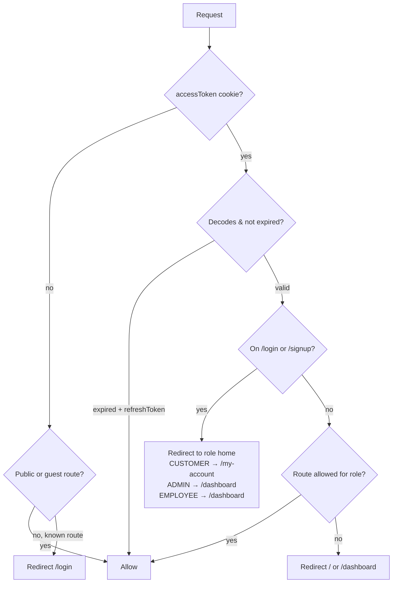
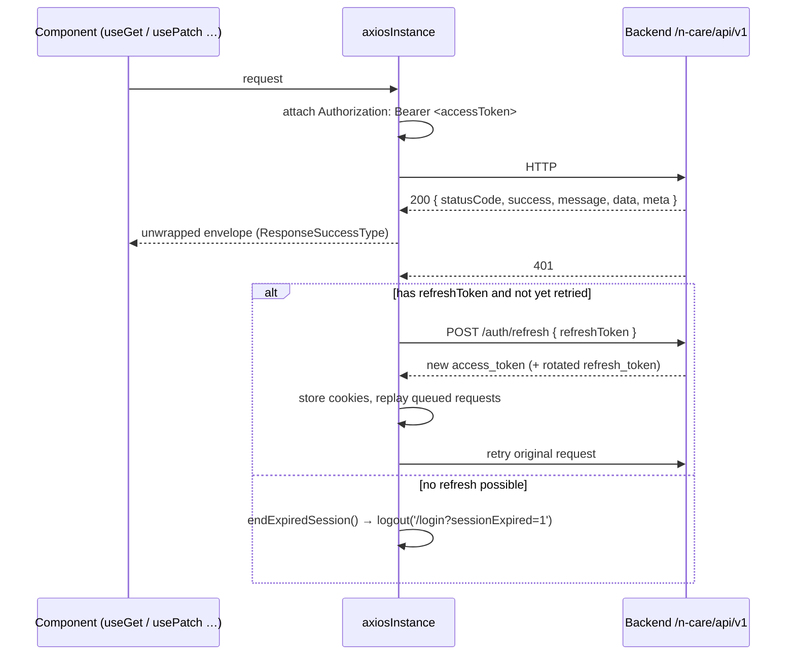
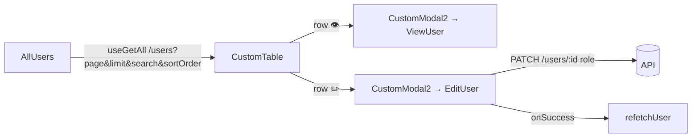
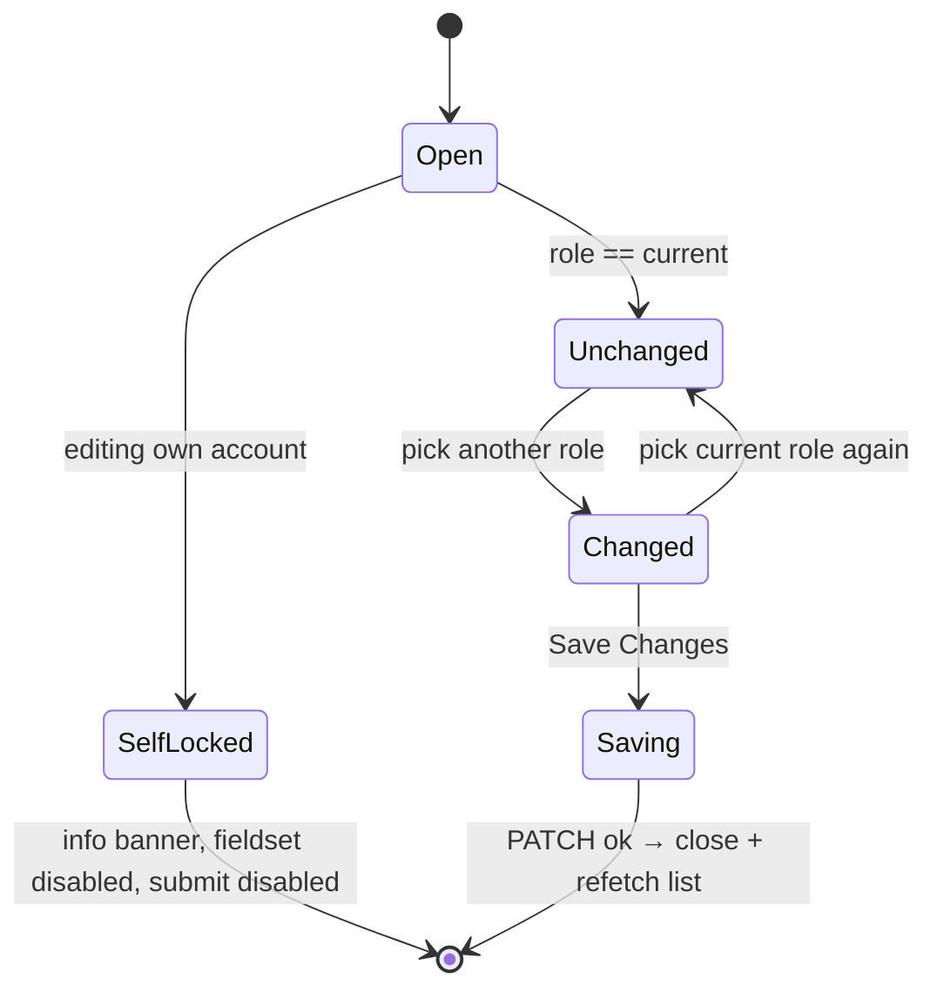
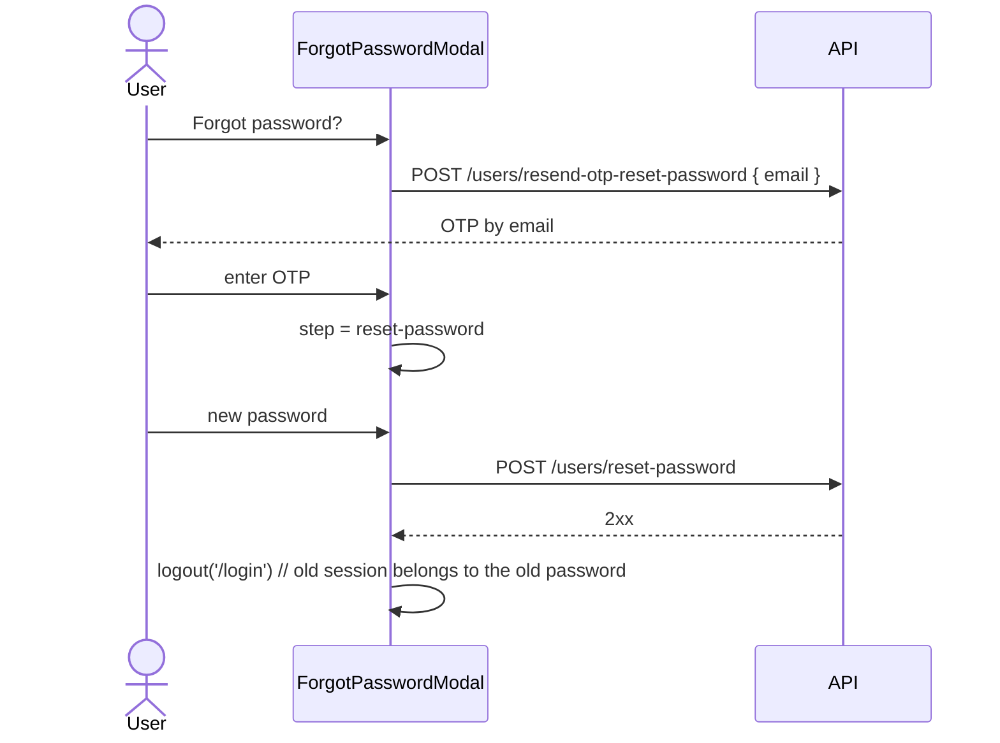

# User Module — Frontend Technical Documentation

> **Scope:** everything the Natura Care client (Next.js 15, App Router) does with **users**: admin user management, the admin/staff profile, the customer "My Account" area, and the auth/session plumbing those screens depend on.
>
> **Audience:** frontend engineers joining or maintaining the project.
>
> **Related:** [Project README](../README.md) (run, build, Docker) · [Analytics / GTM concepts](./concepts/) · [Coding conventions](../claude-docs/basic-instructions.md)

| | |
|---|---|
| **Module root** | [`src/modules/user/`](../src/modules/user/) (+ [`src/modules/account/`](../src/modules/account/) for the customer shell) |
| **Routes** | `/all-users`, `/profile` (admin route group) · `/my-account/**` (customer route group) |
| **Backend resource** | `/users` on `NEXT_PUBLIC_API_BASE_URL` (e.g. `https://api.naturacarebd.com/n-care/api/v1`) |
| **Roles** | `ADMIN`, `EMPLOYEE`, `CUSTOMER` |
| **Last reviewed** | 2026-10-24 |

---

## Table of Contents

1. [Overview](#1-overview)
2. [Tech Stack Used by This Module](#2-tech-stack-used-by-this-module)
3. [File Architecture](#3-file-architecture)
4. [Routing & Access Control](#4-routing--access-control)
5. [Authentication & Session Workflow](#5-authentication--session-workflow)
6. [Identifying the Current User](#6-identifying-the-current-user)
7. [Admin Section — User Management (`/all-users`)](#7-admin-section--user-management-all-users)
   - [7.1 User list](#71-user-list)
   - [7.2 View user](#72-view-user)
   - [7.3 Edit user (role change)](#73-edit-user-role-change)
8. [Admin Section — My Profile (`/profile`)](#8-admin-section--my-profile-profile)
9. [Customer Section — My Account (`/my-account`)](#9-customer-section--my-account-my-account)
   - [9.1 Layout shell](#91-layout-shell)
   - [9.2 Overview](#92-overview)
   - [9.3 Account Details](#93-account-details)
10. [Profile Edit Flows (shared by admin & customer)](#10-profile-edit-flows-shared-by-admin--customer)
    - [10.1 Edit personal information](#101-edit-personal-information)
    - [10.2 Change profile photo](#102-change-profile-photo)
    - [10.3 Change password / forgot password](#103-change-password--forgot-password)
11. [API Reference](#11-api-reference)
12. [Types](#12-types)
13. [Validation Schemas](#13-validation-schemas)
14. [Constants](#14-constants)
15. [Hooks](#15-hooks)
16. [Utilities](#16-utilities)
17. [Reusable Components](#17-reusable-components)
18. [Business Rules Summary](#18-business-rules-summary)
19. [Known Issues & Technical Debt](#19-known-issues--technical-debt)
20. [How-To Recipes](#20-how-to-recipes)

---

## 1. Overview

The user module covers three audiences on top of a single backend resource (`/users`):

| Audience | Where | What they can do |
|---|---|---|
| **Admin** | `/all-users` | List, search and paginate every user; open a detailed read-only profile; change a user's **role**. |
| **Admin & Employee** | `/profile` | Manage their own photo, name, phone and password. |
| **Customer** | `/my-account/**` | Account overview (orders, wishlist, address, setup checklist) and **Account Details**, which reuses the same profile screen as staff. |

Key design decisions:

- **One profile component, two variants.** [`Profile.tsx`](../src/modules/user/admin/profile/Profile.tsx) renders both the staff `/profile` page and the customer *Account Details* page (`variant="customer"` hides role/status badges).
- **The JWT is the source of identity; the API is the source of truth.** The user id is decoded from the `accessToken` cookie, then the full record is fetched from `GET /users/:id` (see [§6](#6-identifying-the-current-user)).
- **Route protection is done in [`middleware.ts`](../src/middleware.ts)** by decoding the JWT role; the API still enforces permissions server-side.
- **Account pages render client-only** because identity is only readable from a browser cookie (see [`AccountClientGate`](#91-layout-shell)).

[↑ Back to top](#table-of-contents)

---

## 2. Tech Stack Used by This Module

| Concern | Library | Notes |
|---|---|---|
| Framework | Next.js 15 (App Router), React 19 | Pages are thin wrappers that `dynamic()`-import the module component. |
| Server state | `@tanstack/react-query` v5 | Wrapped by in-house hooks in [`src/hooks/api/`](../src/hooks/api/). |
| HTTP | `axios` | Shared instance with auth header + refresh interceptor: [`src/lib/axios/axiosInstance.ts`](../src/lib/axios/axiosInstance.ts). |
| Forms | `react-hook-form` + `zod` (`@hookform/resolvers`) | Schemas in [`src/modules/user/schemas/`](../src/modules/user/schemas/). |
| Tables | `@tanstack/react-table` | Via [`CustomTable`](#17-reusable-components). |
| JWT | `jwt-decode`, `js-cookie` | Decoded both in middleware (edge) and in the browser. |
| Social sign-in | `next-auth` | Only a bridge to obtain the app's own JWT — not an app session. |
| Toasts | `sonner` | Fired automatically by the API hooks. |
| Icons | `lucide-react`, `react-icons/lu` | |
| Styling | Tailwind CSS v4, `tw-animate-css` | Brand tokens such as `greenPrimary-*`, `neutralPrimary-*`. |

[↑ Back to top](#table-of-contents)

---

## 3. File Architecture

The project uses a **feature-module** layout: `src/app` holds routing only; all logic and UI live in `src/modules/<feature>/`, split by audience (`admin/`, `customer/`, `public/`) and by kind (`hooks/`, `types/`, `schemas/`, `constants/`, `utils/`).

```text
natura-care-client/
├── src/
│   ├── middleware.ts                         # Role-based route guard (JWT decode at the edge)
│   │
│   ├── app/
│   │   ├── (admin)/                          # Admin/employee dashboard route group
│   │   │   ├── layout.tsx                    # AdminNavbar + AdminSidebar shell
│   │   │   ├── all-users/page.tsx            # → modules/user/admin/AllUsers
│   │   │   └── profile/page.tsx              # → modules/user/admin/profile/Profile
│   │   └── (customer)/                       # Customer route group
│   │       ├── layout.tsx                    # Navbar + AccountHero + AccountClientGate + CustomerSidebar
│   │       └── my-account/
│   │           ├── page.tsx                  # → modules/account/customer/AccountOverview
│   │           ├── account-information/      # → modules/user/customer/AccountInformation
│   │           ├── addresses/                # (address module)
│   │           ├── order/ , order/[id]/      # (order module)
│   │           └── wishlist/                 # (wishlist module)
│   │
│   ├── modules/
│   │   ├── user/
│   │   │   ├── admin/
│   │   │   │   ├── AllUsers.tsx              # User list page (table + view/edit modals)
│   │   │   │   ├── user.columns.tsx          # TanStack column defs + UserAvatar + badge maps
│   │   │   │   ├── ViewUser.tsx              # Read-only user detail modal
│   │   │   │   ├── EditUser.tsx              # Role-change modal
│   │   │   │   └── profile/
│   │   │   │       ├── Profile.tsx           # Shared profile screen (admin | customer variant)
│   │   │   │       ├── EditPersonalInfo.tsx  # Name + phone form
│   │   │   │       ├── EditProfilePhoto.tsx  # Photo upload / remove
│   │   │   │       └── ChangePassword.tsx    # Password change + forgot-password escape hatch
│   │   │   ├── customer/
│   │   │   │   └── AccountInformation.tsx    # <Profile variant="customer" />
│   │   │   ├── hooks/
│   │   │   │   ├── useCurrentUser.ts         # JWT id → GET /users/:id, role flags
│   │   │   │   └── useUser.ts                # JWT payload only (no request)
│   │   │   ├── schemas/
│   │   │   │   ├── profile.schema.ts         # Personal info + password zod schemas
│   │   │   │   └── user.schema.ts            # Legacy, unused (see §19)
│   │   │   ├── types/user.types.ts           # IUser
│   │   │   ├── constants/user.constants.ts   # userRoles (legacy, unused)
│   │   │   └── utils/user.utils.ts           # timeAgo, initialsOf, isSignInLocked
│   │   │
│   │   ├── account/                          # Customer "My Account" shell
│   │   │   ├── constants/account-nav.constants.ts  # ACCOUNT_NAV, isNavItemActive, accountPageTitle
│   │   │   └── customer/
│   │   │       ├── AccountClientGate.tsx     # Client-only render + skeleton
│   │   │       ├── AccountHero.tsx           # Banner + breadcrumb driven by pathname
│   │   │       ├── AccountOverview.tsx       # Dashboard home for customers
│   │   │       └── AccountUI.tsx             # AccountCard, EmptyPanel, button classes, OrderStatusBadge
│   │   │
│   │   └── auth/                             # Login, signup, OTP, forgot password, session
│   │       ├── services/auth.service.ts      # getUserInfo, logout, endExpiredSession, refresh
│   │       ├── actions/auth.actions.ts       # Server actions that set/delete token cookies
│   │       ├── constants/auth.constants.ts   # authKey / refreshKey cookie names
│   │       └── public/forgot-password/       # ForgotPasswordModal, ResetPasswordForm
│   │
│   ├── components/
│   │   ├── layout/sidebar/AdminSidebar.tsx   # Profile card + role-filtered menu
│   │   ├── layout/sidebar/CustomerSidebar.tsx# Account nav with live badges + logout
│   │   ├── layout/navbar/Navbar.tsx          # Storefront navbar (role-aware)
│   │   ├── data-display/table/CustomTable.tsx
│   │   ├── primitives/ (ProfileAvatar, CustomTooltip, modal/CustomModal2, button/CancelButton …)
│   │   └── form/ (InputField, PasswordField, PhoneInputField, SubmitButton …)
│   │
│   ├── hooks/
│   │   ├── api/ (useGet, usePost, usePatch, useFormPatch …)
│   │   ├── table/useHandleModalState.ts
│   │   └── useHasMounted.ts
│   ├── lib/axios/axiosInstance.ts            # Auth header, envelope unwrapping, 401 → refresh
│   └── types/ (api/, ui/)                    # ApiResponse, IPaginationMeta, IModal, ICustomTable …
```

**Page convention.** Every page file only sets `metadata` and lazy-loads the module component with a full-page loader:

```tsx
// src/app/(admin)/all-users/page.tsx
const DynamicAllUsers = dynamic(() => import("@/modules/user/admin/AllUsers"), {
  loading: () => <LoadingPage />,
});
export default function AllUserPage() {
  return <DynamicAllUsers />;
}
```

[↑ Back to top](#table-of-contents)

---

## 4. Routing & Access Control

Access is enforced in [`src/middleware.ts`](../src/middleware.ts), which runs on every non-asset request, reads the `accessToken` cookie and decodes `{ exp, email, role }`.

### Route groups

| Constant | Routes (prefix match) | Who |
|---|---|---|
| `PUBLIC_ROUTES` | `/`, `/login`, `/product`, `/about-us`, `/contact-us`, `/create-account`, details pages, support policy pages … | Everyone |
| `CUSTOMER_ROUTES` | `/my-account` (covers every account page) | `CUSTOMER` only |
| `GUEST_CUSTOMER_ONLY_ROUTES` | `/my-cart`, `/check-out` | Guests and `CUSTOMER` |
| `ADMIN_ONLY_ROUTES` | `/dashboard`, `/analytics`, `/all-users`, `/profile`, `/promotions`, … | `ADMIN` (and `EMPLOYEE` for the subset below) |
| `EMPLOYEE_ROUTES` | `/dashboard`, `/products`, `/inventory`, `/order-list`, `/category`, `/profile` | `EMPLOYEE` |
| `AUTH_ROUTES` | `/login`, `/signup` | Signed-out users |

### Role matrix for this module

| Route | ADMIN | EMPLOYEE | CUSTOMER | Guest |
|---|:-:|:-:|:-:|:-:|
| `/all-users` | ✅ | ❌ → `/dashboard` | ❌ → `/` | ❌ → `/login` |
| `/profile` | ✅ | ✅ | ❌ → `/` | ❌ → `/login` |
| `/my-account/**` | ❌ → `/` | ❌ → `/dashboard` | ✅ | ❌ → `/login` |

### Decision flow



Notes:

- **Unknown paths fall through** to Next's not-found page instead of being redirected.
- **An expired access token with a refresh token is allowed through** so the axios interceptor can refresh it on the first API call ([§5](#5-authentication--session-workflow)).
- **Sidebar visibility mirrors the middleware.** [`AdminSidebar`](../src/components/layout/sidebar/AdminSidebar.tsx) shows only items flagged `employee: true` when `isUserEmployee`. Hiding a link is cosmetic; the middleware is the client-side guard and the API is the real one.

[↑ Back to top](#table-of-contents)

---

## 5. Authentication & Session Workflow

The user screens assume a valid app session. This is how it is created, kept alive and ended.

### Tokens and storage

| Cookie | Constant | Set by | Read by |
|---|---|---|---|
| `accessToken` | `authKey` | Server action `accessTokenCreate` + `document.cookie` after refresh | Middleware, axios request interceptor, `getUserInfo()` |
| `refreshToken` | `refreshKey` | Server action `refreshCreate` | `getNewAccessToken()` |

Both cookies are readable from JavaScript (they are not `httpOnly`); the client relies on that to decode the user id. NextAuth's own session cookie is **not** treated as an app session. It exists only during Google/Facebook sign-in, which trades it for the app JWT via `/auth/social-auth`.

### Request lifecycle



Behavior to know about ([`axiosInstance.ts`](../src/lib/axios/axiosInstance.ts)):

- **The response envelope is unwrapped.** Every intercepted call resolves to `{ statusCode, success, message, data, meta }` (the API's `sendResponse` shape), not the raw axios response.
- **Every 401 is treated as a dead session**, whatever its message, except on credential endpoints (`/auth/login`, `/auth/social-auth`). On those a 401 means the credentials were wrong.
- **Concurrent 401s share one refresh.** Requests queue behind the in-flight refresh and are rejected (not left hanging) if it fails.
- **Network failures** redirect to `/network-error` and reject with `statusCode: 503`.

### Logout

[`logout(redirectTo)`](../src/modules/auth/services/auth.service.ts) clears both cookies (client + server action) and the `localStorage` key, then does a **full page reload** to `redirectTo`. A module-level latch (`isEndingSession`) stops a burst of failing requests from triggering competing redirects. The sidebars and navbar call `logout()` first and then NextAuth's `signOut()`.

[↑ Back to top](#table-of-contents)

---

## 6. Identifying the Current User

Two hooks expose the signed-in user. Pick by need:

| Hook | Network | Returns | Use when |
|---|---|---|---|
| [`useUser()`](../src/modules/user/hooks/useUser.ts) | None | `{ userId, userInfo }` from the decoded JWT (`sub`, `email`, `role`) | You only need the id or role (e.g. building an endpoint, cart/wishlist guards). |
| [`useCurrentUser<T>()`](../src/modules/user/hooks/useCurrentUser.ts) | `GET /users/:id` | `{ currentUserData, isCurrentUserLoading, currentUserRefetch, userId, isUserAdmin, isUserEmployee }` | You need profile data (name, photo, status, verification) or authoritative role flags. |

```ts
// useCurrentUser — essentials
const { sub: userId } = getUserInfo() || {};
useGet<T>(`/users/${userId}`, [`getCurrentUser+${userId}`], undefined, !!userId);
```

- The query key is `getCurrentUser+<id>`. React Query **dedupes** it, so the many consumers (Navbar, both sidebars, Profile, AccountOverview, EditUser, checkout, product cards …) share one request and one cache entry.
- After a profile mutation, call **`currentUserRefetch()`**. That one refetch updates the profile page, the sidebar card and the navbar together.
- `isUserAdmin` / `isUserEmployee` come from the **fetched** record, not the JWT, so they are `false` while loading.
- The JWT is only readable in the browser. Anything that renders based on identity must wait for mount (`useHasMounted`) or sit inside `AccountClientGate`, or you get hydration mismatches.

[↑ Back to top](#table-of-contents)

---

## 7. Admin Section — User Management (`/all-users`)

**Entry:** [`AllUsers.tsx`](../src/modules/user/admin/AllUsers.tsx) · **Access:** `ADMIN` only · **Sidebar label:** "Users"



### 7.1 User list

**State** (local `useState`): `currentPage`, `pageSize` (default 10), `searchTerm`, `sortOrder`.

**Data:**

```ts
useGetAll<{ data: IUser[]; meta: IPaginationMeta }>(
  "/users",
  ["getAllUsers", String(currentPage), String(pageSize), searchTerm, sortOrder],
  { page, limit, search: searchTerm || undefined, sortOrder },
);
```

Every filter value is part of the query key, so a change in any of them triggers a refetch and the results for each combination are cached separately.

**Columns** ([`user.columns.tsx`](../src/modules/user/admin/user.columns.tsx), `getUserColumns(handleView, handleEdit)`):

| Column | Content | Logic |
|---|---|---|
| **User** | Avatar, name, email, verification icon | `UserAvatar` falls back to `initialsOf(name)` when there is no photo or it fails to load; ✅ `LuBadgeCheck` if `emailVerified`, ⚠️ `LuMailWarning` otherwise. |
| **Contact** | Phone (or "—"), "via Email/Google/…" | `PROVIDER_LABELS[authProvider]` |
| **Role** | Coloured badge | `USER_ROLE` map |
| **Status** | Status badge + optional **Locked** badge | `USER_STATUS` map; `isSignInLocked(user)` adds a lock badge with a "locked until" tooltip. |
| **Last Sign-in** | Relative + absolute time, or "Never" | `timeAgo(lastLoginAt)` |
| **Joined** | Date + relative time | `formatDay`, `timeAgo` |
| **Action** | View / Edit buttons | `CustomTooltip action="view" | "edit"` |

Search is server-side (name, email, and phone per the backend). Column sorting is disabled on every column (see [§19](#19-known-issues--technical-debt)).

**Modals** are driven by [`useHandleModalState<IUser>()`](../src/hooks/table/useHandleModalState.ts): `handleOpen("view" | "edit", row)` stores the row, `isOpen(type)` controls each `CustomModal2`, and `handleClose` clears both. Width and height constants keep the form modal clear of the fixed 5rem admin navbar.

### 7.2 View user

**Component:** [`ViewUser.tsx`](../src/modules/user/admin/ViewUser.tsx). Read-only and makes no network calls; it renders the row object passed from the table.

Sections:

1. **Hero:** avatar, name, verification badge, email (copyable), role and status pills (an `ACTIVE` pill pulses).
2. **Account notice:** the most important problem only, picked by `accountNotice(user, isLocked)` in this priority order:

   | Condition | Tone | Message |
   |---|---|---|
   | `lockedUntil` in the future | danger | Sign-in locked until … (too many failed attempts) |
   | `PENDING_VERIFICATION` | warning | Waiting for email OTP; cannot sign in |
   | `SUSPENDED` | danger | Cannot sign in or reset password until reactivated |
   | `INACTIVE` | danger | Cannot sign in until set active |
   | `ARCHIVED` | neutral | Kept for records only |

3. **Stat tiles:** *Member For* (`accountAge`), *Last Sign-in*, *Failed Sign-ins* (`loginAttempts`), *Signs In With*.
4. **Flags:** *Sign-in Access* (`status === "ACTIVE" && !locked`), *Email* verified, *Sign-in Lock*.
5. **Personal & Contact:** first and last name, email, phone, date of birth (with computed age via `ageFrom`), gender.
6. **Security & Access:** sign-in method, provider account id (social only), last sign-in IP, assigned IP, last sign-in, public id (`sid`, copyable).
7. **Bio** and an **audit trail** (Created, Last Updated, Email Verified).

### 7.3 Edit user (role change)

**Component:** [`EditUser.tsx`](../src/modules/user/admin/EditUser.tsx). The **only** field admins can change on another user is `role`.



Business rules:

- **No self-demotion or self-promotion.** `isSelf` compares `useCurrentUser().userId` with the row id. The fieldset and the submit button are disabled and a banner tells the admin to ask another admin. The backend must enforce this too; the UI check is a convenience.
- **Submit is enabled only when the role actually changed.** As a further guard, `onSubmit` shows "No changes detected!" if the role is unchanged.
- **Consequence preview.** `changeNotice(from, to)` explains the effect before saving:

  | Transition | Notice |
  |---|---|
  | any → `ADMIN` | Full dashboard access, including changing other users' roles |
  | any → `CUSTOMER` | Loses admin dashboard access |
  | `ADMIN` → `EMPLOYEE` | Keeps store access; loses users, promotions, content, settings |
  | `CUSTOMER` → `EMPLOYEE` | Gains products, categories, inventory, orders |

- **Request:** `usePatch` → `PATCH /users/:id` with JSON `{ role }`. On 2xx the modal closes and the list refetches.
- The dialog chrome comes from [`CategoryFormDialog`](../src/modules/category/admin/CategoryFormDialog.tsx), which is reused across admin modules.

> A role change takes full effect for the target user only after their **next token is issued**. The middleware reads `role` from the JWT, so an already signed-in user keeps their old route access until they refresh or sign in again. `useCurrentUser` flags update on the next fetch.

[↑ Back to top](#table-of-contents)

---

## 8. Admin Section — My Profile (`/profile`)

**Entry:** [`app/(admin)/profile/page.tsx`](../src/app/(admin)/profile/page.tsx) → [`Profile.tsx`](../src/modules/user/admin/profile/Profile.tsx) (default `variant="admin"`) · **Access:** `ADMIN`, `EMPLOYEE` · reached from the profile card at the top of `AdminSidebar` or from the navbar dropdown (`CustomNavDropdown`).

Layout:

| Block | Content |
|---|---|
| **Identity card** | Avatar with camera button (opens photo modal), name, **role and status badges (admin variant only)**, email, *Edit Profile* button. |
| **Activity strip** | Member since, last login (relative), last updated (relative); exact date on hover. |
| **Personal Information** | First name, last name, email (+ verified tick), phone. Empty last name or phone shows an inline **"+ Add …"** button that opens the edit modal. |
| **Security** | Password (Change button **only for `authProvider === "EMAIL"`**), sign-in method, email verification state. |
| **Profile completion** (sticky on `xl`) | Progress bar plus a checklist. Each unfinished step opens the modal that completes it. |

Profile completion is computed on the client:

| Step | Done when | Action |
|---|---|---|
| Add a profile photo | `profileImageUrl` | Photo modal |
| Add your full name | `firstName && lastName` | Personal info modal |
| Add a phone number | `phone` | Personal info modal |
| Verify your email | `emailVerified` | None (display only) |

`completionPercent = round(done / 4 × 100)`.

The three edit modals are described in [§10](#10-profile-edit-flows-shared-by-admin--customer). Each receives `currentUserRefetch` so the whole UI, sidebar included, updates after saving.

[↑ Back to top](#table-of-contents)

---

## 9. Customer Section — My Account (`/my-account`)

### 9.1 Layout shell

[`app/(customer)/layout.tsx`](../src/app/(customer)/layout.tsx):

```text
PromotionBar + Navbar (fixed)
AccountHero                ← title + breadcrumb from pathname (accountPageTitle)
AccountClientGate          ← renders children only after mount; skeleton before
 ├─ CustomerSidebar        ← ACCOUNT_NAV, live badges, logout
 └─ {page}
Footer
```

- **`robots: { index: false, follow: false }`.** Account pages are private and are also disallowed in `robots.ts`.
- **[`AccountClientGate`](../src/modules/account/customer/AccountClientGate.tsx)** uses `useHasMounted()`. Server rendering would produce a "signed-out" page that the browser then replaces, causing a hydration error, so these pages render client-only behind a skeleton of the same layout.
- **[`AccountHero`](../src/modules/account/customer/AccountHero.tsx)** builds the breadcrumb: Home → My Account → (My Orders →) current page.
- **[`CustomerSidebar`](../src/components/layout/sidebar/CustomerSidebar.tsx)** is a sticky card on desktop and horizontally scrolling pill tabs on phones. Badges: `activeOrders` from `useUserOrderSummary()` and `wishlist` from `useWishlistIds()`, capped at "99+". Logout calls `logout("/login")` then `signOut()`.

Navigation is data-driven by [`ACCOUNT_NAV`](../src/modules/account/constants/account-nav.constants.ts):

| Label | Route | Badge | Match |
|---|---|---|---|
| Overview | `/my-account` | — | exact |
| My Orders | `/my-account/order` | `activeOrders` | prefix |
| Wishlist | `/my-account/wishlist` | `wishlist` | prefix |
| Addresses | `/my-account/addresses` | — | prefix |
| Account Details | `/my-account/account-information` | — | prefix |

### 9.2 Overview

[`AccountOverview.tsx`](../src/modules/account/customer/AccountOverview.tsx) aggregates data from four modules:

| Data | Hook | Endpoint |
|---|---|---|
| User | `useCurrentUser()` | `GET /users/:id` |
| Order summary (totals, active, spent) | `useUserOrderSummary()` | `GET /order/user-order/summary` |
| Recent orders (3) | `useUserOrders({ page: 1, limit: 3 })` | `GET /order/user-order` |
| Wishlist | `useWishlist()` | `GET /wishlist` |
| Addresses / default | `useUserAddress()` | `GET /address/user/all-addresses` |

Blocks:

- **Welcome banner** with a time-based greeting (`Good morning/afternoon/evening, <firstName>`).
- **Stat tiles** that link through: Total orders, On the way (`/my-account/order?status=active`), Wishlist, Total spent (`formatBDT`).
- **Recent orders** (`OrderCard`) or an empty state with a shop CTA.
- **Account setup checklist.** This list differs from the profile one: it includes *Save a delivery address* and leaves out the full-name step. Unfinished steps link to the page that completes them.
- **Default address** and **wishlist preview**.

### 9.3 Account Details

[`AccountInformation.tsx`](../src/modules/user/customer/AccountInformation.tsx) is a one-liner:

```tsx
export default function AccountInformation() {
  return <Profile variant="customer" />;
}
```

It shows the same screen as [§8](#8-admin-section--my-profile-profile) with the title "Account Details" and **without role/status badges**. Every edit flow is identical.

[↑ Back to top](#table-of-contents)

---

## 10. Profile Edit Flows (shared by admin & customer)

All three open inside `CustomModal2` from `Profile.tsx`, and all close and call `currentUserRefetch()` on success.

### 10.1 Edit personal information

[`EditPersonalInfo.tsx`](../src/modules/user/admin/profile/EditPersonalInfo.tsx) · schema `updatePersonalInfoSchema` · `useFormPatch` → `PATCH /users/:id` (**multipart/form-data**)

The form sends **only changed fields**, and the rules below come from backend behavior:

| Rule | Why |
|---|---|
| Send `firstName` / `lastName` only if dirty | Minimal payload |
| When either name part changes, also send `name = "first last"` | The API stores `name` separately and never rebuilds it; without this the sidebar and navbar would keep the old name. |
| Send `phone` only if non-empty **and** different from the stored value | The API checks phone uniqueness **without excluding the current user**, so resending your own number returns 400. `""` fails the format check. |
| If nothing survives the filters, toast "No changes detected!" and close | Avoids an empty PATCH |

### 10.2 Change profile photo

[`EditProfilePhoto.tsx`](../src/modules/user/admin/profile/EditProfilePhoto.tsx) · `useFormPatch` → `PATCH /users/:id` (multipart)

- Client validation: `image/*` only, **max 2 MB** (`MAX_FILE_SIZE`, which matches the server limit).
- Preview uses `URL.createObjectURL`; blob URLs are revoked on replace, remove and unmount.
- Payload: `profileImage=<File>` to upload, **or** `removeProfileImage=true` to delete.

### 10.3 Change password / forgot password

[`ChangePassword.tsx`](../src/modules/user/admin/profile/ChangePassword.tsx) · schema `updatePasswordFormSchema` · `usePost` → `POST /users/change-password/:id` with `{ currentPassword, newPassword }`

- Offered only to **email/password accounts**. For social accounts the Security card shows "Not available for social sign-in", because the API rejects the call for them.
- Validation: new password at least 8 characters, must match the confirmation, and must differ from the current one.
- **"Forgot password?" escape hatch:** a user who no longer knows their current password cannot complete this form, so it opens [`ForgotPasswordModal`](../src/modules/auth/public/forgot-password/ForgotPasswordModal.tsx) prefilled with their email:



[↑ Back to top](#table-of-contents)

---

## 11. API Reference

Base URL: `NEXT_PUBLIC_API_BASE_URL` in the browser, `INTERNAL_API_BASE_URL` (falling back to the public URL) on the Next server. See [`env.config.ts`](../src/config/env.config.ts) and the [README](../README.md).

### User endpoints

| Method | Endpoint | Used by | Payload / Params | Hook |
|---|---|---|---|---|
| `GET` | `/users` | `AllUsers` | `page`, `limit`, `search?`, `sortOrder?` → `{ data: IUser[], meta: IPaginationMeta }` | `useGetAll` |
| `GET` | `/users/:id` | `useCurrentUser` (everything that shows the signed-in user) | — → `IUser` | `useGet` |
| `PATCH` | `/users/:id` | `EditUser` | JSON `{ role }` | `usePatch` |
| `PATCH` | `/users/:id` | `EditPersonalInfo` | multipart `firstName?`, `lastName?`, `name?`, `phone?` | `useFormPatch` |
| `PATCH` | `/users/:id` | `EditProfilePhoto` | multipart `profileImage` **or** `removeProfileImage=true` | `useFormPatch` |
| `POST` | `/users/change-password/:id` | `ChangePassword` | `{ currentPassword, newPassword }` | `usePost` |
| `POST` | `/users/resend-otp-reset-password` | `ForgotPasswordModal` | `{ email }` | `usePost` |
| `POST` | `/users/reset-password` | `ResetPasswordForm` | OTP + new password | `usePost` |

### Session endpoints (used indirectly)

| Method | Endpoint | Purpose |
|---|---|---|
| `POST` | `/auth/login` | Email/password sign-in (a 401 here means wrong credentials, not a dead session) |
| `POST` | `/auth/social-auth` | Exchange a Google/Facebook identity for the app JWT |
| `POST` | `/auth/refresh` | `{ refreshToken }` → new `access_token` (+ rotated `refresh_token`) |

### Customer overview endpoints (owned by other modules)

`GET /order/user-order`, `GET /order/user-order/summary`, `GET /order/user-order/:id`, `GET /wishlist`, `GET /wishlist/product-ids`, `POST /wishlist`, `DELETE /wishlist/:productId`, `GET /address/user/all-addresses`.

### Response & error shapes

```ts
// Success: axios interceptor output (src/types/api/response.types.ts)
interface ResponseSuccessType {
  statusCode: number; success: boolean; message: string;
  data: unknown; meta?: IMeta;
}

// Failure: normalized by toGenericError()
interface IGenericErrorResponse {
  statusCode: number; message: string; errorMessages: string[] | string;
}
```

Mutation hooks **toast automatically**: success shows `message`, a 4xx shows each message (arrays are split into separate toasts), and failures show `error.message`. Don't add your own toast for the same event.

[↑ Back to top](#table-of-contents)

---

## 12. Types

### `IUser` — [`user.types.ts`](../src/modules/user/types/user.types.ts)

| Field | Type | Notes |
|---|---|---|
| `id` | `number` | Internal id; equals JWT `sub`. |
| `sid` | `string` | Public id (shown in ViewUser). |
| `firstName`, `lastName` | `string` | |
| `name` | `string` | Stored full name; **must be sent explicitly** when name parts change. |
| `email` | `string` | Not editable from the UI. |
| `phone` | `string \| null` | Unique across users. |
| `authProvider` | `"EMAIL" \| "GOOGLE" \| "FACEBOOK" \| "APPLE"` | Controls password UI. |
| `providerId` | `string \| null` | Social account id. |
| `emailVerified`, `emailVerifiedAt` | `boolean`, `string \| null` | |
| `profileImageName`, `profileImageUrl` | `string \| null` | URL served from the API host (rendered with ``, not `next/image`). |
| `bio`, `dateOfBirth`, `gender` | optional | Displayed in ViewUser only. |
| `role` | `"ADMIN" \| "EMPLOYEE" \| "CUSTOMER"` | |
| `status` | `"ACTIVE" \| "INACTIVE" \| "SUSPENDED" \| "ARCHIVED" \| "PENDING_VERIFICATION"` | |
| `lastLoginAt`, `lastLoginIp`, `assignedIp` | `string \| null` | |
| `loginAttempts` | `number` | Failed sign-in counter. |
| `lockedUntil` | `string \| null` | Sign-in locked while this is in the future. |
| `createdAt`, `updatedAt` | `string` (ISO) | |

### Shared types used by this module

| Type | File | Purpose |
|---|---|---|
| `ApiResponse<T>` | [`types/api/pagination.types.ts`](../src/types/api/pagination.types.ts) | Typed mutation result (`usePatch`, `useFormPatch`). |
| `IPaginationMeta` | same | `currentPage`, `itemCount`, `itemsPerPage`, `totalItems`, `totalPages`. |
| `ResponseSuccessType`, `IGenericErrorResponse` | [`types/api/response.types.ts`](../src/types/api/response.types.ts) | Interceptor output / error. |
| `IModal` | [`types/ui/modal.types.ts`](../src/types/ui/modal.types.ts) | Props contract for modal content: `data`, `setOpen`, `onClose`, `refetch`, `isLoading`. |
| `ICustomModal2` | same | `CustomModal2` props. |
| `ICustomTable<T>` | [`types/ui/table.types.ts`](../src/types/ui/table.types.ts) | `CustomTable` props (server pagination/search callbacks). |
| `IAccountNavItem` | [`account-nav.constants.ts`](../src/modules/account/constants/account-nav.constants.ts) | Customer nav item. |
| `UserInfoByIdProps` | `types/api/response.types.ts` | **Legacy** user shape; prefer `IUser`. |

[↑ Back to top](#table-of-contents)

---

## 13. Validation Schemas

[`profile.schema.ts`](../src/modules/user/schemas/profile.schema.ts)

```ts
updatePersonalInfoSchema   // firstName: required, ≤100 · lastName: optional, ≤100 · phone: optional
updatePasswordFormSchema   // currentPassword: required
                           // newPassword: 8–255 chars
                           // confirmNewPassword: must equal newPassword
                           // newPassword must differ from currentPassword
```

Inferred types: `UpdatePersonalInfoFormData`, `UpdatePasswordFormData`. Phone format is enforced by `PhoneInputField` (`react-phone-number-input`) and by the API.

[`user.schema.ts`](../src/modules/user/schemas/user.schema.ts) (`userSchema`) is **unused legacy code**; see [§19](#19-known-issues--technical-debt).

[↑ Back to top](#table-of-contents)

---

## 14. Constants

| Constant | Location | Purpose |
|---|---|---|
| `USER_STATUS` | `user.columns.tsx` | Status → label, badge and dot classes (list). |
| `USER_ROLE` | `user.columns.tsx` | Role → label and badge classes (list). |
| `PROVIDER_LABELS` | `user.columns.tsx`, `ViewUser.tsx` | Auth provider display names. |
| `STATUS_STYLES`, `ROLE_STYLES`, `NOTICE_STYLES` | `ViewUser.tsx` | Detail modal styling. |
| `ROLE_OPTIONS` | `EditUser.tsx` | Role cards: id, name, description, icon, badge. |
| `MAX_FILE_SIZE` | `EditProfilePhoto.tsx` | 2 MB avatar limit. |
| `ACCOUNT_NAV` | `account-nav.constants.ts` | Customer sidebar/tabs definition. |
| `authKey` / `refreshKey` | [`auth.constants.ts`](../src/modules/auth/constants/auth.constants.ts) | Cookie names `accessToken` / `refreshToken`. |
| `PUBLIC_ROUTES`, `CUSTOMER_ROUTES`, `ADMIN_ONLY_ROUTES`, `EMPLOYEE_ROUTES`, … | [`middleware.ts`](../src/middleware.ts) | Route access lists. |
| `userRoles` | `user.constants.ts` | **Legacy, unused.** |

> Role colors are intended to match across the list, ViewUser, EditUser and Profile (Admin = blue, Employee = teal, Customer = neutral). If you change one, change them all, or better, consolidate them ([§19](#19-known-issues--technical-debt)).

[↑ Back to top](#table-of-contents)

---

## 15. Hooks

### Module hooks

| Hook | File | Summary |
|---|---|---|
| `useCurrentUser<T>()` | [`hooks/useCurrentUser.ts`](../src/modules/user/hooks/useCurrentUser.ts) | See [§6](#6-identifying-the-current-user). |
| `useUser()` | [`hooks/useUser.ts`](../src/modules/user/hooks/useUser.ts) | JWT payload only. |

### Shared hooks

| Hook | File | Signature / behavior |
|---|---|---|
| `useGet<T>` | [`hooks/api/useGet.ts`](../src/hooks/api/useGet.ts) | `(endpoint, queryKey, params?, shouldFetch = true, options?)`. Returns `response.data` (unwrapped payload). Toasts on error. |
| `useGetAll<T>` | same | `(endpoint, queryKey, params?, options?, shouldFetch = true)`. Returns the **whole envelope** (`data` + `meta`), for paginated lists. Note the argument order differs from `useGet`. |
| `usePatch<T>` | [`hooks/api/usePatch.ts`](../src/hooks/api/usePatch.ts) | `mutate({ endpoint, data })`, JSON body. |
| `useFormPatch<T>` | [`hooks/api/useFormPatch.ts`](../src/hooks/api/useFormPatch.ts) | `mutate({ endpoint, data: FormData })`, multipart. |
| `usePost<T>` | [`hooks/api/usePost.ts`](../src/hooks/api/usePost.ts) | `usePost(endpoint, onSuccess?, onError?)`, then `mutate(body)`. |
| `useHandleModalState<T>` | [`hooks/table/useHandleModalState.ts`](../src/hooks/table/useHandleModalState.ts) | `{ modalData, isOpen(type), handleOpen(type, row), handleClose }` for `"view" \| "edit" \| "delete"`. |
| `useHasMounted` | [`hooks/useHasMounted.ts`](../src/hooks/useHasMounted.ts) | `false` on the server and the first client render. Guards identity-dependent UI. |

[↑ Back to top](#table-of-contents)

---

## 16. Utilities

[`user.utils.ts`](../src/modules/user/utils/user.utils.ts)

| Function | Example | Notes |
|---|---|---|
| `timeAgo(value)` | `"3 days ago"`, `"Just now"`, `"Never"` | `Intl.RelativeTimeFormat`, past only. |
| `initialsOf(name)` | `"Samiha Quazi"` → `"SQ"` | Up to two initials; `"?"` if empty. |
| `isSignInLocked(user)` | `true` while `lockedUntil > now` | Drives the Locked badge and ViewUser notice. |

Other helpers used: `formatEnumString` ([`lib/utils/string.utils.ts`](../src/lib/utils/string.utils.ts), `"PENDING_VERIFICATION"` → `"Pending Verification"`), `formatDate` ([`lib/utils/date.utils.ts`](../src/lib/utils/date.utils.ts)), `formatBDT` (order utils). `ViewUser` has local `ageFrom()` and `accountAge()`; `Profile` has a local `relativeTime()`.

[↑ Back to top](#table-of-contents)

---

## 17. Reusable Components

| Component | Path | Used for | Key props |
|---|---|---|---|
| `CustomTable<T>` | [`components/data-display/table/CustomTable.tsx`](../src/components/data-display/table/CustomTable.tsx) | User list | `data`, `columns`, `isLoading`, `pageCount`, `totalItems`, `pageSize`, `onPageChange`, `onPageSizeChange`, `onSearchChange`, `onSortChange`, `searchPlaceholder`, `toolbar`, `pageResetKey` |
| `CustomModal2` | [`components/primitives/modal/CustomModal2.tsx`](../src/components/primitives/modal/CustomModal2.tsx) | All user modals | `open`, `onOpenChange`, `dialogWidth`, `dialogHeight`, `hasOwnTitle` |
| `CategoryFormDialog` | [`modules/category/admin/CategoryFormDialog.tsx`](../src/modules/category/admin/CategoryFormDialog.tsx) | EditUser frame (header, body, sticky footer) | `title`, `description`, `submitLabel`, `pendingLabel`, `isPending`, `submitDisabled`, `onSubmit`, `onClose` |
| `ProfileAvatar` | [`components/primitives/ProfileAvatar.tsx`](../src/components/primitives/ProfileAvatar.tsx) | Profile, photo modal, sidebars | `src`, `name`, `sizeClass`, `fallbackTextClass`, `bordered`. Falls back to the initial if the image fails and retries when `src` changes. |
| `CustomTooltip` | [`components/primitives/CustomTooltip.tsx`](../src/components/primitives/CustomTooltip.tsx) | Table action icons | `action="view" \| "edit" …`, `content` |
| `CancelButton` | [`components/primitives/button/CancelButton.tsx`](../src/components/primitives/button/CancelButton.tsx) | Modal footers | `onClick` |
| `SubmitButton` | [`components/form/SubmitButton.tsx`](../src/components/form/SubmitButton.tsx) | Form submit with spinner | `submitTitle`, `isPending`, `buttonWidth` |
| `InputField` | [`components/form/InputField.tsx`](../src/components/form/InputField.tsx) | Name fields | `labelName`, `name`, `control`, `trigger`, `placeholderText`, `isRequired` |
| `PasswordField` | [`components/form/PasswordField.tsx`](../src/components/form/PasswordField.tsx) | Password fields (show/hide) | same as `InputField` |
| `PhoneInputField` | [`components/form/PhoneInputField.tsx`](../src/components/form/PhoneInputField.tsx) | Phone with country code | `name`, `control` |
| `Skeleton` | `components/ui/skeleton` | Loading states | `className` |
| `Hero`, `CustomBreadCrumb` | `components/layout/hero`, `components/primitives` | AccountHero | `heroHeading`, `previousItemLinks`, `currentItem` |
| `AccountCard`, `AccountCardTitle`, `EmptyPanel`, `AccountPageHeader`, `OrderStatusBadge`, `primaryButtonClass`, `outlineButtonClass` | [`modules/account/customer/AccountUI.tsx`](../src/modules/account/customer/AccountUI.tsx) | Customer account visual kit | — |
| `AdminSidebar` / `CustomerSidebar` | [`components/layout/sidebar/`](../src/components/layout/sidebar/) | Navigation + current user card | — |

`Profile.tsx` also defines **private** presentational helpers (`Card`, `CardHeader`, `OutlineButton`, `InfoTile`, `SecurityRow`, `StatItem`), and `ViewUser.tsx` defines `StatusPill`, `StatTile`, `Flag`, `Section`, `InfoItem`, `CopyButton`, `AuditRow`, `Avatar`. Promote them to `src/components` only if a second module needs them.

[↑ Back to top](#table-of-contents)

---

## 18. Business Rules Summary

| # | Rule | Enforced in |
|---|---|---|
| BR-1 | Only `ADMIN` can list users and change roles. | `middleware.ts`, `AdminSidebar`, API |
| BR-2 | An admin cannot change their **own** role. | `EditUser` (`isSelf`), API should also enforce |
| BR-3 | Admins can change only `role` for other users; profile data is self-service. | `EditUser` |
| BR-4 | `EMPLOYEE` can access only `/dashboard`, `/products`, `/inventory`, `/order-list`, `/category`, `/profile`. | `middleware.ts` (`EMPLOYEE_ROUTES`) |
| BR-5 | `CUSTOMER` cannot access the dashboard; staff cannot access `/my-account`, `/my-cart` or `/check-out`. | `middleware.ts` |
| BR-6 | Password change is available only for `authProvider === "EMAIL"`. | `Profile` |
| BR-7 | Changing the password requires the current one; otherwise use the OTP reset, which **ends the session**. | `ChangePassword`, `ForgotPasswordModal` |
| BR-8 | Phone must be unique and is sent only when changed. | `EditPersonalInfo`, API |
| BR-9 | `name` is resent whenever first or last name changes. | `EditPersonalInfo` |
| BR-10 | Avatar must be an image of 2 MB or less. | `EditProfilePhoto`, API |
| BR-11 | Users can sign in only when `status === "ACTIVE"` and they are not locked (`lockedUntil > now` = locked). | API; surfaced in `ViewUser` |
| BR-12 | `PENDING_VERIFICATION` users must complete email OTP before signing in. | API; surfaced in `ViewUser` |
| BR-13 | Account pages are never indexed and render client-only. | `(customer)/layout.tsx`, `AccountClientGate` |
| BR-14 | Any 401 (outside login) tries one refresh, then signs the user out to `/login?sessionExpired=1`. | `axiosInstance.ts` |

[↑ Back to top](#table-of-contents)

---

## 19. Known Issues & Technical Debt

| # | Issue | Impact | Suggested fix |
|---|---|---|---|
| TD-1 | **Prefix collisions in `middleware.ts`.** `ADMIN_ONLY_ROUTES` contains `/contact` and `/support`, matched with `startsWith`, so `/contact-us` and `/support/*` count as admin routes. The "hard block cross-access" check then redirects a **signed-in customer or employee** away from Contact Us and the policy pages to `/`. | Signed-in customers can't open public pages | Match on segment boundaries (`pathname === r \|\| pathname.startsWith(r + "/")`), or rename the admin routes. |
| TD-2 | Sorting is wired (`sortOrder` in state, params and query key) but every column has `enableSorting: false`. | Dead code path | Enable sorting on `name` / `createdAt` / `lastLoginAt` and send `sortBy`, or remove. |
| TD-3 | Status/role badge maps are duplicated in `user.columns.tsx`, `ViewUser.tsx`, `EditUser.tsx` and `Profile.tsx`, with different tokens. `Profile`'s `statusBadgeStyle` has no `SUSPENDED`/`ARCHIVED` case and falls back to blue. | Visual drift | Move to `modules/user/constants/user.constants.ts` as single `USER_ROLE_META` / `USER_STATUS_META` maps. |
| TD-4 | `Profile.relativeTime()` duplicates `user.utils.timeAgo()`. | Duplication | Use `timeAgo`. |
| TD-5 | `userSchema` (messages say "Category name") and `userRoles` are unused. `UserFullData()` in `auth.service.ts` and `UserInfoByIdProps` are legacy. | Noise | Delete. |
| TD-6 | Profile components live under `user/admin/profile/` but serve customers too. | Misleading path | Move to `user/shared/profile/`. |
| TD-7 | Token cookies are JS-readable (not `httpOnly`), so XSS can read them. | Security | Long-term: `httpOnly` cookies plus a `/me` endpoint instead of client-side decoding. |
| TD-8 | Role changes apply to the target user's route access only after their JWT is reissued. | Stale access window | Backend: invalidate or rotate tokens on role change. |
| TD-9 | No "Add user", status change (suspend/activate) or unlock action in the admin UI, although the data model supports them. | Feature gap | Add actions to `EditUser` once API endpoints are confirmed. |

[↑ Back to top](#table-of-contents)

---

## 20. How-To Recipes

### Read the signed-in user in a new component

```tsx
"use client";
import { useCurrentUser } from "@/modules/user/hooks/useCurrentUser";

export function Greeting() {
  const { currentUserData, isCurrentUserLoading } = useCurrentUser();
  if (isCurrentUserLoading) return null;
  return <p>Hello, {currentUserData?.firstName}</p>;
}
```

If it renders outside the account area, wrap it with `useHasMounted()` to avoid hydration mismatches.

### Add a column to the user list

1. Add the field to `IUser` if it is new.
2. Append a `ColumnDef<IUser>` in `getUserColumns`. Use `meta: { className: "hidden md:table-cell" }` to hide it on phones.
3. If it should be searchable or sortable, confirm the `/users` query params with the backend.

### Add a new admin action on a user (e.g. suspend)

1. Extend `ModalType` in `useHandleModalState` if you need a new modal type.
2. Create `modules/user/admin/<Action>User.tsx` implementing `IModal`, using `usePatch` and `refetch` on success.
3. Pass a new handler into `getUserColumns` and render another `CustomModal2` in `AllUsers`.
4. Guard self-actions the same way `EditUser` does (`isSelf`).

### Add a new customer account page

1. Create `src/app/(customer)/my-account/<slug>/page.tsx` that `dynamic()`-imports your module component.
2. Add an entry to `ACCOUNT_NAV`. The sidebar, tabs, hero title and breadcrumb pick it up automatically.
3. No middleware change is needed (`/my-account` is prefix-matched).

### Add a profile field

1. Add it to `updatePersonalInfoSchema` and the form defaults in `EditPersonalInfo`.
2. Append it to `FormData` **only when dirty** (watch for unique-constraint fields like `phone`).
3. Display it via an `InfoTile` in `Profile.tsx`. Add a completion step if it matters.

[↑ Back to top](#table-of-contents)
